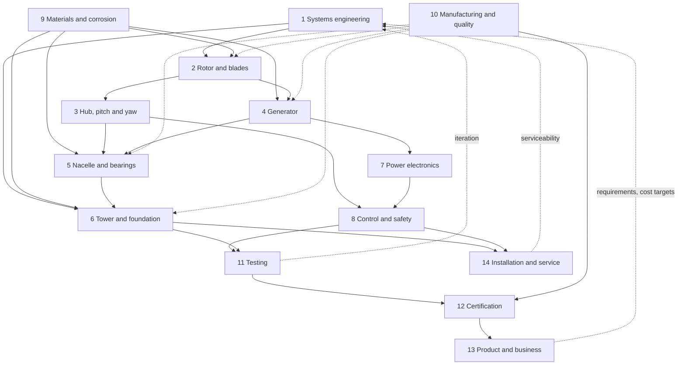

# 12 kW Wind Turbine for Iceland: Project Categories

Status: **Draft, revision 3** · 2026-11-01

This document splits the project into work categories. For each category it
gives the scope, the challenges that are specific to Icelandic conditions, how
much can be manufactured in-house, and what the category depends on.

## 0. Decisions so far

| Question | Decision (Martin, 2026-11-01) | What it means for the design |
|---|---|---|
| Site | **Every Icelandic environment**: coast, inland lowland and highland | Design to the worst case of each: salt of the coast, icing and cold of the highlands, wind of exposed headlands |
| Use case | **All use cases**: grid-tied, off-grid with batteries, direct heating | One turbine with interchangeable power conversion modules |
| Goal | **A product for sale** | Full type certification, CE marking, production quality system, service organisation |
| Manufacturing | **All manufacturing capabilities are available** | Design is not limited by workshop tools; make/buy is decided by cost, quality and certification, not capability |
| Overspeed control | **Active pitch** | Fail-safe pitch to feather is the primary survival system |
| Magnets | **Bought NdFeB** | Compact, light generator; in-house ferrite dropped for now |
| Market | **Iceland only, for now** | Icelandic grid operators, Icelandic language documentation, Icelandic permits; export kept as a later option |
| Price | **5 million ISK** sale price | See the cost budget in section 1.5 |

---

## 1. Design basis

### 1.1 Environmental envelope (all Icelandic sites)

One design must survive anywhere in Iceland, so each parameter takes the
worst case across site types.

| Parameter | Design value | Driving site |
|---|---|---|
| Wind class | IEC 61400-2 **Class S**, reference wind speed V_ref ≈ 50 m/s, 3 s survival gust ≈ 70 m/s (to be confirmed from Met Office data) | Exposed headlands, mountain passes |
| Turbulence | High turbulence category (IEC category A or site-specific higher) | Fjords, terrain near mountains |
| Operating temperature | −30 °C to +30 °C | Highlands |
| Survival temperature | −40 °C | Highlands, north and east |
| Icing | Rime ice, wet snow and freezing rain; ice class to be defined (IEA Task 19 method) | Highlands (rime), coast (wet snow) |
| Corrosion | ISO 12944 **C5** for coastal salt; plus H₂S resistance near geothermal areas | Coast, geothermal areas |
| Erosion | Volcanic ash and sand storms on blades and seals | South and interior |
| Seismic | Peak ground acceleration per Eurocode 8 Icelandic annex, highest zone | South Iceland seismic zone |
| Air density | 1.20 to 1.35 kg/m³ | Cold, sea-level sites give the high end |

### 1.2 Product configuration

| Item | Working assumption | Why |
|---|---|---|
| Rated power | 12 kW electrical | Project goal |
| Configuration | Horizontal axis, 3 blades, upwind | Proven, best efficiency, easiest to certify |
| Rotor diameter | ~6.5 to 8 m (swept area ~35 to 50 m²) | 12 kW at ~11 to 12 m/s rated wind with Cp ≈ 0.40 and ~85 % electrical efficiency |
| Rotor speed | ~150 to 200 rpm at rated | Tip speed ratio ≈ 6 to 7 |
| Drivetrain | Direct drive, no gearbox | Fewer parts, no gear oil in the cold |
| Generator | Permanent magnet synchronous, multi-pole | Matches direct drive |
| Overspeed protection | **Active pitch** (decided), plus fail-safe mechanical brake | Controlled power shedding and lower structural loads than furling at 70 m/s gusts |
| Hub height | 18 and 24 m tower options, tilt-up | Service without a crane |
| Design standard | IEC 61400-2 Class S, type certified | Required to sell |
| Design life | 20 years | Industry norm |

### 1.3 One platform, several variants

To fit every site and every use case without over-building each unit, the
product is designed as one **core turbine** with options:

- **Core turbine:** rotor, hub with pitch, nacelle, generator, controller.
  Designed to the full wind and temperature envelope and C5 corrosion as
  standard (cheaper than managing two corrosion grades in production).
- **Cold climate package:** blade heating or ice-phobic coating, heated
  nacelle electronics, ice detection with automatic stop. Needed for
  highland and icing-prone sites.
- **Tower options:** guyed tilt-up tower for most sites, freestanding tower
  where guys are not possible; foundation variants for rock, soil and
  permafrost-like ground.
- **Power modules** (see category 7): grid-tie inverter, battery charger,
  heating controller, or a hybrid combining them.

### 1.4 Make or buy

With full manufacturing capability, the turbine can be made in-house from raw
material almost entirely. Three items are still worth discussing, because
making them is a separate industry rather than a workshop process:

| Item | Option A: make | Option B: buy | Recommendation |
|---|---|---|---|
| Permanent magnets | Ferrite magnets can be pressed and sintered in-house; NdFeB needs rare earth alloy and sintering lines | Standard catalogue magnets from many suppliers | **Decided: buy NdFeB** |
| Rolling bearings | Possible with heat treatment and precision grinding | Standard catalogue bearings, certified load ratings | Buy; certification bodies expect rated bearings |
| Power semiconductors and chips | Not realistic (needs a semiconductor fab) | Multiple suppliers | Buy; design boards so parts from several makers fit |

Everything else (blades, hub, generator, shafts, castings, nacelle, tower,
electronics boards, enclosures, firmware, cables assembly, tooling) is
planned as in-house.

### 1.5 Cost budget for a 5 million ISK sale price

**Assumption (to confirm):** 5,000,000 ISK is the sale price to the customer
excluding 24 % VAT, for turbine, 18 m tower and one power module. Foundation
work and installation are quoted separately. This is about €34,000 or roughly
417,000 ISK per kW.

A healthy small manufacturer needs the factory cost of one unit to be about
**55 % of the sale price**, leaving the rest for sales, overheads, R&D and
certification payback, and profit. That gives a target unit cost of
**about 2.75 million ISK**, split as a starting budget:

| Subsystem | Share | Budget (ISK) |
|---|---|---|
| Rotor and blades (3 blades, LEP) | 12 % | 330,000 |
| Hub and pitch system | 10 % | 275,000 |
| Generator (incl. NdFeB magnets) | 15 % | 410,000 |
| Nacelle, shaft, bearings, brake, yaw | 10 % | 275,000 |
| Tower 18 m with guys and anchors | 18 % | 495,000 |
| Power electronics (front end + one module) | 15 % | 410,000 |
| Controller, sensors, remote monitoring | 7 % | 195,000 |
| Assembly, end-of-line test, packaging | 8 % | 220,000 |
| Warranty reserve | 5 % | 140,000 |
| **Unit cost total** | **100 %** | **2,750,000** |

Things that move this budget most:

- **Volume.** Type certification, accredited testing and tooling are one-off
  costs, likely tens of millions of ISK. Spread over 50 units that is far more
  per unit than over 500. The annual sales volume is the key number for the
  business case.
- **Options.** The cold climate package, the 24 m tower and extra power
  modules are priced as extras on top of 5 million ISK.
- **Designing for the worst case.** C5 corrosion and Class S loads as
  standard add cost to every unit; this is accepted to keep one product.

---

## 2. Category overview

| # | Category | In-house | Main Iceland driver |
|---|---|---|---|
| 1 | Systems engineering and requirements | Full | Defining extreme wind and icing loads |
| 2 | Rotor and blades | Full | Gusts, icing, ash erosion |
| 3 | Hub, pitch and yaw | Full (bearings bought) | Fast gust response, cold lubrication |
| 4 | Generator | Full (magnets bought at first) | Cold, humidity, salt in windings |
| 5 | Nacelle, shaft and bearings | Full (bearings bought) | Sealing against salt, ash, driven snow |
| 6 | Tower and foundation | Full | Extreme wind loads, frost heave, earthquakes |
| 7 | Power electronics and power modules | Full (semiconductors bought) | Cold start, grid rules, heating use |
| 8 | Control, safety and monitoring | Full | Storm shutdown, ice detection, remote sites |
| 9 | Materials, corrosion and environmental protection | Full | Salt, volcanic ash, H₂S, UV, freeze–thaw |
| 10 | Manufacturing, production and quality | Full | Series production, imported raw materials |
| 11 | Testing and validation | Full (accredited tests external) | Using Icelandic weather as a test bench |
| 12 | Certification, compliance and documentation | Engineering in-house, certification external | Type certification, CE, grid codes |
| 13 | Product management and business | Full | Market across all site types and uses |
| 14 | Installation, service and lifecycle | Full | Remote sites, winter access |

---

## 3. Categories in detail

### 1. Systems engineering and requirements

**Scope:** site wind data, design load cases, overall architecture, power curve
and energy yield targets, mass and cost budget, interfaces between all other
categories, requirement tracking.

**Iceland-specific challenges:**
- Gusts above 50 m/s have been recorded at exposed sites. The standard IEC
  classes may not cover this, so a site-specific Class S definition is likely.
- High turbulence near mountains and fjords, with strong downslope winds.
- Combined loads: ice on blades during high wind.
- Wind data sources: Icelandic Met Office (Veðurstofa Íslands) station data
  and wind atlases.

**In-house:** Fully in-house. Needs aeroelastic/load software (open tools such
as OpenFAST or QBlade are suitable).

**Depends on:** site selection and use case decision (grid or off-grid).
**Feeds:** every other category.

### 2. Rotor and blades

**Scope:** aerofoil selection, blade geometry (chord and twist), structural
layup, root attachment, mass balancing, ice and erosion protection, blade
moulds.

**Iceland-specific challenges:**
- Fatigue from frequent gusts and high mean wind.
- Icing (rime ice in highlands, wet snow and freezing rain on the coast)
  causes imbalance, power loss and ice throw.
- Volcanic ash and sand storms erode leading edges quickly.
- Low temperatures make composites brittle and affect resin curing.

**In-house:** Full. Fibreglass/epoxy blades of 3 to 4 m length made by
vacuum infusion or resin transfer moulding in CNC-machined moulds, including
leading edge protection and optional heating elements (cold climate package).
Blades must pass static and fatigue tests for certification.

**Depends on:** 1 (loads), 3 (pitch or fixed root design), 9 (materials),
10 (moulds). **Feeds:** 4 (torque and speed), 6 (thrust loads), 8 (control
strategy).

### 3. Hub, pitch and yaw

**Scope:** hub casting or weldment, active pitch system (decided, see
section 0) with fail-safe return to feather (spring or stored energy), yaw
system (tail vane or active yaw drive), yaw bearing, yaw brake or damper.

**Iceland-specific challenges:**
- The rotor must shed power within seconds when a gust hits, at any site.
  Fail-safe pitch to feather on loss of power is the key survival function.
- Lubricants and seals must work at −30 °C.
- Ice can jam pitch and yaw mechanisms.

**In-house:** Full for hub (casting or weldment), pitch mechanism and
actuators, yaw system and frames. Pitch and yaw bearings bought (section 1.4).

**Depends on:** 1, 2, 5. **Feeds:** 8 (control), 6 (top mass and loads).

### 4. Generator

**Scope:** electromagnetic design, stator laminations and winding, rotor with
magnets, insulation system, cooling, temperature sensing.

**Iceland-specific challenges:**
- Condensation and salt-laden moisture attack windings; needs good
  impregnation (vacuum varnish or epoxy potting) and anti-condensation
  heating or design.
- Cold makes magnet adhesives and insulation brittle; thermal cycling.
- Very high wind means frequent operation at full load and overspeed events.

**In-house:** Full: lamination stamping, coil winding, vacuum pressure
impregnation, rotor manufacture and magnet assembly. Magnets bought at first
(NdFeB), with in-house ferrite as a later option (section 1.4). Topology
(axial flux vs outer-rotor radial flux) is a design trade to be made early.

**Depends on:** 2 (speed and torque curve), 7 (voltage level), 9.
**Feeds:** 5 (mass and mounting), 7 (electrical characteristics).

### 5. Nacelle, shaft and bearings

**Scope:** main frame, main shaft, main bearings and housings, mechanical
brake, nacelle cover, slip ring or cable twist management, sealing and
drainage.

**Iceland-specific challenges:**
- Wind-driven rain, snow and ash get into every opening; labyrinth seals and
  drainage are essential.
- Bearing grease must be rated for low temperatures.
- Easy access for service in bad weather (or tilt-down design).

**In-house:** Full: frames, shafts, castings, covers, seals and brake.
Main bearings bought (section 1.4).

**Depends on:** 2, 3, 4. **Feeds:** 6 (top-head mass and interface).

### 6. Tower and foundation

**Scope:** tower type (guyed tubular, lattice, or freestanding monopole),
tilt-up mechanism, anchors, foundation, grounding and lightning protection.

**Iceland-specific challenges:**
- Survival wind loads are very high, which drives tower and guy sizing.
- Frost heave and freeze–thaw cycles in soil; many sites are on lava rock
  (rock anchors) or loose volcanic soil.
- Iceland is seismically active; earthquake loads must be checked.
- Lightning is relatively rare but still needs a grounding system.

**In-house:** Full: tower fabrication, hot-dip galvanizing or coating, guy
and anchor hardware, standard foundation designs per ground type. Foundations
are poured on site by the installer to our drawings.

**Depends on:** 1 (loads), 2 and 3 (thrust and top mass), 9 (corrosion).
**Feeds:** 11 (test site), 12 (permits).

### 7. Power electronics and power modules

**Scope:** a common front end (rectifier, DC link, maximum power point
tracking, protection) plus plug-in output modules so one turbine serves every
use case:

- **Grid-tie module:** 1-phase or 3-phase 230/400 V 50 Hz inverter.
- **Battery module:** charge controller for 48 V class battery banks
  (off-grid farms, cabins, telecom sites).
- **Heating module:** direct resistive heating of water tanks or space
  heaters, also acting as the dump load.
- **Hybrid:** any combination, with priority logic (for example battery
  first, then heating, then grid).

**Iceland-specific challenges:**
- Components must start and run at −30 °C (electrolytic capacitors and
  batteries suffer in the cold).
- Grid connection needs approval from the local distribution operator (for
  example RARIK, HS Veitur, Veitur or Orkubú Vestfjarða depending on region)
  and compliance with EN 50549-1.
- Electricity in Iceland is cheap, so heating and off-grid use are likely a
  large part of the market.

**In-house:** Full design and production of boards, magnetics, enclosures and
firmware. Semiconductors, capacitors and chips are bought. The grid-tie
module carries the most certification work.

**Depends on:** 4. **Feeds:** 8, 12, 13.

### 8. Control, safety and monitoring

**Scope:** controller hardware and firmware, operating modes (start-up,
power production, storm shutdown, parking), overspeed and vibration
protection, braking logic, ice detection, data logging and remote monitoring.

**Iceland-specific challenges:**
- Storm shutdown and safe parking must work without grid power (fail-safe
  braking).
- Ice detection (power curve deviation, vibration, temperature and humidity)
  and stopping to avoid ice throw.
- Remote sites need reliable remote monitoring (mobile network coverage
  varies outside towns).

**In-house:** Fully in-house (software and electronics design); sensors and
microcontrollers bought.

**Depends on:** 2, 3, 4, 7. **Feeds:** 11, 12.

### 9. Materials, corrosion and environmental protection

**Scope:** material selection for each part, coatings and paint systems,
fastener and stainless grade selection, galvanic isolation, ice-phobic
coatings, UV protection, sealing strategy.

**Iceland-specific challenges:**
- Salt spray at coastal sites (corrosion class C4 to C5 per ISO 12944).
- Volcanic ash: abrasive, and conductive and corrosive when wet.
- Hydrogen sulphide (H₂S) near geothermal areas attacks copper, silver and
  some electronics.
- Freeze–thaw cycles crack coatings and composites.
- Long summer daylight means high UV exposure for composites and seals.

**In-house:** Fully in-house as an engineering function. Coatings and
specialty materials are bought; applying them can be done in-house.

**Depends on:** site selection. **Feeds:** 2, 4, 5, 6, 7.

### 10. Manufacturing, production and quality

**Scope:** production layout, process plans, jigs, blade moulds, coil winding,
CNC machining, welding procedures (certified welders, EN ISO 3834), composite
production, end-of-line testing, ISO 9001 quality system, traceability of
every serial number, supply chain for raw materials and bought parts, cost per
unit and production volume planning.

**Iceland-specific challenges:**
- Composites need a heated, humidity-controlled space for proper curing.
- Raw materials are imported, with long shipping times, so stock planning
  matters.
- Geothermal heat is cheap, which helps heat curing rooms and ovens.

**In-house:** Full; all manufacturing capabilities are assumed available.
The work here is turning prototype methods into repeatable, certified
production.

**Depends on:** design outputs from 2 to 8. **Feeds:** all hardware, 12
(certification audits factory quality), 13 (unit cost).

### 11. Testing and validation

**Scope:** component tests (blade static and fatigue, generator dynamometer,
electronics climate chamber), prototype field test, power curve measurement,
load and vibration measurement, long-term reliability monitoring.

**Iceland-specific challenges:**
- Icelandic weather is a natural accelerated test: one winter gives plenty of
  storms, icing and freeze–thaw cycles.
- Cold-chamber testing of electronics and lubricants before field use.
- Test site access in winter.

**In-house:** Full for test rigs (generator dynamometer, blade static and
fatigue rigs, climate chamber) and an own test field. Power curve, noise and
load measurements used for certification must be done or witnessed by an
accredited lab.

**Depends on:** 6 (test site), 8 (data logging), all hardware.
**Feeds:** 12 and design iteration in every category.

### 12. Certification, compliance and documentation

**Scope:** IEC 61400-2 type certification (design evaluation, type tests,
manufacturing evaluation), IEC 61400-11 noise and IEC 61400-12-1 power curve
measurement, CE marking for sale in the EEA (EU Machinery Regulation
2023/1230, Low Voltage and EMC directives), grid code compliance (EN 50549-1),
technical file, risk assessment, user, installation and service manuals in
Icelandic and English. Guidance for customers on municipal building permits.

**Iceland-specific challenges:**
- Showing compliance with a Class S design that covers the full Icelandic
  envelope, including icing.
- Grid connection rules differ between distribution operators.
- Municipal planning and building permits for each installation.

**In-house:** Engineering documentation, analysis and pre-compliance testing
in-house. Type certification and accredited measurements require an external
certification body.

**Depends on:** 1, 7, 8, 10, 11. **Feeds:** right to sell; 13.

### 13. Product management and business

**Scope:** target customers and segments (farms, summer houses, remote
industry, telecom, fish farms, municipalities), product variants and options
(section 1.3), price and unit cost targets, warranty terms, sales channels,
product roadmap. Iceland is the only market for now; Nordic and Arctic
export is a later option and the design should not rule it out.

**Iceland-specific challenges:**
- Small home market, so certification and tooling costs are spread over few
  units; volume assumptions drive the price.
- Cheap grid electricity makes payback against grid power long; heating and
  off-grid value propositions matter more.

**In-house:** Full.

**Depends on:** 7, 10, 12. **Feeds:** 1 (requirements and cost targets).

### 14. Installation, service and lifecycle

**Scope:** installation method and kit (tilt-up gin pole, winch),
foundation instructions per ground type, commissioning procedure, installer
training, remote monitoring service, maintenance schedule, spare parts,
warranty handling, end-of-life recycling (especially blades).

**Iceland-specific challenges:**
- Remote sites with winter-only or weather-limited access; the turbine must
  be serviceable by lowering it, without cranes.
- Service intervals should avoid winter work where possible.

**In-house:** Full.

**Depends on:** 6, 8, 10. **Feeds:** 1 (serviceability requirements), 13.

---

## 4. Dependency map

## 5. Suggested order of work

1. **Design basis:** confirm the environmental envelope from Met Office
   data, set the IEC Class S parameters, cost and price targets. (1, 13)
2. **Rotor, pitch and generator concept** together, since they set speed
   and torque. (2, 3, 4)
3. **Structure:** nacelle, tower and foundation variants. (5, 6)
4. **Electrical and control:** common front end first, then power modules.
   (7, 8)
5. **Prototype build and test field**, with production methods in mind
   from the start. (10, 11)
6. **Certification campaign, pilot series, service setup.** (12, 14)

Categories 9 (materials) and 13 (product) run alongside all of these from
the start.

## 6. Open questions

1. **Price scope:** does 5 million ISK exclude VAT, and does it include the
   tower but not foundation and installation (as assumed in section 1.5)?
2. **Volume:** how many units per year do we expect to sell in Iceland? This
   decides how certification and tooling costs are paid back.
