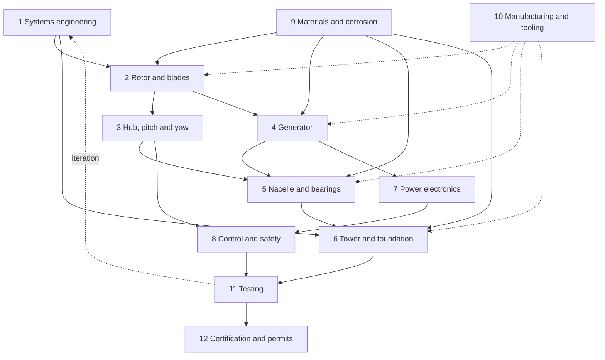

# 12 kW Wind Turbine for Iceland: Project Categories

Status: **Draft for review** · 2026-11-01

This document splits the project into work categories. For each category it
gives the scope, the challenges that are specific to Icelandic conditions, how
realistic in-house manufacturing is, and what the category depends on. It is a
starting point for discussion, not a final design.

---

## 1. Working design assumptions

These are placeholders so the categories can be discussed concretely. Every
one of them is open for change (see [Open questions](#6-open-questions)).

| Item | Working assumption | Why |
|---|---|---|
| Rated power | 12 kW electrical | Project goal |
| Configuration | Horizontal axis, 3 blades, upwind | Proven, best efficiency, easiest to certify |
| Rotor diameter | ~6.5 to 8 m (swept area ~35 to 50 m²) | 12 kW at ~11 to 12 m/s rated wind with Cp ≈ 0.40 and ~85 % electrical efficiency; cold Icelandic air (≈1.3 kg/m³) helps |
| Rotor speed | ~150 to 200 rpm at rated | Tip speed ratio ≈ 6 to 7 |
| Drivetrain | Direct drive, no gearbox | Fewer parts, no gear oil in the cold, simpler to build in-house |
| Generator | Permanent magnet synchronous, multi-pole | Matches direct drive |
| Overspeed protection | Active pitch or furling (to be decided) plus mechanical brake | Gusts make this the most important safety decision |
| Hub height | 15 to 24 m, tilt-up tower | Can be lowered for service without a crane |
| Design standard | IEC 61400-2 (small wind turbines, swept area < 200 m²), Class I or Class S | Iceland's extreme winds likely exceed standard classes |
| Design temperature | −30 °C operating, −40 °C survival | Highland and north-coast sites |
| Design life | 20 years | Industry norm |

### "Make everything ourselves": a realistic boundary

Building everything from raw material is possible for most of the turbine, but
a few items cannot sensibly be made in a workshop. The proposed rule:

- **Make in-house:** all design, blades, hub, nacelle frame, generator (winding,
  assembly, rotor), tower, foundation design, power electronics boards
  (design and assembly), control software, tooling and moulds.
- **Buy as raw material or commodity parts:** steel, aluminium, fibreglass and
  resin, copper magnet wire, electrical steel laminations (or sheet to cut),
  fasteners.
- **Buy as components (no realistic alternative):** NdFeB or ferrite magnets,
  rolling bearings, power semiconductors (MOSFETs/IGBTs), microcontrollers,
  sensors, capacitors, cables, slip ring.

Everything in the third group is a standard catalogue part from several
suppliers, so it does not create dependence on one manufacturer.

---

## 2. Category overview

| # | Category | In-house feasibility | Main Iceland driver |
|---|---|---|---|
| 1 | Systems engineering and requirements | Full | Defining extreme wind and icing loads |
| 2 | Rotor and blades | High | Gusts, icing, ash erosion |
| 3 | Hub, pitch and yaw | High (bearings bought) | Fast gust response, cold lubrication |
| 4 | Generator | Medium to high (magnets bought) | Cold, humidity, salt in windings |
| 5 | Nacelle, shaft and bearings | High (bearings bought) | Sealing against salt, ash, driven snow |
| 6 | Tower and foundation | High | Extreme wind loads, frost heave, earthquakes |
| 7 | Power electronics and grid connection | Medium | Cold start, grid rules, dump loads |
| 8 | Control, safety and monitoring | Full | Storm shutdown, ice detection, remote sites |
| 9 | Materials, corrosion and environmental protection | Full (as engineering), coatings bought | Salt, volcanic ash, H₂S, UV, freeze–thaw |
| 10 | Manufacturing and tooling | Full (this category *is* the in-house capability) | Workshop climate for composites |
| 11 | Testing and validation | High | Using Icelandic weather as a test bench |
| 12 | Certification, permits and documentation | Engineering in-house, certification external | Local permits, grid operator approval |

---

## 3. Categories in detail

### 1. Systems engineering and requirements

**Scope:** site wind data, design load cases, overall architecture, power curve
and energy yield targets, mass and cost budget, interfaces between all other
categories, requirement tracking.

**Iceland-specific challenges:**
- Gusts above 50 m/s have been recorded at exposed sites. The standard IEC
  classes may not cover this, so a site-specific Class S definition is likely.
- High turbulence near mountains and fjords, with strong downslope winds.
- Combined loads: ice on blades during high wind.
- Wind data sources: Icelandic Met Office (Veðurstofa Íslands) station data
  and wind atlases.

**In-house:** Fully in-house. Needs aeroelastic/load software (open tools such
as OpenFAST or QBlade are suitable).

**Depends on:** site selection and use case decision (grid or off-grid).
**Feeds:** every other category.

### 2. Rotor and blades

**Scope:** aerofoil selection, blade geometry (chord and twist), structural
layup, root attachment, mass balancing, ice and erosion protection, blade
moulds.

**Iceland-specific challenges:**
- Fatigue from frequent gusts and high mean wind.
- Icing (rime ice in highlands, wet snow and freezing rain on the coast)
  causes imbalance, power loss and ice throw.
- Volcanic ash and sand storms erode leading edges quickly.
- Low temperatures make composites brittle and affect resin curing.

**In-house:** High. Fibreglass/epoxy blades of 3 to 4 m length are well within
workshop capability using CNC-machined plugs and hand layup or vacuum infusion.
Wood/epoxy cores are a proven alternative. Leading edge protection tape or
coating is bought.

**Depends on:** 1 (loads), 3 (pitch or fixed root design), 9 (materials),
10 (moulds). **Feeds:** 4 (torque and speed), 6 (thrust loads), 8 (control
strategy).

### 3. Hub, pitch and yaw

**Scope:** hub casting or weldment, overspeed regulation method (active pitch,
passive pitch, or furling), yaw system (tail vane or active yaw drive), yaw
bearing, yaw brake or damper.

**Iceland-specific challenges:**
- This is the key survival decision. The rotor must shed power within seconds
  when a gust hits. Furling is simple but rough on the structure in gusty
  wind; active pitch is smoother but more complex.
- Lubricants and seals must work at −30 °C.
- Ice can jam pitch and yaw mechanisms.

**In-house:** High for the hub, linkages, tail and frames (welding and CNC).
Slewing or yaw bearings and pitch bearings are bought. Pitch actuators can be
built from bought motors or springs.

**Depends on:** 1, 2, 5. **Feeds:** 8 (control), 6 (top mass and loads).

### 4. Generator

**Scope:** electromagnetic design, stator laminations and winding, rotor with
magnets, insulation system, cooling, temperature sensing.

**Iceland-specific challenges:**
- Condensation and salt-laden moisture attack windings; needs good
  impregnation (vacuum varnish or epoxy potting) and anti-condensation
  heating or design.
- Cold makes magnet adhesives and insulation brittle; thermal cycling.
- Very high wind means frequent operation at full load and overspeed events.

**In-house:** Medium to high. Axial-flux or outer-rotor radial-flux machines
of this size are built by small workshops worldwide. Winding coils, casting
in resin and machining rotor discs are all doable. Magnets must be bought.
Laminations can be laser-cut from bought electrical steel (radial flux) or
avoided entirely (axial flux with air-cored coils).

**Depends on:** 2 (speed and torque curve), 7 (voltage level), 9.
**Feeds:** 5 (mass and mounting), 7 (electrical characteristics).

### 5. Nacelle, shaft and bearings

**Scope:** main frame, main shaft, main bearings and housings, mechanical
brake, nacelle cover, slip ring or cable twist management, sealing and
drainage.

**Iceland-specific challenges:**
- Wind-driven rain, snow and ash get into every opening; labyrinth seals and
  drainage are essential.
- Bearing grease must be rated for low temperatures.
- Easy access for service in bad weather (or tilt-down design).

**In-house:** High. Frames, shafts and covers are standard welding, turning
and composite work. Bearings, seals and the brake caliper are bought.

**Depends on:** 2, 3, 4. **Feeds:** 6 (top-head mass and interface).

### 6. Tower and foundation

**Scope:** tower type (guyed tubular, lattice, or freestanding monopole),
tilt-up mechanism, anchors, foundation, grounding and lightning protection.

**Iceland-specific challenges:**
- Survival wind loads are very high, which drives tower and guy sizing.
- Frost heave and freeze–thaw cycles in soil; many sites are on lava rock
  (rock anchors) or loose volcanic soil.
- Iceland is seismically active; earthquake loads must be checked.
- Lightning is relatively rare but still needs a grounding system.

**In-house:** High. Steel tube or lattice towers are welding and
galvanizing work (hot-dip galvanizing usually outsourced, or use bought
galvanized tube). Foundations are poured locally.

**Depends on:** 1 (loads), 2 and 3 (thrust and top mass), 9 (corrosion).
**Feeds:** 11 (test site), 12 (permits).

### 7. Power electronics and grid connection

**Scope:** rectifier, DC link, maximum power point tracking, inverter
(grid-tied) or charge controller (battery/off-grid), dump load, protection,
cabling, metering.

**Iceland-specific challenges:**
- Components must start and run at −30 °C (electrolytic capacitors and
  batteries suffer in the cold).
- Grid connection needs approval from the local distribution operator (for
  example RARIK, HS Veitur, Veitur or Orkubú Vestfjarða depending on region).
- Electricity in Iceland is cheap, so using surplus power for **heating**
  (water or space heating via dump load) may be more valuable than grid
  export.

**In-house:** Medium. Designing and assembling the boards, enclosure and
firmware is realistic. Semiconductors, capacitors, magnetics cores and
connectors are bought. A grid-tied inverter is the hardest item to certify;
an off-grid/heating system is much easier.

**Depends on:** 4, the use case decision. **Feeds:** 8, 12.

### 8. Control, safety and monitoring

**Scope:** controller hardware and firmware, operating modes (start-up,
power production, storm shutdown, parking), overspeed and vibration
protection, braking logic, ice detection, data logging and remote monitoring.

**Iceland-specific challenges:**
- Storm shutdown and safe parking must work without grid power (fail-safe
  braking).
- Ice detection (power curve deviation, vibration, temperature and humidity)
  and stopping to avoid ice throw.
- Remote sites need reliable remote monitoring (mobile network coverage
  varies outside towns).

**In-house:** Fully in-house (software and electronics design); sensors and
microcontrollers bought.

**Depends on:** 2, 3, 4, 7. **Feeds:** 11, 12.

### 9. Materials, corrosion and environmental protection

**Scope:** material selection for each part, coatings and paint systems,
fastener and stainless grade selection, galvanic isolation, ice-phobic
coatings, UV protection, sealing strategy.

**Iceland-specific challenges:**
- Salt spray at coastal sites (corrosion class C4 to C5 per ISO 12944).
- Volcanic ash: abrasive, and conductive and corrosive when wet.
- Hydrogen sulphide (H₂S) near geothermal areas attacks copper, silver and
  some electronics.
- Freeze–thaw cycles crack coatings and composites.
- Long summer daylight means high UV exposure for composites and seals.

**In-house:** Fully in-house as an engineering function. Coatings and
specialty materials are bought; applying them can be done in-house.

**Depends on:** site selection. **Feeds:** 2, 4, 5, 6, 7.

### 10. Manufacturing and tooling

**Scope:** workshop setup, process plans, jigs, blade moulds, coil winding
machine, CNC machining, welding procedures, composite workshop, quality
control, build documentation, cost per unit.

**Iceland-specific challenges:**
- Composites need a heated, humidity-controlled space for proper curing.
- Raw materials are imported, with long shipping times, so stock planning
  matters.
- Geothermal heat is cheap, which helps heat curing rooms and ovens.

**In-house:** This category *is* the in-house capability. Key equipment:
CNC router (moulds, plugs), metal lathe and mill, MIG/TIG welding, coil
winder, vacuum pump for infusion and impregnation, curing oven.

**Depends on:** design outputs from 2 to 8. **Feeds:** all hardware.

### 11. Testing and validation

**Scope:** component tests (blade static and fatigue, generator dynamometer,
electronics climate chamber), prototype field test, power curve measurement,
load and vibration measurement, long-term reliability monitoring.

**Iceland-specific challenges:**
- Icelandic weather is a natural accelerated test: one winter gives plenty of
  storms, icing and freeze–thaw cycles.
- Cold-chamber testing of electronics and lubricants before field use.
- Test site access in winter.

**In-house:** High. Test rigs (generator test bench, blade static test frame)
can be built in-house. A calibrated anemometer mast is bought.

**Depends on:** 6 (test site), 8 (data logging), all hardware.
**Feeds:** 12 and design iteration in every category.

### 12. Certification, permits and documentation

**Scope:** IEC 61400-2 compliance, electrical safety and EMC (CE marking for
sale in the EEA), grid operator approval, building and planning permits from
the municipality, noise assessment, user and service manuals.

**Iceland-specific challenges:**
- Municipal planning permission (deiliskipulag/building permit) for towers.
- Grid connection rules of the local distribution operator.
- Possibly visual impact and bird considerations depending on site.

**In-house:** Engineering documentation and self-assessment in-house.
Formal certification (if the turbine is to be sold) requires an accredited
external body.

**Depends on:** 1, 7, 8, 11. **Feeds:** project go/no-go for sale or
grid connection.

---

## 4. Dependency map

## 5. Suggested order of work

1. **Decide the basics:** site, use case (grid, off-grid, heating), pitch vs
   furling. (Category 1)
2. **Rotor and generator concept** together, since they set speed and torque.
   (2, 3, 4)
3. **Structure:** nacelle, tower and foundation. (5, 6)
4. **Electrical and control.** (7, 8)
5. **Tooling and first prototype build.** (10)
6. **Test, iterate, then certify.** (11, 12)

Category 9 (materials) runs alongside all of these from the start.

## 6. Open questions

These decisions change the design the most:

1. **Site:** coastal, inland lowland or highland? (Sets icing, salt and wind
   class.)
2. **Use case:** grid-tied export, off-grid with batteries, or direct heating?
3. **Overspeed control:** active pitch (smoother, more complex) or furling
   (simpler, harsher loads)?
4. **Goal:** one turbine for own use, or a product for sale? (Sets how far
   certification must go.)
5. **Workshop:** which tools and skills are already available (CNC, welding,
   composites, electronics)?
6. **Make/buy boundary:** is the boundary in section 1 acceptable, or should
   we try harder on items like magnets (ferrite instead of NdFeB) or
   bearings?
