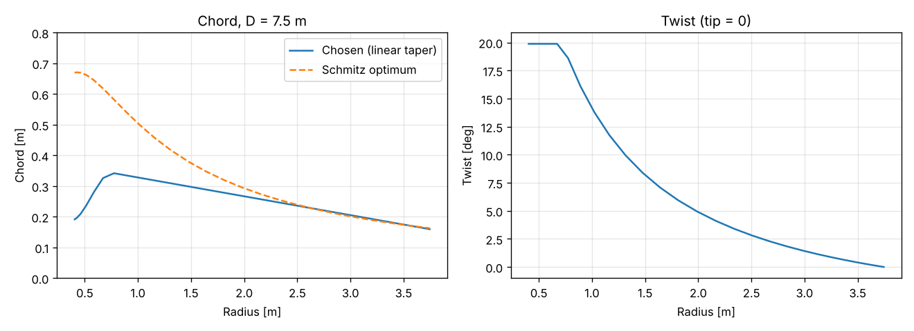
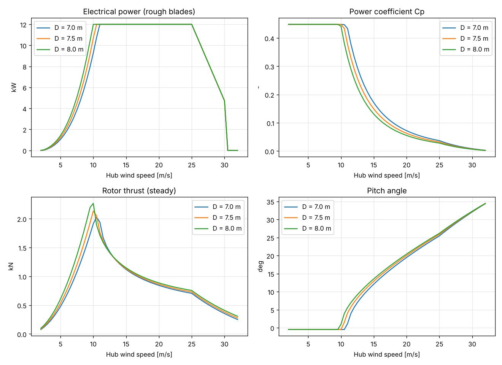

# 12 kW Wind Turbine for Iceland: Rotor Concept Study

Status: **Draft, revision 1** · 2026-11-01
Owner: Category 2 (Rotor and blades), with Category 3 (Hub and pitch)
Builds on: [02 – Design basis](02-design-basis.md)
Model and data: [`analysis/rotor/`](../analysis/rotor/)

## Summary

| Decision | Recommendation |
|---|---|
| Rotor diameter | **7.5 m** |
| Design tip speed ratio | **6.5** |
| Maximum tip speed | **70 m/s** (rotor speed capped at 178 rpm) |
| Rated wind speed | **10.5 m/s** |
| Aerofoils | Roughness-tolerant thick family; shortlist **DU 91-W2-250 / DU 93-W-210 / DU 96-W-180**, with NACA 63-4xx as the reference alternative |
| Blade shape | Linear chord taper, max chord **0.34 m** at 0.24R, tip chord **0.16 m**, twist **~20° at root to 0° at tip** |
| Pitch range | −2° (fine) to 90° (feather); about 26° at 25 m/s and 32° at 30 m/s |
| Storm control | Full power to 25 m/s, linear reduction to 40 % at 30 m/s, then stop |

The 7.5 m rotor gives a good balance: it reaches rated power at 10.5 m/s and
keeps the parked storm loads about 20 % below an 8 m rotor. That matters
more than the extra energy, because most Icelandic sites are windy and
survival drives the structure.

---

## 1. Method

A blade element momentum (BEM) model was written for this study
([`bem.py`](../analysis/rotor/bem.py), [`study.py`](../analysis/rotor/study.py)).
It includes Prandtl tip and hub losses, Buhl's high-induction correction, and
post-stall polars (Viterna). It finds the best operating point at every wind
speed with variable speed below rated, a tip speed cap, and pitch control
above rated.

Two aerofoil polar sets were run:
- **Clean:** new blade, L/D ≈ 100 at the design point.
- **Rough:** leading edge eroded by ash or sand, insects, or light ice
  (lower maximum lift, higher drag). **All recommendations use the rough
  case**, since Icelandic blades will spend much of their life roughened.

Assumptions: air density 1.225 kg/m³, 13.6 kW shaft power at rated,
generator × power electronics efficiency 0.89 plus 120 W fixed losses, so
12.0 kW at the power module output. Availability 97 %. Energy is computed
with a Rayleigh wind distribution at hub height.

**Limitations.** The polars are a generic parametric model, not measured
data for a specific aerofoil, and there are no Reynolds number effects. BEM
gives ideal performance: the maximum Cp of 0.45 (rough) to 0.48 (clean) will
come down by a few percent with real polars, root losses and Reynolds number
around 1 million. Cut-in at 2.5 m/s ignores starting friction and generator
cogging; expect about 3 m/s in reality. The loads here are steady values for
sizing only; design loads come from the aeroelastic load cases in the design
basis.

---

## 2. Tip speed ratio

Swept at 7.5 m diameter:

| Design TSR | Max chord [m] | Blade area [m²] | Cp clean | Cp rough | Tip speed at 11 m/s [m/s] |
|---|---|---|---|---|---|
| 5.5 | 0.47 | 1.17 | 0.473 | 0.448 | 61 |
| 6.0 | 0.40 | 0.99 | 0.476 | 0.449 | 66 |
| **6.5** | **0.34** | **0.85** | **0.478** | **0.448** | **72** |
| 7.0 | 0.30 | 0.74 | 0.479 | 0.447 | 77 |
| 7.5 | 0.26 | 0.64 | 0.480 | 0.446 | 83 |
| 8.0 | 0.23 | 0.57 | 0.480 | 0.444 | 88 |

Cp hardly changes between 5.5 and 8, so the choice is about other things:

- **Leading edge erosion** grows very steeply with impact speed. Volcanic
  ash and wind-driven rain make low tip speed the most important factor
  for blade life, which points to a **low** TSR.
- **Noise** rises with tip speed, which also points to a **low** TSR.
- **Parked storm load and ice mass** scale with blade area, which points to
  a **high** TSR (slender blades).
- **Generator torque** is higher at lower rotor speed, which makes the
  generator larger and heavier, pointing to a **high** TSR.

**TSR 6.5 with a 70 m/s tip speed cap** is the balance point. The rotor
stays at the cap from about 10 m/s, so the blade never sees more than
70 m/s at the tip during operation.

---

## 3. Rotor diameter

Rough blades, 12 kW rated, TSR 6.5, 70 m/s tip speed cap.

### 3.1 Performance and loads

| | D = 7.0 m | **D = 7.5 m** | D = 8.0 m |
|---|---|---|---|
| Rated wind speed | 11.0 m/s | **10.5 m/s** | 10.0 m/s |
| Rated rotor speed | 191 rpm | **178 rpm** | 167 rpm |
| Rated shaft torque | 680 Nm | **729 Nm** | 777 Nm |
| Max steady rotor thrust (operating) | 2.03 kN | **2.14 kN** | 2.27 kN |
| Max steady blade root flap moment (operating) | 1.36 kNm | **1.55 kNm** | 1.76 kNm |
| Parked, one blade broadside at 77 m/s: force | 5.3 kN | **6.1 kN** | 7.0 kN |
| Parked, one blade broadside at 77 m/s: root moment | 7.3 kNm | **9.2 kNm** | 11.3 kNm |
| Blade planform area | 0.74 m² | **0.85 m²** | 0.97 m² |

The parked case is a simple worst-case estimate (DLC 6.2: grid loss, rotor
yawed so one blade faces the 77 m/s gust broadside, drag coefficient 1.8, air
density 1.35 kg/m³). **It is about 6 times the operating root moment**, which
confirms that survival, not power production, sizes the blades, hub and tower
in Iceland.

### 3.2 Annual energy (MWh per year, rough blades, 97 % availability)

| Annual mean wind at hub | D = 7.0 m | **D = 7.5 m** | D = 8.0 m | 7.5 vs 7.0 | 8.0 vs 7.5 |
|---|---|---|---|---|---|
| 5 m/s | 17.0 | **19.3** | 21.5 | +13 % | +12 % |
| 6 m/s | 26.8 | **29.6** | 32.3 | +10 % | +9 % |
| 7 m/s | 36.5 | **39.6** | 42.5 | +8 % | +7 % |
| 8 m/s | 45.4 | **48.5** | 51.4 | +7 % | +6 % |
| 10 m/s | 59.6 | **62.3** | 64.8 | +5 % | +4 % |

With clean blades every value is about 3 to 6 % higher.

### 3.3 Recommendation: 7.5 m

- Going from 7.5 to 8.0 m adds 4 to 7 % energy at typical Icelandic sites
  (7 to 10 m/s) but **raises the parked root moment by 23 %**. That cost
  lands in the blade root, hub, pitch bearings, main shaft, tower and
  foundation.
- Going down to 7.0 m saves 20 % on parked moment but loses 8 to 13 % energy
  and pushes rated wind to 11 m/s, which is weak at sheltered sites.
- A 7.5 m rotor meets requirement R2.1 (rated at 11 m/s or lower) with
  margin.

An 8 m low-wind variant could be offered later using the same hub, once
measured loads show margin.

---

## 4. Blade design (D = 7.5 m)

### 4.1 Geometry

| r [m] | r/R | Chord [m] | Twist [°] |
|---|---|---|---|
| 0.42 | 0.11 | 0.196 (root, round) | 19.9 |
| 0.59 | 0.16 | 0.280 | 19.9 |
| 0.89 | 0.24 | 0.335 (max) | 16.1 |
| 1.32 | 0.35 | 0.309 | 10.0 |
| 1.81 | 0.48 | 0.278 | 5.9 |
| 2.34 | 0.62 | 0.246 | 3.4 |
| 2.83 | 0.76 | 0.216 | 1.8 |
| 3.26 | 0.87 | 0.190 | 0.9 |
| 3.57 | 0.95 | 0.171 | 0.3 |
| 3.75 | 1.00 | 0.160 | 0.0 |

Full table: [`blade_geometry_D7.5.csv`](../analysis/rotor/results/blade_geometry_D7.5.csv).

The chord follows the theoretical optimum (Schmitz) through the outer blade,
where most of the power comes from. Inboard, it is a straight taper instead
of the optimum's wide root. This gives up very little power and makes the
mould simpler and the blade lighter. Twist is capped at 20° at the root.

### 4.2 Aerofoils

Requirements for Iceland, in order of importance:
1. **Insensitive to leading edge roughness**, because ash erosion and light
   ice are certain.
2. **Thick sections** (18 to 25 %) so the spar is deep and stiff enough for
   the parked storm loads.
3. **Blunt leading edge** that tolerates erosion and holds leading edge
   protection well.
4. Published wind tunnel data at Reynolds numbers near 1 million, including
   with roughness, for certification.

| Option | Thickness | Notes |
|---|---|---|
| **DU family** (DU 91-W2-250 root, DU 93-W-210 mid, DU 96-W-180 tip) | 25 / 21 / 18 % | Designed for low roughness sensitivity, used on many pitch-regulated turbines, data with roughness published. Designed for higher Re than ours, so needs checking at ~1×10⁶. **Preferred.** |
| NACA 63-4xx (63-421 to 63-418) | 21 to 18 % | Old, very well documented including standard roughness. A safe reference. |
| NREL S-series for small turbines (S822/S823) | 16 to 21 % | Made for 3 to 10 m rotors, but tuned for stall regulation, which we don't need. |
| Low-Reynolds small wind sections (SG604x) | ~10 % | Too thin for our loads. Rejected. |

**Next step:** run XFOIL or a similar tool at Re 0.6 to 1.5 × 10⁶ with free
and fixed transition for the DU and NACA candidates, then re-run this study
with those polars. Wind tunnel verification of the chosen section with
roughness is recommended before tooling (quality-first rule).

### 4.3 Rotor speed, pitch and control

- Variable speed from cut-in to about 10 m/s at the optimum TSR, then
  constant **178 rpm** with pitch control.
- Pitch is at fine (−0.5°) below rated, about 4° at 11 m/s, 26° at
  25 m/s and 32° at 30 m/s. **Feather (90°)** for parking.
- Storm control (R8.2): energy gain under a Rayleigh distribution is small
  (0.7 % at 10 m/s mean wind), because the model has few hours above 25 m/s.
  Its real value is avoiding repeated stops and restarts in Icelandic storms.
  Field data will show the real gain.
- **Correction to requirement R3.1:** "feather within 2 s" should read
  "pitch to at least 45° within 2 s, and to full feather within 6 s". Power
  and thrust are already close to zero by about 35°. Aeroelastic DLC 5.1 and
  2.1 runs will set the final rates.

---

## 5. Inputs to other categories

| To | Value | Note |
|---|---|---|
| Generator (cat. 4) | Rated 178 rpm, 729 Nm shaft torque, 13.6 kW shaft power | Design overspeed **230 rpm** (1.3 × rated) for the protection system margin, TBC |
| Generator (cat. 4) | Variable speed range ≈ 40 to 178 rpm | Cut-in at ≈ 40 rpm |
| Hub and pitch (cat. 3) | Pitch range −2° to 90°, root diameter ≈ 0.2 m, pitch bearing radius ≈ 0.4 m | Root moment ≥ 9.2 kNm parked (steady estimate, before safety factors and dynamics) |
| Tower (cat. 6) | Max operating steady thrust 2.1 kN; parked worst case dominated by broadside blade drag (≥ 6 kN per blade) plus nacelle and tower drag | Tower sizing awaits aeroelastic DLC 6.x results |
| Control (cat. 8) | Speed and pitch schedule from [`power_curve_D7.5_rough.csv`](../analysis/rotor/results/power_curve_D7.5_rough.csv) | Basis for the controller design |
| Materials (cat. 9) | 70 m/s tip speed for leading edge protection rating | Ash and rain erosion tests |

---

## 6. Next steps

1. Aerofoil polars (XFOIL, then wind tunnel) and a re-run of this study.
2. First structural blade layup: spar cap and shell sized for the parked root
   moment with safety factors, a blade mass estimate, and first flapwise and
   edgewise natural frequencies (must avoid 3P resonance across 40 to
   178 rpm).
3. Aeroelastic model in OpenFAST or QBlade with this geometry, running DLC
   1.1, 5.1, 6.1, 6.2 and 6.5.
4. Generator concept study with the inputs in section 5.
