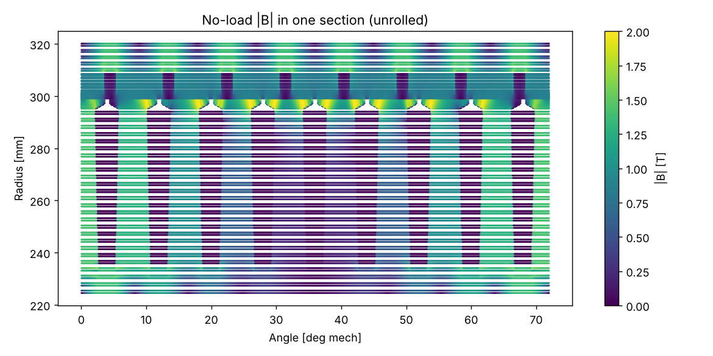
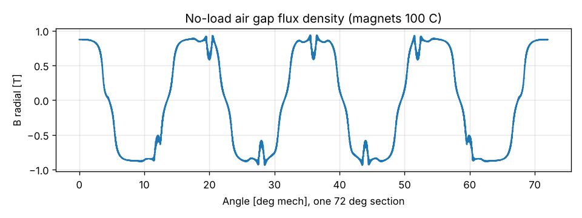
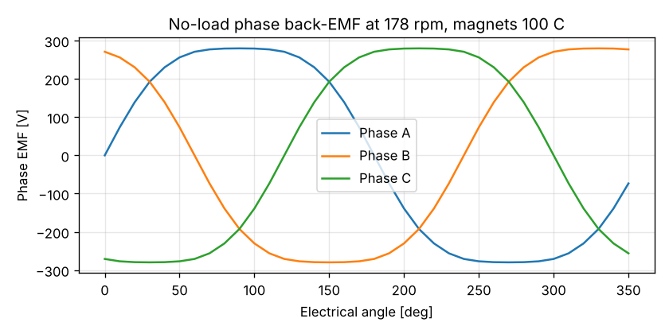
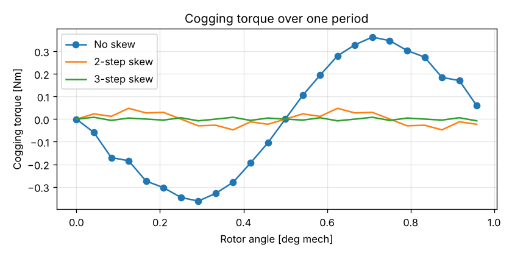
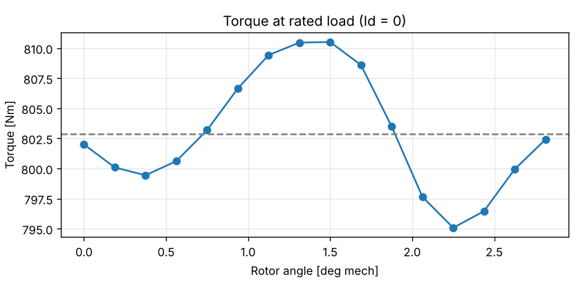
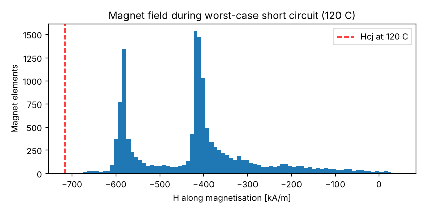

# 12 kW Wind Turbine for Iceland: Generator FEA and Thermal Check

Status: **Draft, revision 1** · 2026-11-01
Owner: Category 4 (Generator)
Builds on: [04 – Generator concept](04-generator-concept.md)
Models: [`analysis/generator/fem.py`](../analysis/generator/fem.py),
[`run_fea.py`](../analysis/generator/run_fea.py),
[`thermal.py`](../analysis/generator/thermal.py)

## Summary

| Check | Result | Verdict |
|---|---|---|
| Air gap flux | 0.94 T peak, 1.01 T fundamental | ✅ As designed |
| Back-EMF | 386 V line at 178 rpm with **29 turns per coil**; 836 V peak at cold overspeed; line voltage THD 0.6 % | ✅ |
| Cogging torque | **0.73 Nm peak-to-peak (0.1 % of rated)**, no skew needed | ✅ 5 × better than the 0.5 % target |
| Torque at rated current | 802 Nm needs **3.32 A/mm²** (not 3.0 as estimated) | ⚠️ 5 % less torque per amp than the analytical estimate |
| Torque ripple at rated load | **1.9 %** peak-to-peak | ✅ |
| Iron loss | 189 W no-load (≈ 217 W under load) | ✅ Matches estimate |
| Demagnetisation, worst short circuit at 120 °C | N42SH: **only 5.7 % margin**. N40UH: 25.7 % margin | ❌ → **change grade to N40UH** |
| Thermal, plain design, hot day | Winding hot spot **≈ 180 °C** | ❌ Unacceptable |
| Thermal, improved cooling, hot day | Winding hot spot **95 to 106 °C**, magnets ≤ 61 °C | ✅ Within the 130 °C design limit |
| Efficiency (updated) | **≈ 93.5 %** at rated, warm | ✅ Meets 93 %, less margin than the 94.5 % estimate |
| Anti-condensation heating | **≈ 30 W** keeps the parked stator 5 K above ambient | ✅ Easy for the converter |

**Three design changes come out of this check:**
1. **Magnet grade N42SH → N40UH** for demagnetisation margin.
2. **Cooling package is mandatory**, not optional: aluminium stator carrier
   into a ventilated hollow spindle, fan blades on the rotor end cover, fins
   inside and ribs outside the drum.
3. **Slot depth +5 mm** (next iteration) to bring current density back to
   about 3.0 A/mm² and recover efficiency margin.

---

## 1. Model

A 2D nonlinear magnetostatic finite element model was written for this
project in Python (numpy and scipy only), so it can be rerun and audited by
anyone.

- One periodic section of 8 poles and 9 slots (72°) represents the whole
  40-pole, 45-slot machine.
- 76,000 nodes and 150,000 linear triangles, with 0.05° angular resolution
  and 6 element layers across the 2 mm air gap.
- Real geometry: parallel-sided teeth, tooth tips with a 4 mm slot opening,
  a 0.5 mm retaining sleeve, 7.4 mm magnets at 80 % pole arc, and the
  rotor yoke.
- Nonlinear iron: M270-35A laminations (stator), S355 steel (rotor drum),
  solved with Newton-Raphson (converges in about 10 steps).
- Rotor rotation is represented by moving the magnet pattern on a fixed
  mesh. This is exact for a smooth rotor drum, and avoids the remeshing
  noise that would swamp a cogging torque of less than 1 Nm.
- Torque is computed with Arkkio's method over the air gap.

The field plot shows the expected pattern: about 1.0 to 1.5 T in the teeth
and yokes, local saturation (around 2 T) only at the tooth tips next to the
slot openings, and 1.4 T in the rotor drum.

**Limitations:** 2D only (end effects and end-winding leakage are not
included, typically a few percent less torque); magnet eddy losses are not
computed by the FEA; the B-H curves are typical catalogue data, not measured
on our material batch.

---

## 2. No-load results

### 2.1 Air gap flux and back-EMF

| Item | Value |
|---|---|
| Air gap flux, peak | 0.94 T (analytical estimate 0.85 T) |
| Fundamental | 1.01 T |
| Turns per coil (for ≈ 380 V line at rated, hot magnets) | **29** (15 coils per phase in series, star connection) |
| Line EMF at 178 rpm, magnets 100 °C | 386 V rms |
| Line EMF at 230 rpm, magnets −40 °C | 591 V rms, **836 V peak** |
| Phase EMF harmonics | 11.6 % third harmonic (cancels in star connection), others < 0.6 % |
| Line EMF THD | 0.6 % |

The 836 V peak confirms the earlier estimate (850 V): the power electronics
need 1200 V class semiconductors.

### 2.2 Cogging torque

| | Peak-to-peak |
|---|---|
| No skew | **0.73 Nm (0.10 % of rated)** |
| 2-step skew | 0.10 Nm |
| 3-step skew | 0.02 Nm |

The 40/45 slot-pole combination works as intended. Cogging is so low that
**magnet skew is not needed**, which simplifies rotor assembly. The rotor
will start as soon as aerodynamic torque beats bearing and seal friction.

### 2.3 Iron loss

189 W at no-load at 59 Hz, from the FEA flux waveforms in every stator
element (hysteresis plus eddy, with a 1.5 build factor). With extra harmonics
under load, ≈ 217 W is used in the thermal model.

---

## 3. Rated load

| Item | Value |
|---|---|
| Torque at the design electric loading (30 kA/m) | 764 Nm (target 802 Nm) |
| Current for 802 Nm | 658 ampere-turns per coil side, **22.7 A rms phase current** |
| Current density at 802 Nm | **3.32 A/mm²** |
| Mean torque | 803 Nm |
| Torque ripple | 15 Nm peak-to-peak, **1.9 %** |

The machine needs about 10 % more current than the analytical model
predicted for the target torque, mostly due to slot leakage and tooth-tip
saturation. The torque ripple is very low, which is good for drivetrain
fatigue and noise.

**Consequence:** copper loss rises from 435 W to about 530 W at 75 °C.
**Recommendation:** deepen slots by about 5 mm in the next iteration to get
back to ≈ 3.0 A/mm².

---

## 4. Short-circuit demagnetisation

Worst case: three-phase terminal short circuit with full DC offset (2 × the
steady short-circuit current) while magnets are at 120 °C.

| Item | Value |
|---|---|
| d-axis synchronous inductance | 13.7 mH |
| Steady short-circuit current | 62.8 A peak (2.0 × rated) |
| Transient worst case | 125.5 A peak |
| Worst field in magnets | −675 kA/m (N42SH), −665 kA/m (N40UH) |
| Intrinsic coercivity at 120 °C | N42SH 716 kA/m, **N40UH 896 kA/m** (typical temperature coefficient −0.55 %/K, to be confirmed with supplier datasheet) |
| Margin | N42SH **5.7 %**, N40UH **25.7 %** |

N42SH is too close to the limit for a product that must survive faults for
20 years. **Recommendation: N40UH** (rated to 180 °C). Its remanence is
about 3 % lower (1.26 T vs 1.30 T), so the magnets should be about 0.3 mm
thicker to keep the same flux. This is to be confirmed in the next FEA run.

The thermal model shows magnets at 60 to 80 °C in service, so 120 °C is a
deliberately harsh check. Quality-first rule: the margin must hold even in
the harsh case.

---

## 5. Thermal network

Lumped model with nodes for slot winding, end winding, stator core, internal
air, rotor drum with magnets, and ambient. Heat leaves through the drum
surface (forced convection in the rotor wake, plus radiation), through the
air gap, through internal air, and through the stator carrier into the
spindle. Losses come from the FEA (copper 533 W at 75 °C, iron 217 W, rotor
40 W, stray 70 W), with copper resistance updated for temperature. Solar
heating of the drum (100 W) is included on hot days.

### 5.1 Results

| Case | Plain design: winding hot spot | Plain: magnets | **Improved cooling: winding hot spot** | **Improved: magnets** |
|---|---|---|---|---|
| Hot day +30 °C, rated, 10.5 m/s | 182 °C | 75 °C | **95 °C** | **57 °C** |
| Hot day, nacelle in weak wake | 189 °C | 82 °C | **99 °C** | **61 °C** |
| Hot day, 110 % overload | 217 °C | 82 °C | **106 °C** | **60 °C** |
| Typical Iceland +10 °C, rated | 147 °C | 48 °C | **68 °C** | **32 °C** |
| Cold −30 °C, rated (plain) | 80 °C | −6 °C | | |

Design limit: 130 °C hot spot (class H insulation at 180 °C, designed for
class B rise with margin).

### 5.2 Why the plain design runs hot

In an outer-rotor machine, the stator (where most losses are) sits inside
the rotor. Its heat must cross the 2 mm air gap or reach the end covers by
internal air, and both paths are poor. In the plain design, the stator core
runs about 100 K above the drum.

### 5.3 Cooling package (now part of the baseline design)

| Measure | Effect |
|---|---|
| **Aluminium stator carrier** conducting into a **hollow spindle ventilated by nacelle air** (assumed 0.40 K/W total) | Biggest single gain: direct path from stator core to outside air |
| **Fan blades on the rotor end cover** | Internal air circulation, h raised from 15 to 40 W/m²K |
| **Fins on the drum inside** (3 × area) | Better heat pickup from internal air |
| **Ribs on the drum outside** (1.5 × area) | Better heat rejection to the wind |

Everything stays sealed: no outside air enters the generator. The spindle
bore airflow is outside the sealed volume.

### 5.4 Cold climate

- At −30 °C and rated power, the plain winding runs at 80 °C, so cold is not
  a thermal concern while running.
- **Anti-condensation:** about **30 W** of stator heating by DC injection
  from the converter keeps the parked stator 5 K above ambient from 0 °C to
  −30 °C, in calm or windy conditions. This needs no separate heater.

---

## 6. Updated generator data (replaces values in doc 04)

| Item | Doc 04 | **Now** |
|---|---|---|
| Magnet grade | N42SH | **N40UH** (≈ 7.7 mm, TBC) |
| Current density at rated | 3.0 A/mm² | 3.32 A/mm² now, back to ≈ 3.0 with slots +5 mm |
| Turns per coil | – | **29**, 15 coils per phase in series, star |
| Rated phase current | – | **22.7 A rms** |
| Efficiency at rated | 94.5 % | **≈ 93.5 %** (warm winding); ≈ 94 % after slot change |
| Cooling | Natural, drum surface | **Cooling package mandatory** (section 5.3) |
| Cogging | Target < 0.5 % | **0.1 %, no skew** |

---

## 7. Next steps

1. FEA iteration 2: N40UH, magnets 7.7 mm, slots 65 mm deep; confirm
   torque at 3.0 A/mm², demag margin and efficiency.
2. Magnet eddy loss calculation (time-stepping or analytical with slot
   harmonics), to confirm the 40 W rotor loss and decide magnet segment
   count.
3. Design the stator carrier and ventilated spindle with category 5, then
   recompute the thermal network with real geometry, then calibrate on a test
   rig.
4. Build a stator segment (5 coils) for winding, VPI, potting and
   thermal-resistance tests.
