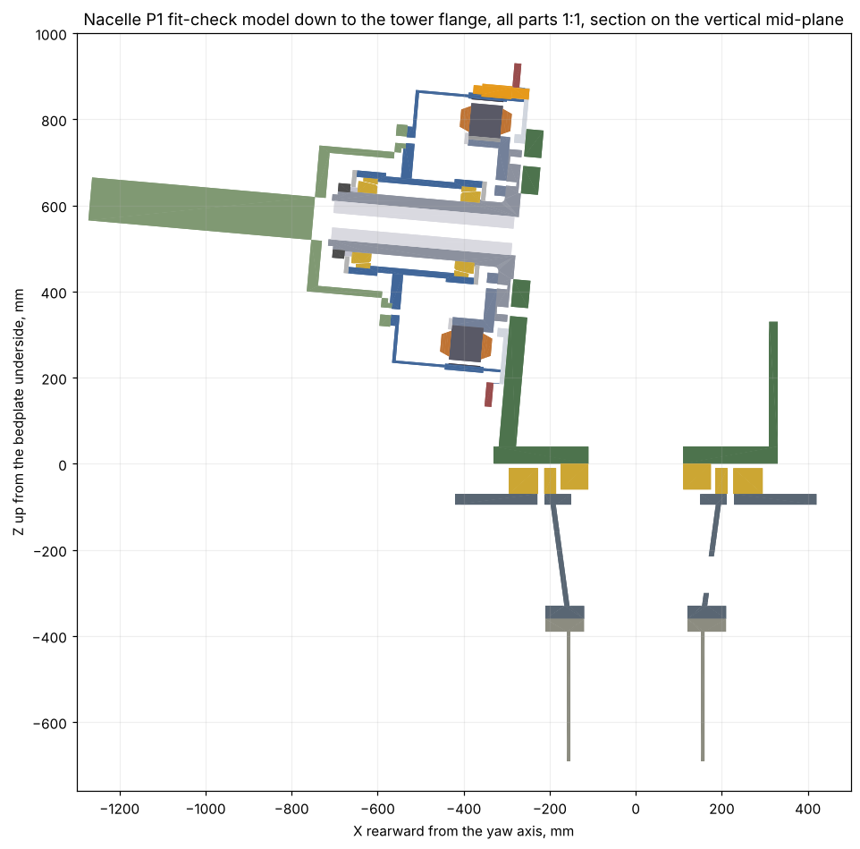

# 12 kW Wind Turbine for Iceland: Nacelle P1 Full-Size Fit-Check Model

Status: **Draft A** · 2026-11-02
Owner: Category 5 (Nacelle) with Category 10 (Manufacturing) and 11 (Testing)
Builds on: [14 – Nacelle prototype P1](14-nacelle-prototype-p1.md) and its drawing set
Model and scripts: [`cad/nacelle_fitcheck/`](../cad/nacelle_fitcheck/) (one command, `python3 build.py`)
Digital check: [`out/assembly_check.md`](../cad/nacelle_fitcheck/out/assembly_check.md)

## Summary

Every P1 nacelle part, from the hub flange down to the tower mounting point, is modelled **at full size (1:1)** as **its own object**,
one STEP and one STL file per part, not split. All files share one
coordinate frame, so opening any group of them shows them in their
assembled position, and the combined `NP1-fitcheck-assembly.step` holds all
43 objects with names and colours.

Before anything is printed, the same solids are run through a digital fit
check: interference in the assembled position, running gaps between
rotating and stationary parts, and the assembly path of every part along
the spindle axis in the doc 14 §7.2 order. **It found real problems in the
P1 design** (section 3). They should be fixed in the P1 drawings before the
plastic, and certainly before the steel.

| Item | Value |
|---|---|
| Scale | 1:1, all parts |
| Objects | 43 (make parts, bedplate plates, tower-top adapter and tower flange, and envelopes of bought parts and end windings) |
| Files | `out/step/*.step`, `out/stl/*.stl`, `out/NP1-fitcheck-assembly.step`, `out/parts-list.md` |
| Largest parts | tower-top adapter Ø840 × 290, brake disc Ø800, drum Ø690 × 412, rear cover Ø690, bedplate plates up to 741 × 609 |
| Plastic | ≈ 153 L solid volume, **≈ 58 kg PETG** at about 30 % solid fraction |
| Printer needed | build volume ≥ 840 × 840 mm for the adapter and disc; ≥ 700 mm for drum, rear cover and bedplate plates (large-format printer or print service) |

*Section on the vertical mid-plane. The orange lock pin at the top runs into the drum shell (finding 6).*

## 1. What the model is for

The physical model answers what drawings and the digital check cannot
easily show:

1. **Handling and assembly order**: can the build team actually put the
   parts together in the planned order, with the planned fixtures, and take
   them apart again?
2. **Tool access**: can a torque wrench reach the 12 × M20 bedplate bolts
   from inside the bedplate, the 12 × M12 carrier bolts, the 24 × M12 disc
   bolts, the lock pin?
3. **Bought parts**: when the real bearings, calipers, yaw bearing and
   gearmotors arrive, do they fit the printed parts and brackets?
4. **Cable and air paths**: do the stator leads pass the Ø28 holes in the
   carrier and flange and the Ø32 holes in the bedplate? Where does the fan
   manifold go?
5. **Brackets still to draw** (NP1-310 caliper brackets, NP1-400 tower-top
   adapter, lock pin holder, fan manifold): they can be mocked up in
   cardboard or printed against the real geometry.

It does **not** check what needs steel: bearing preload, the 2 mm air gap
under load, magnetic pull, balance. Those stay on the bench (doc 15).

## 2. The parts

The full table with sizes, filament per part and every change from the
steel part is generated as [`out/parts-list.md`](../cad/nacelle_fitcheck/out/parts-list.md).

| Group | Objects |
|---|---|
| Stationary drivetrain | spindle NP1-100, front spacer NP1-101, cooling insert NP1-110, stator carrier NP1-200, stator core NP1-201 (45 slots, real lamination contour, 3 key notches), 3 stator keys, clamp ring NP1-202, front and rear end-winding envelopes, lock pin NP1-320 |
| Rotating | drum NP1-210 (all bolt and lock holes), front and rear seal covers NP1-211, rear cover NP1-212, magnet layer NP1-220 (one ring with 40 pole gaps), brake disc NP1-230 |
| Bedplate NP1-300 | front plate, bottom plate, left and right side plates, rear plate: separate objects, like the plates of the weldment |
| Bought, as envelopes | 32028 X cones (with rollers) and cups, KMT 27 locknut, yaw bearing inner ring and outer gear ring (z150 m4), two brake caliper space claims |
| Yaw and tower top (section 7) | tower-top adapter NP1-400, tower flange stub, 2 yaw drives with brackets NP1-420, 2 yaw brake calipers, 2 rotor caliper brackets NP1-310 |
| Bench | dummy hub NP1-600 with the Ø100 shaft |

### Changes from the steel parts

Printed parts cannot be shrink-fitted or pressed, so where two printed
parts meet on a press or transition fit the bore is opened by
**0.2 mm on radius** (cones, cups, spacer, cooling insert, stack bore,
keys, bedplate spigot bore, lock pin, yaw inner ring). All other
dimensions are as drawn. Tapped holes are printed at tap-drill size (M8
Ø6.8, M10 Ø8.5, M12 Ø10.2, M16 Ø14, M20 Ø17.5): tap them, or use a nut
behind. Threads are not modelled (M135 locknut seat is a plain Ø135).

Bought-part envelopes are **estimates** and must be replaced when the
supplier drawings arrive: 32028 X cone/roller envelope Ø181 to Ø191,
caliper 180 × 130 × 140 mm with its inner edge 15 mm inside the pad track,
yaw bearing per doc 13 with 16 holes assumed on PCD 440.

**Never put real magnets in the printed drum.** The magnet layer is a
plastic dummy.

## 3. Findings from the digital fit check

Numbers below are from [`assembly_check.md`](../cad/nacelle_fitcheck/out/assembly_check.md).

Seven problems in the P1 design, plus two drawing slips. Each one would
have stopped the steel build at the assembly bench.

| # | Finding | Evidence | Suggested fix (to decide) |
|---|---|---|---|
| 1 | **The brake disc cannot be fitted to the finished drum.** Disc bore Ø640 is smaller than the drum shell over the magnets (Ø646, x 335 to 425) in front of it and the flange ring (Ø690) behind it. Doc 14 §7.2 step 2 "fit the brake disc" is impossible; the disc would be trapped by welding and could never be changed | Assembly path, step 2 blocked both ways | Split the disc in two halves, or bolt it to the rear face of the flange ring, or open the bore to ≥ Ø650 and move the 24 bolts outward (needs a larger flange ring) |
| 2 | **The stator cannot pass the rear bearing cone.** Carrier bore Ø180 against an estimated cone/roller envelope of Ø191 | Step 4 blocked; the other order (stator first, then rear cone) is clear | Swap steps 3 and 4 in doc 14 §7.2 (stator first). Confirm with the 32028 X drawing |
| 3 | **The rear bearing seal cover cannot be installed and, as drawn, overlaps the spindle.** Its Ø152 bore sits over the Ø155 cone shoulder (1 mm overlap), and riding in with the drum it would have to pass the rear cone and the shoulder | 723 mm³ static overlap; step 5 blocked; 0 mm running gap | Redesign the rear seal: e.g. lip seal running on a sleeve behind the shoulder, cover bore larger than the cone envelope, or a split cover fitted from the front before the drum |
| 4 | **The front seal cover cannot go on after the locknut.** Cover bore Ø162 against the KMT 27 nut Ø174 | Step 6 blocked | Fit the cover before the nut, which means the "rolling torque without seals" check must be done before the cover, then nut off and on again, or a cover bore larger than the nut |
| 5 | **The rotating rear cover runs 1 mm from the bedplate front plate**, and the spindle flange face does not touch the plate: as drawn the plate starts at x 476 while the flange face is at x 470 (only the 6 mm spigot touches the plate). Closing the bolted joint would put the plate 5 mm into the rotating cover | Running gap 1.0 mm; geometry | Recess the plate front face for the cover (or make the rear cover thinner and move it forward) and correct the plate position to the flange face; aim for ≥ 5 mm running gap |
| 6 | **The rotor lock pin cannot reach the lock holes.** From the front the Ø30 pin body runs into the drum shell (Ø646) over x 335 to 425; from behind, the rear cover closes the holes. Also the pin's 40 mm engagement is longer than disc + ring (16 + 14 = 30 mm, the drum drawing says 20 deep in a 14 mm ring) | 7,918 mm³ pin/drum and 4,753 mm³ pin/rear cover overlap | Put the lock holes in the rear cover or the flange ring OD (radial pin), or move them outside r 345 on the disc only |
| 7 | **The brake calipers have no room behind the disc.** The pad track starts at r 345, the same radius as the drum flange ring and rear cover OD, so the caliper half behind the disc sits on the rotating ring. In front, a typical caliper body would be 7 mm from the drum shell | Caliper space claim overlaps drum and rear cover | Move the pad track outward by ≈ 20 mm (disc Ø840) or reduce the flange ring OD; settle with the caliper supplier drawing (NP1-310 not drawn yet) |
| 8 | Drawing slip, NP1-600 dummy hub: the Ø361 recess is drawn at the wrong end, so the drum's Ø360 spigot hits the hub | Step 9 blocked as drawn, clear when corrected | Correct the drawing (the printed hub has the corrected recess) |
| 9 | Drawing/BOM slip: stator keys are listed 90 mm long but the key seat is 73.5 mm (carrier rim x 343.5 to 417, clamp ring in front) | Key/carrier and key/clamp ring overlap at 90 mm | BOM line 10: key 10 × 8 × 70. Printed keys are 73.5 mm |

Everything else is clear: the stack, keys and clamp ring go onto the
carrier; the cups go into the drum from each end; the drum with cups and
magnets passes over the stator; the front bearing, spacer and nut go on;
the rear cover passes over the flange; the bedplate fits the spigot; the
air gap is 2.5 mm to the magnet face and no other rotating part comes
closer than 1.5 mm to a stationary one (the bearing envelopes).

Findings 2, 6 and 7 depend on bought-part dimensions that are estimates
here (32028 X cone envelope, caliper body); 1, 3, 4, 5, 8 and 9 come from
the P1 geometry alone.

## 4. Printing

| Setting | Value | Why |
|---|---|---|
| Material | PETG (or PLA for parts that are only looked at) | Tougher than PLA for repeated assembly; holds tapped threads better |
| Nozzle / layer | 0.6 mm / 0.3 mm (0.4 / 0.2 for the stator core, keys, spacer, lock pin) | Big parts in reasonable time; fine parts keep slot and key shapes |
| Walls | 4 perimeters (6 on bolted faces and around tapped holes) | Holes and seats need solid material, infill can be light |
| Top / bottom | 5 layers | |
| Infill | 15 % gyroid (spindle, drum, plates); 30 % for the dummy hub shaft | |
| Supports | Tree supports, from the build plate only where possible | |
| Calibrate first | Print a 100 mm test ring with a Ø70.2 bore and a Ø140 test peg; adjust shrink/XY compensation until the bore takes the peg with a light push | All seats rely on the 0.2 mm clearance |

**Suggested orientation** (slicer: rotate each part, the files are in
assembly position):

| Part | Face on the bed |
|---|---|
| Spindle | flange rear face (spigot needs a small support ring) |
| Drum | rear flange ring face; supports under the hub web |
| Stator carrier | web rear face (x 440) |
| Stator core, clamp ring, disc, covers, rings | flat, any face |
| Bedplate plates | largest face |
| Cooling insert, dummy hub | end face, standing (the hub shaft is 520 mm long: lay it down if the printer is short) |

Large-format alternatives if the printer is too small: print the brake
disc, rear cover and bedplate plates as 2D profiles cut from 6 to 10 mm
plywood or MDF on a CNC router or laser using the P1 DXF files
(`cad/nacelle_p1/out/dxf`), and print only the 3D parts.

## 5. Physical fit-check procedure

Work in the doc 14 §7.2 order. Record each step as pass, fail or note,
with a photo.

| # | Step | Check |
|---|---|---|
| 1 | Stack onto carrier, 3 keys, clamp ring, 12 × M8 | Keys enter carrier and stack together; clamp ring holes line up with the tapped holes |
| 2 | Cups into drum, front and rear | Cups seat on the Ø196 shoulders; rear cup can be reached through the open drum rear |
| 3 | Magnet layer into drum, then brake disc | **Expect the disc not to go on (finding 1)**: record how it fails |
| 4 | Cooling insert into the spindle bore | Partition fins at 0° and 180°, sensor holes reachable |
| 5 | Stator onto spindle flange, 12 × M12, 2 dowels | Try both orders: rear cone first (expected to block, finding 2) and stator first. Pull a 25 mm cable through the Ø28 holes |
| 6 | Rear cone, then rear seal cover | Can the seal cover be placed at all (finding 3)? |
| 7 | Drum onto spindle, nose up, with the guide tool mock-up | Drum centres on the guide before the magnet layer reaches the stator; 4 × 1.5 mm feelers fit the gap at 90° |
| 8 | Front cone, spacer, locknut, front seal cover | Can the seal cover go on after the nut (finding 4)? |
| 9 | Rear cover over the flange | Bolt access to 24 × M10; seal carrier around the Ø400 flange |
| 10 | Bedplate plates: tape or clamp together, then spindle flange to the front plate, 12 × M20 from inside | Torque wrench reach through the open top; flange face to plate contact (finding 5); gap rear cover to plate |
| 11 | Calipers (envelopes or real units) on mock brackets | Disc clearance, bracket bolt access, pad change path, hydraulic hose route |
| 12 | Lock pin | Can it reach the lock holes from either side (finding 6)? |
| 13 | Yaw rings under the bottom plate, adapter NP1-400 under the outer ring, tower flange stub under the adapter; yaw drives and brackets, yaw calipers | Pinions engage the gear; turn the nacelle a full revolution on the adapter; bolt access to 16 × M16 and 16 × M20; cable loop through the cone window |
| 14 | Dummy hub onto drum | Spigot enters the recess (finding 7) |
| 15 | Disassemble in reverse | Every part comes off without cutting; note any trapped parts |

## 7. Below the bedplate, down to the tower mounting point (new design)

The P1 drawing set stops at the bedplate and the yaw bearing (NP1-310 and
NP1-400 were waiting for supplier drawings). To close the model down to
the tower, the missing parts are designed here as a **proposal**, with
the same 1:1 rules. The **tower mounting point** is the top face of the
tower flange, **360 mm below the bedplate underside** (930 mm below the
rotor centre).

| Part | Design | Basis |
|---|---|---|
| **NP1-400 tower-top adapter** | S355J2+N weldment: 25 mm plate Ø840 / Ø300 that is both the yaw ring seat and the **yaw brake track (r 340 to 420, both faces)**; 12 mm cone from Ø396 down to Ø332 (inside the PCD 440 bolts, so a Ø30 socket reaches all 16 from below); 30 mm flange Ø420; 8 gussets kept **inside r 315** so the yaw calipers can pass all the way round; 90 × 85 window for the cable loop | Doc 14 §4.6: yaw brake ring outside the gear at r ≈ 0.38 m |
| Adapter to yaw outer ring | 16 × M16 10.9 from below on PCD 440 | Bolt load 15.7 kN at the SLM tilt moment, preload ≈ 90 kN |
| **Tower top flange + 300 mm stub** | Flange Ø420 / Ø240 × 30 on the Ø320 × 8 tower tube; **16 × M20 10.9 through bolts on PCD 380** | Doc 09 tower top Ø320; moment at the flange 24.3 kNm + 41.6 kN × 0.36 m = 39.3 kNm → 25.8 kN per bolt against ≈ 110 kN minimum preload; slip factor ≈ 4 for 41.6 kN shear + 8 kNm yaw-brake torque |
| **Yaw drives** (envelopes) | 2 gearmotors at **±90° (left and right of the yaw axis)**, pinion z14 m4 at centre distance 328 mm, gearbox Ø100, motor Ø110, 400 mm tall | Doc 13: 0.18 kW, 1:1680. Inside the bedplate there is no room (the side plates are at ±240 and the pinion circle is r 328), so the drives sit outside the side plates |
| **NP1-420 yaw drive brackets** | Horizontal 25 mm plate at bedplate-bottom level carrying the gearbox flange (4 × M10), plus a 15 mm web bolted to the side plate (4 × M16) | New |
| **Yaw brake calipers** (space claims incl. bracket) | 2 units under the two **front corners** of the bedplate (±141.8°), gripping the adapter plate edge from outside, 150 × 150 × 150 mm, 3 mm running gap each side | Slip 8 kNm with μ 0.4 on r 0.38 m needs 13.2 kN clamp per caliper (doc 14: ≈ 14 kN) |
| **NP1-310 rotor caliper brackets** | Placeholder blocks 120 × 70 × 130 on the side plates, 4 × M16 each | Final shape after the caliper is chosen and finding 7 is solved |
| Yaw bearing inner ring | Envelope now 60 mm high, so it stands 10 mm clear of the adapter while yawing | Real slewing rings offset the two mounting faces the same way |

**Yaw check.** The digital check now also turns the nacelle through a
full yaw revolution against the tower-side parts (adapter with gussets,
gear ring, tower flange). Everything is clear. The smallest gaps are
the intended ones: 3 mm from the brake pads to the track, 5 mm from the
pinions to the adapter plate, and 10 mm from the bedplate, inner ring and
drive brackets to the gear ring and adapter (`assembly_check.md` §2b).

**What the print should check:** spanner access to the 16 × M16 adapter
bolts (from below, between the gussets) and the 16 × M20 tower bolts
(through the window and from outside), cable loop room in the cone,
yaw caliper pad change, and the drive pinions engaging the gear.

## 8. Next steps

1. Decide the fixes for the findings in section 3 and update
   `cad/nacelle_p1/geometry.py` and the drawings; rerun both scripts until
   the digital check is clean.
2. Then print. Start with the parts behind the findings that only a
   physical test can settle (bearing envelopes against real 32028 X,
   lock pin access, caliper brackets).
3. Replace the envelopes as supplier drawings arrive (bearings, calipers,
   yaw bearing, gearmotors).
4. Add the tower top flange (section 7) to the doc 09 tower drawings, and
   draw NP1-400 and NP1-420 properly once the slewing ring and gearmotor
   drawings are in.
