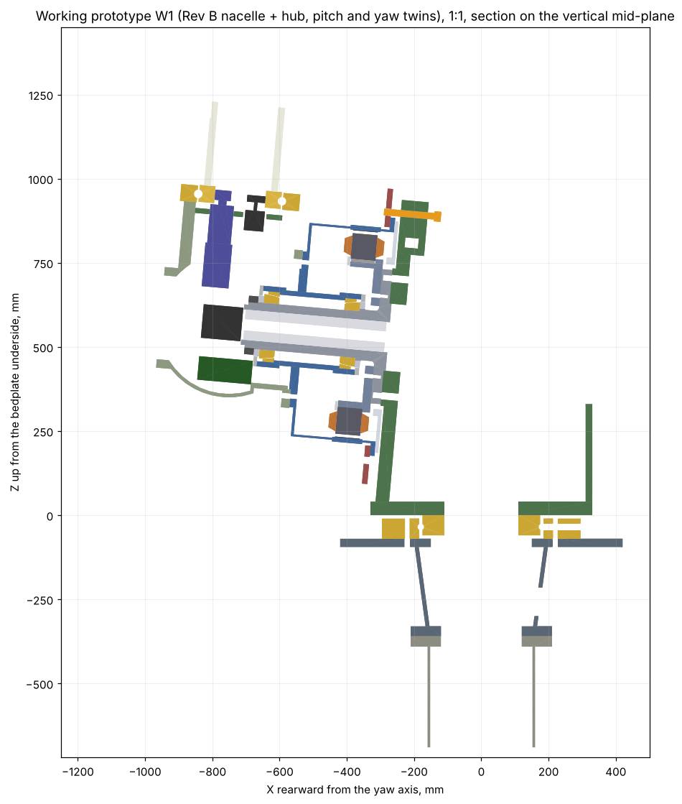

# 12 kW Wind Turbine for Iceland: Working 3D-Printed Nacelle Prototype (W1)

Status: **Draft A** · 2026-11-03
Owner: Category 5 (Nacelle) with 3 (Hub, pitch, yaw), 7 (Power electronics), 8 (Control and safety), 10 (Manufacturing), 11 (Testing)
Builds on: [14 – Nacelle prototype P1](14-nacelle-prototype-p1.md), [16 – Fit-check model](16-nacelle-fit-check-model.md), [13 – Hub, pitch and yaw](13-hub-pitch-yaw.md), [11 – Control and safety](11-control-safety.md), [12 – Power electronics](12-power-electronics.md)
Model and scripts: [`cad/nacelle_w/`](../cad/nacelle_w/) (W1 parts, `python3 build_w.py`), [`cad/nacelle_fitcheck/`](../cad/nacelle_fitcheck/) and [`cad/nacelle_p1/`](../cad/nacelle_p1/) (geometry **Rev B**)
Component list: [`cad/nacelle_w/bom_w.csv`](../cad/nacelle_w/bom_w.csv)

## Summary

The 1:1 fit-check model becomes **W1, a working prototype**: a printed
nacelle and hub that turns on real bearings, pitches three blades with the
real pitch drives, yaws on a ball-bearing twin of the yaw ring, brakes and
locks with real calipers and pin, and is run by the real controller and the
real hardwired protection system. Every printed part has the same interfaces
(bolt circles, spigots, bores) as the steel or cast part that replaces it, so
the prototype becomes the P1 machine **one part at a time**.

| Item | Decision |
|---|---|
| Principle | **Buy real, print what we make.** Every bought part (bearings, actuators, calipers, sensors, electronics) is the production choice from day one. Only the in-house make-parts (spindle, drum, hub, bedplate, brackets, adapter) are printed, each as a *twin* with the steel part's interfaces |
| First fix | The 9 fit-check findings of doc 16 are fixed in the P1 geometry (**Rev B**, section 2). The digital check is now clean: no clashes, every assembly step clear |
| What W1 does | Rotor turns to 100 rpm (printed-drum limit), 3 independent pitch axes on stored energy, yaw with cable-twist logic, spring-applied rotor brake, lock pin, all sensors, control system and safety chain, generator torque by **power hardware-in-the-loop** |
| What W1 does not do | Carry wind loads, make power from its own generator (no magnets in a printed drum), run the full brake torque on printed brackets |
| Swap tracking | A **build manifest** in the controller lists which parts are printed; the controller sets speed, torque, pitch-torque and brake-pressure limits from it (section 6) |
| Car industry | Reading used: both **automotive mechanical parts** and an **automotive-style shell**. Accepted: sealed connectors, wheel-speed (Hall) sensor as a diverse speed channel, car EPB caliper as a *test candidate* for the yaw brake, automotive panel processes and hardware for the cover. Rejected for safety or life reasons: car hydraulic calipers as the rotor brake, wheel-hub bearings for pitch, EPS motors for pitch, EV inverters, reused car body panels (section 5) |
| New parts | 28 W1 objects (hub twin, 3 pitch bearing twins with real balls, pitch drive brackets, blade root stubs, yaw ring twins, envelopes of the bought units; ≈ 22 kg PETG) plus 4 new Rev B objects (seal sleeve, lock pin holder, two overspeed sensors) and redesigned caliper brackets. Clash check of all new parts: clean; pitch pinions mesh with 0.13 mm backlash |

---



*Section through the W1 assembly: hub with the upper pitch bearing twin, drive and blade stub, Rev B drivetrain, lock pin and holder at the top, yaw ring twins and tower-top adapter below.*

## 1. What "working" means for a printed prototype

PETG and ASA parts at 1:1 hold their shape and carry light loads; they do
not carry the turbine's loads, hold a press fit for long, or survive
NdFeB magnets (each pole pulls with several kN towards the stator; a printed
drum would fail and the magnets are a crushing hazard). W1 therefore tests
**function, assembly, wiring and software** with real bought units, and
leaves **loads, air gap and generator power** to the steel P1 (doc 15).

| Function | Real in W1? | How |
|---|---|---|
| Rotor turns on its bearings | Yes, ≤ 100 rpm | Real 32028 X bearings in printed seats; hub driven through the front opening by a 1.5 to 3 kW bench servo (NW-610 adapter, to be drawn) |
| Generator torque and power flow | Emulated | The controller's torque setpoint goes to the bench servo drive, which applies it to the rotor (power hardware-in-the-loop); a rotor/wind model on the bench PC closes the loop. Same CAN message the doc 12 converter will receive |
| Pitch, 3 independent axes | Yes, full speed (30 °/s), limited torque | Real servo, gearbox, controller, supercaps and encoder on printed bearing twins with real balls |
| Emergency feather on stored energy | Yes | Real supercap modules; safety chain opens STO |
| Yaw, cable twist, untwist | Yes, no wind load | Real gearmotors on the printed yaw ring twin with real balls |
| Rotor brake | Apply / release / timing / pad wear switches; torque only on steel brackets | Real calipers and HPU; steel disc from day one |
| Rotor lock | Yes | Real steel pin in the printed holder; switch into the safety chain |
| Overspeed protection | Yes | Two inductive sensors on the disc lock holes into a safe speed monitor |
| Sensors, heaters, cooling fans | Yes | Real units |
| Loads, stiffness, air gap, efficiency, thermal | No | P1 steel bench tests (doc 15) |

## 2. Fit-check findings fixed (geometry Rev B)

All changes are in [`cad/nacelle_p1/geometry.py`](../cad/nacelle_p1/geometry.py)
(single source of truth), so the P1 drawings, the printable parts and the
digital check all follow. The drawing set is regenerated as Rev B.

| # | Doc 16 finding | Rev B fix |
|---|---|---|
| 1 | Brake disc trapped on the drum | Disc bore **Ø640 → Ø652**: it now slides on from the front over the Ø646 magnet shell (3 mm radial clearance). Drum flange ring OD **Ø690 → Ø710**; disc bolts **24 × M10 10.9 on PCD 678** (slip capacity ≈ 160 kN at μ 0.2 against 26 kN at 8.7 kNm) |
| 2 | Stator cannot pass the rear cone | Assembly order changed: stator first, then seal sleeve, then rear cone (section 2.1) |
| 3 | Rear seal cover cannot be installed, overlaps the shoulder | New stationary **seal sleeve NP1-102** (Ø155/Ø195 × 15.5, hardened, O-ring) on a lengthened Ø155 shoulder (3.5 → 17.5 mm). The rear lip seal (195 × 220 × 12) runs on the sleeve; the seal cover bore Ø198 is larger than the cone envelope (Ø191), so the cover is bolted to the drum before the drum goes on |
| 4 | Front seal cover cannot go on after the nut | Spacer NP1-101 OD **Ø160 → Ø180**, lip seal 180 × 200 × 10; cover bore Ø183 passes over the KMT 27 nut (Ø174). Rolling-torque check is done before the cover |
| 5 | Rear cover 1 mm from the bedplate; flange face not on the plate | Front plate face moved to x 480 with a machined **Ø410 × 10 pad** whose face (x 470) meets the spindle flange. Rear cover now runs **5 mm** from the plate |
| 6 | Lock pin cannot reach the lock holes | Lock holes moved from the ring to the **disc only**: 12 × Ø22 on PCD 740, between the ring (r 355) and the pad track (r 385). Pin **Ø20** from behind at the top, holder **NP1-321** on the front plate top edge. Shear 23.5 kN, τ 75 MPa (allowable 300) |
| 7 | No caliper room behind the disc | Disc **OD Ø800 → Ø880**, pad track r 385 to 435 (r_eff 0.41 m). Caliper inner edge r 370 is 15 mm clear of the ring. Clamp needed **13.3 kN per caliper** (was 14.7). Disc mass 22.7 → 34.5 kg |
| 8 | Dummy hub recess drawn at the wrong end | Drawing NP1-600 corrected |
| 9 | Stator key length | BOM: keys 10 × 8 × **70** (seat 73.5) |

Digital check result ([`assembly_check.md`](../cad/nacelle_fitcheck/out/assembly_check.md)):
no static interference; the only running gaps below 3 mm are the designed
ones (1.5 mm seal-cover bores under their lips, the bearing envelopes and the
2.5 mm air gap); all 17 assembly steps clear; yaw check unchanged.

**Mass effect:** drivetrain without hub 321 → 336 kg (disc + 12 kg, sleeve
and larger spacer + 2 kg). P2 mass reduction (doc 14) should look at a
ventilated or lighter disc.

### 2.1 Rev B assembly order

1. Stator: stack onto carrier, keys, clamp ring.
2. Rotor: cups into the drum, magnets (P1 only), **rear seal cover onto the
   drum housing**, **brake disc from the front**.
3. Spindle: **stator onto the bare spindle**, **seal sleeve NP1-102**, rear
   cone.
4. Complete rotor over the spindle (guide tool, doc 14).
5. Front cone, spacer, KMT 27 nut, preload and rolling-torque check, **then
   the front seal cover**.
6. Rear cover over the flange; bedplate front plate on the spigot.
7. Hub (or bench dummy hub).

## 3. W1 parts and swap path

New parts are modelled 1:1 in [`cad/nacelle_w/parts_w.py`](../cad/nacelle_w/parts_w.py)
in the same world frame, so they open together with the fit-check files.
`build_w.py` writes one STEP and STL per part, the full assembly
`NW1-assembly.step` (39 MB, not committed: regenerate it or take it from the project files), the parts list and a clash/running check of the new parts
against the Rev B nacelle ([`out/w_check.md`](../cad/nacelle_w/out/w_check.md)).

| Part | W1 | Interface kept for the swap | Swap to |
|---|---|---|---|
| **NW-500 hub** | Printed twin of the doc 13 hub: sphere R 220, 10 mm wall, necks Ø330 to the bearing face at r 350, front opening Ø250 | 12 × M16 PCD 400 + Ø361 recess to the drum; 16 × M16 PCD 300 per neck; 8 × M12 PCD 275 on the front opening | EN-GJS-400-18U-LT casting |
| **NW-510 pitch bearings** (3) | Printed outer ring and inner ring with **involute internal gear z48 m3**, groove for **27 real Ø25.4 balls**, filling plug NW-511 | Ø355 × 50, Dpw 250, same bolt circles | Real slewing ring (doc 13) |
| **NW-520 pitch drive brackets** (3) | 15 mm plate in the neck bore carrying the gearbox flange at 51 mm centre distance and the encoder | Gearbox flange and pinion position | Machined pad in the cast hub + steel bracket |
| Pitch drives, encoders (3 each) | **Real** (envelopes in CAD until supplier drawings) | – | – |
| **NW-530 blade root stubs** (3) | Ø220 × 250 printed tubes with 0° mark, take test masses for the pitch inertia | 10 × M16 PCD 200 | Real blade (doc 10) |
| **NW-430 yaw ring twins** | The fit-check yaw ring envelopes plus a groove for **53 real Ø19.05 balls** and a filling plug | 16 × M16 PCD 300 / PCD 440, gear z150 m4 | Real slewing ring (order now, 10 to 16 weeks) |
| **NP1-310 caliper brackets** (2) | L bracket: 25 mm mounting plate behind the caliper (4 × M16 axial) + web on the side plate (4 × M16) | Caliper bolt pattern (set by the chosen caliper) | S355 before any torque test |
| **NP1-321 lock pin holder** | Block on the front plate top edge with the pin bush, two M18 sensor seats at ±15° and a pocket for the "pin engaged" switch | 2 × M12 into the plate | Steel |
| Hub electronics (3), slip ring + encoder | Real units in printed brackets | – | – |
| Brake disc NP1-230 | **Steel from day one** (laser-cut 16 mm plate): a printed disc cannot be braked | 24 × M10 PCD 678 | – |

### 3.1 Rules for printed twins

- **Same bolts as steel.** Holes keep the steel size and position. In
  printed parts use **heat-set brass inserts or captive nuts** (not tapped
  plastic) wherever the joint will be opened more than twice, and steel
  washers under every bolt head.
- **Bearing seats:** print 0.2 mm radial under the steel fit (doc 16) and
  retain the real bearing with a printed or steel clamp ring, not with
  interference. Inspect seats after every 10 operating hours.
- **Gears:** printed gears are involute ([`gears.py`](../cad/nacelle_w/gears.py))
  with 0.3 mm backlash; run printed-on-steel only at the W1 torque limits
  (section 6).
- **Material:** PETG for structure, ASA for anything outdoors or warm,
  PA-CF for the gear rings and brackets if the printer allows it.
- **Real balls in printed races** are for motion only (no load case). Fill
  with balls and printed spacers through the plug, grease lightly.

## 4. Bought components

The full list with candidates, frozen interfaces and the automotive verdict
for each line is [`bom_w.csv`](../cad/nacelle_w/bom_w.csv). Candidates are
product families to request datasheets from; none is ordered yet.

| System | Unit | Requirement (source) | Candidates |
|---|---|---|---|
| Main bearings | 32028 X tapered roller, ×2 | doc 14 | SKF 32028 X/Q, Timken, Schaeffler, NSK |
| Rotor brake | Spring-applied, hydraulically released caliper, ×2 | ≥ 13.3 kN clamp, 16 mm disc, −40 °C pads, pad wear and position switches | RINGSPANN HS/DS (FHM) family, Svendborg BSAB family, KTR-STOP, Coremo |
| Brake pads | Sintered metal | μ 0.35 to 0.45 stable when cold and wet | From the caliper supplier |
| Hydraulics | Compact power unit with accumulator, two normally-open dump valves (rotor, yaw) | Brakes apply on power loss | Hydac, Bosch Rexroth, caliper supplier |
| Pitch drive | 48 V PMSM servo with holding brake, 1:100 planetary, z14 m3 pinion, ×3 | 2.1 Nm peak, 1,710 rpm, 510 Nm at the bearing (doc 13) | Servo: Kollmorgen AKM2 class, Nanotec, JVL, Dunkermotoren BG 75 class; gearbox: Neugart, Apex, Wittenstein |
| Pitch controller | 48 V servo drive, STO, CANopen DS402, ×3 | doc 13 §5 | Ingenia, Elmo, Nanotec, Kollmorgen AKD-N class |
| Pitch energy | 21 × 350 F supercaps, balancing, heater, ×3 | 14 strokes at −30 °C (doc 13) | UCAP/Maxwell BCAP0350, Eaton HB |
| Pitch sensors | Multiturn absolute encoder (gear-driven z16), limit switches −2°/91°, rubber end stops | doc 13 | Kübler Sendix, Baumer, Hengstler; Schmersal, Euchner |
| Slip ring | 48 V 2 × 30 A, CAN FD, 2 safety rings, Ethernet, integrated encoder ≥ 1024 ppr | doc 13 §5 | Moog, Senring, Jinpat, Stemmann |
| Yaw ring | Dpw 360, z150 m4 external gear | doc 13 | thyssenkrupp rothe erde, IMO, Kaydon/SKF |
| Yaw drives | 0.18 kW, 1:1,680 planetary gearmotor + inverter with torque limit, ×2 | doc 13 | Bonfiglioli, Brevini, Comer, NORD |
| Yaw brake | 8 kNm slipping, ×2 | doc 13 | Hydraulic (same supplier as the rotor brake) **or** car EPB caliper after test (section 5) |
| Yaw position | Multiturn encoder + cam limit switch ±3 turns | doc 11 | Stromag, Ter gear limit switches |
| Overspeed | 2 × M18 inductive on the disc lock holes + safe speed monitor | 225 rpm hardware trip (doc 11) | ifm, Pepperl+Fuchs, Balluff; **Pilz PNOZ s30** |
| Wind | Heated ultrasonic anemometer | Icing (doc 02) | FT Technologies FT742, Gill WindSonic M, Thies |
| Vibration | 2-axis accelerometer + pendulum switch | doc 11 | ifm VSA/VSE or IEPE sensors |
| Control system | Industrial controller + I/O | doc 11 | **Beckhoff CX + EtherCAT** (recommended for W1/P1: open, fast to change); Bachmann M1 (wind-industry standard) as the alternative |
| Protection system | Hardwired 2-channel chain, PL d cat 3 | doc 11 | Pilz PNOZ s30 + PNOZsigma or PNOZmulti, e-stops, watchdog relay |
| Cooling | 2 × 48 V radial blowers | doc 14 §6 | ebm-papst 48 VDC radial blowers |

**Generator in W1.** The generator stays printed (dummy stator and magnet
ring). Generator torque is emulated by the bench servo drive under the
controller's torque setpoint. If an electrically real test of the rectifier
and dump-load chain is wanted before P1, a small off-the-shelf 3 to 5 kW
low-speed PM generator can be run from the bench drive into the doc 12
converter prototype at reduced voltage; it is not part of W1's mechanics.

## 5. Car industry: what we use and what we don't

Reading used: Martin's "shell from the car industry" is read two ways,
**(a) reusing automotive mechanical and electrical parts** and **(b) an
automotive-style body shell for the nacelle cover**. Both are evaluated.

### 5.1 Automotive parts

| Automotive part | Use it? | Why |
|---|---|---|
| **Hydraulic brake caliper + disc** (car) as rotor brake | **No** | Applied by pressure, so a lost hose or pump releases the brake. IEC 61400-2 and doc 11 need a fail-safe (spring-applied) brake |
| **Truck air disc brake with spring brake chamber** | No | Spring-applied (fail-safe), cheap and proven at −40 °C, but needs a compressed-air system in the nacelle, a 45 mm thick disc and ~35 kg per caliper |
| **Car electric parking brake (EPB) caliper** as **yaw brake** | **Test it in W1** | Motor-on-caliper units reach up to about 20 kN clamp ([Continental EPB-Ci](https://conti-engineering.com/components/caliper-integrated-electric-parking-brake-epb-ci/)) and hold without power. That would take hydraulics off the yaw. Open: slip behaviour at 8 kNm, life at our cycle count, a 10 to 12 mm bolt-on brake ring under NP1-400 instead of the 25 mm plate edge |
| **Car brake pads** | No | Do not fit industrial calipers; pads come with the caliper |
| **Wheel-hub bearing units** for pitch | **No** | Built for a few kNm of tilting moment while rotating; the pitch bearing needs 26 kNm (SLM) and lives on small oscillations, which fret a wheel bearing |
| **Electric power steering motor + worm** for pitch | No | Torque and reversal life short of 510 Nm / 230 million reversals; closed CAN protocol |
| **Wiper motor** for yaw | No | Wrong speed, extra gearbox needed, short duty |
| **EV traction inverter** as active rectifier | No | 400 V class or locked firmware, no access to field weakening; doc 12 SiC converter stays |
| **Active wheel-speed sensor (Hall)** | **Yes**, as an optional third, diverse speed channel on the disc lock holes | IP69K, −40 °C, very cheap, robust against dirt |
| **Sealed automotive connectors** (Deutsch DT/DTM, TE Superseal) | **Yes** for harness splices; M12/M8 industrial for sensors | IP67/IP69K, −40 °C, vibration-proof |
| **HVAC blower** for generator cooling | W1 stand-in only | Cheap, but its life is far below 100,000 h; production uses industrial EC blowers |
| **48 V mild-hybrid battery** | No | No heater or BMS access; use a heated 48 V LiFePO4 |

### 5.2 Automotive-style shell (nacelle cover and spinner)

Reusing a real car or truck body panel is **rejected**: no panel has the
right shape (≈ 1.4 × 0.9 × 0.9 m around the bedplate and drum), and the cover
also needs UV and salt resistance for 20 years, ice loads, a lightning
receptor path and service hatches. What the car industry *does* offer is the
**process and the hardware**:

| Stage | Cover |
|---|---|
| W1 | Printed ASA panels on an aluminium extrusion frame bolted to the bedplate; automotive EPDM edge seals, quarter-turn fasteners, a gas-strut service hatch |
| P1/P2 field units | **Vacuum-infused glass/vinyl-ester** shell with gelcoat (doc 13 already specifies the spinner this way), moulded on a CNC-milled or printed plug, like low-volume car and boat bodies |
| Series (> ~300 a year) | **SMC compression moulding** as used for truck cabs and hoods, or RTM-light |
| Bought hardware in all stages | EPDM door-type seals, quarter-turn fasteners, gas struts, cabin-air-filter style intake vents with drain, sealed cable grommets |

## 6. Electrical and control system in W1

### 6.1 Architecture

```
TOWER BASE (bench cabinet in W1)            NACELLE                                HUB (via slip ring)
 400 V AC ─► 48 V PSU ─┬─► LiFePO4 48 V ───► 48 V bus ──────────────────────────► 48 V (pitch drives, supercaps)
                       └─► 24 V control ───► controller + EtherCAT I/O
 bench servo drive ◄── torque setpoint (CAN) ─ controller ── CANopen ───────────► 3 pitch controllers (STO)
                                              │  EtherCAT I/O: brake valves, pressures, pad wear, fans,
                                              │  heaters, yaw inverter, yaw encoder, temps, wind, vibration
 PROTECTION (hardwired, 2 channels):          │
 e-stops ─┬─ PNOZ s30 (2 × M18 on disc holes) ─┴─ safety chain ─────────────────► STO pitch ×3, brake dump
          ├─ pendulum vibration switch                                            valves, converter enable,
          ├─ cable-twist cam switch, lock-pin switch, controller watchdog         bench drive enable
```

- **Buses:** CANopen (CAN FD capable) to the hub through the slip ring;
  EtherCAT for nacelle I/O. The bench PC talks to the controller over
  Ethernet for logging and the wind/rotor model.
- **Safety chain** opens STO on all three pitch drives (they feather on
  their supercaps), dumps both brake circuits (springs apply), disables the
  bench drive (W1) or converter (P1). The lock pin switch blocks a rotor
  release while the pin is in.
- **Connectors:** M12 A-coded for sensors, M12 X-coded for Ethernet,
  sealed automotive connectors for harness splices, M32 glands through the
  bedplate (doc 14).

### 6.2 Build manifest and stage limits

The controller holds a **build manifest**: one line per swappable part
with its state (`printed`, `steel`, `cast`, `real`). Limits follow from the
weakest part fitted, so swapping a part is a manifest change plus a
re-test, not a software change.

| If this part is printed | Limit set by the controller |
|---|---|
| Drum, hub, spindle | Rotor ≤ 100 rpm (W1 runs the 40 rpm start and the 62 to 75 rpm exclusion-zone logic); bench torque ≤ 100 Nm |
| Pitch bearing or ring gear | Pitch motor current ≤ 15 % (≈ 75 Nm at the bearing), full 30 °/s speed allowed |
| Caliper bracket NP1-310 | Brake pressure limited to "touch" (≈ 10 % clamp); full apply only with steel brackets and the rotor stopped |
| Yaw ring twin, adapter NP1-400 | Yaw drive torque ≤ 20 %; yaw brake pressure ≤ 30 % |
| Any printed part at all | Outdoor or tower use blocked |

## 7. W1 tests

| Test | What it proves | Pass |
|---|---|---|
| W1-T1 Build | Rev B assembly order works with real bearings, seals and bolts; disassembly without cutting | All steps done, photo log |
| W1-T2 Wiring and I/O | Every sensor and actuator reaches the controller with the right sign and scale | I/O list 100 % checked |
| W1-T3 Pitch | Each axis: homing on the encoder, limit switches, 30 °/s, synchronised moves, emergency feather from supercaps with the 48 V bus off | 3 s to 90°, 14 strokes from a full module at room temperature |
| W1-T4 Safety chain | Every input opens the chain, every output reaches the safe state, PNOZ s30 trips at the scaled overspeed | 100 % of trip paths |
| W1-T5 Rotor and brake | Run-up to 100 rpm, normal stop, brake apply on power loss, lock pin interlock | Brake applies < 1 s after chain opens |
| W1-T6 Yaw | Yaw to target, cable-twist untwist at ±2.5 turns, cam switch at ±3 | Error < 2° |
| W1-T7 Control loop (HIL) | Torque control, speed exclusion zone, constant power and storm logic on the bench model | Behaviour matches the doc 11 simulation |
| W1-T8 Swap rehearsal | Replace one printed part by its steel twin (first: NP1-310 brackets), update the manifest, re-run its test | No other part touched |

## 8. Printing

| Part group | Approx. size | Note |
|---|---|---|
| Hub NW-500 | Ø770 × 440 | Largest W1 part; four pieces on a 600 mm printer |
| Pitch rings NW-510 | Ø355 × 50 | Print flat; PA-CF preferred for the inner (gear) ring |
| Blade stubs, brackets, lock holder | ≤ 260 mm | Any large-format printer |
| Fit-check parts | see doc 16 | Rev B parts replace the earlier files |

Filament for the new printed parts is in [`out/parts-list-w.md`](../cad/nacelle_w/out/parts-list-w.md) (≈ 22 kg PETG); the Rev B fit-check set is ≈ 62 kg ([parts list](../cad/nacelle_fitcheck/out/parts-list.md)).

## 9. Swap roadmap

| Order | Swap | Why first |
|---|---|---|
| 1 | Brake disc steel, real calipers, real bearings, all electronics | Day one: they are bought or cheap, and they are what W1 tests |
| 2 | NP1-310 brackets and NP1-321 holder to steel | Lets the brake be tested at full clamp with the rotor locked |
| 3 | Yaw ring twin → real slewing ring (when it arrives), NP1-400 to steel | Long-lead item; also lets the yaw brake slip test run |
| 4 | Pitch bearing twins → real slewing rings | After the bearing supplier drawing; check the twin dimensions against it first |
| 5 | Spindle, drum, stator, bedplate → P1 steel (doc 14) | This is the P1 bench article; W1 has de-risked assembly, wiring and software |
| 6 | Hub twin → cast hub | After the hub casting design (doc 13 §11) |

## 10. Open points and next steps

1. **Supplier drawings** for the rotor caliper, pitch drives, encoders, slip
   ring and slewing rings: replace the envelopes, finish the NP1-310 bolt
   pattern, and rerun `assembly_check.py` and `build_w.py`.
2. **Yaw brake decision** after a bench test of a car EPB caliper on a steel
   coupon (clamp, slip torque, cold behaviour). Until then the hydraulic
   caliper of doc 13 stays the baseline.
3. Draw the **NW-610 bench drive adapter** (hub front opening to the bench
   servo) and the **fan manifold** at the spindle rear.
4. Write the **I/O list** and **build manifest** as files in the controller
   project; start the controller software on the doc 11 state machine.
5. Mass: Rev B adds 15 kg to the drivetrain; include the disc in the P2
   mass reduction.
