# 12 kW Wind Turbine for Iceland: Final Magnet Geometry (P1 generator)

Status: **Rev B, proposed for approval** · 2026-11-05 (Rev A, same day: special-size blocks 18.75 × 36.90 × 8.20; Rev B: catalogue 40 × 20 mm blocks, at Martin's request)  
Owner: Category 4 (Generator) with 10 (Manufacturing and quality)  
Builds on: [06 – Generator round 2](06-generator-round2.md) (frozen electromagnetic design), [14 – Nacelle prototype P1](14-nacelle-prototype-p1.md) (§4.5 magnets, §5.2 air gap budget), [18 – Generator manufacturing](18-generator-manufacturing.md) (§4.3 magnet purchase spec, §6.4 to §6.8 rotor build)  
Analysis: [`analysis/generator/magnets.py`](../analysis/generator/magnets.py) → [`magnets_summary.json`](../analysis/generator/results/magnets_summary.json) (2D nonlinear FEA of 11 magnet shapes, magnet eddy loss, demagnetisation, forces, tolerance scatter, step skew)  
Geometry: [`cad/generator_mfg/magnet_geom.py`](../cad/generator_mfg/magnet_geom.py) (all magnet, seat and comb dimensions in this document come from here)  
Pictures: [`cad/generator_mfg/figures_magnets.py`](../cad/generator_mfg/figures_magnets.py) → detail drawings M01 to M11 and isometric views MI01 to MI04; illustrated PDF in the project folder

## Summary

> **Decision proposed: buy 40 × 20 mm flat magnets.** Each pole is made of
> **four identical N40EH (or N40UH) blocks, 40 × 20 × 7.5 mm**, two side by
> side (20 across) and two along the stack (40 along), magnetised straight
> through the 7.5 thickness. The same block is used for north and south
> poles: it is simply turned over. **The rear row of blocks is turned 0.50°
> against the front row** (a step skew); this cancels the cogging that the
> wider pole would otherwise give. 160 + 8 identical blocks, one part number
> (NP1-220 Rev D).

Rev B changes only the magnet size, so that a **standard 40 × 20 face** can
be ordered: makers stock 40 × 20 blocks and only the thickness is ground to
order. Two consequences were designed in (§13): the poles become slightly
wider (span 0.85 instead of 0.80), so the rows are skewed, and two 40 mm
blocks plus the shim make 80.2 mm, so the magnets **overhang the 74 mm
stator stack by 3.1 mm at each end** and the drum's magnet seat grows from
90 to 96 mm long.

| | Doc 18 arcs (A) | Rev A blocks (F2t) | **Rev B: 40 × 20 blocks (C2t)** |
|---|---|---|---|
| Magnet per pole | 4 arcs 7.20° × 18.35 × 7.70, radial | 2 × 2 blocks 18.75 × 36.90 × 8.20 | **2 × 2 blocks 20 × 40 × 7.50, rows skewed 0.50°** |
| Block size | special (curved) | special | **catalogue 40 × 20 face**, thickness ground to 7.50 |
| Part numbers | 2 (N and S) | 1 | **1** (NP1-220 Rev D), turned over for S |
| Pieces per generator | 160 + 8 | 160 + 8 | 160 + 8 |
| Piece mass / magnet mass | 41 g / 6.65 kg | 43 g / 6.92 kg | **46 g / 7.30 kg** |
| Pole span | 0.80 | 0.80 | 0.85 |
| Magnet length / stack | 74 / 74 | 74 / 74 | **80.2 / 74** (3.1 overhang each end) |
| Line EMF, 178 rpm, 100 °C, 28 turns | 387 V | 381 V | **380 V** (2D, overhang not counted, see §13) |
| Torque at the same current | 803 Nm | 790 Nm | 787 Nm |
| Cogging, peak to peak | 1.02 Nm | 0.96 Nm | 6.6 Nm without skew, **< 0.1 Nm with the 0.50° skew** (2D) |
| Torque ripple at load | 1.75 % | 1.56 % | 2.8 % without skew, **1.97 %** with |
| Line EMF distortion (THD) | 0.50 % | 0.40 % | 0.9 % |
| Magnet eddy loss, rated | 10.9 W | 12.8 W | **15.5 W** (budget 40 W) |
| Demag margin, worst short circuit, 120 °C, N40UH | 27.7 % | 32.2 % | **29.8 %** |
| Drum seat | Ø618.4 × 90 (doc 18) | Ø620.00 × 90 | **Ø618.65 +0.05/0 × 96** (x 332 to 428) |
| Comb bars | 40 × 82 long | 40 × 82 long | **80 × 44 long** (one per row and gap) |

Four findings change other documents:

1. **The open eddy-loss check is now done** (doc 14 open point 3, doc 18 M8).
   Magnet eddy loss at rated load is 11 to 13 W for any reasonable
   segmentation, against the 40 W rotor loss assumed in doc 06. **Splitting a
   pole into two blocks side by side cuts the loss by 3.6 ×** (it stops the
   largest current loops), so the flat design needs only **2 blocks along the
   stack** instead of 4 arcs. The magnet order no longer waits for anything.
2. **Doc 18 left out the bond line in the seat diameter.** The magnet seat
   Ø618.4 equals the magnet outer diameter, so the 0.15 mm glass-bead bond line
   would have pushed every magnet 0.15 mm into the sleeve space. The new seat
   Ø618.65 (Rev A: Ø620.00) includes the bond line.
3. **A flat block bonded to a round seat has a slightly thicker bond under its
   middle** (0.31 instead of 0.15 mm). This is fine for the adhesive and costs
   nothing measurable; one wide flat block per pole would have needed 0.73 mm
   and lost 6 % EMF, which is why it was rejected.

4. **(Rev B) A 0.85 pole span lands on the cogging peak of the 40/45
   combination** (6.6 Nm), exactly as the span-0.84 cases did in Rev A. A
   step skew of half the 1° cogging period between the two block rows
   cancels it in the FEA (to < 0.1 Nm) and costs only 0.4 % EMF. This makes
   the 40 × 20 size usable; without the skew it would not be.

The flat-block route was chosen over the arcs because it is the **simpler
and more controllable part to buy and inspect** (flat ground faces,
micrometer-checkable, no grinding of radii, no radial-orientation tooling,
one part number), it is **at least as good electrically**, and it removes
the biggest mix-up risk in doc 18 (an N arc in an S position). Rev B goes one
step further and uses a catalogue face size. Cost was not a criterion
(project rule), but flat catalogue-size blocks are also the cheaper and
faster part to source.

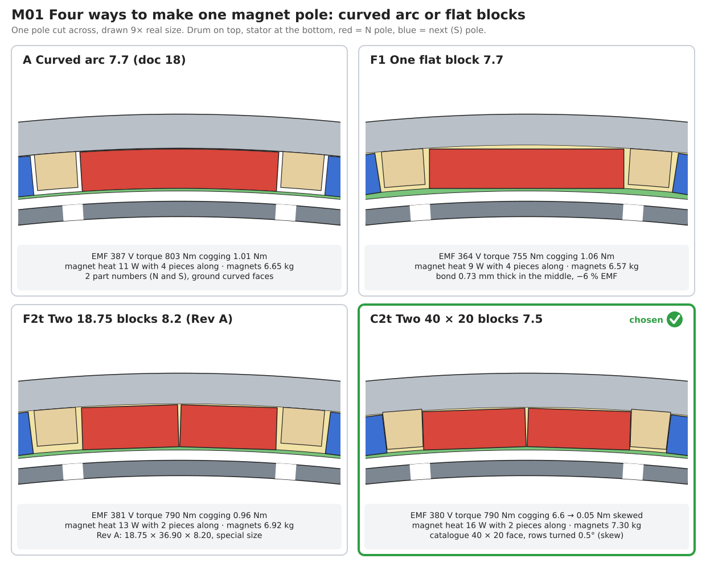

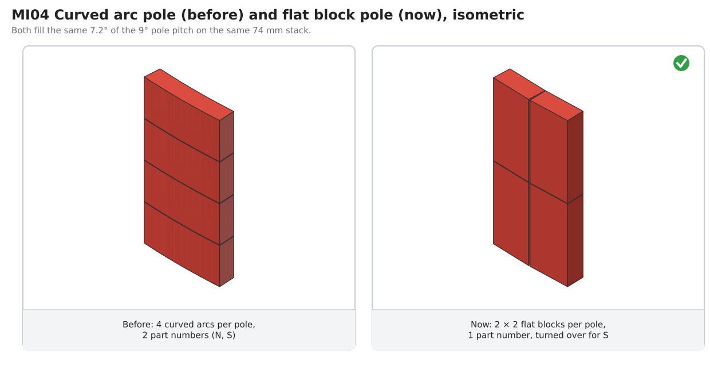

---

## 1. What was fixed before and what was open

From docs 06, 14 and 18: 40 poles, 45 slots, outer rotor, stator tip radius
299.0 mm, mechanical gap 2.0 mm to a 0.5 mm glass-epoxy sleeve (moulded on a
Ø602.0 mandrel, doc 18 §6.7), N40UH magnets 7.70 mm thick, pole span 0.80 of
the 9° pole pitch (7.20°), stack 74 mm, 40 G11 comb bars between the poles,
room-temperature toughened epoxy with 0.15 mm glass beads.

Open before this document:

| # | Open point | Closed by |
|---|---|---|
| 1 | Magnet axial segmentation not confirmed by an eddy-loss calculation (doc 14 open point 3, doc 18 M8) | §3: eddy loss computed for every shape and segmentation |
| 2 | Arcs need two part numbers (doc 18 M7), arc radii and radial orientation are the hardest features to buy and check | §2, §5: flat blocks, one part |
| 3 | Seat diameter did not include the bond line | §4: seat Ø618.65 (Rev A Ø620.00) |
| 5 | (Rev B) Use the catalogue 40 × 20 mm size | §13 |
| 4 | Retention and tolerances never written down for the magnet itself | §6, §7 |

## 2. The options compared

Seven shapes were run in Rev A, and four 40 × 20 cases in Rev B (§13), through the same 2D nonlinear FEA (the doc 05/06 model,
extended so that a magnet of any shape can sit on the fixed mesh). Every case
uses the real P1 radii, the 0.15 mm bond line, the moulded sleeve bore
r 301.0, a magnet inner face at r 301.5 on the pole (or block) centre line, the
drum shell to r 323, the 74 mm stack, magnets at 100 °C and the same stator
current (the doc 06 sizing current, 22.6 A rms with 28 turns).

| Key | Shape | Seat Ø | Magnets | Line EMF | Torque | Cogging p-p | Ripple | Line THD | Eddy loss, 2 / 4 pieces along | Demag margin |
|---|---|---|---|---|---|---|---|---|---|---|
| A | Arc 7.20°, 7.70, radial (doc 18) | 618.70 | 6.65 kg | 387.4 V | 803 Nm | 1.02 Nm | 1.75 % | 0.50 % | 27.4 / 10.9 W | 27.7 % |
| F1 | 1 flat block 37.94 wide, 7.70 | 619.86 | 6.57 kg | 364.3 V | 755 Nm | 1.06 Nm | 1.21 % | 0.25 % | 22.7 / 9.0 W | 28.5 % |
| F2 | 2 flat blocks 18.75 wide, 7.70 | 618.98 | 6.50 kg | 375.5 V | 779 Nm | 1.06 Nm | 1.54 % | 0.36 % | 13.2 / 8.0 W | 31.3 % |
| F3 | 3 flat blocks 12.43 wide, 7.70 | 618.83 | 6.46 kg | 376.2 V | 780 Nm | 1.58 Nm | 1.66 % | 0.44 % | 7.8 / 5.7 W | 30.2 % |
| F2w | 2 blocks 19.70 wide (span 0.84), 7.70 | 619.01 | 6.82 kg | 381.7 V | 792 Nm | **5.40 Nm** | 2.40 % | 0.80 % | 14.3 / 8.4 W | 30.5 % |
| F2t | 2 blocks 18.75 wide, 8.20 (Rev A) | 619.98 | 6.92 kg | 380.8 V | 790 Nm | 0.96 Nm | 1.56 % | 0.40 % | 12.8 / 7.7 W | 32.2 % |
| F2wt | 2 blocks 19.70 wide, 8.00 | 619.61 | 7.09 kg | 384.9 V | 799 Nm | **5.53 Nm** | 2.40 % | 0.82 % | 14.0 / 8.3 W | 31.0 % |
| C1 | 1 block 40 wide, 4 × 20 along, 8.20 | 620.99 | 7.98 kg | 374.9 V | 778 Nm | 2.73 Nm | 2.00 % | 0.67 % | 10.0 W (4 × 20) | 28.7 % |
| C2 | 2 blocks 20 wide, 2 × 40 along, 8.20 | 620.02 | 7.98 kg | 388.7 V | 807 Nm | **6.89 Nm** | 2.80 % | 0.97 % | 14.8 W (2 × 40) | 31.2 % |
| **C2t** | **2 blocks 20 wide, 2 × 40 along, 7.50** | **618.62** | **7.30 kg** | **381.1 V** | **791 Nm** | **6.64 Nm** (skewed < 0.1) | 2.83 % (skewed 1.97 %) | 0.92 % | **15.5 W (2 × 40)** | **29.8 %** |
| C2s | 2 blocks 20 wide, 2 × 40 along, 7.00 | 617.62 | 6.81 kg | 374.8 V | 777 Nm | 6.41 Nm | 2.83 % | 0.89 % | 16.0 W (2 × 40) | 28.7 % |

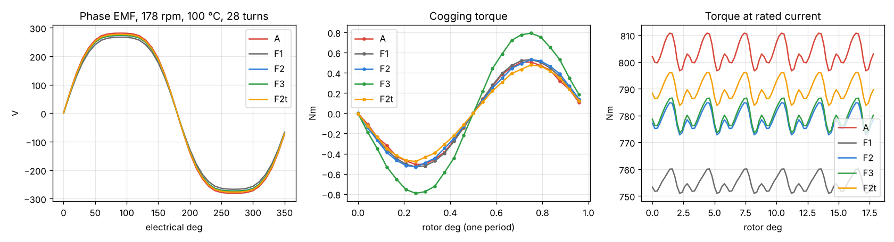

What the table says:

- **Flat blocks lose EMF because they hold less magnet, not because they are
  flat.** With 2 or 3 blocks the loss is the same 3 %: blocks that fit the
  pole at the inner face leave small wedge-shaped gaps towards the drum, so
  2 to 3 % less magnet. One wide block (F1) loses 6 % because its edges stand
  0.6 mm further from the stator.
- **Widening the pole is a trap.** Span 0.84 (F2w, F2wt) wins the EMF back but
  lands on a cogging peak of the 40/45 combination: 5.4 Nm instead of 1 Nm,
  and the ripple and EMF distortion double. Rev A therefore kept the doc 06
span of 0.80. Rev B accepts 0.85 (set by the 20 mm catalogue width) and
removes the cogging peak with a step skew of the two rows (§13.4).
- **A 0.5 mm thicker block (F2t) wins the EMF back** without touching the
  span, the stator or the winding: 381 V at 28 turns (doc 06 target 380 V),
  cogging and ripple slightly lower than the arcs, best demagnetisation
  margin. It costs 0.27 kg more magnet, 0.8 mm on the seat diameter and
  0.5 mm of drum yoke (13.0 mm left under the seat; the doc 06 FEA used 12 mm).
- **Three blocks (F3)** would cut the eddy loss further but raise cogging
  (1.6 Nm) and give 240 small pieces. No reason to go there.
- **Demagnetisation.** Worst case is the doc 06 transient short circuit (2 ×
  the steady short-circuit current, d-axis, magnets at 120 °C). All flat
  shapes are better than the arcs. Note: in the first run the flat shapes
  showed a false demagnetising peak in mesh elements cut by the slanted block
  sides; the check now uses only elements fully inside a magnet (as for the
  arcs, whose edges follow the mesh).

Rev A chose F2t. **Rev B chooses C2t** (40 × 20 × 7.50, rows skewed 0.50°,
§13); the rest of this document defines C2t. The C cases are computed on the
74 mm stack; the 3.1 mm overhang at each end is not in the 2D model.

## 3. Magnet eddy loss and segmentation (closes doc 14 point 3, doc 18 M8)

Method: time-stepped FEA at rated load over one electrical period (90 steps;
the stator-frame field repeats every 18° of rotation, so 4 periods of the
rotor-frame history are built from it exactly), field history followed in
every magnet node in the rotor frame, eddy current density σ·(−∂A/∂t) with
**zero net current in each piece**, resistivity 1.5 µΩ m. The 2D result is
for infinitely long pieces; the finite length of each piece is applied with
the exact factor for a rectangle in a uniform alternating field (the Prandtl
torsion analogy). The dominant field frequencies seen by the magnets are
44.5, 89, 133.5 and 178 Hz: the 40/45 winding's space harmonics, not slot
ripple, so the skin depth (> 25 mm) is far larger than the magnet and the
resistance-limited method is valid.

| Pieces along the stack | 1 | 2 | 3 | 4 | 6 |
|---|---|---|---|---|---|
| A, arc 38 mm wide | 45.3 W | 27.4 W | 16.7 W | 10.9 W | 5.5 W |
| **F2t, block 18.75 wide** | 15.8 W | **12.8 W** | 10.0 W | 7.7 W | 4.7 W |
| F3, block 12.4 wide | 8.8 W | 7.8 W | 6.7 W | 5.7 W | 4.1 W |
| C2t, block 20 wide (on 74 mm) | 18.7 W | 14.9 W | 11.5 W | 8.7 W | 5.2 W |

Result: **2 blocks along the stack**. For Rev B (two 40 mm blocks, the
whole 80.2 mm in the field) the loss is **15.5 W** at rated speed and about
30 W at the 250 rpm design overspeed (loss ∝ speed²); Rev A had 12.8 W. Doc 06 assumed 40 W rotor loss;
the magnets sit on the drum, which is cooled by the outside air, so their
temperature rise from this is a few kelvin. Going to 4 blocks along would
save 5 W for twice the pieces and three shim gaps instead of one, and is not
worth it.

PWM ripple from the SiC active rectifier (doc 12) adds little: with
Ld ≈ 14 mH the switching ripple current is well under 1 A, against 23 A
rated. It is checked on the bench by the magnet temperature probe (doc 15).

## 4. Final geometry

### 4.1 The block NP1-220 Rev D

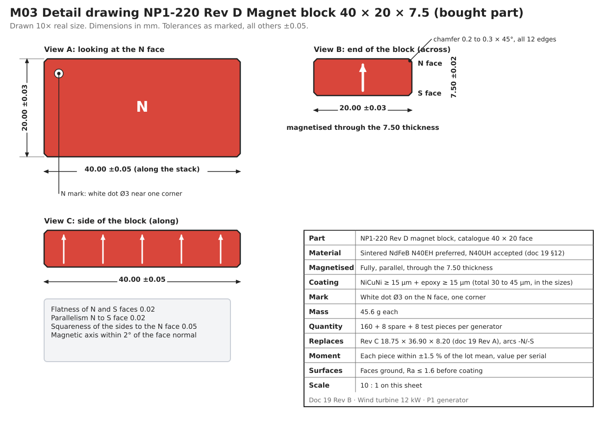

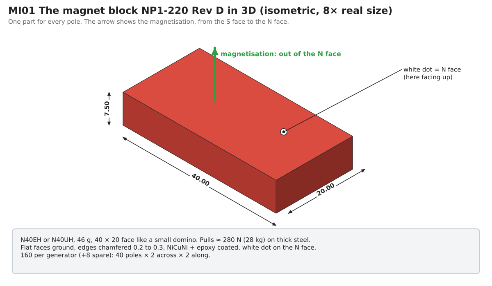

| Feature | Value |
|---|---|
| Size | **20.00 ±0.03 (across) × 40.00 ±0.05 (along) × 7.50 ±0.02 (thickness)**; catalogue 40 × 20 face |
| Edges | Chamfer 0.2 to 0.3 × 45° on all 12 edges |
| Faces | N and S faces ground, flatness 0.02, parallelism 0.02; sides square to the N face within 0.05 |
| Magnetisation | Parallel, through the 7.50 thickness, fully saturated; magnetic axis within 2° of the face normal |
| Mass | 45.6 g |
| Count | 160 per generator + 8 spare + 8 test pieces (unmagnetised acceptable) for Q1 |
| Marking | White dot Ø3 on the N face near one corner |

### 4.2 One part, two poles

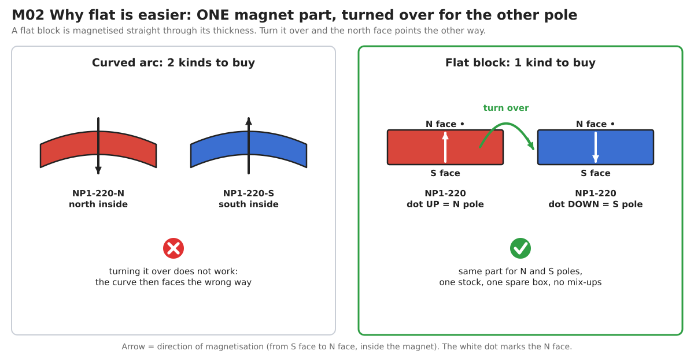

At an N pole the block goes in **dot up** (N face towards the stator); at an S
pole the same block goes in **dot down** (N face against the drum). This
removes doc 18 M7 completely: one part number, one stock, one spare box.

### 4.3 The pole on the drum

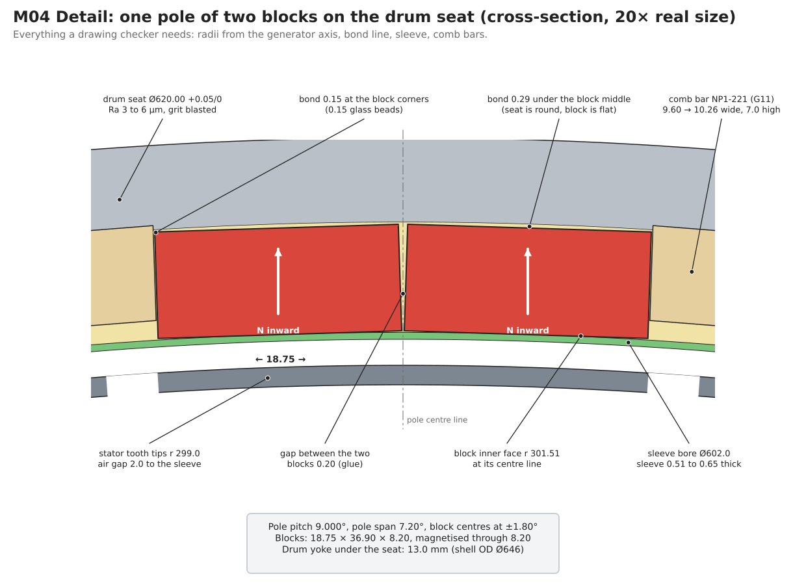

| Feature | Value (radii from the generator axis) |
|---|---|
| Pole pitch / span | 9.000° / 7.64° (0.85); block centre lines at ±1.92° from the pole centre |
| Step skew | **Front row pole centres −0.25°, rear row +0.25°** from the nominal pole centre (0.50° = 2.7 mm at the seat) |
| Drum seat | **Ø618.65 +0.05/0**, **x 332 to 428** (96 long; was x 335 to 425), run-out ≤ 0.02 to the cup seats, Ra 3 to 6 µm after grit blasting |
| Bond line | 0.15 at the block corners (0.15 mm glass beads), 0.31 under the block middle |
| Block inner face | r 301.51 at the block centre line, r 301.68 at the block edges |
| Sleeve | Moulded on the Ø602.0 mandrel: 0.51 thick at the block centres, 0.68 at the block edges; sleeve length x 332 to 428 |
| Gap between the two blocks of a pole | 0.20 at the inner corners, widening to 0.70 at the outer corners (glue) |
| Comb bars NP1-221 | G11, trapezoid 7.04 (inner) to 7.67 (seat side) × 7.0 high × **44.0 long, two per pole gap** (front bar x 336 to 380, rear bar x 380 to 424, rear bar turned 0.50°), faces at 2.58° to the bar centre line so they lie flat against the neighbouring blocks; 80 + 8 spare |
| End rings NP1-222 | G11, OD Ø618.65 −0.1/−0.2, ID Ø604.0, **7.9 wide**, 40 notches for the comb bar ends; the rear ring is clocked 0.50° against the front ring |
| Axial layout | Block rows **x 339.9 to 379.9 and x 380.1 to 420.1** (stack x 343 to 417: 3.1 mm overhang at each end), 0.2 mm PTFE shim between rows (removed after cure) |
| Drum yoke under the seat | 13.7 mm (shell OD Ø646 unchanged; the Ø646 band grows to x 332 to 428 with the seat) |

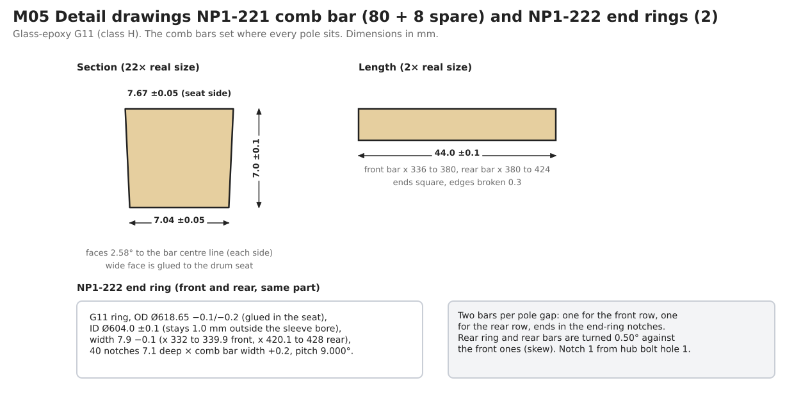

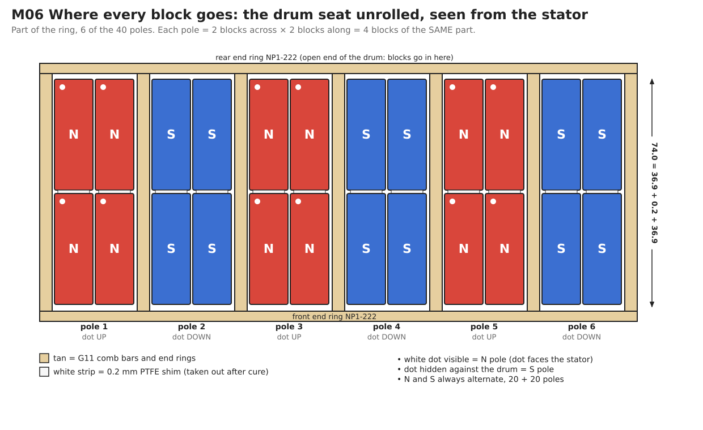

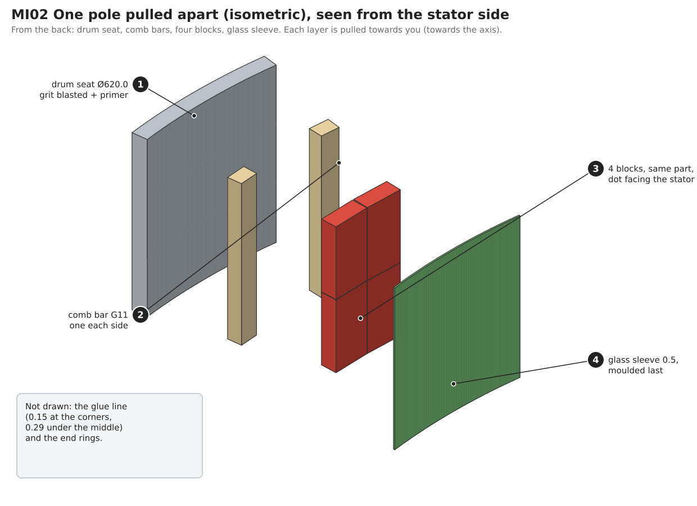

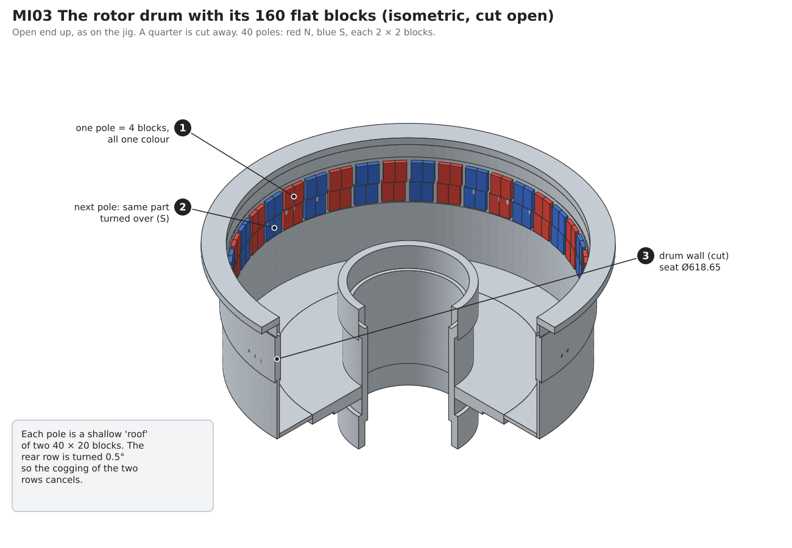

The two blocks of one pole **push each other apart** (same polarity side by
side), so each one settles against its own comb bar by itself. The comb bars
therefore set the pole position, and the 0.20 mm centre gap fills with glue.
Because the front and rear rows have their own comb bars, the 0.50° skew is
set simply by where the bars sit: the front ring and bars on the nominal
grid −0.25°, the rear ones +0.25°, both from the same indexing template
(two marked positions).

## 5. Flat or arc: buying and making

| Aspect | Arc segments (doc 18) | Flat 40 × 20 blocks (Rev B) |
|---|---|---|
| How the maker produces it | Pressed in a radially oriented die (tooling per size) or cut from blocks with much waste; both radii ground with profiled wheels | Sliced from standard pressed and sintered blocks; the 40 × 20 face is a stock size, only the 7.50 thickness is ground to order; no tooling |
| Tolerances commonly held | Thickness ±0.05, radii ±0.05, arc angle ±0.1° | ±0.02 to ±0.05 on every size, flatness 0.02 |
| Magnetisation | "Radial" for a 7.2° segment is in practice parallel along the centre line; needs a shaped fixture | Parallel through thickness, the standard case for every maker |
| Polarity variants | 2 part numbers (curve fits one way only) | 1 part number |
| Coating | Even coat on curved faces is harder; thin arc edges chip | Even coat on flat faces, chamfered edges |
| Incoming inspection | Radius gauges or CMM | Micrometer and go/no-go gauges |
| Typical lead time (sintered NdFeB, custom size) | 6 to 10 weeks incl. tooling and first article | 3 to 6 weeks after drawing approval |
| Number of qualified makers | Fewer (radial tooling) | Many |
| Effect on the machine | Reference | −2 % EMF at the same turns (chosen to hit the 380 V target); cogging and ripple as low as the arcs only with the 0.50° row skew |

## 6. Retention: what holds the magnets

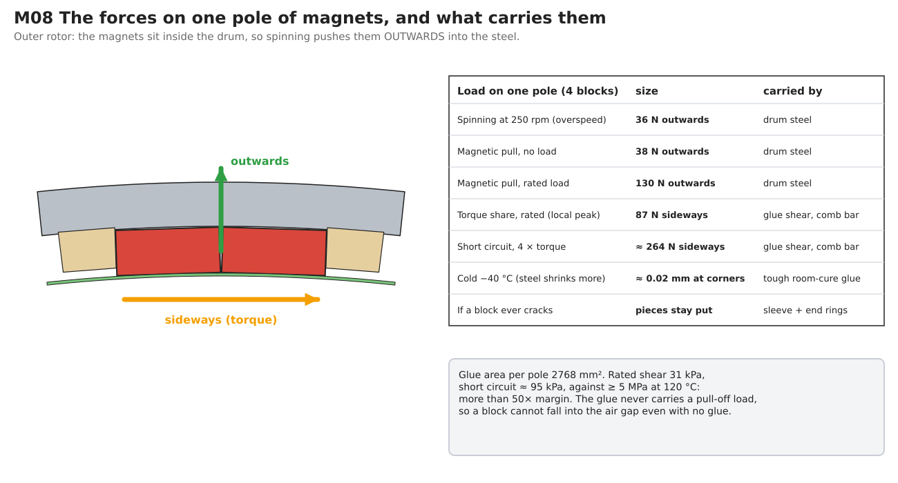

| Load (one pole, 4 blocks) | Value (from FEA unless noted) | Carried by |
|---|---|---|
| Centrifugal at 250 rpm | 38 N outwards (hand calculation) | Drum steel (outer rotor) |
| Net magnetic force, no load | 37 N outwards | Drum steel |
| Net magnetic force, rated load | 131 N outwards | Drum steel |
| Tangential, rated load (local peak on one pole) | 85 N | Glue shear and comb bars |
| Tangential, short circuit (4 × torque) | ≈ 260 N | Glue shear and comb bars |
| Differential shrinkage steel/NdFeB, 20 to −40 °C | ≈ 0.02 mm at the block corners | Toughened room-cure glue (qualified on Q1) |

Glue area per pole is 3,200 mm², so the rated shear is 27 kPa and the short
circuit case about 83 kPa, against ≥ 5 MPa adhesive strength at 120 °C: more
than 50 × margin. Every radial load pushes the blocks into the drum, so the
glue never carries a pull-off load. Three independent things keep a block
out of the air gap: the glue, the comb bars and end rings, and the moulded
glass sleeve over all magnets (it also holds the pieces if a block ever
cracks). The thermal-mismatch movement at the block corners is set by the
half-diagonal of the block (22.4 mm), almost the same as the doc 18 arc
(21.5 mm), so the doc 18 adhesive choice and the Q1 cold-cycling test stand
unchanged; Q1 must use real NP1-220 Rev D blocks. The 3.1 mm of block that
overhangs the stack at each end still sits fully on the seat and under the
sleeve.

## 7. Tolerances

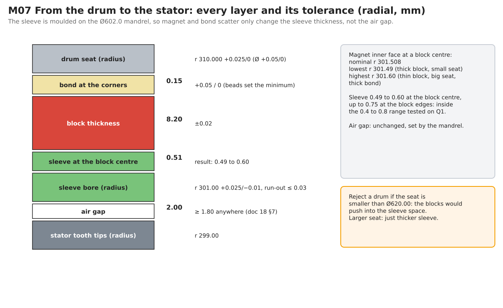

**Radial.** The sleeve is moulded on the mandrel, so the magnet and bond
scatter only change the sleeve thickness, not the air gap (doc 18 M6). With
seat +0.05/0 on the diameter, bond +0.05/0 and block ±0.02, the inner face at
a block centre lies between r 301.49 and r 301.61: the sleeve is 0.49 to 0.61
at the block centres and up to 0.78 at the block edges, inside the 0.4 to 0.8
range to be qualified on Q1. A drum with a seat smaller than Ø618.65 is
rejected. The doc 14 air gap budget item "magnet thickness and bond line
0.050" drops out of the gap budget (it is replaced by the mandrel and sleeve
bore tolerance already in doc 18 §6.8).

**Across and along.** Block width ±0.03 gives a centre gap between the two
blocks of 0.14 to 0.26 mm (never touching, glue fills it). The comb bar width
±0.05 and the 0.1 mm glue clearance per side keep the pole span within
±0.02°. Block length ±0.05 with the 0.2 mm shim keeps the rows within
80.2 ±0.15, so the overhang is 3.1 ±0.2 at each end; the stator stack
tolerance no longer matters because the magnets are longer than the stack.
**The skew angle matters:** in the FEA a mean skew of 0.45° or 0.55° leaves
1.0 Nm, 0.40° or 0.60° leaves 2.0 Nm, 0.50° leaves < 0.1 Nm. The two
template positions (front and rear) are therefore machined 0.50 ±0.02°
apart (±0.11 mm at the seat), which keeps it below about 0.5 Nm. Random
errors of single poles average out over the 40 poles and are covered by
the scatter study below.

**Magnetic.** Tolerance study (pole remanence and position scatter,
cogging over a full slot pitch; the 72° FEA section repeats the scatter
pattern five times, so this is an indication, not a statistical result).
For Rev B the same scatter is applied to both rows of a pole:

| Case | Rev A (F2t) | Rev B (C2t), no skew | **Rev B, rows skewed 0.50°** |
|---|---|---|---|
| Nominal | 0.96 Nm | 6.64 Nm | **0.02 Nm** |
| Poles sorted to ±0.5 %, strong next to weak (doc 18 sorting rule) | 1.14 Nm | 6.88 Nm | **0.24 Nm** |
| Unsorted, every pole random within ±1.5 % | 2.74 Nm | 8.03 Nm | 1.37 Nm |
| One pole 3 % weak (e.g. a chipped block) | 2.41 Nm | 7.82 Nm | 1.28 Nm |
| Pole centres random within ±0.05° (±0.26 mm at r 301) | 2.35 Nm | 7.70 Nm | **1.13 Nm** |
| Pole centres random within ±0.10° (doc 18 pole-map limit) | 8.50 Nm | 13.2 Nm | 6.32 Nm |
| Pole centres random within ±0.25° | 14.8 Nm | 16.7 Nm | 10.8 Nm |

With the skew, Rev B is as good as or better than Rev A in every scatter
case; without it, it is 3 to 7 times worse. The tolerance rules below apply
unchanged.

Conclusions:

- **Remanence:** sorting matters. Unsorted pieces (±1.5 %) almost triple the
  cogging; the doc 18 sorting rule (poles within ±0.5 %, strong next to weak)
  keeps it at 1.1 Nm. Keep it.
- **Pole position matters much more than remanence.** At the doc 18 pole-map
  limit of ±0.1° the cogging rises to about 8.5 Nm (1.2 % of rated torque).
  The section model repeats the error pattern five times, which adds the
  errors coherently, so the real value over 40 independent poles is lower,
  but the trend is clear. **Tighten the comb bar placement to ±0.03° (±0.16 mm
  at the seat) and the pole-map acceptance to ±0.05°** (doc 18 §6.4 and §6.6).
  With trapezoid comb bars in notched end rings and blocks that push
  themselves against the bars, ±0.05° is reachable with the aluminium
  indexing template already planned.

## 8. Purchase specification NP1-220 Rev D (send with drawing M03)

| Item | Requirement |
|---|---|
| Part | NP1-220 Rev D magnet block 40 × 20 × 7.5, drawing M03 (doc 19 Rev B) |
| Material | Sintered NdFeB (GB/T 13560 designation), quote both: **N40EH preferred** (Br ≥ 1.25 T, HcJ ≥ 2,388 kA/m / 30 kOe) and **N40UH accepted** (Br ≥ 1.26 T, HcJ ≥ 1,990 kA/m / 25 kOe), values at 20 °C (§12). Grain-boundary-diffused Dy/Tb grades accepted if they meet all values |
| Export | State country of manufacture, origin of the Dy/Tb, and lead time including any export licence |
| Test data per lot | J-H and B-H demagnetisation curves at 20, 60, 100, 120 and 150 °C on samples from the lot; temperature coefficients of Br and HcJ; density |
| Size | 40.00 ±0.05 × 20.00 ±0.03 × 7.50 ±0.02 mm **including coating**; chamfer 0.2 to 0.3 on all edges; flatness and parallelism of the pole faces 0.02. A stock 40 × 20 block ground to 7.50 is welcome; state if a stock thickness is offered instead (§13.4) |
| Magnetisation | Parallel through the 7.50 dimension, fully saturated; deviation of the magnetic axis from the face normal ≤ 2° |
| Uniformity | Magnetic moment (Helmholtz coil) of every piece measured and reported against its serial; all pieces within ±1.5 % of the lot mean |
| Coating | NiCuNi ≥ 15 µm + epoxy ≥ 15 µm; ≥ 500 h neutral salt spray (ISO 9227) without red rust; cross-cut adhesion class 0 to 1; adhesion of the chosen structural adhesive to the coating approved by the adhesive maker |
| Corrosion of the bare alloy | Low-weight-loss grade: PCT 121 °C, 2 bar, 100 % RH, 96 h, weight loss ≤ 5 mg/cm² |
| Marking | White dot Ø3 on the N face, one corner; lot number on every box |
| Quantity | 168 magnetised + 8 test pieces (unmagnetised acceptable) per generator |
| Packaging | Every block in its own non-magnetic spacer, alternating (repelling) layout, steel-shielded box meeting the IATA PI 953 field limit for air freight |
| First article | 5 pieces measured (size, moment, coating thickness, one demagnetisation curve) and approved before the lot is released |
| Documents | Material certificate, per-piece moment list, coating report, salt-spray and PCT reports, RoHS/REACH declaration |

## 9. Incoming inspection and bonding

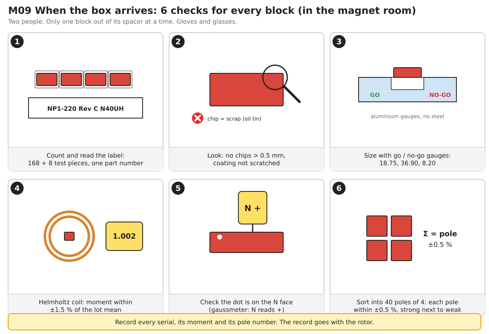

Incoming inspection replaces doc 18 §6.5 "receive and sort": count, look
(no chips > 0.5 mm), size with aluminium go/no-go gauges, moment in the
Helmholtz coil (±1.5 % of the lot mean, within ±1 % of the supplier's value),
check the dot is on the N face with the gaussmeter, then **sort into 40 poles
of 4 blocks** with pole sums within ±0.5 %, strong and weak poles alternating.

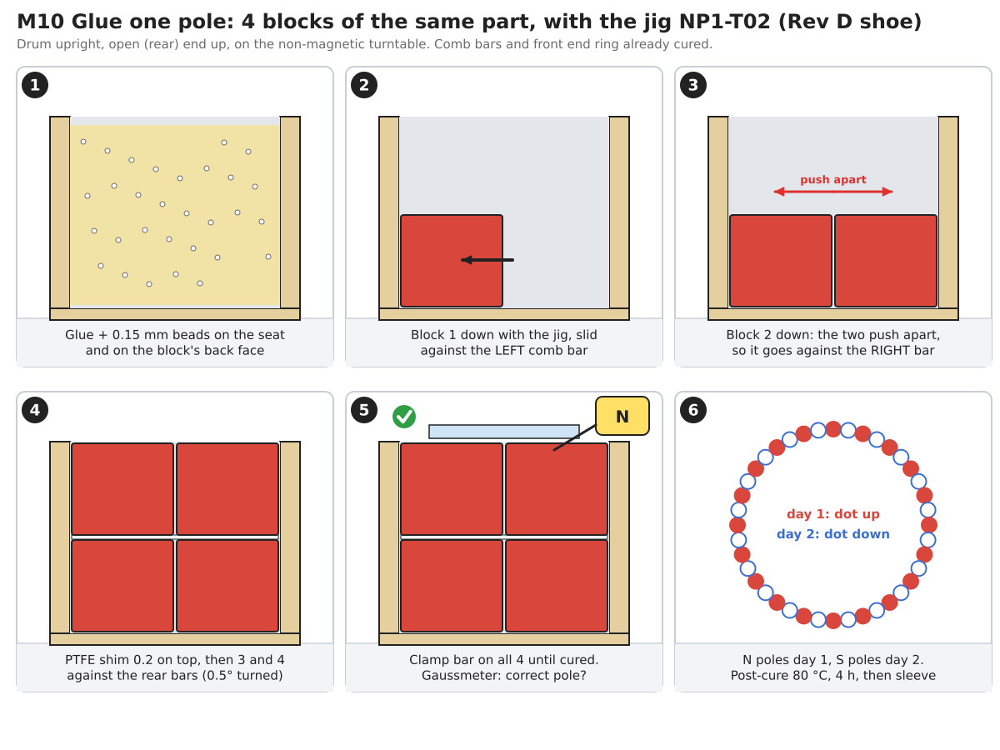

Bonding is as doc 18 §6.4 and §6.5 with these changes:

1. Comb bars NP1-221 are trapezoid (wide face on the seat), **two per pole
   gap** (front row and rear row), and their outer ends sit in the notches of
   the end rings NP1-222; locate notch 1 from hub bolt hole 1. The indexing
   template has two positions per gap: front −0.25°, rear +0.25° from the
   nominal pole centre line (0.50 ±0.02° apart). The rear ring is clocked to
   the rear bars.
2. The jig NP1-T02 gets a **Rev D shoe**: a flat POM pocket 20.10 × 40.10 with
   the block held dot up (N poles) or dot down (S poles).
3. Per pole: block 1 against the left front comb bar, block 2 next to it (it
   moves against the right bar by itself), PTFE shim 0.2, then blocks 3 and 4
   the same way against the rear bars (0.50° turned), clamp bar on all four
   until cured. The blocks start 3.1 mm before the stack (x 339.9), on the
   front end ring.
4. N poles first (all 20, dot up), cure, then S poles (dot down); gaussmeter
   check of every pole before the glue gels.
5. Pole map (doc 18 §6.6) with the pole centre limit tightened to **±0.05°**
   (§7), measured on each row separately; the rear row must read 0.50 ±0.02°
   after the front row on average over the 40 poles. The axial uniformity
   check looks for a dip over the single row joint at x 380.
6. Comb bars are placed with the indexing template to **±0.03°** (±0.16 mm).

## 10. Changes to other documents

| Document | Change |
|---|---|
| Doc 14 §4.5 | Magnets are 160 flat blocks NP1-220 Rev D, 40 × 20 × 7.50 (2 × 2 per pole, rows skewed 0.50°, 3.1 mm overhang each end); segmentation confirmed |
| Doc 14 §5.2 | Remove "magnet thickness and bond line 0.050" from the air gap budget (mandrel-moulded sleeve) |
| Doc 14 open point 3 | Closed by §3 |
| Doc 18 §0 table, App. B | Magnets: 160 + 8 flat blocks 45.6 g, 7.30 kg; seat Ø618.65 × 96; EMF ≈ 380 V at 100 °C (2D, plus 0 to 2 % from the overhang), worst-case peak ≈ 895 to 910 V (28 turns) |
| Doc 18 M7, M8 | Closed (one part number; eddy loss done) |
| Doc 18 §4.2 | Comb bars: G11 trapezoid 7.04/7.67 × 7.0 × 44, 80 + 8 (NP1-221); end rings NP1-222 7.9 wide with notches, rear ring clocked 0.50° |
| Doc 18 §4.3 | Replace by §8 of this document |
| Doc 18 §6.3, drum NP1-210 | Magnet seat **Ø618.65 +0.05/0, x 332 to 428** (was Ø618.4, x 335 to 425); the thick shell band (OD Ø646) grows by 3 mm at each end to match |
| Doc 18 §6.7 | Sleeve mould length x 332 to 428 (covers the overhanging blocks and both end rings) |
| Doc 18 §6.4, §6.5 | As §9 of this document; comb bar placement ±0.03° (was ±0.05°) |
| Doc 18 §6.6 | Pole centre acceptance ±0.05° (was ±0.1°) |
| Doc 06 | Rotor loss 40 W confirmed (magnet eddy 15.5 W at rated) |
| `cad/nacelle_p1/geometry.py` | `MAGNET` still describes the doc 18 arcs; switch to `magnet_geom.py` values when doc 18 goes to Rev B (after Q1) |

## 11. Open items

| # | Item | Owner | Due |
|---|---|---|---|
| 1 | Approve this magnet definition (Rev B: 40 × 20 × 7.50 blocks, rows skewed 0.50°) | Martin | Now |
| 2 | Send §8 and drawing M03 for quotation (N40EH and N40UH) to at least three makers, at least one outside China; first article 5 pieces | Cat. 10 | Week 1 |
| 3 | Order 8 test pieces early for the Q1 magnet panels (unmagnetised acceptable) | Cat. 10 | Week 1 |
| 4 | Drawings NP1-221 comb bar, NP1-222 end ring, jig shoe NP1-T02 Rev D, indexing template with the two skew positions; drum drawing NP1-210 seat Ø618.65 × 96 | Cat. 4/10 | Week 2 |
| 4a | Measure the no-load EMF and cogging on Q1/P1 and compare with §13 (overhang and skew are 2D estimates); turn count 27 or 28 is the lever if the EMF comes out high | Cat. 11 | Bench T1 |
| 5 | Update doc 18 to Rev B with §10 (after Q1) | Cat. 10 | Weeks 3 to 8 |
| 6 | Bench check of magnet temperature at rated load (confirms §3) | Cat. 11 | Bench T2 |

## 12. Magnet grade assessment

Question (Martin, 2026-11-05): which grade is best for this generator, which
is easiest to buy, and which is feasible?

### 12.1 What the grade must do

The grade sets two things on the fixed block size: the **EMF** (through the
remanence Br) and the **resistance to demagnetising** in the worst fault
(through the intrinsic coercivity HcJ, which falls as the magnet warms). The
design case is the doc 06 transient short circuit with the magnets at
**120 °C**; a margin of at least **20 %** between the worst field in the
magnet and HcJ is required. 150 °C is run as an extra check, because the
magnet temperature in service is still a model value until the bench test.

Every grade was run on the final geometry with its catalogue minimum
values ([`grades.py`](../analysis/generator/grades.py) →
[`grades_summary_C2t.json`](../analysis/generator/results/grades_summary_C2t.json)
for Rev B; Rev A in `grades_summary.json`). EMF values include the 0.4 % skew loss.

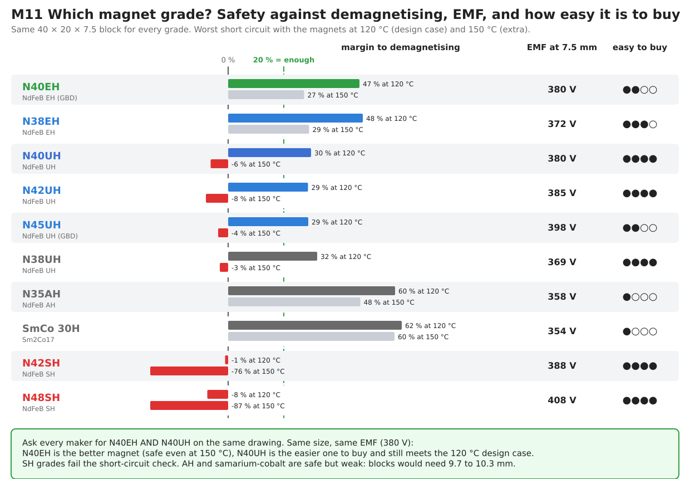

| Grade | Br / HcJ at 20 °C (min) | Line EMF, 7.50 mm block | Block for 380 V | Margin at 120 °C | Margin at 150 °C | Heavy rare earth (Dy/Tb) |
|---|---|---|---|---|---|---|
| N42SH | 1.29 T / 1,592 kA/m | 388 V | 6.8 mm | **−1 %** (fails) | −76 % | low, ≈ 2 to 4 % |
| N48SH | 1.37 T / 1,592 kA/m | 408 V | 5.1 mm | **−8 %** (fails) | −87 % | low |
| N38UH | 1.22 T / 1,990 kA/m | 369 V | 8.6 mm | 32 % | −3 % | ≈ 4 to 6 % |
| **N40UH** | 1.26 T / 1,990 kA/m | **380 V** | 7.5 mm | **30 %** | −6 % | ≈ 4 to 6 % (≈ 1 % with GBD) |
| N42UH | 1.28 T / 1,990 kA/m | 385 V | 7.0 mm | 29 % | −8 % | ≈ 4 to 6 % |
| N45UH (GBD) | 1.32 T / 1,990 kA/m | 399 V | 5.8 mm | 29 % | −4 % | ≈ 1 to 2 % Tb |
| N38EH | 1.22 T / 2,388 kA/m | 372 V | 8.3 mm | 48 % | 29 % | ≈ 6 to 9 % |
| **N40EH (GBD)** | 1.25 T / 2,388 kA/m | **380 V** | 7.5 mm | **47 %** | **27 %** | ≈ 1.5 to 3 % Tb |
| N35AH | 1.17 T / 2,786 kA/m | 358 V | 9.7 mm | 60 % | 48 % | ≈ 9 to 12 % |
| SmCo 30H (Sm2Co17) | 1.08 T / 1,990 kA/m | 354 V | 10.3 mm | 62 % | 60 % | none (samarium and cobalt instead) |

Rev B margins are 1 to 3 points lower than Rev A's (thinner block, wider
pole), and the ranking is unchanged.

"Block for 380 V" is an estimate from the EMF slope found in §2; anything
other than about 7.5 mm means new block, seat and sleeve numbers. Heavy rare
earth contents are typical industry values, not supplier data.

### 12.2 Sourcing (status 2026-11-05)

- **Every grade that passes contains dysprosium or terbium** (or, for SmCo,
  samarium). China's MOFCOM Announcement No. 18 (4 April 2025) puts seven
  medium and heavy rare earths, including Dy, Tb and Sm, **and magnets
  containing them** under export licensing. It has never been suspended:
  each shipment needs a licence, unless the maker holds one of the
  year-long general licences issued since December 2025 (first to JL MAG,
  Zhong Ke San Huan and Yunsheng). Dy and Tb exports are reported at about
  half their earlier level.
- A wider second wave of controls announced in October 2025 was suspended,
  and **that suspension runs out on 10 November 2026**, five days after this
  document. What follows is not known yet, so quotes should state the lead
  time including any export licence.
- **Makers outside China** produce UH and EH grades: in Japan (Shin-Etsu,
  Proterial, TDK), in Germany (VAC) and, since 2025, in Estonia (Neo
  Performance Materials, Narva). They are usually dearer and prefer larger
  orders; 7 kg per generator is small, so a distributor may be needed.
  Their plants also depend partly on Chinese heavy rare earth feed.
- **UH grades are the most common high-temperature grades**: wind, servo and
  traction motors use them, many makers stock the alloy, and N40UH and
  N42UH are standard. **EH grades** are made by fewer makers; N40EH needs
  grain-boundary diffusion (GBD) of terbium, which only the larger makers
  run. **AH and SmCo** are specialist products with few makers, long lead
  times and the highest prices.

### 12.3 Ranking

| Rank | Grade | Best for the turbine | Easy to buy | Feasible for P1 |
|---|---|---|---|---|
| 1 | **N40EH (GBD)** | ★★★★ Same size and EMF as N40UH, safe even at 150 °C (27 %) | ★★ Larger makers only, Tb content | **Yes: drop-in on the same drawing, ask for it** |
| 2 | **N40UH** | ★★★ Meets the 120 °C case with 30 %, no reserve at 150 °C | ★★★★ Standard grade, many makers | **Yes: current choice, safe fallback** |
| 3 | N38EH | ★★★ Like N40EH but 2 % less EMF (block 8.3 mm or 29 turns) | ★★★ Common EH grade | Yes, with a geometry change |
| 4 | N42UH | ★★★ +1.4 % EMF over N40UH, same margin | ★★★★ | Yes, drop-in (EMF slightly above target) |
| 5 | N45UH (GBD) | ★★ High EMF, but no reserve at 150 °C | ★★ | Only with a thinner block (5.8 mm) |
| 6 | N38UH | ★★ Low EMF | ★★★★ | Needs 8.6 mm block |
| 7 | N35AH | ★★ Very safe, low EMF | ★ | Needs 9.7 mm; long lead time |
| 8 | SmCo 30H | ★★ Most temperature-proof, low EMF, brittle | ★ | Needs 10.3 mm and a new drum seat; costly |
| – | N42SH, N48SH | ✗ Demagnetise in the worst short circuit | ★★★★ | **No** (as doc 06 found for N42SH) |

**Recommendation.** Keep the drawing as it is (40 × 20 × 7.50) and ask
every maker to quote **N40EH (preferred) and N40UH (accepted)** on the same
drawing. Both give 380 V. N40EH gives 27 % margin even at 150 °C, which
covers an error in the magnet temperature model at no cost in size or EMF.
N40UH meets the 120 °C design case with 30 % margin and is the easier part
to buy. Choose N40EH if a qualified maker can deliver it, with its export
licence, inside the 8 to 12 weeks planned in doc 18; otherwise N40UH. The
bench test (doc 15) measures the real magnet temperature and settles which
grade the production version needs.

## 13. Rev B: 40 × 20 mm catalogue blocks

Question (Martin, 2026-11-05): adjust the design for 40 × 20 magnets.

### 13.1 Two ways to lay a 40 × 20 block

"40 × 20" is taken as the face size of the block; the thickness (the
magnetised direction) stays free, because makers grind it to order from
stock blocks. The pole pitch at the magnet face is 47.4 mm and the stack
74 mm, so the block can lie two ways:

| | C2 / C2t: 20 across, 40 along | C1: 40 across, 20 along |
|---|---|---|
| Blocks per pole | 2 across × 2 along | 1 across × 4 along |
| Pole span | 7.64° (0.85) | 7.59° (0.84) |
| Length of the rows | 40 + 0.2 + 40 = 80.2 mm | 4 × 20 + 3 × 0.2 = 80.6 mm |
| Bond under the block middle | 0.31 mm | 0.80 mm (wide flat block on a round seat) |
| EMF at 8.2 mm thick | 389 V | 375 V |
| Cogging without / with skew | 6.9 / < 0.1 Nm (2 rows, 0.50°) | 2.7 / < 0.1 Nm (4 rows, 0.25° steps) |
| Magnet eddy loss | 14.8 W | 10.0 W |
| Demag margin, N40UH, 120 °C | 31.2 % | 28.7 % |

**20 across, 40 along wins**: the wide single block (C1) wastes magnet
(the edges stand far off the stator, like F1 in §2), needs a thicker and
heavier block for the same EMF, has a 0.8 mm glue line under its middle,
three shim joints and four skew steps. Its only gain is 5 W less eddy loss.

### 13.2 Thickness

With 20 across, the 0.85 span gives more flux than Rev A's 0.80, so the
block can be **thinner: 7.50 mm gives 381 V before skew, 380 V after**
(28 turns, 100 °C), the doc 06 target. 8.2 mm would give 389 V and 7.0 mm
375 V. The seat follows the thickness: Ø618.65 for 7.50.

If a maker offers a stock thickness instead of grinding 7.50: **8.0 mm**
gives about 385 V and Ø619.6 (acceptable with 28 turns, peak voltage
≈ 905 V); **10 mm** gives an estimated 400 V and Ø623.3, which would need
27 turns and new drum, sleeve and comb numbers. Ask for 7.50.

### 13.3 The overhang

Two 40 mm blocks and the 0.2 mm shim make 80.2 mm against the 74 mm stack.
The rows are centred on the stack, so the magnets **overhang 3.1 mm at each
end**. This is normal practice in PM machines and does no harm: the
overhanging magnet sits on the same seat, under the same sleeve, and the
end turns are well inside it (r < 299). It adds a little end flux, typically
1 to 2 % EMF for this gap, which the 2D FEA does not include; the EMF is
therefore 380 to 387 V and is measured on Q1 (§11 item 4a). The
alternative, grinding the blocks to 36.9 mm, would give up the catalogue
size, which was the point of the change.

The drum seat land grows from x 335–425 to **x 332–428** so the 7.9 mm end
rings still fit. If a drum were already machined, 4.9 mm end rings on the
old land would also work; the drum is not made yet, so the land is
lengthened instead.

### 13.4 Why the rows are skewed

The 40-pole, 45-slot machine has a cogging period of 1° (360 / lcm(40, 45)).
Its size depends strongly on the pole span: 0.80 (Rev A) sits in a valley
(≈ 1 Nm), 0.84 to 0.85 on a peak (5.4 to 6.9 Nm, §2). The 20 mm block width
fixes the span at 0.85. Turning the rear row by **half the cogging period,
0.50°**, makes the two rows cog in opposite phase, so their sum cancels.
In 2D (the two rows superposed) the cogging falls from 6.6 to 0.02 Nm and
the load ripple from 2.83 to 1.97 %; the EMF loses only 0.4 % (the
fundamental sees a 10° electrical skew). End effects at the row joint are
not in the model, so the bench measures the real cogging (§11 item 4a).


The skew costs nothing in parts: the comb bars are split into a front and a
rear bar per gap anyway (each 44 mm long), so the rear set is simply placed
0.50° further round with the indexing template. The blocks, end rings and
jig are the same for both rows.

## 14. Prototype magnets: plain N42, 40 × 20 × 5 mm

Question (Martin, 2026-11-05): calculate plain N42 blocks 20 × 40 × 5 mm (no
temperature rating) for prototyping, with the missing thickness made up by a
filler.

**Set-up.** Same Rev B rotor (seat Ø618.65, sleeve, comb bars, rows skewed
0.50°), but a 5 mm block instead of 7.5 mm. The block's inner face stays at
r 301.5, so the air gap and sleeve do not change; the 2.5 mm gap between the
block's back and the seat is filled. Two fillers were run: a non-magnetic
plate (G11 or epoxy) and a **mild steel plate** (20 × 40 × 2.5, one behind
each block). N42 catalogue minimum values: Br 1.28 T, HcJ 955 kA/m (12 kOe)
at 20 °C, −0.12 %/K and −0.62 %/K, maximum working temperature about 80 °C.
Model: [`proto.py`](../analysis/generator/proto.py) →
`results/proto_steel.json`, `results/proto_resin.json`.

| | Rev B production (N40EH/UH 7.5, 100 °C) | **N42 5 mm + steel filler** | N42 5 mm + resin filler |
|---|---|---|---|
| Line EMF, 178 rpm, 28 turns | 380 V | **374 V at 20 °C, 358 V at 60 °C** | 292 V at 20 °C, 278 V at 60 °C |
| Torque at the sizing current (22.6 A rms) | 787 Nm | 739 Nm (−6 %, 60 °C) | 578 Nm (−27 %) |
| Cogging, rows skewed (not skewed) | < 0.1 (6.6) Nm | < 0.1 (7.4) Nm | < 0.1 (5.0) Nm |
| Magnet mass | 7.30 kg | 4.86 kg | 4.86 kg |

The **steel filler is the one to use**: it works as part of the drum yoke,
so the thin magnet loses only 2 to 6 % of EMF against the production
magnet. A resin filler adds 2.5 mm of "air" to the magnet circuit and loses
a quarter of the EMF and torque.

**Demagnetisation (steel filler).** Worst field in the magnet against N42's
HcJ at that temperature; ≥ 20 % margin is the design rule:

| Magnet temperature | 20 °C | 40 °C | 60 °C | 80 °C |
|---|---|---|---|---|
| Rated load (q-axis current, normal running) | 36 % | 29 % | 18 % | 4 % |
| Steady three-phase short circuit (≈ 39 A rms) | 21 % | 12 % | 0 % | −16 % |
| Transient short circuit (2 × steady, design case) | **−7 %** | −19 % | −36 % | −58 % |
| Largest d-axis current with 20 % margin | 60 A peak | 40 A peak | 20 A peak | 0 |

(The non-magnetic filler is more robust, −7 % in the transient case only at
60 °C, but it is too weak to be a useful prototype.)

What this means for the prototype:

- **Normal running at rated current is fine while the magnets stay below
  about 50 °C.** A bench or short field test easily stays there; put a
  temperature probe on the drum (doc 15) and stop at 50 °C.
- **No short circuits, ever.** Even at 20 °C the transient short circuit
  partly demagnetises the block corners. So no short-circuit tests on the
  N42 rotor, no braking by shorting the phases, and the rectifier must not
  crowbar the generator. Fuse or open the circuit instead.
- **Field weakening (negative d-axis current) is limited** to 40 A peak
  (28 A rms) at 40 °C and 20 A peak at 60 °C.
- Expect 2 to 6 % less voltage and torque than the production rotor: at
  60 °C, 358 V and 739 Nm at the same current. Everything else (sleeve, comb
  bars, skew, jig, inspection) is the production process, so the prototype
  still qualifies the build.
- The steel plate is bonded with the same glue and glass beads, so each
  position becomes seat → bond → steel plate → bond (0.15 mm) → magnet. The
  plate thickness must take up the second bond line: **2.35 ±0.03 mm**,
  flat ground, DC01 or S235, any corrosion protection that the glue accepts.
  The extra 0.15 mm glue line between magnet and plate (not in the model)
  costs roughly another 1 % of EMF.
- Swap to the N40EH/UH blocks for any unattended or field use.

## Appendix A. How to rerun

```
cd analysis/generator
python3 magnets.py              # all 11 shapes, ~70 min (or in parallel: A F1 F2 F3 / F2w F2t F2wt / C2 C1 C2t C2s)
python3 magnets.py tol F2t      # tolerance scatter on the Rev A shape, ~20 min
python3 grades.py               # magnet grade assessment on Rev A (F2t), ~10 min
python3 magnets.py C2 C1 C2t C2s   # Rev B: 40 x 20 cases incl. step skew, ~30 min
python3 magnets.py tol C2t      # Rev B tolerance scatter, with and without skew
python3 grades.py C2t           # Rev B grade assessment (§12) -> grades_summary_C2t.json
python3 proto.py steel          # §14 prototype N42 5 mm + steel filler (also: resin), ~10 min
cd ../../cad/generator_mfg
python3 magnet_geom.py          # final dimensions
python3 figures_magnets.py --png
```
