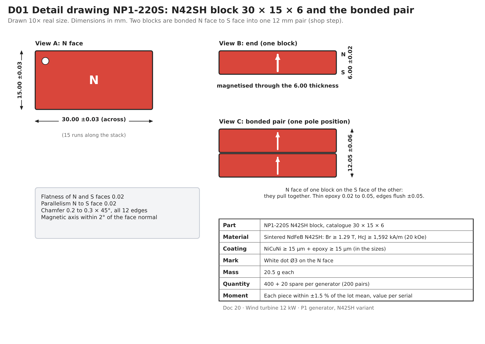
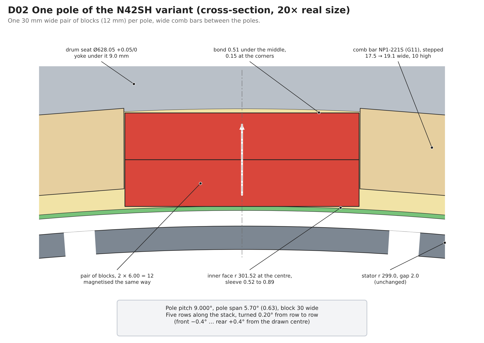
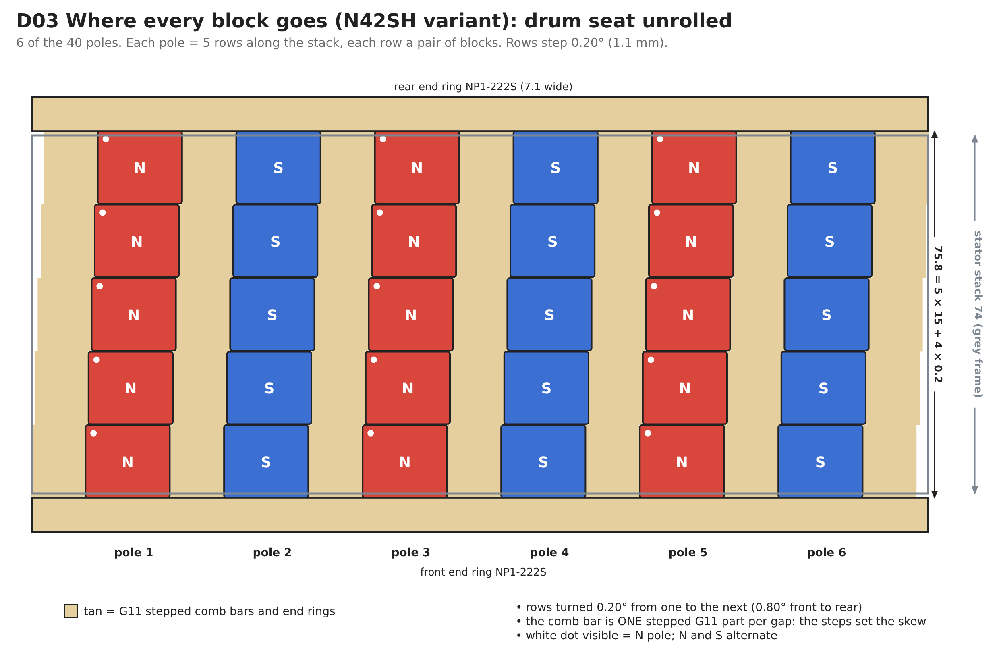
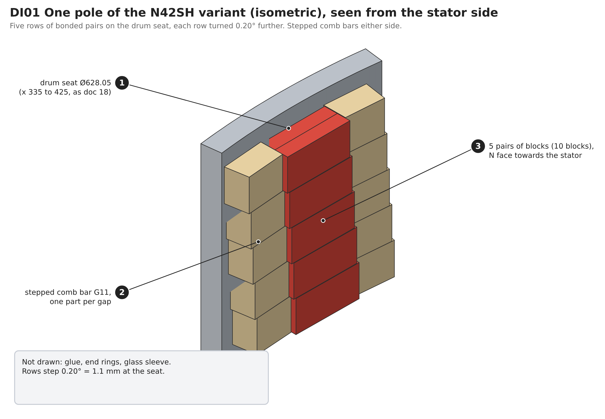
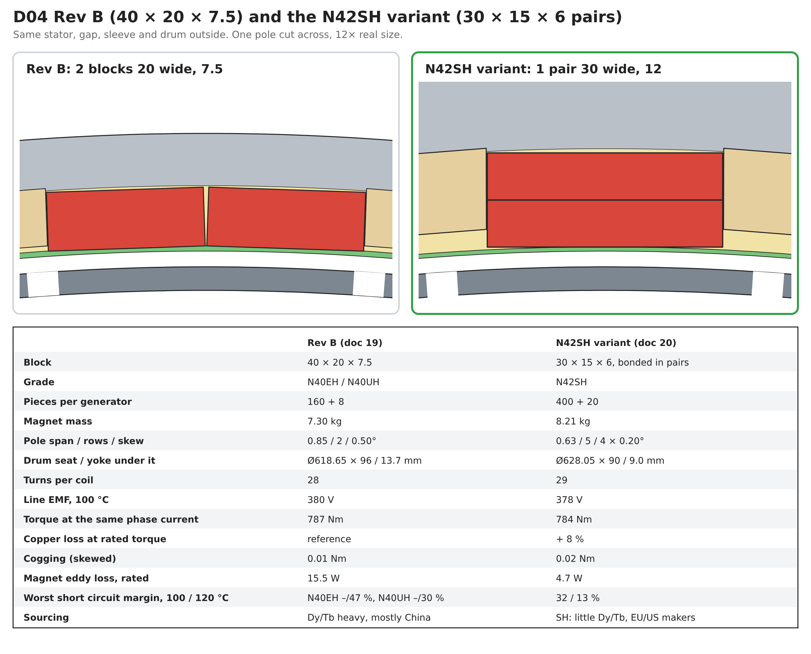

# 12 kW Wind Turbine for Iceland: Magnet Variant N42SH 30 × 15 × 6 (P1 generator)

Status: **Rev A, proposed** · 2026-11-05 (at Martin's request: "adjust the design to 30x15x6 N42SH and compare it to the original design")  
Owner: Category 4 (Generator) with 10 (Manufacturing and quality)  
Baseline: [19 – Final magnet geometry](19-magnet-geometry.md) Rev B (40 × 20 × 7.5, N40EH / N40UH, approved 2026-11-05). Doc 19 stays the approved drawing set; this document is an alternative rotor that can be built instead of it.  
Analysis: [`analysis/generator/sh30.py`](../analysis/generator/sh30.py) `S1d` → [`sh30_S1d.json`](../analysis/generator/results/sh30_S1d.json); [`magnets.py`](../analysis/generator/magnets.py) `S1d` (eddy loss, ripple, forces) → `magnets_summary.json`  
Geometry: [`cad/generator_mfg/magnet_geom_s30.py`](../cad/generator_mfg/magnet_geom_s30.py) (every dimension below comes from here)  
Pictures: [`cad/generator_mfg/figures_s30.py`](../cad/generator_mfg/figures_s30.py) → D01 to D04, DI01

## Summary

- **Layout:** each pole is one stack of two N42SH 30 × 15 × 6 blocks bonded
  N face to S face (a 30 × 15 × 12 magnet), five stacks along the 74 mm
  stator, the rows step-skewed 0.20° apart. 10 blocks per pole, **400 per
  generator** (+ 20 spares), 8.21 kg of magnet.
- **It matches Rev B** once the coils get **29 turns instead of 28**:
  378 V at 100 °C (Rev B 380 V), 784 Nm at the same phase current (Rev B
  787 Nm), copper loss **+8 %** at rated torque, cogging 0.02 Nm, and a
  much cleaner voltage (phase THD 2 % against 13 %).
- **Demagnetisation:** the 12 mm magnet keeps **32 % margin at 100 °C** and
  13 % at 120 °C in the transient short circuit. That is clearly better than
  N42SH on the Rev B drawing (20 % and −1 %), and keeps the 20 % rule up to
  about **112 °C**. It still does not meet the original 120 °C case, so it
  needs the 100 °C design basis and the three conditions of doc 19 §16.3.
- **Why build it:** 30 × 15 × 6 N42SH is a stock catalogue part at
  European and US makers, the grade needs little Dy/Tb, and the small
  pieces have a third of Rev B's eddy loss (4.7 W against 15.5 W).
- **What it costs:** 2.5 × the pieces and a pair-bonding step, a new drum
  seat Ø628.05 (drum steel under the magnets 9.0 mm instead of 13.7 mm,
  running at about 1.7 T), new comb bars and 29-turn coils.

**Recommendation:** keep Rev B as the production baseline wherever N40EH or
N40UH can be bought. Use this variant when only SH is available outside
Asia; it is the better of the two SH options (more margin than N42SH
40 × 20 × 7.5, at the price of more parts and a new seat and winding).

## 1. Why this layout

Doc 19 §15 looked at single 6 mm blocks. One block across × five along
(S1) builds easily but gives only 312 V; three across × three along (S3)
gives 376 V but leaves 2 mm between poles and overhangs the stack 8 mm at
each end. The way out is to **stack two blocks radially**: the S1 layout
with a 12 mm magnet. The longer magnet gives the flux back (narrower pole,
but 12 mm instead of 7.5 mm magnet length against the same 2.5 mm
magnetic gap) and raises the operating point, which is what gives the
better demagnetisation margin. The 0.63 pole span cogs at 5.4 Nm unskewed;
five rows 0.20° apart (one fifth of the 1° cogging period) cancel it.



## 2. Geometry

| Item | Value |
|---|---|
| Block | N42SH 30 × 15 × 6 mm, magnetised through 6, NiCuNi (as doc 19 §8) |
| Magnet per pole | 1 across × 5 along × 2 high = 10 blocks; pairs bonded N to S |
| Rows | 5 × 15 + 4 × 0.20 shim = 75.8 mm, centred on the stack (0.9 overhang each end) |
| Row positions (front face, x) | 342.1 / 357.3 / 372.5 / 387.7 / 402.9 |
| Step skew | −0.4 / −0.2 / 0 / +0.2 / +0.4° front to rear (0.80° in all) |
| Drum seat | **Ø628.05**, land x 335 to 425 (doc 18 land length unchanged) |
| Bond line | 0.15 at the block edges, 0.51 under the block middle |
| Magnet inner face | r 301.52 (sleeve bore r 301.0: 0.52 in the middle, 0.89 at the edges) |
| Pole span | 5.70° (0.63 of the 9° pitch) |
| End rings | 7.1 wide at each end |
| Comb bars (NP1-221S) | G11, one stepped bar per pole gap, 82 long, 10 high, 17.54 wide at the top, 19.11 at the seat |
| Drum steel under the seat | 9.0 mm (Rev B 13.7 mm) |
| Mass | 20.5 g per block, 8.21 kg per generator |
| Pieces | 400 + 20 spares |







## 3. Comparison with Rev B



| | Rev B (doc 19) | **N42SH variant** |
|---|---|---|
| Block / grade | 40 × 20 × 7.5, N40EH or N40UH | 30 × 15 × 6 in pairs, N42SH |
| Pieces / magnet mass | 160 + 8 / 7.30 kg | 400 + 20 / 8.21 kg |
| Pole span / rows / skew | 0.85 / 2 / 0.50° | 0.63 / 5 / 4 × 0.20° |
| Drum seat / steel under it | Ø618.65 × 96 / 13.7 mm | Ø628.05 × 90 / 9.0 mm |
| Turns per coil | 28 | **29** |
| Line EMF at 178 rpm, 100 °C | 380 V | 378 V |
| Torque at the same phase current | 787 Nm | 784 Nm |
| Copper loss at rated torque | reference | +8 % |
| Cogging, skewed (unskewed) | 0.02 (6.6) Nm | 0.02 (5.4) Nm |
| Torque ripple at rated load, skewed | 2.0 % | 2.3 % |
| Phase / line THD, no load | 13.4 / 0.9 % | 2.0 / 1.8 % |
| Magnet eddy loss, rated | 15.5 W | 4.7 W |
| Radial magnet pull per pole, no load / rated | 37 / 131 N | 50 / 145 N |
| Transient SC margin, 100 / 120 °C | N40EH > 47 / 47 %; N40UH > 30 / 30 % | **32 / 13 %** |
| 20 % margin kept up to | > 150 °C (EH), ≈ 130 °C (UH) | ≈ 112 °C |
| Grade availability outside Asia | EH/UH: Dy/Tb heavy, few quotes | SH: stock grade at Neo, VAC and others |

For reference, N42SH in the Rev B block (doc 19 §16) gives 388 V with
28 turns but only 20 % / −1 % margin at 100 / 120 °C. The variant buys
12 points of margin with the thicker magnet.

What changes in practice:

- **Winding: 29 turns.** With 28 turns the variant gives 365 V and 757 Nm
  (−4 %). One more turn per coil fits the slot (the copper area is
  unchanged, wire one step thinner or the same wire at a slightly higher
  fill) and brings both back. Same ampere-turns at the same torque, so the
  slot heat goes up by the 8 % from the 3 % lower torque per ampere-turn
  and the longer wire: hot spot about 2 to 3 K higher than doc 06.
- **Voltage.** The worst-case peak (20 °C magnets, overspeed) is about
  890 V, slightly under Rev B, still inside the 1,200 V parts.
- **Drum steel.** The seat grows by 9.4 mm in diameter, so the drum shell
  under the magnets is 9.0 mm thick. The FEA includes the S355 drum: at
  no load it runs at 1.45 T median and 1.7 T at the pole edges (Rev B 0.9
  and 1.4 T). The EMF above already includes this saturation. Mechanically
  the drum must be rechecked for the 11 % higher pull at rated load on a
  thinner shell (doc 18 drum check, open item O3).
- **Rotor field and eddy loss.** Five 15 mm pieces along the stack cut the
  eddy loss to 4.7 W; the magnets run cooler than Rev B for the same load.

## 4. Demagnetisation

Worst element against N42SH catalogue HcJ (1,592 kA/m at 20 °C,
−0.60 %/K), 29 turns make no difference here because the fault current
scales with them:

| Magnet temperature | HcJ | Rated load | Steady short circuit | Transient short circuit (2 ×) |
|---|---|---|---|---|
| 60 °C | 1,210 kA/m | 69 % | 61 % | 51 % |
| 80 °C | 1,019 kA/m | 64 % | 55 % | 43 % |
| 100 °C | 828 kA/m | 56 % | 47 % | **32 %** |
| 120 °C | 637 kA/m | 44 % | 32 % | 13 % |

Everything except the transient short circuit passes at 120 °C. The
variant therefore takes the doc 19 §16.3 design basis: **100 °C design
case**, released only if the bench test measures ≤ 75 °C magnets in the
worst case, infrared drum watch with derating at 85 °C and a pitch stop at
95 °C, and no deliberate phase shorting. With those, it has 12 K more
reserve than N42SH 40 × 20 × 7.5.

## 5. Buying

- **Part:** 30 × 15 × 6 mm, N42SH, magnetised through 6, NiCuNi
  10 to 20 µm, tolerances ±0.05 on 30 and 15, ±0.03 on 6 (the pair stack
  height matters more than a single block), Br and HcJ certificates per
  batch, as doc 19 §8 otherwise. 420 per generator.
- **Sources:** this is a catalogue size at most makers; the outside-Asia
  list of doc 19 §16.4 (Neo Narva, VAC Hanau / eVAC, Noveon) applies. Small
  lots go through distributors at 2 to 3 × the Chinese price.
- **Ask for the pairs pre-bonded** if the maker offers it (many bond
  stacks before magnetising, which is easier and safer than bonding two
  magnetised blocks). Otherwise the pair is bonded in-house (§6).

## 6. Changes to build and documents

| What | Change |
|---|---|
| Drum (doc 18 §6.4) | Seat Ø628.05 on the same land x 335 to 425; drum stiffness recheck with 9.0 mm shell |
| Comb bars NP1-221S | New stepped G11 bar, 82 × 10 high × 17.54 / 19.11, one per pole gap (40) |
| End rings | 7.1 wide |
| Pair bonding (new step before doc 19 §9) | In a non-magnetic V-jig: the second block is pushed on from the side (never let them snap together), 0.02 to 0.05 glue line, pair height checked 12.00 ±0.08 |
| Placing jig | Five row stops 15.2 apart, offset 0.20° per row (template as doc 19 §9, new insert) |
| Stator coils (doc 18 §5) | 29 turns per coil |
| Sleeve check (doc 19 Q1) | Gap to the sleeve bore up to 0.9 at the block edges (range extended from 0.8) |
| Controller | Magnet temperature watch, derate 85 °C, stop 95 °C (doc 19 §16.3) |

## 7. Open items

| # | Item | Owner |
|---|---|---|
| O1 | Bench test: magnet temperature ≤ 75 °C at rated and 110 % load and after hot shutdown | Cat 4 |
| O2 | Coil with 29 turns: check slot fill with the chosen wire, update doc 06 thermal model (+2 to 3 K expected) | Cat 4 |
| O3 | Drum with 9.0 mm shell under the magnets: stiffness and stress under magnet pull (145 N radial per pole at rated load) | Cat 5 |
| O4 | Quote pre-bonded pairs from Neo / VAC; otherwise prove the in-house pair bonding on 20 pairs | Cat 10 |
| O5 | 3D check of the row-end flux (five short rows, 0.9 overhang); the 2D model ignores end effects as in doc 19 | Cat 4 |

## Appendix A. How to rerun

```
cd analysis/generator
python3 sh30.py S1d          # EMF, cogging, torque, demag   -> results/sh30_S1d.json  (~15 min)
python3 magnets.py S1d       # eddy loss, ripple, forces     -> results/magnets_summary.json
cd ../../cad/generator_mfg
python3 magnet_geom_s30.py   # geometry table
python3 figures_s30.py --png # D01 to D04, DI01
```
