# 12 kW Wind Turbine for Iceland: Generator Rev C, Complete Design (Rotor and Stator) with One N45SH 30 × 15 × 12 Block per Pole

Status: **design for review** · 2026-11-05 (Martin: "Ok let's keep this design double check everything and update the whole generator design with 30x15x12 N45SH (one block) create wholistic document with the rotor and stator, complete drawings and isometric views ask me if something unclear or you suggest something")  
Replaces for building: rotor of [19 – Magnet geometry Rev B](19-magnet-geometry.md) and [20 – N42SH variant](20-magnet-variant-n42sh.md); stator of [18 – Manufacturing](18-generator-manufacturing.md) §5.1 (unchanged, drawn again here)  
Builds on: [06 – Generator round 2](06-generator-round2.md) (electromagnetic design, thermal model), [18](18-generator-manufacturing.md) (segmented stator, process), [21 – Optimal N42SH shape](21-n42sh-optimal-shape.md), [22 – Smaller drum](22-smaller-generator-drum.md) (Ø646 kept)  
Geometry: [`cad/nacelle_p1/geometry.py`](../cad/nacelle_p1/geometry.py) (master, now Rev C) and [`cad/generator_rc/rotor_rc.py`](../cad/generator_rc/rotor_rc.py)  
Drawings: [`cad/generator_rc/`](../cad/generator_rc/) → `out/NP1-generator-RevC.pdf` (11 sheets), `out/dxf/` (CAD), `out/iso/` (isometric views)  
Analysis: [`analysis/generator/sh30.py`](../analysis/generator/sh30.py) `S1x` → [`sh30_S1x.json`](../analysis/generator/results/sh30_S1x.json); [`checks_rc.py`](../analysis/generator/checks_rc.py) → [`rc_checks.json`](../analysis/generator/results/rc_checks.json); [`passive_cooling.py`](../analysis/generator/passive_cooling.py) → [`passive_cooling.json`](../analysis/generator/results/passive_cooling.json)

## Summary

Rev C is the doc 20 rotor with each bonded pair of 6 mm blocks replaced by
**one solid N45SH block, 30 × 15 × 12 mm, magnetised through the 12 mm**.
The drum stays at Ø646. The stator is the doc 18 segmented stator, and its
magnetic shape and 28-turn winding are unchanged. Everything was checked
again: the new FEA, demagnetisation, temperatures, bond and drum
strength, unbalanced pull and voltage.

| | Rev B (doc 19) | Doc 20 (N42SH pairs) | **Rev C (this document)** |
|---|---|---|---|
| Magnet | N40UH/EH 40 × 20 × 7.5 | N42SH 30 × 15 × 6, bonded pairs | **N45SH 30 × 15 × 12, one block** |
| Pieces per generator | 160 | 400 (200 pairs) | **200 + 10 spare** |
| Magnet mass | 8.0 kg | 8.2 kg | **8.2 kg** |
| Drum seat | Ø618.65 | Ø628.05 | **Ø628.05** (unchanged from doc 20) |
| Line EMF, 178 rpm, 100 °C | 380 V (28 turns) | 378 V (29 turns) | **372.0 V** (28 turns) |
| Torque at the sizing current density (2D, 100 °C, doc 22 method) | n/a | 760 Nm | **772.6 Nm** (+1.7 %) |
| Cogging, skewed | small | ≈ 0 | **0.01 Nm** pk-pk (5.4 Nm unskewed) |
| Transient short-circuit margin at 100 °C | see doc 19 | 32 % | **30.1 %** (rule ≥ 20 %) |
| Turns per coil | 28 | 29 | **28** |
| Bonding steps | 1 | 2 (pair, then seat) | **1** |

**What changed against doc 20:** no pair bonding step (half the pieces,
no glue line inside the magnet), slightly stronger grade, 28 turns kept
instead of 29. **What did not change:** drum, seat, comb bars, end rings,
sleeve, stator, coils, carrier and the doc 18 process.

**Results of the double check:**

- **Electromagnetic: OK.** 372 V at 100 °C with 28 turns; the controller
  works the same as with Rev B. 1.7 % more torque per ampere-turn than doc 20.
- **Demagnetisation: OK.** 30.1 % transient short-circuit margin at
  100 °C, 22 % at 110 °C. The magnets run at 67 to 72 °C in the worst hot
  case, where the margin is about 45 %.
- **Thermal: one finding, now fixed with passive cooling.** The doc 06
  cooling package (fan blades, inner fins, outer ribs) was assumed in the
  thermal sign-off but never drawn in P1. Without it the winding hot spot
  reaches 144 to 168 °C on a 30 °C day, above the 130 °C design limit.
  Rev C now has a **purely passive** package that turns with the rotor: 24
  blades on the rear cover, 36 inner fins and 48 outer ribs on the drum.
  Hot spot **94 to 105 °C**, magnets 55 to 59 °C (§4, §4a).
- **Mechanical: OK, with one condition.** Bond shear is 28 kPa at rated
  torque and 170 kPa at a short circuit, against ≥ 5 MPa. The drum is
  stable only because both ends are held round: the front disc and the
  rear brake-disc flange must be continuous, full-round welds (§5).
- **Voltage: OK.** Highest line peak 852 V (−30 °C, 250 rpm overspeed)
  against 1,200 V.

**Questions and suggestions for Martin** are in §10. Martin chose rotor
fins and passive cooling on 2026-11-05 and accepted Ø676 over the outer
ribs.

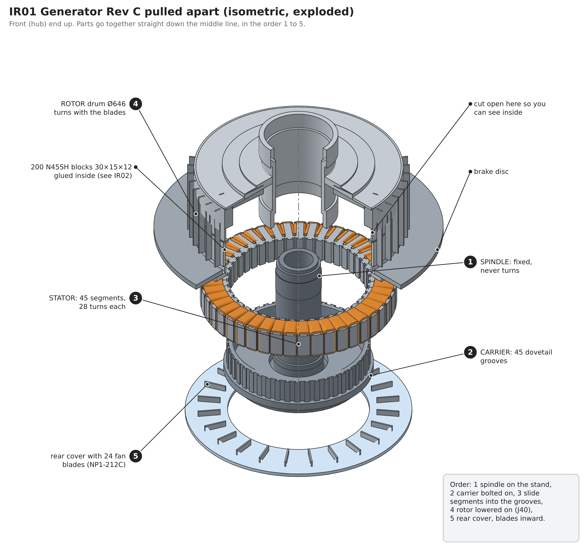

## 1. Machine data

| Item | Value |
|---|---|
| Type | Outer-rotor radial-flux PMSG, direct drive, 40 poles / 45 slots, tooth-coil double-layer winding, star |
| Rated point | 802 Nm at 178 rpm, 13.6 kW shaft, 12 kW net to the grid; overspeed limit 250 rpm |
| Air gap | Ø600 at the magnet face, 2.0 mm mechanical (stator Ø598, sleeve bore Ø602) |
| Stack | 74.0 mm, M270-35A, 0.35 mm self-bonding sheets, 45 tooth segments of 8° |
| Winding | 45 coils, 28 turns, 4 strands Ø1.55 in hand, 15 coils per phase in series, class 200 wire, class H system, VPI + potted ends |
| Rotor | S355J2+N drum, Ø646 outside, seat Ø628.05 × 90 long (x 335 to 425), 200 blocks in 5 rows of 40 |
| Magnet | N45SH, 30 (across) × 15 (along) × 12 (radial), NiCuNi, 41.0 g |
| Pole | 1 block across, 5 rows along, rows skewed 0.20° (−0.4° to +0.4°), span 5.70° (α 0.633) |
| Encapsulation | Glass-epoxy sleeve, 0.52 mm at the block centre to 0.89 mm at the edges |
| Cooling | Passive only: 24 blades on the rear cover, 36 inner fins, 48 outer ribs (no motor, no power) |
| Masses | Rotor ≈ 161 kg (drum 91.8, fins and ribs 12.5, brake disc 34.5, covers 10, magnets 8.2, G11 2); stator ≈ 115 kg (carrier 40.6, core 48.0, winding 24, clamp ring 2.2) |

## 2. Design basis

- **Magnets are designed at 100 °C**, as doc 19 §16.3: the controller
  derates at 85 °C and stops at 95 °C magnet temperature (estimated from
  the EMF).
- **Demagnetisation rule:** after a 3-phase terminal short circuit from
  rated load, at least 20 % of every block's volume stays above the knee
  margin at 100 °C (doc 19).
- **Thermal rule:** winding hot spot ≤ 130 °C at rated load on a 30 °C day
  (class H system, 180 °C, keeps 50 K reserve for life).
- **Same stator as doc 18.** The tooth shape, slot and yoke are frozen;
  only the rotor magnet pack changes.

## 3. Electromagnetic results (FEA, shape S1x)

2D FEA with the doc 06 model (`sh30.py S1x`), N45SH data Br 1.32 T,
HcJ 1,592 kA/m at 20 °C, αBr −0.12 %/K, βHcJ −0.60 %/K.

| | 20 °C | 60 °C | 100 °C |
|---|---|---|---|
| Line EMF at 178 rpm, 28 turns (skewed) | 404.6 V | 388.7 V | 372.0 V |

| Magnet temperature | 60 °C | 80 °C | 100 °C | 110 °C | 120 °C |
|---|---|---|---|---|---|
| HcJ (kA/m) | 1,210 | 1,019 | 828 | 732 | 637 |
| Margin at rated load (%) | 68.2 | 63.0 | 55.4 | 50.2 | 43.3 |
| Margin, steady short circuit (%) | 60.5 | 54.3 | 45.3 | 39.0 | 30.8 |
| **Margin, transient short circuit (%)** | 49.7 | 41.7 | **30.1** | 22.0 | 11.4 |
| Peak short-circuit current (A) | 66.3 | 64.4 | 62.6 | 61.7 | 60.8 |

- **Turns:** 380 V at 100 °C would need 28.6 turns. 28 turns are kept: the
  controller and doc 12 converter work over the whole EMF range, the slot
  layer plan (37/37/31/7 of 125 positions) stays as doc 18, and copper loss
  does not depend on the turn count for the same slot fill. Rated torque
  needs 380/372 = 2.2 % more current than the doc 06 basis, so the copper
  loss is **518 W** (doc 06 / Rev B 496 W, +4.3 %; doc 20 with 29 turns
  was +8 %).
- **Torque:** 772.6 Nm (2D) at the sizing current density, against 760 Nm
  for doc 20. With the same 3D correction as doc 22, about 815 Nm, so the
  802 Nm rated torque is reached with 1.6 % less current than the basis.
- **Cogging:** 5.35 Nm pk-pk with straight rows, 0.01 Nm with the 0.20°
  step skew.
- **Rotor eddy loss:** 4.7 W in the solid blocks (S1d result, same block
  width), negligible.
- **Annual energy:** the extra 22 W of copper loss at rated is under 0.1 %
  of the annual energy (estimate from doc 22: 31.6 MWh at 6 m/s,
  51.1 MWh at 8 m/s).

## 4. Thermal check and the cooling finding

The doc 06 lumped thermal model (`thermal.py`) was run with the Rev C
losses (copper 518 W, iron 218 W) and the P1 geometry (stack 74 mm, slot
65 mm, drum Ø646 × 194). The doc 06 sign-off used an "improved" cooling
package: fan blades on the rotor end cover (inside air h 40 W/m²K),
inner drum fins (3 × area), outer ribs (1.5 × area). **None of these are in
the P1 drawings.**

Winding hot spot / magnet temperature (°C), ambient 30 °C, 100 W sun:

| Cooling | Rated, 10.5 m/s | Rated, weak wake | 110 % load | Iceland 10 °C, rated |
|---|---|---|---|---|
| P1 as drawn before Rev C (no fan) | **144.1** / 66 | **148.9** / 71 | **167.7** / 70 | 113.4 / 39 |
| **Rev C as drawn: 24 fan blades on the rear cover** | 108.8 / 67 | 114.0 / 72 | 122.1 / 71 | 80.0 / 40 |
| **Rev C passive package (blades + inner fins + outer ribs), §4a** | **94.0** / 55 | **97.7** / 59 | **104.6** / 58 | 67.3 / 31 |
| Doc 06 assumption, for reference (3 × inner area, 1.5 × outer) | 93.0 / 56 | 97.0 / 60 | 103.1 / 59 | 66.2 / 32 |

Design limit 130 °C hot spot, 100 °C magnet.

- **Fan blades** (NP1-212C): 24 blades 4 mm × 18 mm high, r 240 to 308,
  welded on the inside of the rear cover at x 447 to 465. They stir the air
  between end windings and drum, 4 mm clear of the drum bore (Ø624).
- **Inner fins and outer ribs:** see §4a.
- Magnet temperatures stay at 55 to 59 °C with the passive package (67 to
  72 °C with blades only), well inside the 100 °C design point.

## 4a. Passive cooling study (Martin, 2026-11-05: "I think the rotor deserves fins, can we explore purely passive cooling")

**Everything here is passive.** There is no electric fan, pump or power
draw. The parts are welded to the rotor, and they move air only because
the rotor turns. The 24 "fan blades" on the rear cover are themselves just
radial fins on a part that turns. Script:
[`passive_cooling.py`](../analysis/generator/passive_cooling.py) →
[`passive_cooling.json`](../analysis/generator/results/passive_cooling.json).

**Parts (now on NP1-210C and NP1-G00):**

| Part | Geometry | Added area | Fin efficiency | Mass |
|---|---|---|---|---|
| 36 inner fins | L-shaped 3 mm S355 plates every 10°, welded to the hub web and the shell bore in the front cavity: x 220 to 312, r 262 to 312, plus a web leg x 220 to 250, r 140 to 262. 9 mm clear of the end windings (x 321) | 0.60 m² (+66 % of the inside area 0.90 m²) | 0.78 | 7.0 kg |
| 48 outer ribs | 4 × 20 S355 flat bars every 7.5° on the shell outside, x 222 to 430, tips Ø676, clear of the brake disc (x 435) | 0.39 m² (+54 % of the outside area 0.72 m²) | 0.95 | 5.5 kg |
| 24 cover blades | as §4 (NP1-212C) | small | | in the cover |

The doc 06 assumption of 3 × the inside area cannot be reached in the real
cavity; the drawn fins give about 1.5 ×. So the earlier "inner fins give 7 to
9 K" in this document's first issue was too optimistic: they give 3 to 4 K
on their own. The outer ribs are the bigger passive gain.

**Winding hot spot / magnet temperature (°C), 30 °C ambient unless stated:**

| Passive option | Rated | Weak wake | 110 % load | Iceland 10 °C |
|---|---|---|---|---|
| A. No cooling parts | 144.1 / 66 | 148.9 / 71 | 167.7 / 70 | 113.4 / 39 |
| B. Cover blades only (Rev C first issue) | 108.8 / 67 | 114.0 / 72 | 122.1 / 71 | 80.0 / 40 |
| C. Inner fins only, air barely stirred (h 15) | 139.1 / 66 | 143.9 / 71 | 161.1 / 70 | 108.6 / 39 |
| C'. Inner fins only, fins stir the air (h 25) | 120.4 / 66 | 125.4 / 72 | 136.8 / 71 | 90.9 / 40 |
| D. Outer ribs only | 133.6 / 54 | 136.9 / 58 | 155.0 / 57 | 104.7 / 30 |
| E. Inner fins + outer ribs, no blades (h 25) | 109.2 / 55 | 112.8 / 58 | 123.7 / 58 | 81.6 / 30 |
| F. Blades + inner fins | 105.5 / 67 | 110.7 / 72 | 117.9 / 71 | 76.9 / 40 |
| **G. Blades + inner fins + outer ribs (chosen)** | **94.0** / 55 | **97.7** / 59 | **104.6** / 58 | 67.3 / 31 |
| G with the inside air only half as stirred (h 25) | 108.8 / 55 | 112.4 / 58 | 123.2 / 58 | 81.2 / 30 |
| H. G with 25 mm ribs (tips Ø696) | 89.2 / 50 | 92.2 / 53 | 99.1 / 52 | 63.3 / 26 |

**What the numbers say:**

- **Moving the inside air is the biggest lever, more than fin area.** Heat
  leaves the coils into the inside air and the stator core. Fins on the
  drum only help if that air is moving over the end windings. Inner fins
  in still air (C) gain only 5 K. Inner fins alone are not enough
  (C', 137 °C at 110 %).
- **Outer ribs cool the magnets and the drum** (11 to 13 K lower magnet
  temperature) and take 10 to 14 K off the hot spot.
- **G is the recommended passive package:** 94 to 105 °C on the hot
  cases, 25 K under the 130 °C limit. Even if the inside air moves only
  half as well as doc 06 assumed, it stays at 123 °C or lower (row "G with
  h 25"). The magnets stay below 60 °C, where the demag margin is about
  50 %.
- **H (taller ribs)** gains another 5 K. It is only worth it if the bench
  test shows the hot spot above about 110 °C, and only if the nacelle
  cover has room.

**Costs and checks:**

- 12.5 kg more on the rotor (161 kg). Welded before stress relief and
  machining, so the drum is machined and balanced with them.
- **Ø676 over the ribs:** accepted by Martin (2026-11-05). Confirm the
  caliper and cover-lip clearance in the next nacelle model update (docs 07, 16).
- Rib windage at 178 rpm is a few watts. The ribs are 4 mm flat bars with
  rounded ends, so they whistle less than thin blades.
- Paint the ribs as the drum (zinc spray + epoxy, C5). Keep the inside
  fins bare or thinly primed: paint is a thermal barrier.

## 5. Mechanical checks

| Check | Value | Limit / comment |
|---|---|---|
| Bond area per block | 450 mm² (30 × 15 on the seat) | |
| Bond shear at rated torque | 28 kPa | Epoxy ≥ 5 MPa at 120 °C |
| Bond shear, transient short circuit (6 × rated) | 170 kPa | Margin 29 |
| Centrifugal force per block at 250 rpm | 8.6 N outward | |
| Magnetic pull per block at rated | 30 N outward | Bond in **compression**: both forces push the block into the seat |
| Drum wall under the seat | 8.98 mm | |
| Net magnetic pressure on the drum | 44 kPa | |
| Hoop stress (magnetic + magnets + own spin at 250 rpm) | 2.5 MPa | S355 yield 355 MPa |
| Unbalanced magnetic pull | 1.29 kN per mm of eccentricity | Doc 18: 1.9 (thinner magnet); J40 tooling OK |
| Drum stability, ring only (ends free) | stiffness 1.1e7 against magnetic 1.85e7 Pa/m: **0.6** | Not enough on its own |
| Drum stability, both ends held round (Donnell shell, 239 mm) | 5.6e9 against 1.85e7 Pa/m: **302** | OK |

**Condition from the stability check:** the 9 mm shell is safe only
because the front disc and the rear brake-disc flange keep its ends round.
Drawing NP1-210C now asks for full-round continuous welds at both and a
roundness check of the seat (0.05) after stress relief. A drum with a free
rear edge would not be acceptable.

## 6. Voltage and insulation

| | Value |
|---|---|
| Line EMF at −30 °C, 178 rpm | 428.9 V rms |
| Highest line peak, −30 °C, 250 rpm overspeed | 852 V |
| Limit (converter 1,200 V class, winding test 2.5 kV) | 1,200 V |

## 7. Stator (unchanged from doc 18, drawn again)

The stator is the doc 18 segmented stator. The Rev C sheets redraw it with
the same numbers so the set is complete.

- **Segment NP1-201C:** one tooth per segment, 8° pitch, 205 sheets
  M270-35A bonded to 74.0 mm. Dovetail foot 14 wide at r 218.6, 6 deep,
  60° flanks (20.92 at the bottom). 45 + 3 spare per stator, 1.07 kg each.
- **Carrier NP1-200C:** S355 ring with 45 dovetail grooves, slide fit,
  rear stop face at x 417, bolted to the spindle flange.
- **Coil NP1-203C:** 28 turns, 4 × Ø1.55 in hand, layer-wound directly on
  the insulated tooth (PPS end caps, NKN slot liner), layers 37/37/31/7 of
  125 positions, about 0.45 kg copper per coil.
- **Connection:** 15 coils per phase in series, star, coil order and
  polarity per `coil_connection.csv` (doc 18 §5.9).
- **Clamp ring NP1-202:** 1.4404 stainless, front of the stack.
- **Process:** doc 18 §5 unchanged (bond, inspect, insulate, wind, test,
  assemble, connect, VPI, pot).

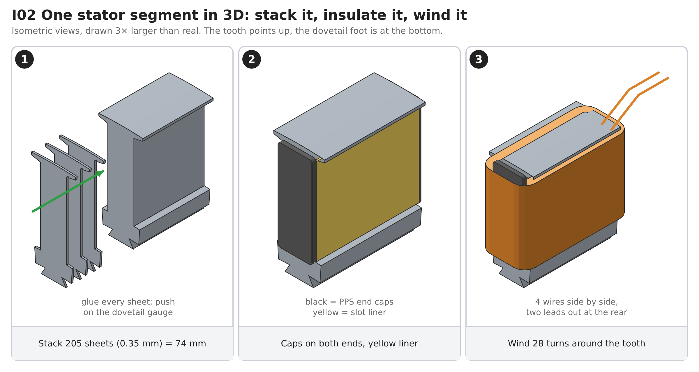

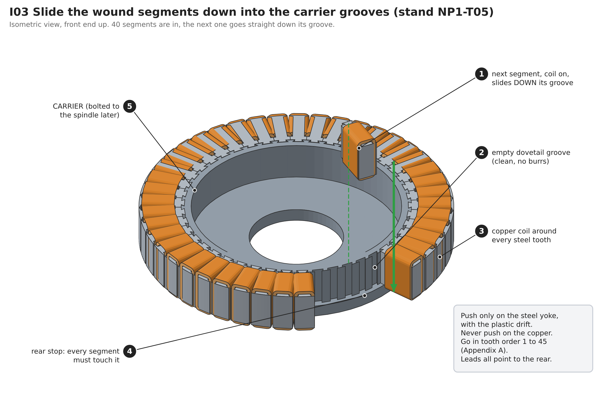

## 8. Rotor

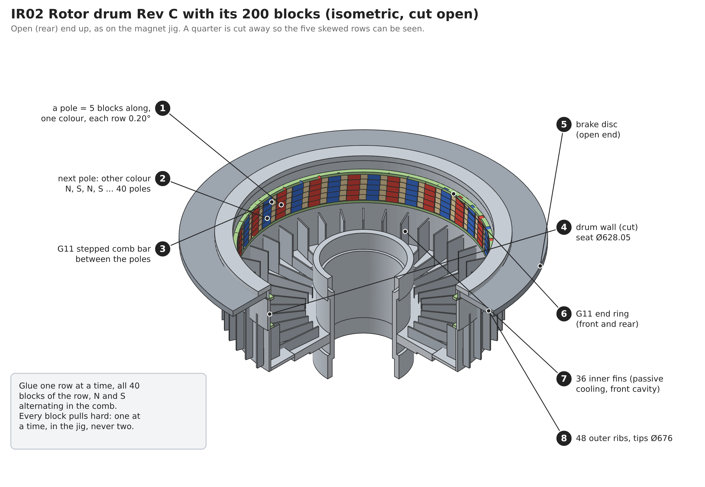

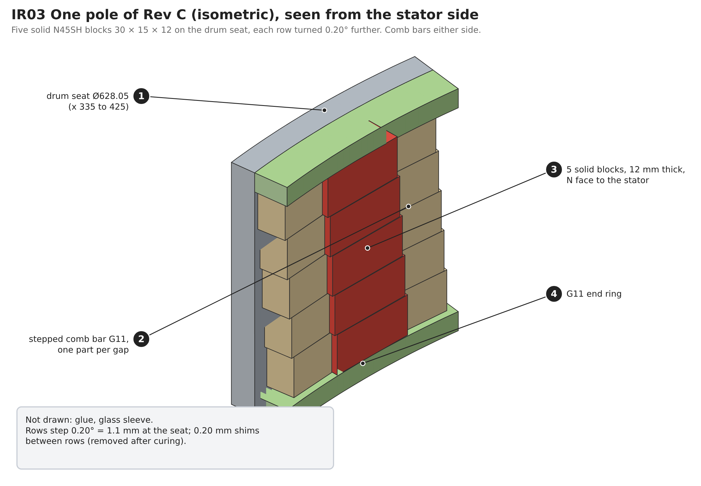

**Drum NP1-210C.** As doc 20: seat Ø628.05 +0.05/0 over x 335 to 425,
8.98 mm of steel under the seat, outside Ø646. Seat roundness 0.05 and
runout 0.05 to the bearing seats after stress relief. Full-round welds at
the front disc and at the brake-disc flange (§5).

**Magnets NP1-220E (purchase drawing).**

| Item | Requirement |
|---|---|
| Grade | N45SH: Br ≥ 1.32 T, HcJ ≥ 1,592 kA/m, (BH)max ≥ 342 kJ/m³ at 20 °C |
| Size | 30 ±0.05 × 15 ±0.05 × 12 ±0.03; faces flat and parallel within 0.02 |
| Magnetisation | Through the 12 mm, saturated, axis within 2° of the face normal |
| Edges / coating | Chamfer 0.2 to 0.3; NiCuNi 10 to 20 µm, 72 h salt spray |
| Uniformity | Moment within ±1.5 % of the lot mean, value per serial |
| Data | J-H curves per batch at 20, 60, 100, 120 °C |
| Marking | White dot on the N face |
| Quantity | 200 + 10 spare per generator, + 8 for the Q1 tests |

**Comb bars NP1-221C.** Stepped G11 bar between every two poles (40 + 4
spare), 82 long, 10 high, 17.54 wide at the bottom and 19.11 at the top.
Five steps of 1.096 mm, one per row, give the 0.20° skew without a skewed
fixture.

**End rings NP1-222C.** G11, 7.1 wide, from the seat to the block inner
face (12.5 radial), front and rear. They close the pack and hold the comb
ends.

**Magnet pack NP1-223C.** Rows at x 342.1, 357.3, 372.5, 387.7, 402.9
(15 mm blocks, 0.20 mm removable shims), 75.8 mm long, 0.9 overhang at each
end of the stack. Bond line 0.15 at the corners, 0.51 at the middle (flat
block on a round seat). Sleeve 0.52 to 0.89.

**Bonding (replaces doc 18 §6.5 and doc 20's pair step).** Place one row
at a time with the doc 19 jig: all 40 blocks of the row, N and S
alternating, each one pushed sideways into its comb pocket, never let to
snap. Shims out after cure, then the next row. Each block goes down once;
there is no pair bonding.

**Rear cover NP1-212C.** 5083 plate with the seal carrier and the 24 fan
blades on the inside (§4). Balance the rotor with the cover fitted.

## 9. Drawings and views

The drawing set is `cad/generator_rc/out/NP1-generator-RevC.pdf`, with a
PDF and a DXF of each sheet. Regenerate with `python3 build_rc.py --png`.

| Drawing | Title | Material | Mass |
|---|---|---|---|
| NP1-G00 | Generator Rev C, assembly section with parts list | | ≈ 276 kg generator |
| NP1-201C | Stator tooth segment lamination (45 + 3) | M270-35A, 0.35 mm, self-bonding | 1.07 kg per stack |
| NP1-200C | Stator carrier with 45 dovetail grooves | S355J2+N | 40.6 kg |
| NP1-203C | Coil on segment | Cu Ø1.55 grade 2, class 200; NKN; PPS GF40 | ≈ 0.45 kg Cu |
| NP1-202 | Stator front clamp ring (unchanged) | 1.4404 | 2.2 kg |
| NP1-210C | Rotor drum weldment with inner fins and outer ribs | S355J2+N | 91.8 + 12.5 kg |
| NP1-220E | Magnet block 30 × 15 × 12 (purchase drawing) | N45SH, NiCuNi | 41.0 g |
| NP1-221C | Stepped pole comb bar (40 + 4) | G11 | ≈ 25 g |
| NP1-222C | Magnet end rings, front and rear | G11 | ≈ 0.12 kg each |
| NP1-223C | Rotor magnet pack: pole section, layout, sleeve | assembly | 8.2 kg |
| NP1-212C | Drum rear cover with seal carrier and fan blades | EN AW-5083 | ≈ 9.0 kg |

Isometric views (`python3 iso_rc.py --png`): IR01 exploded generator,
IR02 rotor with 200 blocks, IR03 one pole, IR04 assembled section,
IR05 segment, IR06 segments into the carrier.

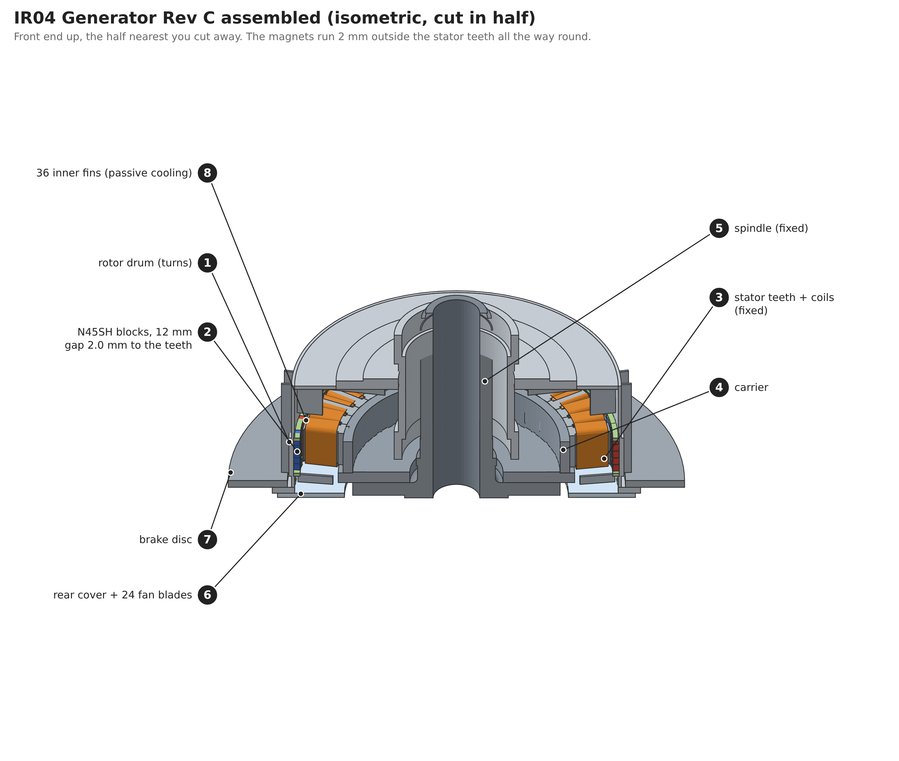

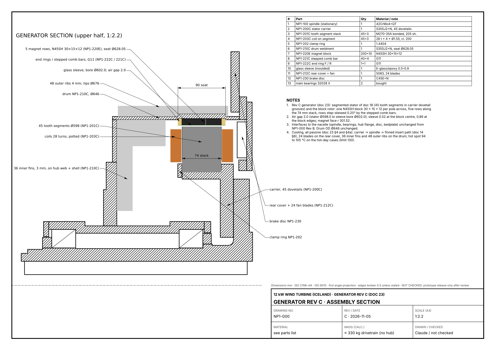

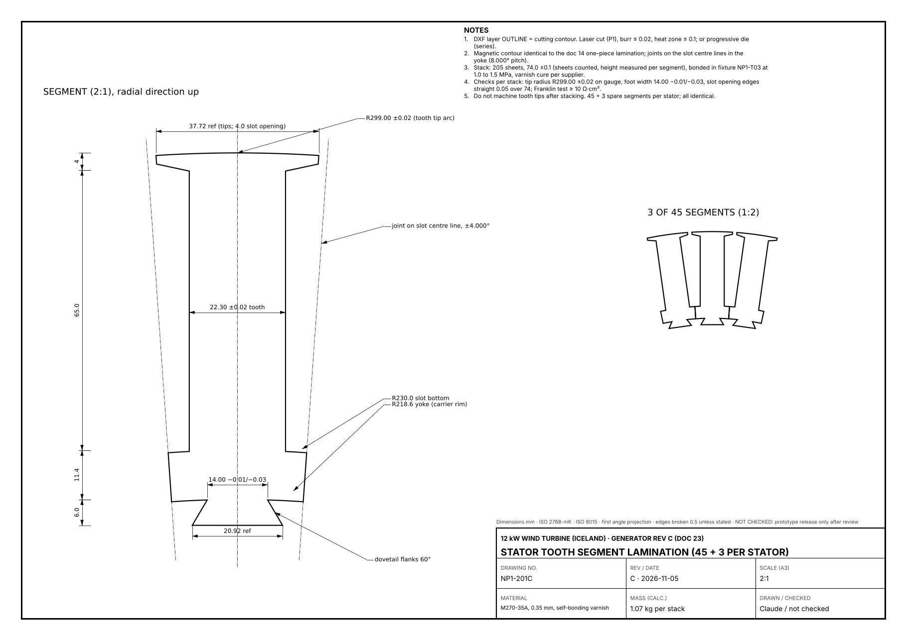

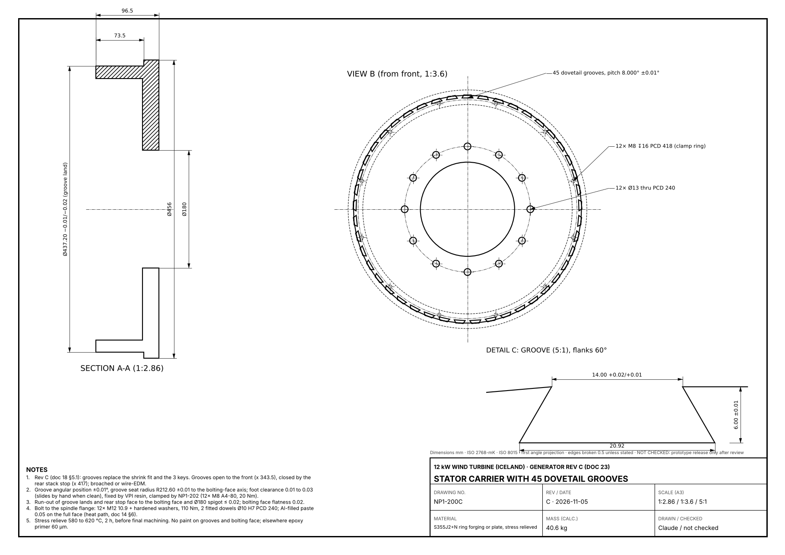

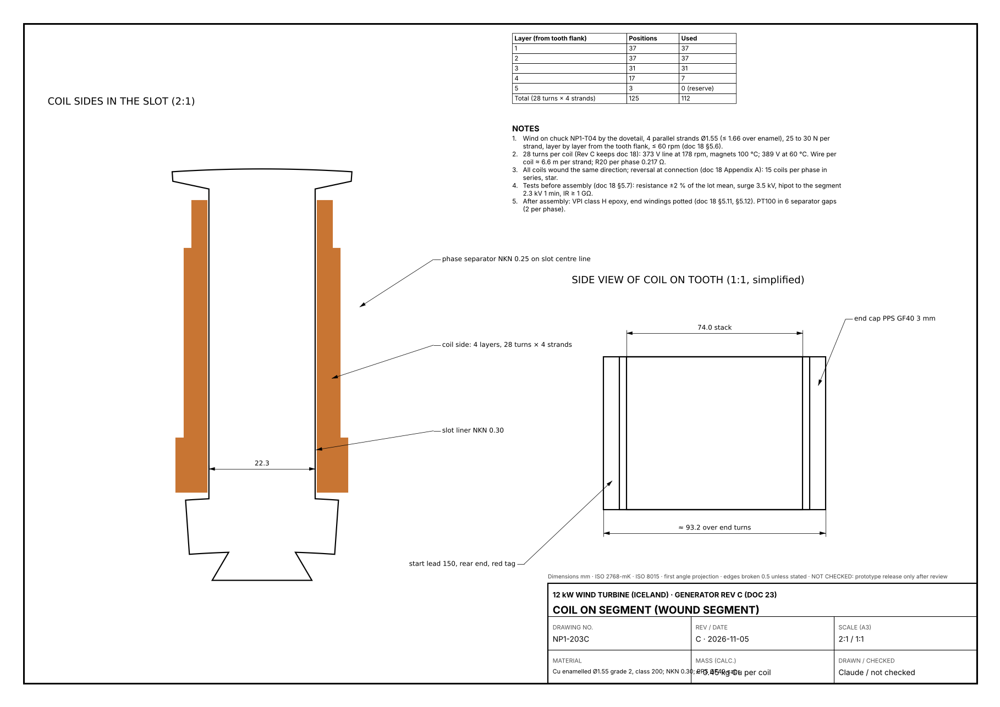

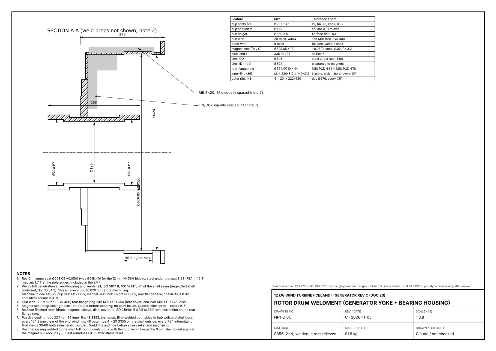

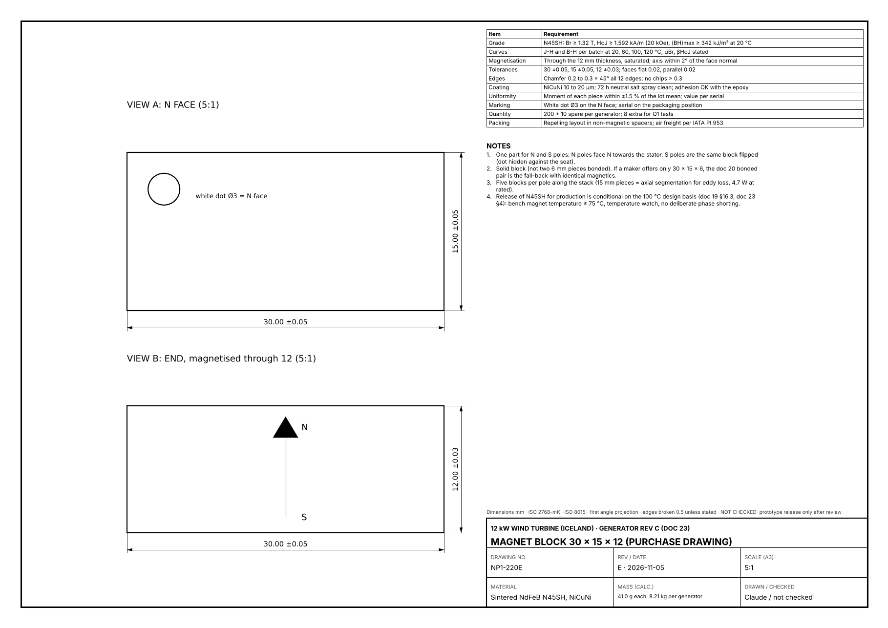

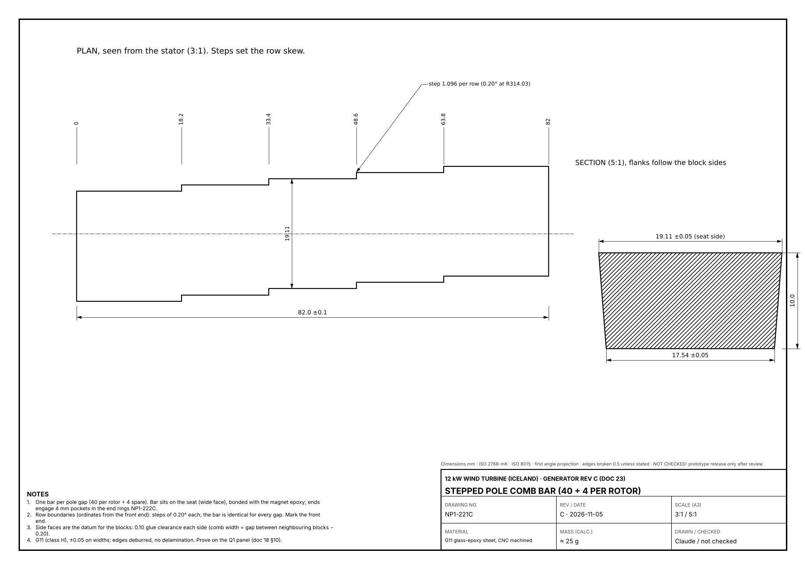

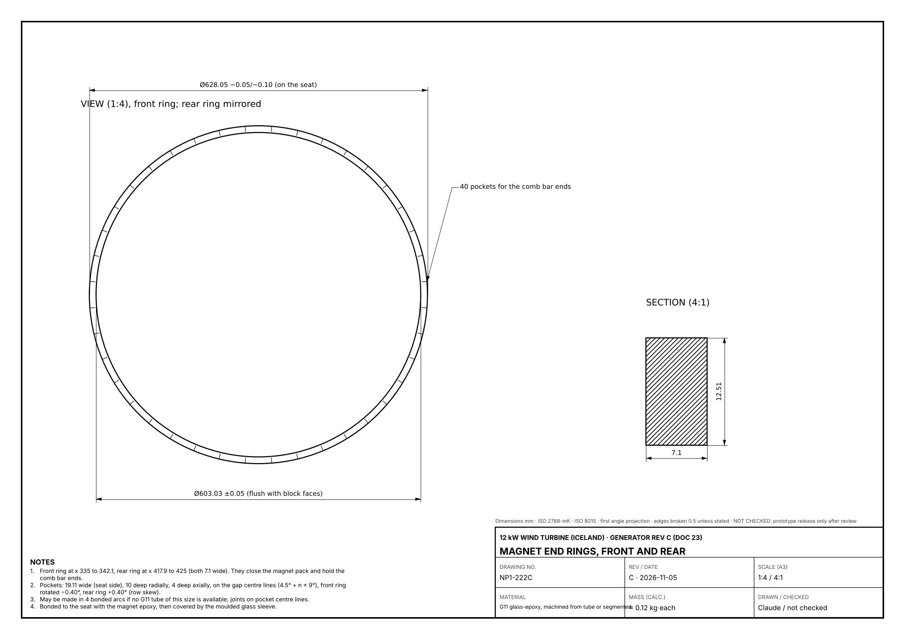

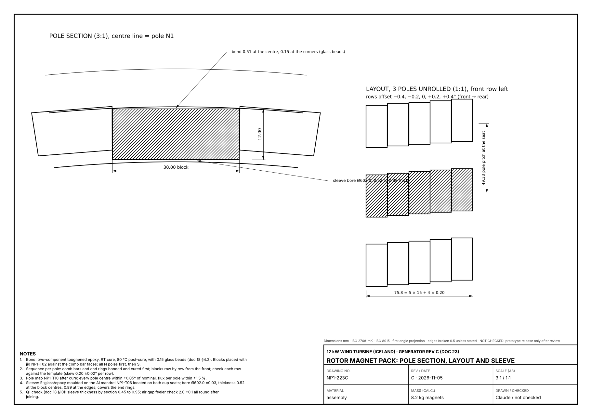

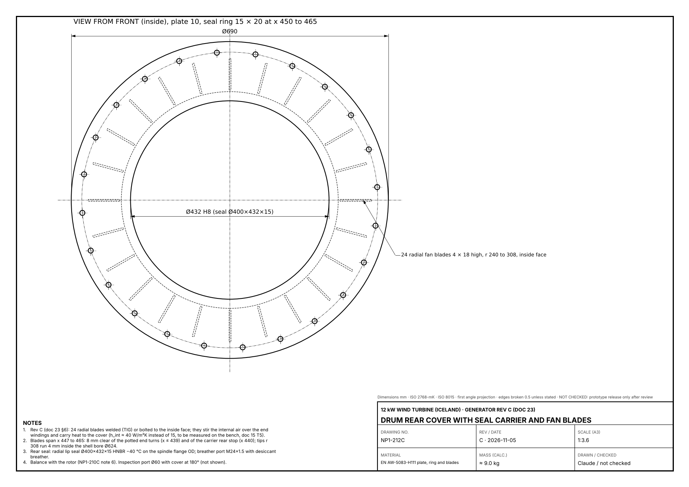

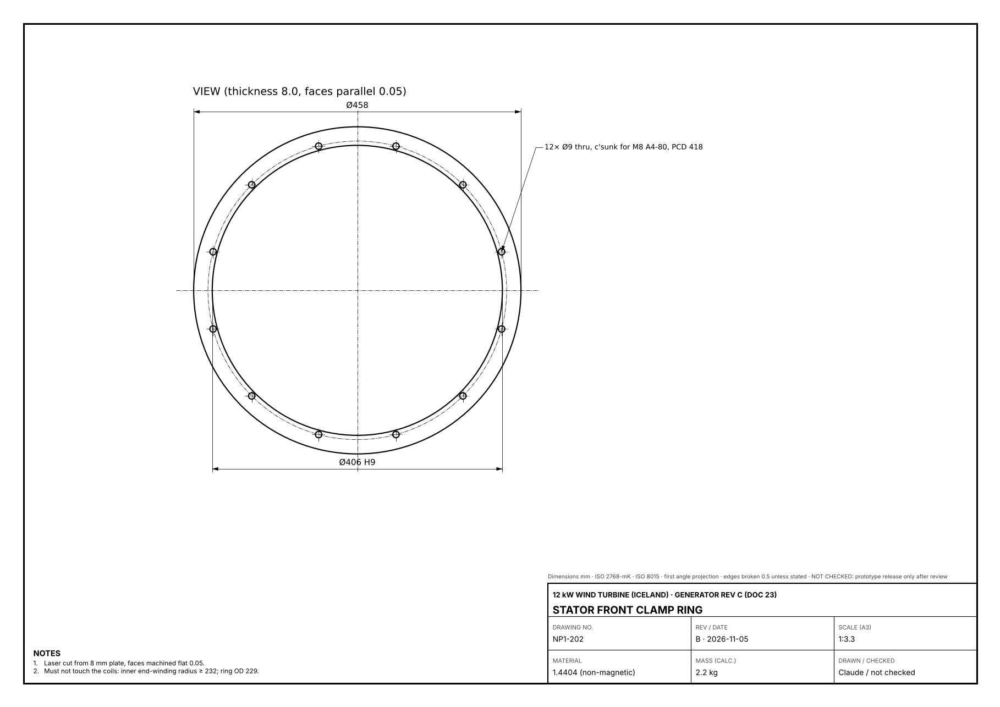

## 10. Changes to other documents, questions and suggestions

**Changes for building (against doc 18):**

| Doc 18 step | Rev C |
|---|---|
| §4.3 magnets | NP1-220E: N45SH 30 × 15 × 12, 210 pieces |
| §6.2 drum machining | Seat Ø628.05; full-round end welds; seat roundness 0.05 |
| §6.4 comb | Stepped G11 bars NP1-221C, end rings NP1-222C |
| §6.5 bonding | One block at a time, row by row, no pair bonding |
| §6.8 sleeve | Sleeve 0.52 to 0.89 (Q1 checks the full range) |
| §6.1 drum weldment | 36 inner fins and 48 outer ribs welded before stress relief (NP1-210C note 7) |
| §6.8 complete the rotor | Rear cover NP1-212C with 24 fan blades; balance with it fitted |
| §5 stator | Unchanged, 28 turns |
| Controller | Magnet temperature: derate 85 °C, stop 95 °C (doc 19 §16.3) |

**Questions for Martin:**

1. ~~Outer ribs fit~~: Ø676 over the ribs accepted by Martin (2026-11-05).
2. **Magnet supplier:** 30 × 15 × 12 N45SH is less common than
   30 × 15 × 6. Should I prepare a quote request for Neo Narva, VAC and two
   Chinese makers with this drawing?

**Suggestions:**

- **Q1 test panel with the real blocks:** bond 10 blocks on a seat sector
  with the stepped comb, cure, then a push-off test at 120 °C. This proves
  the single-block bond before the full rotor.
- **Bench test of temperatures** (doc 15): thermocouples on the end
  windings, slot centre, inside air and drum, at rated and 110 %. This
  calibrates the inside-air coefficient, the largest uncertainty in §4a.
- **3D end-effect check** of the five short rows (open from doc 20 O5).

## Appendix. How to rerun

```
cd analysis/generator
python3 sh30.py S1x              # FEA of the Rev C pole, ~40 min -> results/sh30_S1x.json
python3 checks_rc.py             # thermal, mechanical, voltage -> results/rc_checks.json
python3 passive_cooling.py       # passive cooling options -> results/passive_cooling.json
cd ../../cad/generator_rc
python3 build_rc.py --png        # drawing set: PDF, DXF, PNG
python3 iso_rc.py --png          # isometric views IR01 to IR06
```
