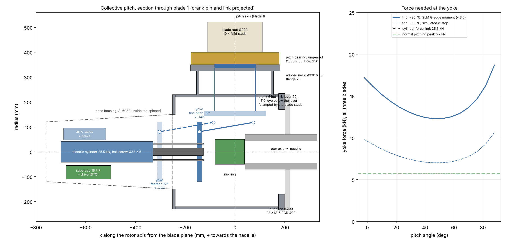
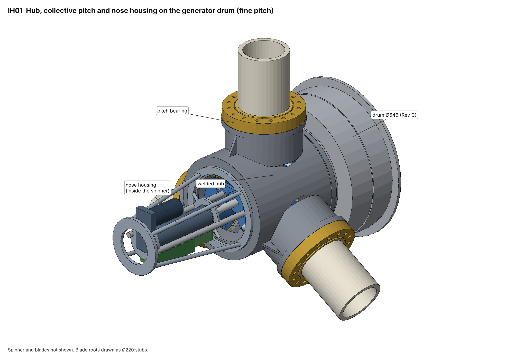
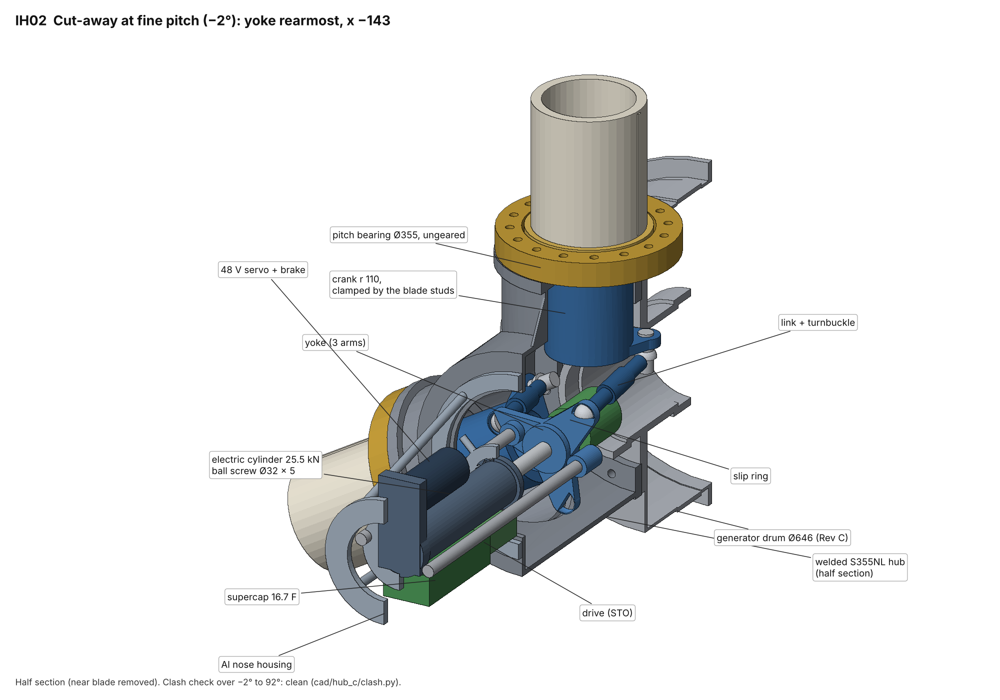
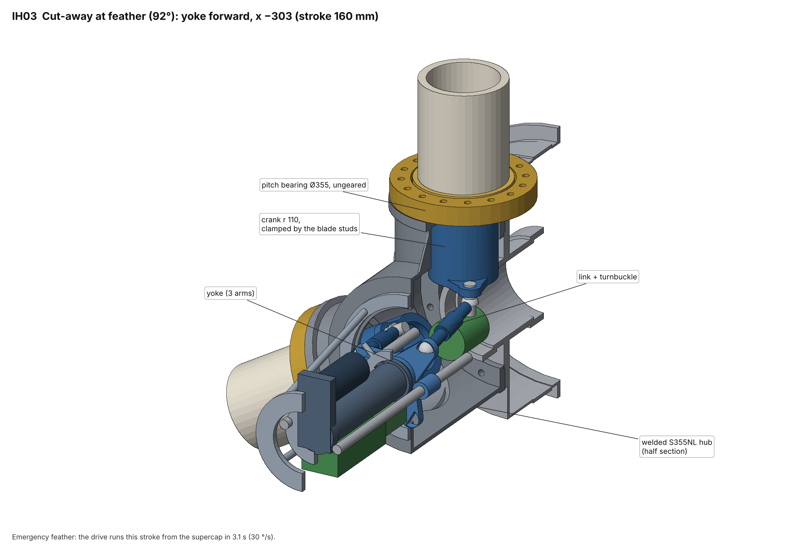
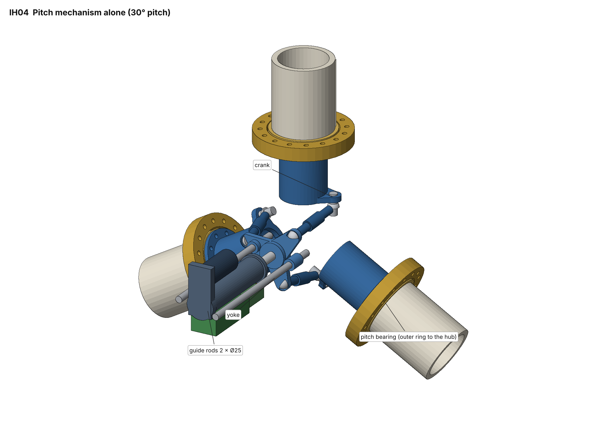
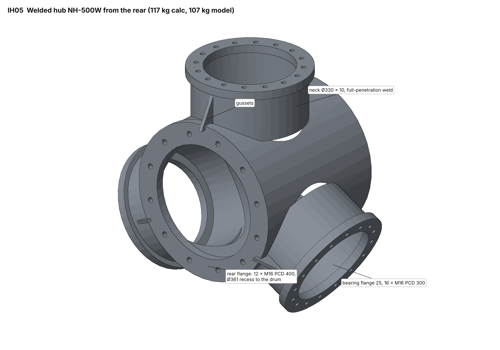

# 12 kW Wind Turbine for Iceland: Collective Pitch and Welded Hub

Status: **Draft, revision 1** · 2026-11-05
Owner: Category 3 (Hub, pitch and yaw)
Replaces: the pitch system and hub of [13 – Hub, pitch and yaw](13-hub-pitch-yaw.md), sections 2, 5 and 6. Doc 13 still holds for the pitch bearing sizing (§4), the pitch moments (§3) and the yaw system (§7).
Builds on: [07 – Nacelle](07-nacelle-spindle-bearings.md), [08 – Loads](08-load-verification.md), [11 – Control and safety](11-control-safety.md), [17 – W1 prototype](17-working-printed-prototype.md), [23 – Generator Rev C](23-generator-rev-c.md)
Models: [`analysis/hub/collective.py`](../analysis/hub/collective.py) (sizing), [`analysis/hub/collective_fig.py`](../analysis/hub/collective_fig.py) (layout figure), with the doc 13 models in [`analysis/hub/hub.py`](../analysis/hub/hub.py)
3D model: [`cad/hub_c`](../cad/hub_c/) (`model.py` parts, `clash.py` clash check over the stroke, `iso_hub.py` isometric views IH01–IH05)

## Decisions (Martin, 2026-11-05)

1. "Simplify, three independent pitch drives is too much for a 12 kW windmill." → **one collective pitch actuator for all three blades**.
2. Fail-safe: **one supercapacitor module; the actuator feathers the blades itself** when power or the safety chain is lost. A gas-spring version was sized and rejected (§9).
3. Hub: **welded S355NL** for the first units. The ductile iron casting stays the series option. Both use the same interfaces.

## Summary

| Item | Selection |
|---|---|
| Mechanism | One **electric cylinder** on the rotor axis, in a nose housing inside the spinner. It moves a **three-arm yoke**, and three **links** with spherical eyes turn a **crank** on each blade root. All three blades pitch together |
| Stroke | Yoke 160 mm for −2° to 92°. Leverage 65 to 111 mm of yoke travel per radian of pitch |
| Actuator | Ball screw Ø32 × 5 with a 1:2 belt to a parallel **48 V servo with a spring-applied holding brake**. Force limit **25.5 kN**, which covers the −30 °C trip case of 20.9 kN with 20 % margin. Normal pitching needs ≤ 5.7 kN. **11.3 Nm peak / 2.5 Nm continuous at the motor, 1,400 rpm at 30 °/s, 0.8 kW peak** |
| Fail-safe | **One supercap module**: 21 × 350 F, 56.7 V, 16.7 F, the same module as doc 13 but one instead of three. **5.1 emergency strokes at end of life and −30 °C**, against 2 required. The drive feathers on a fixed firmware sequence (PL d) when the safety chain opens, the 48 V supply is lost or its watchdog trips |
| Second braking system | The two spring-applied rotor brakes (doc 07, **8.7 kNm**). With **all blades stuck at fine pitch**, the aerodynamic torque is at most 3.5 kNm at 32 m/s and 250 rpm (BEM), so the brakes alone stop the rotor with 2.5 × margin |
| Pitch bearings | Doc 13 four-point slewing rings (Ø355 × 50, Dpw 250, 27 × 25.4 mm), **without gear teeth** |
| 3D check | Full model of hub, bearings, cranks, links, yoke, cylinder and nose housing on the Rev C drum: **no clashes at 7 positions from −2° to 92°** (`cad/hub_c/clash.py`). The check moved the crank to r 110 with a 5° phase shift: at r 120 the pin hit the drum bearing housing at fine pitch, and the link hit the crank tube |
| Hub | **Welded S355NL**: shell Ø460 × 10, three necks Ø330 × 10 with full-penetration welds, bearing flanges 25 mm. **117 kg**. Interface to the drum unchanged: **12 × M16 10.9 on PCD 400, Ø361 recess** |
| Mass, hub + pitch | **≈ 239 kg** with the welded hub, **≈ 218 kg** with the cast hub. Doc 13 was 199 kg |
| What goes away against doc 13 | 2 of 3 servo drives, 2 of 3 drive controllers, 2 of 3 supercap modules, 3 ring gears and pinions, 3 blade encoders and 2 limit switch sets |

**The simplification removes parts and electronics. It does not save mass.**
The three pitch bearings (57 kg) and the hub are sized by the 26 kNm parked
blade load (SLM H), which does not change. The cranks (8 kg each in the
3D model), yoke and links weigh more than the gearmotors they replace. The welded hub is 27 kg heavier
than the casting. That is the price of making it in-house without a pattern.



*Left: section through blade 1 (crank pin and link projected), with the linkage at fine pitch (solid) and feather (dashed). Right: yoke force needed over the stroke.*

### Isometric views (from the 3D model)



*IH01: hub, collective pitch and nose housing on the generator drum, fine pitch. Spinner and blades not shown.*



*IH02: half section at fine pitch (−2°), yoke rearmost at x −143.*



*IH03: half section at feather (92°), yoke forward at x −303.*



*IH04: the pitch mechanism alone at 30° pitch.*



*IH05: welded hub NH-500W from the rear.*

---

## 1. Mechanism

```
 spinner / nose housing                         hub (welded)                         nacelle
 ┌────────────────────────────┐ front plate ┌──────────────────────────────┐ hub face x 200
 │ supercap + drive (STO)     │             │      blade 1 ↑               │
 │ 48 V servo + brake ═ belt  │             │   crank r 120 ◯──link──┐     │ slip ring
 │ ball screw cylinder ──rod──┼─────────────┼──► yoke (3 arms, R 110) │     │ (spindle nose)
 │       guide rods 2 × Ø25 ──┼─────────────┼──►                     │     │
 └────────────────────────────┘             └──────────────────────────────┘
   yoke x −303 (feather)  ◄──── 160 mm ────►  x −143 (fine)
```

- **Direction:** feathering pulls the yoke forward (−x), so the links are in
  **tension** during an emergency feather. Driving to fine pushes them, at
  ≤ 5.7 kN in normal operation.
- **Crank:** a welded S355 part: a 15 mm flange ring clamped to the
  blade-side ring by the 10 blade studs inside the hub, a tube Ø168 × 4 down
  the neck, and a 20 mm lever (s 144 to 164 from the rotor axis) with a pin
  Ø30 at **r 110** from the pitch axis. The link eye sits on the pin *below*
  the lever, at s 118. The crank swings from −42° to +52° about mid-stroke
  (a 5° phase shift), so the pin stays 8 mm clear of the drum bearing housing
  at fine pitch. About 8 kg.
- **Links:** Ø30 × 4 tube, 220 mm between eye centres, with an M20 turnbuckle
  for the **0° setting of each blade (±3°)**. Steel/steel spherical plain
  bearings, greased from the hub lubricator. PTFE liners are not used: the
  230 million small reversals from doc 13 §4.2 would wear them. The largest link angle to the rotor axis is
  13.5°.
- **Yoke:** a 20 mm S355 plate with three arms (eyes at R 110), fixed to the
  cylinder rod. It runs on **two guide rods Ø25**, which also take the twisting
  moment from the inclined links.
- **Clearances:** the yoke at fine pitch (x −143) is 63 mm in front of the
  slip ring (x −80). At feather (x −303) it sits in the nose housing, whose
  rear ring was opened to Ø316 so the links and eyes pass. All of this is
  confirmed by the clash check in the 3D model.

## 2. Loads on the mechanism

The blade torques come from doc 13 (bearing friction model, 30 % chord pitch axis):

| Case (per blade) | Torque at the pitch bearing | Yoke force, three blades |
|---|---|---|
| **Emergency feather, −30 °C, SLM G edge moment (γ 3.0), −64 Nm aerodynamic × 1.35** | **433 Nm** | **20.9 kN** at feather (lowest leverage) |
| Emergency feather, −30 °C, simulated e-stop | 247 Nm | 11.9 kN |
| Normal pitching, −30 °C, equivalent load × 1.35 | 118 Nm | 5.7 kN |
| Storm, parked, V_e50 (1.5 × 294 Nm), all three blades the same way | 440 Nm | 20.2 kN, held by the motor brake through the back-driven screw |

Friction dominates, as in doc 13. Aerodynamic and centrifugal pitch moments
are below 100 Nm. The trip force is highest at the two ends of the stroke,
where the crank has the least leverage (figure, right).

## 3. Actuator and drive

| Item | Value |
|---|---|
| Type | Electric cylinder: ball screw Ø32 × 5 (C_dyn ≥ 30 kN, C_0 ≥ 60 kN), parallel motor through a 1:2 toothed belt, sealed IP67, low-temperature grease |
| Stroke | 180 mm (160 working + 2 × 10 overtravel to the rubber stops at −3° and 93°) |
| Speed | 0.058 m/s at 30 °/s (emergency), 0.029 m/s at 15 °/s (normal limit) |
| Force | 25.5 kN limit, set by current, so a stall on an end stop cannot overload the links (8.7 kN each) or cranks (≤ 950 Nm) |
| Motor | 48 V PMSM servo, 11.3 Nm peak, 2.5 Nm continuous, 1,400 rpm at 30 °/s, **spring-applied holding brake ≥ 7.7 Nm** (storm holding × 1.2) |
| Drive | One 48 V servo drive with STO, CANopen DS402, ≥ 35 A peak (31 A at the 30 V end of the supercap window) |
| Screw life | About 1,240 km of travel in 20 years, almost all in small strokes. The supplier must confirm life under the doc 13 duty (R3.5 now applies to the screw and the link eyes too) |
| Pitch angle | **Linear absolute position sensor** on the yoke (magnetostrictive type) + the motor encoder. One sensor for all three blades: the links fix the blades relative to each other |
| Limit switches | One set on the yoke: −2° (fine) and 91° (feather). Rubber stops on each blade at −3° and 93° |

Candidates (envelope only, not yet asked): SKF CASM-63/100, Rexroth EMC-63,
Exlar FTX, Tolomatic RSX in the 25 to 30 kN class with a 48 V servo from the
doc 17 list (Kollmorgen, Nanotec, JVL).

## 4. Fail-safe feathering (R3.1, R3.6 revised)

| Trigger | Action |
|---|---|
| Safety chain opens (two channels through the slip ring, doc 11) | Drive goes to supercap-only mode and runs the fixed feather sequence |
| 48 V slip-ring supply lost | Same |
| Watchdog or bus loss | Same |
| Supercap below its 2-stroke reserve | Feather and stop, fault reported |

**Sequence (drive firmware, certified with the protection system, ISO 13849 PL d):**
drive to 91° at 30 °/s on supercap power, stop on the feather limit switch,
set the holding brake. Time from fine pitch to feather is 3.1 s, and 45° takes 1.5 s.

**Energy:** one stroke at the −30 °C SLM G case needs 2.9 kJ. The module gives
18.7 kJ between 56 and 30 V, so **5.1 strokes at end of life** (80 %). The
weekly stored-energy test in doc 11 stays: a full stroke on supercap power at
low wind.

**Single point of failure and the second system.** In doc 13, one failed
drive still left two blades to stop the rotor. Now a failed drive, a broken
link or a jammed screw stops all three blades wherever they are. The
independent second system is the **mechanical rotor brake** (doc 07, two
spring-applied calipers, 8.7 kNm). New check with the BEM model, all three
blades at 0° pitch:

| Wind | Aerodynamic torque at 178 / 210 / 250 rpm |
|---|---|
| 15 m/s | 1.6 / 1.8 / 1.7 kNm |
| 25 m/s | 1.8 / 2.4 / 3.3 kNm |
| 32 m/s | 1.9 / 2.6 / 3.5 kNm |
| 50 m/s | 2.4 / 3.0 / 4.0 kNm |

The brake beats the rotor with at least 5.2 kNm left over up to 32 m/s (2.5 ×), and still with 4.7 kNm at
50 m/s. A stop from 250 rpm takes about 1.1 s and puts about 125 kJ into the Ø880
disc (+5 K bulk), which the disc absorbs easily. The brake becomes a
**safety function** (it was "parking and service" in doc 07 §7). So:

- **New R3.8** The rotor brake shall stop the rotor from the 210 rpm trip with
  all blades at fine pitch at any wind up to the 32 m/s storm stop. Its release
  shall be in the safety chain, and it shall be tested monthly by a
  brake-only stop at low wind.
- Doc 11's protection logic changes: on a pitch fault (drive fault, position
  disagreement between the yoke sensor and the motor encoder, energy low) the
  brake applies **at once**, without waiting for the pitch.
- Load case to add to the next load rerun: **DLC 2.3/7.1 with all three blades
  stuck** (not one). The parked thrust with three blades broadside at V_e1 is
  about 12 kN, well below the SLM H 41.6 kN used for the bearings and tower,
  so no sizing change is expected.

## 5. Pitch bearings

As doc 13 §4 (SLM H governs; static factor 1.33, L10 247 million revolutions
against 4 million), with two changes:

- **No gear teeth.** The inner (blade) ring is a plain ring. Its bore opens from Ø150 to
  Ø180, so it is about 8 % lighter (19 kg each).
- The crank flange is clamped between the inner ring and the stud nuts inside
  the hub. The supplier must accept this stack: blade root, ring, crank flange
  25 mm, M16 10.9 studs.

The oscillation-wear risk (R3.5) is unchanged and is now shared by all three
bearings, which see identical motion. The 24 h lubrication sweep (0 → 10° → 0) stays.

## 6. Welded hub (NH-500W)

| Part | Selection |
|---|---|
| Material | S355NL plate and tube, impact tested at −50 °C. Stress relieved after welding, then all flanges machined in one set-up |
| Shell | Rolled tube Ø460 × 10, length 440 (x −240 to +200) |
| Necks | 3 × tube Ø330 × 10 into the shell, **full-penetration welds, toes ground** |
| Bearing flanges | 3 × ring Ø360 / Ø262 × 25, 16 × M16 tapped on PCD 300 (as doc 13), flatness 0.05 |
| Rear flange | Ring Ø470 / Ø340 × 25, **12 × M16 10.9 on PCD 400, Ø361 H7 recess**: same as the cast hub, W1 twin and dummy hub NP1-600 |
| Front plate | Ring Ø460 / Ø300 × 12, 12 × M12 on PCD 340 for the nose housing |
| Stiffeners | 6 gussets between necks and shell, the final layout to come from FEA |

**Checks** (hot-spot stress, SCF 2.5 assumed at the neck saddle until the FEA):

| Check | Stress | Allowable |
|---|---|---|
| Static, SLM H 26 kNm | 83 MPa | 323 MPa (355 / 1.1) |
| Fatigue, root moment DEL m = 3 (5.3 kNm, × 2) | 34 MPa range at 10⁷ | **42 MPa** (IIW FAT 90 ground full-penetration, γ_Mf 1.25) |
| Hub-to-drum joint | 12 × M16 10.9, slip capacity 292 kN against 142 kN | unchanged (doc 13) |

Fatigue has the least margin. The saddle weld detail and the gusset layout need the FEA
before drawings are released.

**Mass 117 kg** by hand calculation (shell 30, necks 28, bearing flanges 28, rear flange 16,
front plate 9, gussets 6), **107 kg** in the 3D model. The cast hub of doc 13 adapted to the larger front
opening would be about 96 kg.

## 7. Nose housing, spinner, cold and ice

- **Nose housing:** welded Al 6082 tube and frame on the front plate, carrying
  the cylinder, guide rods, drive and supercap module. It reaches to about
  x −760, inside a spinner about 0.8 m long ahead of the blade plane.
  The supercap module and drive sit on the rotor axis, so centrifugal load is
  negligible and the rotor stays balanced.
- **Spinner:** vacuum-infused glass/vinyl-ester (doc 17 §5.2), with EPDM blade boots (doc 13
  §4.5).
- **Cold:** heater pads on the supercap module and the cylinder (2, instead of
  6 in doc 13). The hub and nose are closed with a desiccant breather. The
  drive sizing uses −30 °C friction. A climate-chamber test of the complete
  mechanism at −40 °C replaces the per-axis test (R11.3).
- **Slip ring:** 48 V for one drive (≈ 35 A peak, ≈ 2 A mean) plus the
  two-channel safety chain and CANopen. Rings for **blade heating** stay
  reserved (R2.8), with power still to be set by the ice protection design.
- **Lightning:** blade down-conductor → strap across the pitch bearing → hub →
  spark gap to the spindle (doc 13 §6), unchanged. The links and cylinder are
  bonded by braids so no current passes through the screw or the rod ends.

## 8. Requirements updated

- **R3.1** Emergency feather at 30 °/s from stored energy: **met by the single
  actuator** (20.9 kN needed at −30 °C, 25.5 kN available, 5.1 strokes).
- **R3.6 (revised)** The collective pitch actuator shall feather all blades on
  loss of the safety chain, of slip-ring power or of its watchdog, using only
  its own stored energy. It shall report its stored energy for the weekly test.
- **New R3.8** Rotor brake as the independent second braking system with all
  blades at fine pitch (§4).
- **R3.5** extended to the ball screw and link eyes.
- Doc 07 §7 and doc 11 §2 (protection system) to be updated for R3.8 at their
  next revision.

## 9. Rejected: gas springs with a latch

Sized in `collective.py` (`spring_variant_rejected`) before the choice:

- A steel coil spring for the 17.3 kN / 176 mm trip work (first linkage geometry, before the 3D check) would weigh about
  30 kg, so the springs would have to be **two nitrogen gas springs**.
- If the springs moved with every pitch step, their seals would wear out
  (about 1,350 km of travel) and the motor would have to hold about 20 kN
  continuously. So they would sit cocked behind a **latch**, with a
  **damper** to set the feather speed, and the cylinder would have to
  **re-cock them against 41 kN**.
- Result: 240 kg (welded hub), four more units and 40 kN parts. The supercap
  version was chosen.

## 10. Mass and part count

| | Doc 13 (3 drives) | **Doc 24 (collective, supercap)** |
|---|---|---|
| Pitch bearings | 3 × 21 kg = 63 | 3 × 19 kg = 57 |
| Drives, controllers, supercaps | 3 × (6 + 2.5 + 3) = 35 | cylinder + motor 11, controller and sensors 3, supercap 3.5 |
| Mechanism | – | cranks 24, links 4, yoke and guides 6.5, nose housing 5 |
| Covers, switches | 4.5 | (in the above) |
| Spinner, boots, slip ring rotor, cabling | 8 | 8 |
| Hub | 90 (cast) | **117 (welded)** / 96 (cast) |
| **Total** | **199** | **239 welded / 218 cast** |
| Electronic units in the hub | 3 drives, 3 supercap modules, 3 encoders | **1 drive, 1 supercap module, 1 position sensor** |

Tower top: doc 14 estimated about 730 kg with a 200 kg hub. The welded hub
version adds about 40 kg (+5 %). The tower update listed in doc 13 §8 should use
**770 kg** until the P2 drivetrain mass reduction is known.

## 11. Open points and next steps

1. **3D model:** done for the hub and pitch system (`cad/hub_c`, clash-free).
   Still to do: put it into the full Rev B / W1 nacelle model and confirm the
   rotor brake caliper and cover-lip clearance there (open item from the
   nacelle model).
2. **Hub FEA:** neck saddle weld hot spot, gussets, flatness of the bearing
   flanges under 26 kNm. Then the drawing set (NH-500W, NH-530 crank, NH-540
   link, NH-550 yoke, NH-560 nose housing).
3. **Supplier enquiries:** electric cylinder (force, life under oscillating
   duty, −40 °C), ungeared pitch slewing rings with the crank-flange stack,
   spherical plain bearings for the link eyes.
4. **W1 printed prototype:** replace the three pitch drive envelopes and
   ring-gear twins (NW-510 gear, NW-520) with printed cranks, links and yoke and
   the real cylinder. The bench limit in doc 17 §6 changes to an actuator force
   limit (≈ 3 kN on printed rings).
5. **Doc 11 / doc 07 update** for R3.8, and an extra load case: all blades stuck at fine pitch.
6. **Pitch rig test:** one blade-root set on a real bearing plus the cylinder.
   Run oscillation endurance on the screw, eyes and bearing, a −40 °C start, and
   feathering on supercap power with the 48 V supply off.
