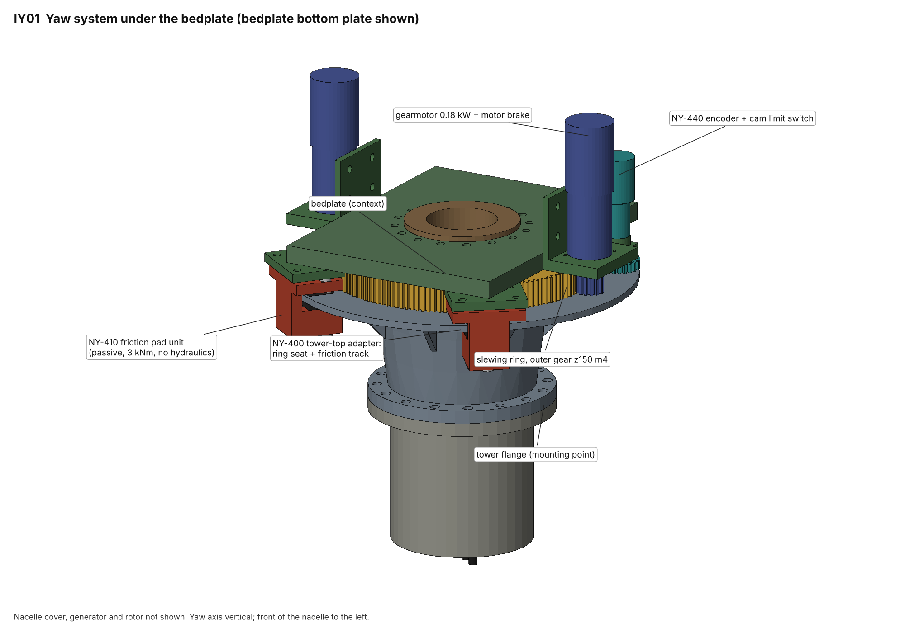
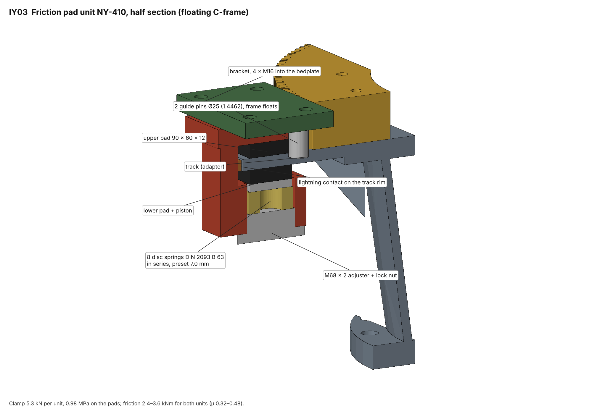
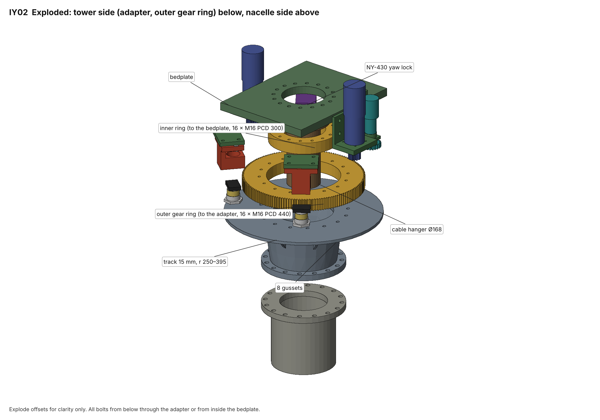
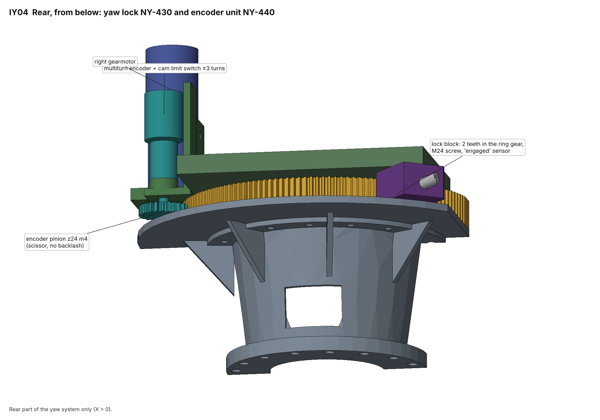
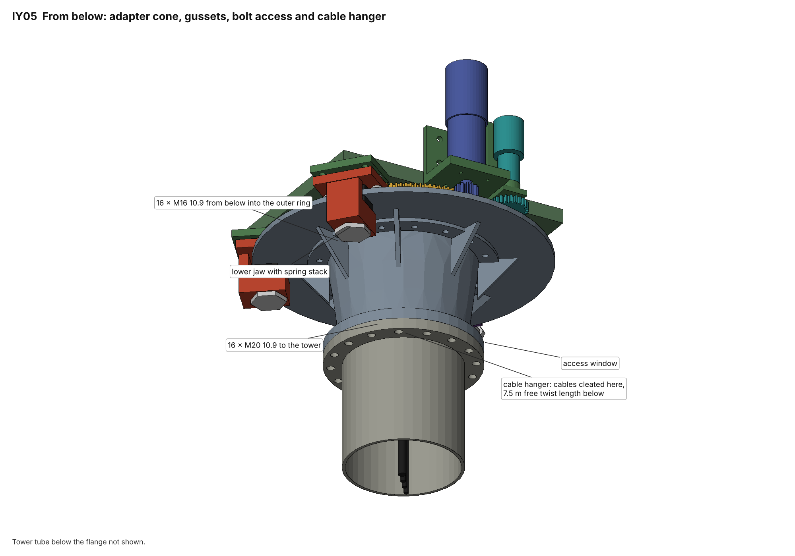

# 12 kW Wind Turbine for Iceland: Yaw System Detail Design

Status: **Draft, revision 1** · 2026-11-05
Owner: Category 3 (Hub, pitch and yaw)
Replaces: the yaw brake and drive holding concept of [13 – Hub, pitch and yaw](13-hub-pitch-yaw.md) §7 and requirement R3.7, and the NP1-400 adapter and yaw caliper proposal of [16 – Fit-check model](16-nacelle-fit-check-model.md) §7. Doc 13 §7 still holds for the slewing ring selection. Doc 11 §5 still holds for the yaw control logic.
Builds on: [02 – Design basis](02-design-basis.md), [07 – Nacelle](07-nacelle-spindle-bearings.md), [08 – Loads](08-load-verification.md), [11 – Control and safety](11-control-safety.md), [14 – Nacelle P1](14-nacelle-prototype-p1.md), [23 – Generator Rev C](23-generator-rev-c.md), [24 – Collective pitch hub](24-collective-pitch-hub.md)
Models: [`analysis/yaw/yaw.py`](../analysis/yaw/yaw.py) (sizing; it reuses the slewing ring models in `analysis/hub/hub.py`)
3D model and drawings: [`cad/yaw`](../cad/yaw/) (`model.py` parts, `clash.py` clash check over a full yaw turn, `iso_yaw.py` isometric views IY01–IY05, `drawings.py` + `build.py` drawing set NY-000 to NY-460)

## Decisions (Martin, 2026-11-05)

1. **Keep active yaw.** A tail vane was considered and not pursued. A vane large enough for a 7.5 m rotor would take about 40 kNm at 77 m/s at the nacelle, and it adds overhung mass to a tower top that is already heavy.
2. **Hold and damp concept:** the bought slewing ring stays. **Passive spring-loaded friction pads** damp the nacelle, and **two gearmotors with spring-applied motor brakes** hold it. There are **no hydraulics** on the yaw system and **no controlled slip setting**.

Why the doc 13 controlled-slip brake was dropped: the drives have an overall ratio of 1:18,000. The motors' reflected inertia is therefore about **324,000 kg m²**, against **354 kg m²** for the nacelle and rotor about the yaw axis. When the brake slips, 99.9 % of a gust's yaw moment still goes into the gear teeth. What the slip was meant to protect, the tower in torsion, is not at risk: 15 kNm gives only **12 MPa** in the Ø320 × 8 tower top. So the gear train is sized to hold the design yaw moment on its own, and nothing slips.

## Summary

| Item | Selection |
|---|---|
| Yaw bearing | Bought four-point contact slewing ring, **D_pw 360, 53 × Ø19 balls**. External gear **z150 m4** on the outer ring, teeth induction hardened. Outer ring to the tower adapter, 16 × M16 PCD 440. Inner ring to the bedplate, 16 × M16 PCD 300. Unchanged interface from doc 13 / 16 / W1 |
| Bearing check | Static safety **s₀ = 1.44** at the SLM tilt moment of **34.6 kNm**, with a 4,000 MPa Hertz limit. The simulated envelope gives 16.2 kNm and s₀ = 3.4 |
| Drives | **2 × 0.18 kW 4-pole gearmotors**, 1:1,680 planetary, pinion **z14 m4 b 50**, at ±90°. Each motor has a **2 Nm spring-applied brake**. One VFD drives both motors at **0.5 °/s**. Motor load is 0.31 Nm of 1.15 Nm rated, and 0.61 Nm with one drive failed |
| Holding | Motor brakes through the gear train. The design yaw moment of **8 kNm** is checked on **one pinion** (backlash) with no friction credit: 26.7 kN tooth force and **747 Nm** gearbox output, so the gearbox static rating must be **≥ 1,500 Nm**. Gear safety: pinion S_F 4.4 / S_H 1.75, ring S_F 3.5 / S_H 1.34 |
| Damping | **2 friction pad units NY-410**, floating C-frames with 8 disc springs each. They give **2.4 to 3.6 kNm** at μ 0.32 to 0.48, which is **1.5 ×** the 95th percentile operating yaw moment. Clamp 5.3 kN per unit, 0.98 MPa on the pads |
| Track | Part of the tower-top adapter **NY-400**: 15 mm, r 250 to 395, faces bare and Ra 1.6 |
| Lock | **NY-430**: two-tooth block screwed into the ring gear by hand. A sensor reports "lock engaged" and inhibits the drive |
| Position | **NY-440**: z24 scissor pinion on the ring gear, driving a multiturn absolute encoder and a geared cam limit switch. The switch opens the safety chain at ±3 turns |
| Cable twist | **NY-460**: Ø168 hanger tube through the yaw bore, rotating cleat 290 mm below the bearing, then a **7.5 m** free loop of torsion-rated cables to a fixed cleat. No slip ring for power |
| Wind direction | Heated 2D ultrasonic anemometer (primary) and a heated cup with vane (diverse backup), both on the nacelle mast |
| 3D check | Full model on the bedplate and tower stub. **No clashes at yaw 0° or anywhere in a 360° sweep in 10° steps** (`cad/yaw/clash.py`). The first run found five clashes, all fixed (§9) |
| Mass | Nacelle side **≈ 141 kg** (incl. half of the ring). Tower side **≈ 134 kg** (adapter 107 kg + half of the ring). Doc 07 budgeted 45 kg for the whole yaw system |

**The tower top is about 1,100 kg, not 770 kg.** The 770 kg used since doc 24
came from doc 14's 730 kg. That figure covered only the drivetrain, bedplate,
hub and blades. A full count with the Rev C generator, the doc 24 hub and
everything below the bedplate gives **969 kg above the yaw bearing** and
**1,103 kg above the tower flange** (§2). This matters more than any choice
inside the yaw system. The tower update (doc 13 §8) must use it, and so must the
P2 mass reduction.

## 1. What was already defined, and what changes

| Item | Before (doc 07 / 13 / 14 / 16) | Doc 25 |
|---|---|---|
| Bearing | Slewing ring D_pw 360, z150 m4 external gear, checked at 24.3 kNm | Same ring. Checked again at **34.6 kNm**, because the rotor centre sits 0.605 m above the bearing (P1 geometry), not 0.40 m, and the tower top is heavier |
| Drives | 2 × 0.18 kW, 1:1,680, not self-locking, torque-limited by the inverter | Same gearmotors, now with **spring-applied motor brakes**. The inverter torque limit can't protect the gear against gusts because of the inertia (see Decisions), so the gear is sized to hold |
| Brake | 2 hydraulic spring-applied calipers, 8 kNm controlled slip, 0.5 kNm residual pressure while yawing | **2 passive pad units, 3 kNm constant**. No hydraulic lines, valves or accumulator for yaw. The hydraulic unit serves only the rotor brake |
| R3.7 | "Brake slips above 8 kNm, drives not self-locking" | Replaced (§10) |
| Adapter | NP1-400 proposal: 25 mm plate to Ø840, track r 340 to 420, 143 kg | **NY-400**: 25 mm seat, 15 mm track to Ø790, **107 kg** |
| Cable twist | Hanging loop, untwist ±2.5, switch ±3 (doc 11) | Same logic. Free length set at 7.5 m, hanger tube, cable list (§7) |
| Lock | "Yaw lock pin" | Tooth block into the ring gear (no holes in the track) |

## 2. Tower-top mass

`yaw.py` §1. The positions are in the nacelle frame: X rearward from the yaw axis, Z up from the yaw bearing top face.

| Item | Mass | X (mm) |
|---|---|---|
| Blades 3 × 20.5 kg (doc 10) | 61.5 kg | −770 |
| Hub + collective pitch, welded (doc 24) | 239 kg | −720 |
| Generator rotor Rev C (doc 23) | 161 kg | −451 |
| Generator stator Rev C (doc 23) | 115 kg | −370 |
| Spindle (doc 14) | 57 kg | −420 |
| Bedplate, P1 weldment (doc 14) | 150 kg | −40 |
| Nacelle cover and electrics | 20 kg | 0 |
| Slip ring, sensors, cabling, fans, seals | 25 kg | −150 |
| Yaw, nacelle side: inner ring half 27.5, gearmotors 44, brackets 15.4, VFD 4, pad units 26.4, lock + encoder 13.4, hanger 10 | 141 kg | – |
| **Above the yaw bearing** | **969 kg** | CoG **−386** (ahead of the yaw axis) |
| Yaw, tower side: outer ring half 27.5, adapter NY-400 107 | 134 kg | – |
| **Above the tower flange** | **1,103 kg** | |

The gravity moment at the bearing is 3.6 kNm nose down.

## 3. Loads at the yaw bearing and bolts

| Case | Tilt moment | Axial | Radial |
|---|---|---|---|
| **SLM H parked thrust 41.6 kN at 0.605 m + SLM shaft moment 5.35 kNm + 1.1 × gravity** | **34.6 kNm** | 10.5 kN | 41.6 kN |
| Simulated envelope (γ 1.35) | 16.2 kNm | 10.5 kN | 5.8 kN |

| Joint | External load per bolt at 34.6 kNm | Preload | Ratio |
|---|---|---|---|
| Bedplate to inner ring, 16 × M16 10.9 PCD 300 | 28.2 kN | 90 kN | 0.31 |
| Outer ring to adapter, 16 × M16 10.9 PCD 440 (from below) | 19.1 kN | 90 kN | 0.21 |
| Adapter to tower flange, 16 × M20 10.9 PCD 380 (49.6 kNm there) | 32.0 kN | 110 kN | 0.29 |

All joints stay closed with margin. Slewing ring suppliers usually ask for at
least 2 × the external bolt load as preload, and these have more than 3 ×.

**Slewing ring:** most loaded ball 13.7 kN, Hertz stress 3,540 MPa, **s₀ = 1.44**
against the 4,000 MPa limit used in doc 13. Wind turbine yaw bearing practice
asks for s₀ ≥ 1.0 on design loads that already include the SLM γ 3.0, so this
passes. The supplier enquiry must state 34.6 kNm, not 24.3 kNm. Friction is
128 Nm warm and 280 Nm at −30 °C.

## 4. Yaw moments, holding and damping

| Yaw moment | Value | Source |
|---|---|---|
| Operating, 95th percentile | 1.59 kNm | doc 13 duty simulation |
| Simulated ultimate (γ 1.35) | 7.03 kNm | DLC 7.1, one blade stuck at fine, parked, yaw 30° |
| **Design hold** | **8.0 kNm** | doc 07, parked side wind at V_e50 |

With collective pitch (doc 24), the DLC 7.1 case of one stuck blade no longer
exists as simulated, because all three blades move together. The 8 kNm design
hold is kept anyway. It is not reduced until the loads are rerun.

**Holding.** The motor brakes hold the nacelle. Each 2 Nm brake would hold
23 kNm at the ring through the gear train, so the brake never slips. What
limits the hold is the gear strength, sized for 8 kNm on one pinion:

| Check (ISO 6336 simplified, K_A 1) | Pinion z14 (18CrNiMo7-6 case hardened) | Ring z150 (42CrMo4, induction hardened) |
|---|---|---|
| Static hold, one pinion, 26.7 kN | σ_F 573 MPa, **S_F 4.4**; σ_H 1,373 MPa, **S_H 1.75** | σ_F 533 MPa, **S_F 3.5**; **S_H 1.34** |
| Yawing at max cold friction, 11.0 kN per pinion | S_F 4.2, S_H 1.70 | S_F 3.3, **S_H 1.30** |

The ring flank is the weakest point. **Induction-hardened ring teeth are
required** in the supplier enquiry. With through-hardened 42CrMo4 the static
contact safety would be below 1.

**Damping.** The two pad units give 2.4 to 3.6 kNm of constant friction. That
is above the operating yaw moment 95 % of the time, so the gear does not knock
in its backlash when the wind direction wanders. Only the rarer, larger gusts
reach the gear teeth.

## 5. Friction pad unit NY-410

| Item | Value |
|---|---|
| Arrangement | Floating C-frame on 2 guide pins (Ø25, 1.4462). The disc springs push the lower pad up, and the reaction pulls the frame and upper pad down onto the track. Both faces clamp equally at any pad wear |
| Position | Under the two front corners of the bedplate (±141.8°), where the doc 16 calipers were |
| Pads | 90 × 60 × 12 on a 6 mm back plate, r 325 to 385 (r_eff 0.355). Organic industrial pad material, μ 0.40 ± 20 %, low static/kinetic ratio (≤ 1.15) against stick-slip |
| Clamp | **5.3 kN per unit**, so 3.0 kNm nominal for both units. Pad pressure 0.98 MPa, sliding speed 3.1 mm/s, heat 26 W |
| Springs | 8 × DIN 2093 B 63 (63 × 31 × 2.5) single, in series. Preset 7.0 mm, 0.50 h₀ per disc. One year of wear lowers the clamp by **8 %** |
| Adjustment | M68 × 2 plug with lock nut, set with a thin load cell between the pads at the yearly service |
| Wear | Assumed 1,500° of yaw travel a day including untwisting, and 0.25 cm³/MJ: **6.6 mm per pad in 20 years** of 9 mm usable. To confirm on the P1 bench (§11) |
| Lightning | A CuSn contact block on the track rim with a 50 mm² Cu braid to the bedplate. Lightning current does not pass through the slewing ring balls (doc 13 lightning path) |
| Pad change | Back off the adjuster, lower the frame on its pins, slide the pads out sideways. No lifting of the nacelle |
| Mass | 13 kg each (model, machined from solid). A pocketed or cast frame would be about 8 kg |

## 6. Drives, control and power

| Item | Value |
|---|---|
| Torque to yaw | Pad friction at μ_max, cold, breakaway (4.76 kNm) + ring friction at −30 °C (0.28 kNm) + operating yaw moment 95th percentile (1.59 kNm) = **6.63 kNm** |
| Per drive | 3.31 kNm at the ring, 309 Nm gearbox output, 0.31 Nm motor at η 0.60 (cold) |
| One drive failed | 0.61 Nm motor, within the 1.15 Nm rating, so the turbine can still yaw at full rate on one drive |
| Speed | 1,500 rpm motor → 0.083 rpm ring → **0.5 °/s** |
| Inverter | One VFD (0.75 kW) for both motors in parallel, each with a thermistor. A separate brake supply runs through a controller relay **and** the safety chain contact. Safety chain open → brakes drop |
| Sequence | Release brakes → ramp to speed → yaw → ramp down → apply brakes after 0.5 s at zero speed. Untwist uses the same sequence |
| Electrical power while yawing | 95 W (27 W mechanical, plus 2 × 20 W brake coils) |
| Backup battery (doc 13 §7.3, 72 h storm yawing) | 5.3 kWh → **7.9 kWh installed**, down from 8.4 kWh. Still open until the dynamic stall check (doc 08 §4.3) |
| Cold | Gearboxes with −40 °C synthetic oil and heater pads, preheated below −20 °C (doc 11 §6) |

**Wind direction.** A heated 2D ultrasonic anemometer is the primary sensor.
A heated cup with vane, a different principle, is the backup. They sit 0.6 m
apart on a mast at the rear of the nacelle, 0.5 m above the cover. The
controller compares them. A disagreement above 15° for 10 minutes raises an
alarm, and the controller then uses the ultrasonic. If both are unavailable
(icing), it parks. The yaw offset is calibrated at commissioning against the
power curve. Doc 11 §5.1 is unchanged: yaw when the 60 s mean error exceeds 8°
or the 10 s mean exceeds 20°.

Open: an arctic-heated ultrasonic can draw 100 W or more in icing. The 54 W
base load of the backup battery estimate assumed 20 W. Running the heater from
the battery in a storm would add up to about 6 kWh over 72 h. Decide with the
battery sizing.

## 7. Cable twist (NY-460)

| Item | Value |
|---|---|
| Path | Cables leave the bedplate through a **Ø168.3 × 4.5 hanger tube** with a Ø260 flange bolted on the bedplate bottom plate. They pass through the yaw bore and are cleated 290 mm below the bearing. Nothing rubs on the ring or the adapter |
| Free length | **7.5 m** to a fixed cleat on a tower cross-bar. Wind turbine torsion cables allow about 150 °/m, so ±3 turns needs ≥ 7.2 m |
| Cables | Generator 4G6 screened 0.6/1 kV (doc 12), 48 V supply 2 × 10 mm², safety chain and signals 12 × 1.0 mm² screened, industrial Ethernet. All torsion-rated for −40 °C |
| Limits | Controller untwists at ±2.5 turns when the 10 min mean wind is below 5 m/s. The cam switch opens the safety chain at ±3 turns (doc 11). The encoder counts turns; the cam switch is independent of it |
| Inspection | Through the cone window of NY-400: sheath wear, cleats, twist count against the encoder |

## 8. Drawings and isometric views

Drawing set: [`cad/yaw/out/NY-drawing-set.pdf`](../cad/yaw/out/NY-drawing-set.pdf) (A3, PDF per sheet in `out/pdf/`, 1:1 DXF in `out/dxf/`). All sheets are "not checked" until review.

| Drawing | Title | Material | Mass |
|---|---|---|---|
| NY-000 | Yaw system general arrangement: plan, section through the pad unit, parts list | – | ≈ 275 kg incl. adapter |
| NY-400 | Tower-top adapter with friction track | S355J2+N weldment | 107 kg |
| NY-410 | Friction pad unit (passive, spring-loaded) | S355J2+N, 1.4462 pins | 13 kg |
| NY-430 | Yaw lock (service) | S355J2+N, 42CrMo4+QT | 6.5 kg |
| NY-440 | Yaw encoder and cam limit switch unit | S355J2+N, 42CrMo4+QT | 6.9 kg |
| NY-460 | Cable hanger and twist loop | S355 tube | 10 kg |

The drive brackets keep drawing number NP1-420 from doc 16. The bought slewing ring and gearmotors are defined by the specification in §11.

## 9. 3D model and clash check

`cad/yaw/model.py` builds every part in the nacelle frame. It reuses the
fit-check model for the slewing ring envelopes, gearmotor envelopes, NP1-420
brackets, bedplate and tower stub. `clash.py` checks every pair of parts at
yaw 0° with the lock engaged. It then turns all nacelle-side parts through
360° in 10° steps against the adapter, outer gear ring and tower stub, with
the lock retracted. Gear meshes, the engaged lock block and shaft fits are
intended overlaps and are left out.

The first run found five real clashes, and the drawing review found one thin wall. All were fixed in the model and drawings:

| Clash | Fix |
|---|---|
| Pad unit guide pins reached through the track | Pins end at z −56, above the track. The frame keeps 19 mm of pin engagement at full upper pad wear |
| Lock housing reached into the gear tips (r 300 < 304) | Housing starts at r 310; only the block reaches the teeth |
| Encoder arm sat in the gear ring height | Arm raised above the gear (z −8 to 7) |
| Cam switch hit the encoder bracket plate | Encoder moved to −68° with a z24 pinion (centre distance 348) |
| Spring bore left a 3 mm wall in the lower jaw (drawing review) | Lower jaw widened inward to r 305, outside the gussets (r 300) |
| Piston and adjuster overlapped the frame | Bore depth and adjuster position corrected |

Final result: **clean** (`cad/yaw/out/clash.json`).

## 10. Requirements updated

- **R3.7 (replaced).** The yaw system shall hold the design yaw moment (8 kNm,
  γ included) with spring-applied brakes that apply on loss of power or of the
  safety chain. The gear train shall carry it on one pinion with S_F ≥ 2 and
  S_H ≥ 1.2. No yaw function shall depend on hydraulic pressure.
- **New R3.9.** Passive yaw friction shall be at least 1.25 × the 95th
  percentile operating yaw moment over the whole μ band and pad life, and
  shall be re-set at the yearly service.
- **New R3.10.** Cable twist shall be limited by an independent geared cam
  switch in the safety chain at ±3 turns. The cable loop shall have at least
  150 °/m of torsion rating over the free length.
- R3.4 (yaw error, grid loss) and doc 11 §5 are unchanged.

## 11. Purchasing specification and open points

| Item | Specification to send |
|---|---|
| Slewing ring | Four-point contact, D_pw 360, external gear z150 m4 x = 0, **teeth induction hardened**, both rings 16 × M16 holes (PCD 300 inner, 440 outer). Design loads M 34.6 kNm, F_a 10.5 kN, F_r 41.6 kN (static, γ included). Operating: 20 years, about 30,000 ring revolutions, mostly oscillating. −40 °C grease, double lip seals, C5 corrosion protection on exposed faces |
| Gearmotors (2) | 0.18 kW 4-pole, spring-applied brake 2 Nm (IP66, heater), planetary 1:1,680, **static output ≥ 1,500 Nm**, rated output ≥ 400 Nm, not self-locking, pinion z14 m4 b 50 x +0.3 (18CrNiMo7-6 case hardened), −40 °C oil, output bearing for 11 kN radial at the pinion |
| Pads | Organic industrial yaw-brake pad, μ 0.35 to 0.45 from −40 to +40 °C, μ_s/μ_k ≤ 1.15, wear data at 1 MPa |
| Encoder / switch | Multiturn absolute, SSI or CANopen, −40 °C. Geared cam switch, 4 positively opening contacts, ratio for ±18.75 input turns |

Open points:

1. **Tower-top mass 1,103 kg** (§2). Put it into the tower update and the load rerun (doc 13 §8 actions). P2 mass reduction targets: bedplate (150 kg P1 weldment), drum, hub.
2. **Pad test on the P1 bench** (doc 15 T7): μ and stick-slip from −30 to +20 °C, wear at 1 MPa, clamp loss over the test. This replaces the "8 kNm slip ±15 %" test with "hold 8 kNm with motor brakes; friction 2.4 to 3.6 kNm". The W1 car-EPB yaw brake test (doc 17 §5.1) is no longer needed.
3. Supplier confirmation of the slewing ring at 34.6 kNm with s₀ ≥ 1.0. If it falls short, use the next ball size (Ø22.2) on the same D_pw.
4. Backup battery: icing heater power of the ultrasonic, and the dynamic stall check (doc 08 §4.3).
5. Load rerun with collective pitch to replace the DLC 7.1 single-blade case. The design hold may then fall below 8 kNm.
6. Track corrosion in C5-VH: the track faces are bare under the pads and protected by the nacelle skirt. Check on the coastal pilot site; if needed, give the track a thermal-sprayed stainless layer.
7. Doc 16 / W1: the W1 print set still has the hydraulic yaw caliper envelopes and the NP1-400 proposal. Swap in NY-400 and NY-410 at the next print.
