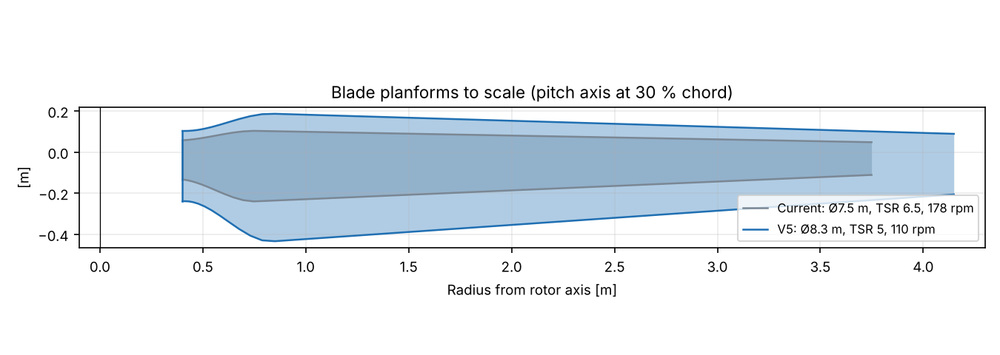
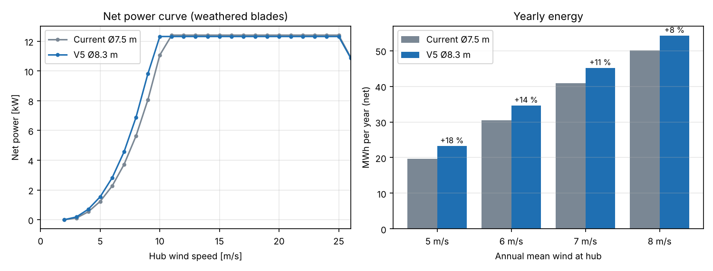
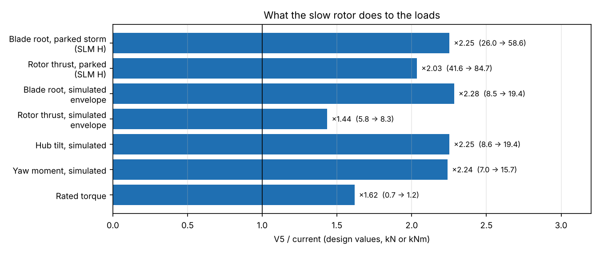
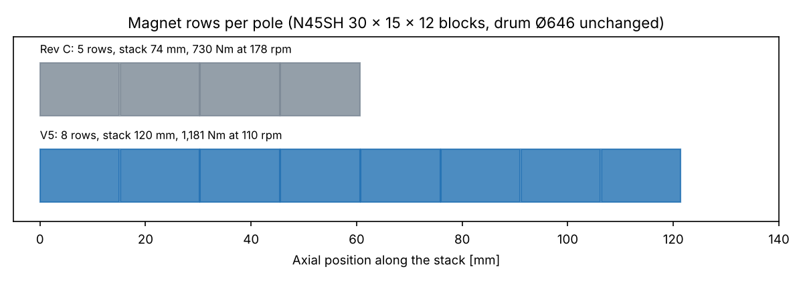

# 12 kW Wind Turbine for Iceland: Slow-Running Variant V5 (Ø8.3 m, TSR 5, 110 rpm)

Status: **Draft, revision 1** · 2026-11-05
Owner: Category 1 (Systems engineering), with all design categories
Request (Martin, 2026-11-05): "Let's try to make a complete version of the one you suggested, 110 rpm TSR 5", and "predict roughly how much energy it would make in one year".
Compares with: the current design, [03 – Rotor](03-rotor-concept.md), [10 – Blade](10-blade-structure.md), [11 – Control](11-control-safety.md), [12 – Power electronics](12-power-electronics.md), [23 – Generator Rev C](23-generator-rev-c.md), [24 – Collective pitch and hub](24-collective-pitch-hub.md), [25 – Yaw](25-yaw-system.md), [09 – Tower](09-tower-foundation.md)
Models: [`analysis/variant_tsr5/`](../analysis/variant_tsr5/). Each script reuses the existing project model unchanged and only replaces its inputs (radius, speed, masses, loads). See the README there for the run order.

## Summary

V5 is the same 12 kW turbine with a larger, slower rotor: **Ø8.3 m, three blades, design tip speed ratio 5, rated 110 rpm**. Every subsystem was re-sized against a new IEC SLM load set and a full 103-case aeroelastic rerun.

| | Current (Ø7.5 m) | **V5 (Ø8.3 m)** | Change |
|---|---|---|---|
| Rated speed / tip speed | 178 rpm / 70 m/s | **110 rpm / 48 m/s** | −38 % / −32 % |
| Rated wind | 10.5 m/s | **10.0 m/s** | −0.5 m/s |
| Rated torque | 730 Nm | **1,181 Nm** | +62 % |
| **Yearly energy, net, 6 m/s mean** | 30,400 kWh | **34,600 kWh** | **+14 %** |
| **Yearly energy, net, 7 m/s mean** | 40,800 kWh | **45,200 kWh** | **+11 %** |
| Blade | 20.5 kg, max chord 0.34 m | **41 kg, max chord 0.62 m** | ×2 |
| Parked storm load at the blade root (SLM H, design) | 26.0 kNm | **58.6 kNm** | ×2.25 |
| Generator | Rev C, stack 74 mm, 200 blocks | **Rev C, stack 120 mm, 320 blocks** | +73 kg |
| Hub + collective pitch | 239 kg | **≈ 365 kg** | +53 % |
| Rotor brake | 2 calipers, 8.7 kNm | **4 calipers, 17.5 kNm** | ×2 |
| Yaw ring | Dpw 360 | **Dpw 450** | one size up |
| Head mass above the tower flange | 1,103 kg | **1,377 kg** | +25 % |
| 18 m tower | 1,940 kg | **2,730 kg** | +41 % |
| Footing, soft volcanic soil | 4.3 m, 11.9 m³ | **4.8 m, 14.7 m³** | +24 % concrete |
| Power electronics | 750 V SiC chain | **unchanged** | none |

**Bottom line: V5 gives 11–14 % more energy at typical Icelandic sites and is
quieter and gentler on the blade leading edge. It pays for that with roughly double the storm
loads on the blades, and so a heavier hub, brake, yaw, tower and footing.**
That is the physics of a slow rotor. At TSR 5 the blades must be about twice
as wide to catch the same power, and a parked blade in a 77 m/s gust sees
its full planform area. Doc 03 picked Ø7.5 m and TSR 6.5 because storm survival
drives the structure in Iceland. V5 is a valid design, and every check below
passes, but it moves the balance towards energy and away from mass.

---

## 1. Rotor (`rotor_tsr5.py`, `power_v5.py`)

Same BEM model, polars, storm ramp (full power to 25 m/s, 40 % at 30 m/s) and losses as doc 03 and doc 12. Only the radius, the design TSR and the speed cap change.

| | Current | V5 |
|---|---|---|
| Diameter | 7.5 m | **8.3 m** (proposed in the viewer study) |
| Design TSR / optimum TSR in operation | 6.5 / 6.9 | **5.0 / 5.4** |
| Cp max, clean / weathered | 0.478 / 0.448 | 0.470 / 0.446 |
| Chord max / tip / root cylinder | 0.34 / 0.16 / 0.19 m | **0.62 / 0.30 / 0.34 m** |
| Blade planform area | 0.85 m² | **1.73 m²** |
| Solidity | 5.8 % | 9.6 % |
| Speed range | 40–178 rpm | **30–110 rpm** |
| Max steady thrust in operation | 2.18 kN | 2.39 kN |
| Pitch at 25 m/s | 26° | 34° |

Note on the diameter: if rated power had to be reached exactly where the
optimum TSR meets the 110 rpm cap, the rotor would be Ø8.76 m. Ø8.3 m reaches
rated 0.5 m/s later (in the constant-speed part of the curve) and keeps the
storm loads 12 % lower. That is the better trade for Iceland.

### Yearly energy

Net energy after generator, rectifier, inverter and 120 W auxiliaries, 97 % availability, Rayleigh wind distribution at hub height. The doc 12 loss chain is used with V5's generator losses (§3).

| Mean wind at hub | Current, weathered | **V5, weathered** | Gain | Current, clean | V5, clean |
|---|---|---|---|---|---|
| 5 m/s | 19,700 kWh | **23,200 kWh** | +18 % | 20,800 | 24,300 |
| 6 m/s | 30,400 kWh | **34,600 kWh** | +14 % | 31,800 | 35,800 |
| 7 m/s | 40,800 kWh | **45,200 kWh** | +11 % | 42,300 | 46,400 |
| 8 m/s | 50,100 kWh | **54,200 kWh** | +8 % | 51,500 | 55,400 |
| 10 m/s | 64,400 kWh | **67,800 kWh** | +5 % | 65,600 | 68,800 |

The gain comes from the 22 % larger swept area below rated wind. It shrinks at
windy sites, because both machines then spend most hours capped at 12 kW.
A rough uncertainty of ±15 % applies to both columns. That covers the generic
polars and the textbook Rayleigh wind; a real site's wind statistics can move
it more. The **ratio** between the two designs is much more reliable than the
absolute numbers. The aeroelastic runs confirm the curve. Mean power in
turbulence is 11.7 kW at 10 m/s and 13.2 to 13.6 kW of shaft power from 12 to 24 m/s.

---

## 2. Loads (`structure_v5.py` SLM, `dlc_v5.py` simulation)

**SLM (IEC 61400-2 simplified load model)**, same reconstructed equations as doc 08, γ_f 3.0:

| Case (design values) | Current | V5 | Ratio |
|---|---|---|---|
| H parked: blade root flap | 26.0 kNm | **58.6 kNm** | 2.25 |
| H parked: shaft thrust | 41.6 kN | **84.7 kN** | 2.03 |
| G shutdown: shaft torque (with the V5 4-caliper brake) | 28.4 kNm | **55.9 kNm** | 1.97 |
| G shutdown: blade root edge | 10.4 kNm | 20.7 kNm | 2.0 |
| E overspeed: blade root pull | 63.7 kN | 54.5 kN | 0.86 |
| D max thrust | 25.4 kN | 31.1 kN | 1.22 |
| A fatigue: blade flap range | 1.62 kNm | 1.88 kNm | 1.16 |

**Aeroelastic rerun.** The doc 11 final case set (103 runs) was rerun in the
in-house simulator. It used the V5 blade (41 kg, flap 13.9 Hz), rotor inertia
480 kg m², a head of 1,300 kg and the resized 18 m tower (0.97 Hz, §6). The
doc 11 controller was kept: constant power, storm ramp, speed exclusion zone
and ±0.3° pitch misalignment.

| Channel (design, γ 1.35) | Current (doc 11 final) | V5 | Governing case (V5) |
|---|---|---|---|
| Blade root resultant | 8.5 kNm | **19.4 kNm** | 6.x parked V_ref, 90° yaw |
| Blade root flap | 7.0 kNm | 16.1 kNm | 7.1 parked, one blade stuck at fine |
| Rotor thrust | 5.8 kN | 8.3 kN | 7.1 parked, blade stuck |
| Hub tilt moment | 8.6 kNm | 19.4 kNm | 7.1 |
| Yaw moment | 7.0 kNm | 15.7 kNm | 7.1 |
| Aero torque on the parked rotor (char.) | 5.8 kNm | **12.0 kNm** | 6.x parked V_ref, 30° yaw |
| Peak rotor speed | 232 rpm (130 %) | 148 rpm (134 %) | 1.3 extreme turbulence; design overspeed 155 rpm |
| Blade flap DEL (m 10) | 3.4 kNm | 4.3 kNm | |
| Tower base DEL (m 4) | 68 kNm | 89 kNm | |

What changes:

- **Parked loads now govern everything structural**, as in doc 08, but more strongly. Operating loads grow much less (thrust +44 %) because the rated thrust hardly changes (2.0 vs 2.1 kN): the bigger rotor runs at a lower thrust coefficient.
- **Speed limits keep the doc 08/11 ratios**: overspeed trip 130 rpm (118 %), design overspeed 155 rpm (140 %).
- **Controller retune.** With the doc 11 gains scaled only by inertia, two normal-turbulence runs at 24–26 m/s tripped on overspeed. Raising the speed-loop bandwidth from 3 to 4 rad/s fixed that. The overspeed torque term was scaled to 1,050 Nm per rad/s, by the torque and speed ratios. After the retune, the only trips are in the extreme turbulence cases (DLC 1.3), exactly as for the current design.

---

## 3. Blade (`structure_v5.py`, doc 10 model)

The doc 10 layup sizing was re-run with the V5 planform and loads, the thickness distribution scaled to the longer blade, and SLM G with the larger brake.

| Option | Mass | Flap / edge frequency | Governs |
|---|---|---|---|
| Glass caps | 47.2 kg | 15.0 / 31.5 Hz | cap buckling, trailing panel buckling |
| Carbon caps (doc 10 choice) | 43.9 kg | 22.3 / 34.9 Hz | cap buckling (caps far thicker than strength needs) |
| **Carbon caps with foam core and inner skin** | **41.1 kg** | **13.9 / 31.1 Hz** | panel buckling, web shear; SLM H strain 0.69 |

**Recommendation: carbon caps backed by core.** The V5 caps are 0.19 m wide (0.3 c), twice
the current width, so plain thin caps buckle long before they are strong
enough. A cored cap fixes that with the least material: caps 2.5 mm at the root
tapering to 1.0 mm from mid-span, webs at 15 % and 45 % chord as in doc 10.
Blade flap frequency at 110 rpm is 14.1 Hz, far above 3P (5.5 Hz). Tip
deflection is 0.04 m against 0.95 m tower clearance.

**Root joint:** Ø0.30 m root, **14 × M16 inserts on PCD 265**, 67 kN per bolt against 113 kN (SLM H 58.6 kNm with 52.8 kN pull at design overspeed). The aerodynamic root cylinder (Ø0.34 m) narrows to Ø0.30 at the flange.

Mass doubles. The cured blade is 4.15 m long and 0.62 m wide, which still suits
in-house infusion, but the moulds are new: no part of the doc 10 tooling carries over.

---

## 4. Generator (`generator_v5.py`, based on Rev C)

**The simplest possible change: keep everything in Rev C and make the stack longer.**
The drum stays Ø646 (Martin's decision of 2026-11-05) and the 40 poles and 45 slots stay. The same
N45SH 30 × 15 × 12 block is used, with the same 28 turns and the same wire.

Why it works: torque per amp and EMF per rpm both scale with stack length. The stack
grows from 74 to **120 mm** (×1.62), and 1,181 / 730 Nm = 1.62. So the rated
current stays the same, and the EMF at 110 rpm is 1.62 × 110/178 = 1.00 × the Rev C EMF at 178 rpm.
The voltage, current, converter and the demagnetisation margins (they depend on
current per turn, not stack length) are all unchanged. The doc 23 2D FEA is
per unit length, so its results scale exactly. End effects favour the longer stack.

| | Rev C | **V5** |
|---|---|---|
| Stack / magnet rows / blocks | 74 mm / 5 / 200 (+10 spares) | **120 mm / 8 / 320 (+16 spares)**, rows 121.4 mm |
| Skew | 5 steps of 0.20° | 8 steps of 0.125° |
| Magnet mass | 8.2 kg | 13.1 kg |
| Line EMF at rated, 100 °C | 372 V at 178 rpm | **373 V at 110 rpm** |
| Electrical frequency | 59.3 Hz | 36.7 Hz |
| Peak line voltage, −30 °C at design overspeed | 852 V | 854 V |
| Transient short-circuit demag margin, 100 °C | 30.1 % | 30.1 % |
| Copper loss at rated | 518 W | **703 W** (turns 36 % longer) |
| Core + rotor loss | 258 W | 210 W (lower frequency) |
| Generator efficiency at rated | 94.7 % | **94.0 %** |
| Drum stability (shell, ends held round) | 302 × | 211 × |
| Mass rotor / stator / total | 161 / 115 / 276 kg | **181 / 168 / 349 kg** |

**Cooling (passive, doc 23 §4a model).** The rotor turns 38 % slower, so the
inside air is stirred less (h_int scaled by speed^0.8), and the copper loss is
36 % higher. With the Rev C package as drawn (Ø676 ribs), the hot spot reaches
**132 °C at 110 % load on a hot day**, just over the 130 °C limit. With the
Ø696 option (60 ribs, 27.5 mm high) it is **125 °C**, and 81 °C at a typical
Icelandic 10 °C. Magnets stay below 60 °C. **V5 needs the Ø696 ribs.** The ribs
also get 46 mm longer with the drum; that was not credited, so it is margin.

The longer stack also means: a carrier and drum 46 mm longer, 8 rows of
magnets to place, and the same coils with longer straight legs. The stator
segment tooling and the winding process of doc 18 carry over, with only
the stack fixture changed.

---

## 5. Hub, collective pitch and rotor brake (`hub_yaw_v5.py`, doc 13/24 models)

| | Doc 24 (current) | **V5** |
|---|---|---|
| Pitch bearing (4-point, ungeared) | Dpw 250, 22.2 mm balls, ≈ 19 kg | **Dpw 350, 30 mm balls, Z 32, ≈ 29 kg**: s0 1.37 (SLM H, ≥ 1.25), L10 300 × the need |
| Pitch trip torque per blade (−30 °C, SLM G) | 433 Nm | **780 Nm** (bearing friction under the doubled brake load, plus aero) |
| Crank radius | 110 mm | **140 mm** (stroke 205 mm), to keep the cylinder size reasonable |
| Electric cylinder | 25.5 kN rated, 11.3 Nm motor | **34 kN rated, 15 Nm motor** |
| Storm holding on the screw (all blades pushing, ×1.5) | 20 kN, brake 7.7 Nm | **55 kN, brake ≈ 21 Nm**: Ø40 screw with C₀ ≥ 110 kN |
| Supercap strokes at end of life | 5.1 | **2.8** (2 required). One module still meets it, with less margin |
| Welded hub | shell Ø460 × 10, necks Ø330 × 10, 117 kg | **shell Ø580 × 10, necks Ø410 × 10, ≈ 196 kg**: neck hot spot 119 MPa static (≤ 323), 27.5 MPa fatigue (≤ 42) |
| Hub-to-drum joint | 12 × M16 PCD 400 | **14 × M16 PCD 400** (or 12 × M20), for SLM G torque 55.9 kNm |
| **Hub + pitch total** | 239 kg | **≈ 365 kg** |

The pitch moments themselves stay small (the slow rotor has a low centrifugal
twisting moment). The growth comes from bearing friction under the doubled
storm and brake loads, and from the 1.1 kNm per blade storm holding moment of the wide blades.

**Rotor brake.** The simulation shows **12.0 kNm aerodynamic torque on the
parked, feathered rotor** at V_ref with 30° yaw error. That is more than the
current 8.7 kNm brake can hold (current design: 5.8 kNm). **V5 needs four
calipers instead of two (17.5 kNm, 1.45 × the parked torque).** With all
blades stuck at fine pitch (requirement R3.8 of doc 24), the aerodynamic torque is
6.2 kNm at 32 m/s and design overspeed, so the doubled brake gives 2.8 × margin.
The disc and its radius stay as they are; there is room for four calipers around the Ø646 drum.

**Main bearings and spindle** (doc 07): their margins were very large (spindle
reserve 17, bearing C required 33 kN on a 140 mm seat). With about 2.3 × the
tilt moment and a 46 mm longer spindle they still pass comfortably (reserve about 7).
The spindle grows only to keep the bearing spacing around the longer stator (≈ 70 kg instead of 57).

---

## 6. Yaw (`hub_yaw_v5.py`, doc 25 model)

| | Doc 25 | **V5** |
|---|---|---|
| Mass above the yaw bearing | 969 kg | **1,243 kg** |
| Design tilt moment at the bearing (SLM H + shaft moment) | 34.6 kNm | **64.8 kNm** |
| Ring Dpw 360, s0 | 1.44 | **0.76: fails** |
| **Ring Dpw 450** (22.2 mm balls), s0 | – | **1.32** (≥ 1.25) |
| Yaw holding moment (design) | 8 kNm | **17.9 kNm** |
| External gear | z150 m4, face 50 | **z180 m4, face 70**: static S_H ring 1.16, pinion 1.51; S_F > 2.6 |
| Gearbox static rating needed | ≥ 1,500 Nm | **≥ 2,800 Nm** |
| Bolts (bedplate, adapter, tower flange) | | loaded to 40–59 % of preload: pass |

The yaw concept of doc 25 stays: passive friction pads, two braked
gearmotors, no hydraulics. Only the sizes change. The ring goes one standard size up,
and the pads, adapter NY-400 and bedplate interface grow with it. The
gearmotors need a heavier output stage (≥ 2,800 Nm static), but the same 0.18 kW motors.

---

## 7. Tower and footing (`tower_v5.py`, doc 09 model)

The doc 09 sizing was re-run with the V5 head (1,377 kg), V5 operating loads and fatigue spectra
from the simulation, and the parked side force on the rotor scaled with blade area
(22.7 kN against 13.8 kN). The frequency window follows the new speed range: 1P runs to 1.83 Hz
and 3P starts at 1.5 Hz. A freestanding tower therefore sits below 3P(30 rpm)/1.1 = 1.36 Hz, with a speed
exclusion zone around its 1P crossing, as in doc 09.

For a fair comparison the current turbine was sized in the same run with its
**real 1,103 kg head** (doc 25; doc 09 used 480 kg). Its operating loads were still simulated with the light head.

| 18 m freestanding monopole | Current (1,103 kg head) | **V5** |
|---|---|---|
| Base Ø / top Ø / walls | 0.55 / 0.32 m, 10 / 8 mm | **0.50 / 0.42 m, 16 / 8 mm** |
| Mass | 1,940 kg | **2,730 kg** |
| First frequency, rigid / soft soil with ice | 0.91 / 0.85 Hz | 0.97 / 0.91 Hz |
| Speed exclusion zone | 50–60 rpm | **53–64 rpm** (around 5.5 m/s wind; rotor is in the zone 3–5 % of the time at 4–6 m/s) |
| Governing case | parked V_e50, side wind | earthquake 0.5 g + operation, parked V_e50 close behind |
| Base moment, design | 653 kNm | **931 kNm** |
| Utilisation / fatigue damage, mid flange | 0.85 / 0.23 | 0.96 / 0.84 |
| Base flange | 24 × M24 on 0.65 m | **32 × M24 on 0.60 m** |
| Mid flange | 12 × M24 | 16 × M24 |

| Footing (square, 1.6 m deep) | Current | **V5** |
|---|---|---|
| Firm soil | 3.8 m, 9.5 m³ | **4.3 m, 11.9 m³** |
| Soft volcanic soil | 4.3 m, 11.9 m³ | **4.8 m, 14.7 m³** |
| Frost-susceptible silt | 4.0 m, 10.4 m³ | **4.5 m, 13.0 m³** |
| Rock plinth, anchors | 8 × Ø28 | **8 × Ø40** |

The tower frequency used in the load rerun (0.97 Hz) is this result: the
loop was run twice and closed. Two items in `tower.py` are hard-wired to the current rotor and
were not changed: the side-side 1P resonance check and the rotor area in the
tilt-up case. Both need updating before the tower is detailed.

---

## 8. Power electronics (`power_v5.py`, doc 12 model)

**No change.** Voltage and current are the same as Rev C at rated, so the doc 12 chain carries over:
active SiC rectifier, 750 V DC link, dump load, and the grid, heating and battery modules.

| | Current | V5 |
|---|---|---|
| Rated: EMF / current / DC link needed | 379 V / 20.7 A / 642 V | 380 V / 20.7 A / **619 V** |
| E-stop braking at peak speed: DC link needed | 882 V | **840 V** (lower frequency, less reactive drop) |
| Lowest operating speed: EMF | 138 V at 40 rpm | 103 V at 30 rpm (boost ratio ≈ 5, within the active rectifier's range) |
| Rotor energy at e-stop | 64 kJ | 54 kJ |
| Rectifier + inverter efficiency | 97.3 % | 97.3 % |

---

## 9. Mass and part changes

| Item | Current | V5 |
|---|---|---|
| Blades | 3 × 20.5 kg | 3 × 41.1 kg |
| Hub + pitch | 239 kg | ≈ 365 kg |
| Generator | 276 kg | 349 kg |
| Spindle | 57 kg | ≈ 70 kg |
| Bedplate, cover, cabling, yaw (nacelle side) | 336 kg | 336 kg (bedplate to be re-checked for the Dpw 450 ring) |
| **Above the yaw bearing** | **969 kg** | **1,243 kg** |
| Yaw tower side + adapter | 134 kg | 134 kg (grows with the ring, not yet counted) |
| **Head above the tower flange** | **1,103 kg** | **1,377 kg** |
| 18 m tower | 1,940 kg | 2,730 kg |
| **Steel and composites above the footing** | **≈ 3.0 t** | **≈ 4.1 t** |

What carries over unchanged: converter and all electrical modules, controller
and safety architecture (new gains), generator electromagnetic design, winding,
segments, drum diameter, magnet block, collective pitch concept, yaw concept,
tower concept and tilt-up method.

What is new: blade moulds, generator stack length, a larger pitch bearing, hub, crank
and cylinder, four brake calipers, a larger yaw ring and gear, the tower and footing drawings.

---

## 10. Assessment

**For V5:**
- **+11 to +14 % energy** at the 6–7 m/s sites that most customers will have,
  and +18 % at sheltered 5 m/s sites. Rated power is reached at 10.0 m/s.
- **Tip speed 48 m/s instead of 70 m/s.** Leading-edge erosion from rain, ash and
  sleet scales roughly with the 5th to 8th power of tip speed. This is a real
  durability gain in Iceland and may remove the need for a replaceable
  leading-edge shield. It also cuts noise by about 8 dB(A) at the source (50·log of the tip speed ratio), which helps near houses.
- Lower design overspeed (155 rpm). Rotating loads on the blades, generator and magnet bonds are lower.
- The electrical system, the generator's electromagnetic design and all control concepts carry over.

**Against V5:**
- **Storm loads roughly double** at the blade root, rotor thrust when parked,
  hub tilt, yaw and parked rotor torque. Every structure from the blade root to the footing gets heavier:
  **+1.1 t of steel and composites per turbine, +25 % head mass**, and +24 % footing concrete.
- **New blade tooling** and twice the blade material. The blades are 0.62 m wide, so handling, transport and the hub spinner grow.
- Generator efficiency 0.7 points lower at rated (more copper per turn). This is already included in the energy figures.
- Bigger parts on the critical path: pitch bearings (Dpw 350) and yaw ring (Dpw 450), a 34 kN cylinder with a Ø40 screw, and four brake calipers.

**My recommendation:** treat V5 as a credible second product rather than a
replacement. It suits low-wind and noise-sensitive sites (inland valleys, near
houses), where +15–18 % energy matters most and storms are milder. For exposed
coastal and highland sites, the current Ø7.5 m rotor remains the better
balance, as doc 03 concluded. If one product must cover everything (the brief
so far), the deciding question is whether +11–14 % energy is worth about
+35 % more structure. I would keep Ø7.5 m as the baseline.

A middle option worth one more study: **Ø8.0 m at TSR 5.5–6 (≈ 135–150 rpm)**.
It should give about two-thirds of V5's energy gain for about half of its load growth.

---

## 11. Open points if V5 goes ahead

1. **Blade:** detailed layup with cored caps, root transition Ø0.34 → 0.30, mould design; reconsider a third shear web against cap buckling.
2. **Parked load mitigation:** park with one blade pointing down (azimuth control) and check whether the 6.x and 7.1 cases drop. That could pull back part of the hub, yaw and tower growth.
3. **Generator:** update the Rev C drawings to the 120 mm stack (NP1-200C carrier, 201C stacks, 210C drum, 223C pole pack with 8 rows), and adopt the Ø696 ribs.
4. **Hub and pitch:** 3D clash check with crank r140 and the Dpw 350 bearings, hub FEA, cylinder supplier enquiry (34 kN, Ø40 screw).
5. **Brake:** four-caliper layout on the drum; check the cover lip clearance.
6. **Yaw:** Dpw 450 ring RFQ and new adapter NY-400; bedplate interface.
7. **Tower:** update the side-side resonance and tilt-up checks in `tower.py` for the V5 rotor, then do the 24 m tower.
8. **Certification loads:** the simulator has no edgewise blade DOF or dynamic stall. Wide blades at 30° yaw while parked need an OpenFAST/QBlade check even more than the current design does (doc 08 open point).
