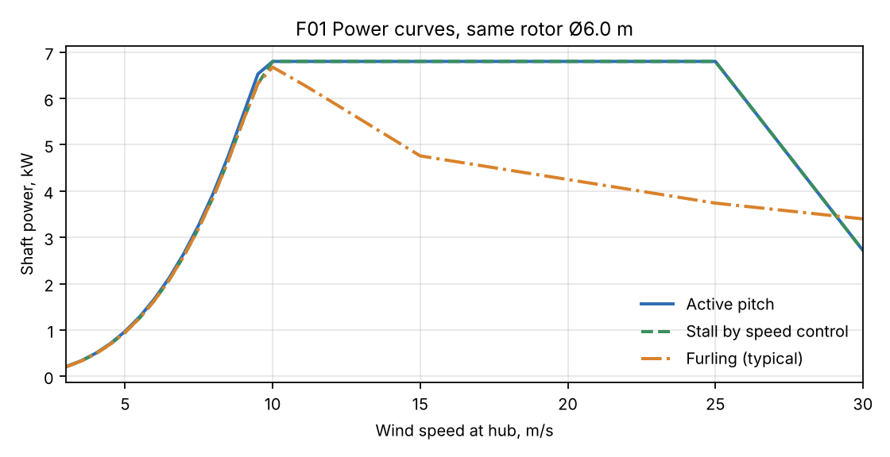
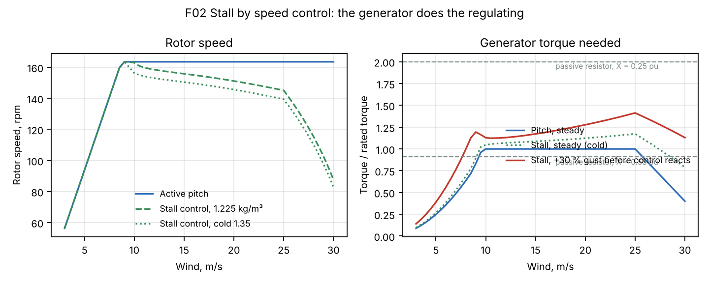
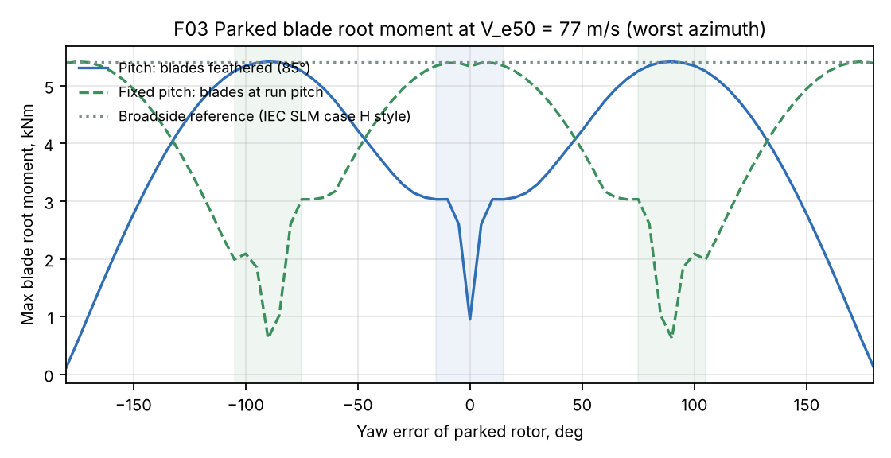
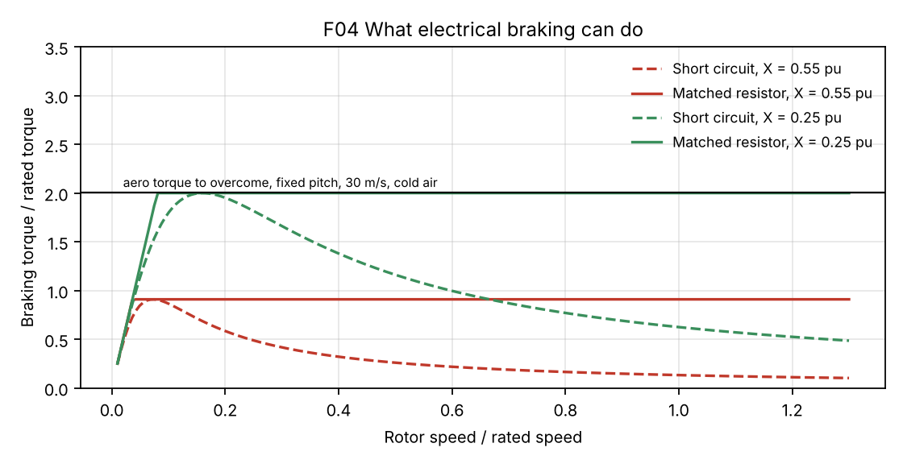

# 6 kW Wind Turbine for Iceland: Concept Study and the Pitch Question

Status: **Draft, revision 1** · 2026-11-06
Owner: Category 1 (Systems engineering), with 2 (Rotor), 3 (Hub/pitch/yaw), 7 (Power electronics), 8 (Control and safety)
Request (Martin, 2026-11-06): "designing 6 kW turbine from scratch, have a study whether variable pitch is a must and overall what would be the best design for it"
Builds on: [02 – Design basis](02-design-basis.md), [03 – Rotor](03-rotor-concept.md), [11 – Control](11-control-safety.md), [12 – Power electronics](12-power-electronics.md), [24 – Collective pitch](24-collective-pitch-hub.md), [25 – Yaw](25-yaw-system.md), [27 – Size/TSR map](27-size-tsr-decision-map.md)
Model: [`analysis/turbine_6kw/`](../analysis/turbine_6kw/) (`sizing.py`, `regulation.py`)

This is a separate product from the 12 kW machine. Nothing from the 12 kW design is assumed. The same brief applies: Iceland, all environments (sheltered farm to highland), all use cases (grid-tie, off-grid battery, heating), quality first, in-house manufacture, simple and proportionate.

## Summary

**Variable pitch is not a must at 6 kW.** The best overall concept is a **fixed-pitch, variable-speed rotor that the generator slows into stall above rated wind**, with two independent fail-safe stopping systems (a normally-closed braking-resistor contactor and a spring-applied disc brake) and active yaw that turns the parked rotor out of the wind in storms.

Why, in four results from the study:

1. **Pitch buys almost no energy.** On the same Ø6.0 m rotor, stall regulation by speed control gives **1.0–1.7 % less** yearly energy than active pitch. Furling loses **5–12 %**, most at windy sites.
2. **Pitch does not lower the storm design loads of a small turbine.** Feathered blades only help while the rotor is held into the wind. If yaw is lost in a storm (likely in an Icelandic grid outage) a feathered rotor sees the same broadside load as a fixed one: **5.4 kNm** blade root, both cases. With yaw working, a fixed-pitch rotor yawed 90° out of the wind is exactly as good as a feathered one held into it: **3.0 kNm** both. The IEC 61400-2 simple load model gives no credit for feathering either.
3. **Stall control moves the job from the hub to the generator.** The generator must give **1.2× rated torque** continuously and about **1.4×** in gusts, and the stopping systems must overcome **2.0×** (BEM) at 30 m/s in cold air. That is a modestly bigger generator, a 2× dump resistor and a 3× spring brake, all static parts inside the nacelle.
4. **What pitch costs at 6 kW is large in proportion.** Three pitch bearings, an actuator, linkage, a supercap, slip-ring power, sensors and hub electronics, about **130 kg** of rotating parts that ice up, wear by oscillation, and must be serviced at hub height. On the 12 kW machine that is a reasonable share. On a 6 kW machine it is a third of the complexity for 1–2 % energy.

**Recommended concept "S6"** (key numbers in §8): 3 blades upwind, **Ø6.0 m**, fixed pitch, design TSR 5.5, **164 rpm** max (tip 51 m/s), **6 kW** electrical at **9.7 m/s**, direct-drive outer-rotor PM generator rated **400 Nm** nominal / **480 Nm** continuous / **600 Nm** for 10 s, 18 m tilt-up tower, about **720 kg** tower-top mass, about **43.7 dB(A) at 60 m** (model, ±4 dB). Yearly energy **12.0 / 17.1 / 22.2 / 28.6 MWh** at sheltered / inland / coastal / highland sites.

The main risk is that BEM is weakest exactly in deep stall. Real 3D stall usually gives more torque than BEM, so every stall torque below carries a 1.5× margin, the blade has a ±2° pitch shim at the root flange for tuning, and the first prototype must measure its high-wind power curve and brake stops before the design is frozen.

---

## 1. The rotor

The doc 27 model, run for 6 kW (`sizing.py`). Energy is net yearly MWh at the four doc 27 Icelandic site types (5.0 / 6.0 / 7.0 / 8.5 m/s mean at 18 m hub).

| Rated wind | TSR | Ø m | rpm | Tip m/s | dB(A) at 60 m | MWh/yr: sheltered / inland / coastal / highland | Parked blade root, kNm (SLM H) | Head kg (pitch version) |
|---|---|---|---|---|---|---|---|---|
| 9.0 | 5.5 | 6.62 | 143 | 49.5 | 44.2 | 13.9 / 19.4 / 24.7 / 30.9 | 24.7 | 882 |
| 9.0 | 6.0 | 6.61 | 156 | 54.0 | 45.9 | 13.9 / 19.4 / 24.7 / 30.9 | 20.8 | 842 |
| **9.5** | **5.5** | **6.10** | **164** | **52.2** | **43.8** | **12.4 / 17.7 / 22.9 / 29.3** | **19.4** | **825** |
| 9.5 | 6.0 | 6.09 | 179 | 57.0 | 45.5 | 12.4 / 17.7 / 22.9 / 29.3 | 16.3 | 791 |
| 10.0 | 5.5 | 5.65 | 186 | 55.0 | 43.5 | 11.0 / 16.1 / 21.2 / 27.7 | 15.4 | 778 |
| 10.5 | 5.5 | 5.25 | 210 | 57.8 | 43.2 | 9.8 / 14.6 / 19.6 / 26.2 | 12.3 | 740 |

**Choice: Ø6.0 m, TSR 5.5, speed cap 164 rpm, rated at about 9.7 m/s** (240 W/m² shaft).

- A 6 kW machine sells to farms, summer houses, off-grid and heating customers, often at sheltered sites. A rotor bigger than the 12 kW-style 10.5 m/s rule pays there: Ø6.0 m gives **+18 %** energy at a 6 m/s site over Ø5.25 m.
- Going to Ø6.6 m adds another 10 % but raises the parked blade moment by 30 % and pushes rated wind down to 9 m/s, which means more regulation work above rated. Ø6.0 m is the balance. Ø6.6 m stays a possible "low-wind" blade set on the same hub later.
- TSR 5.5 keeps the noise under the R2.7 target (45 dB(A) at 60 m) with margin and keeps the tip speed low for ash and rain erosion. TSR 6 would be 1.7 dB louder for slimmer blades.

## 2. The ways to limit power and protect the rotor

| Option | How it limits power | How it stops in a storm or fault | Used in practice |
|---|---|---|---|
| **A. Active pitch** | Blades turn toward feather above rated, speed held at the cap | Feather + spring brake | Most turbines above ~20 kW; our 12 kW (doc 24) |
| **B. Stall by speed control** | Fixed blades; the converter slows the rotor so the blades stall and power stays at rated | Braking resistor + spring brake; yaw out of wind when parked | Many small variable-speed turbines |
| **C. Furling** | Tail vane: rotor yaws out of the wind as thrust rises | Rotor keeps running furled; optional brake | Classic small battery-charging turbines |
| **D. Passive / flexible pitch** | Springs, centrifugal weights or flexible blades twist the blades toward feather or stall as speed and thrust rise | Same mechanism, plus a brake | Some small turbines; hard to tune and certify |
| **E. Electrical braking only** | Not a regulation method on its own | Shorted or resistor-loaded generator | Used as a stopping aid |

A, B and C were modelled on the same rotor. D and E are judged from the same numbers.

## 3. Energy

Net yearly energy, MWh (`regulation.py`, same loss chain as doc 27):

| | Sheltered 5 m/s | Inland 6 m/s | Coastal 7 m/s | Highland 8.5 m/s |
|---|---|---|---|---|
| A. Active pitch | 12.05 | 17.33 | 22.51 | 28.92 |
| **B. Stall by speed** (fixed pitch −2°) | **11.84 (−1.7 %)** | **17.07 (−1.5 %)** | **22.22 (−1.3 %)** | **28.62 (−1.0 %)** |
| C. Furling, typical curve | 11.50 (−4.6 %) | 16.25 (−6.2 %) | 20.68 (−8.1 %) | 25.40 (−12.2 %) |

- B holds rated power from 10 to 25 m/s like A. Its small loss is below rated: the fixed pitch is set 2° toward stall so that the stall is earlier and the stall torques lower. At −1° the loss is under 0.5 % for 7 % more gust torque. That is a tuning choice for the prototype (§7).
- C cannot hold rated power. The rotor yaws out early and the power falls with wind. The curve used (70 % of rated at 15 m/s, 55 % at 25 m/s) follows the shape of published small furling turbines. That loss is worst exactly where Icelandic customers have the most wind.
- Ice losses are not included. They are the same for A and B.

## 4. What stall control asks from the generator

Above rated wind, B slows the rotor from 164 rpm to about 140 rpm at 25 m/s (cold air), so the blades are deeper in stall. Power is held, so torque rises a little:

| Fixed pitch −2°, cold air 1.35 kg/m³ | Torque / rated torque (397 Nm) |
|---|---|
| Steady, worst point (25 m/s) | **1.17** |
| Gust: wind jumps +30 % before the controller reacts | **1.41** (power briefly 1.20×) |
| To stop the rotor at 30 m/s from 1.15× speed (worst speed) | **2.00** |
| Same at 35 m/s | 2.18 |
| A. Active pitch, any wind | 1.00 + control margin |

With the 1.5× margin for 3D stall these become the design values: **generator 1.2× continuous (480 Nm) and 1.5× for 10 s (600 Nm)**, **converter and dump resistor 2× rated power**, **stopping systems 3× rated torque (1.2 kNm)**.

Two other numbers decide the safety design:

- **Runaway.** If all electrical load is lost and nothing brakes, a fixed-pitch rotor accelerates to about TSR 11.7: **930 rpm at 25 m/s, 290 m/s tip speed.** That destroys the rotor. Fixed pitch therefore needs two stopping systems that each work without power and without the controller. (A pitch rotor has the same need, met by the feather actuator and the brake.)
- **Operating thrust** is higher with stall: 1.7 kN vs 1.1 kN for pitch, flap moment 0.79 vs 0.66 kNm. Both are far below the parked storm loads (§5), so they do not size anything.

## 5. Storm survival: parked loads

Blade root moment of a stopped rotor at V_e50 = 77 m/s, cold air, worst azimuth, characteristic values (strip theory with 360° polars, flat plate Cd 1.5):

| Parked state | Blade root, kNm | vs broadside |
|---|---|---|
| A. Feathered, yaw held within ±15° | 3.0 | 56 % |
| **B. Fixed pitch, rotor yawed 90° out of the wind (±15°)** | **3.0** | **56 %** |
| B. Fixed pitch, rotor facing the wind | 5.4 | 100 % |
| A or B, yaw lost (any wind direction) | 5.4 | 100 % |
| Broadside reference (IEC 61400-2 SLM case H style) | 5.4 | 100 % |

This is the central result. A feathered blade is edge-on to the wind only while the rotor points into the wind. Turn the wind 90° and the feathered blades are broadside. A fixed-pitch rotor is the mirror image: broadside when facing the wind, edge-on when yawed 90° out. **So the storm loads depend on the yaw system holding the right position, not on pitch.** The design must survive the yaw-lost case anyway (grid outages and storms come together in Iceland), and the IEC 61400-2 simple load model already assumes broadside for every turbine. Blades, hub, shaft and tower are therefore sized by the same broadside load for A and B.

Concept B uses this: in a storm it stops, yaws 90° out of the wind with the yaw drive (about 3 minutes, from a small 48 V battery if the grid is down) and holds there with the yaw brake. Its normal storm load is then the same as a feathered pitch rotor.

## 6. Comparison

| Criterion | A. Active pitch | **B. Stall by speed** | C. Furling | D. Passive pitch | E. Electrical only |
|---|---|---|---|---|---|
| Energy (vs A) | reference | **−1 to −2 %** | −5 to −12 % | ≈ −2 to −5 % (tuning) | n/a |
| Storm design loads | broadside (yaw lost) | **broadside (yaw lost), same as A** | lower thrust when furled, gyroscopic yaw loads | broadside | n/a |
| Stopping in a fault | feather + brake | **resistor contactor + brake, both fail-safe** | furl + brake | mechanism + brake | **cannot stop above ~0.9–2× torque** |
| Icing | pitch bearings and linkage can freeze; ice changes nothing else | **nothing moves in the hub**; ice lowers power, never raises it | tail and furl hinge ice up, furl behaviour changes | spring/weight tuning changes with ice mass | — |
| Gusty Icelandic wind | smooth power, lowest torque | 1.4× torque peaks, absorbed by converter and resistor | yaw hunting, noise, fatigue | hard to damp | — |
| Grid-tie / off-grid / heating | all | **all; the dump resistor is the heater in heating mode** | weak for grid-tie (unsteady power) | all | — |
| Noise | rotor stays at 164 rpm in high wind | **rotor slows in high wind (quieter)** | furl events loud | — | — |
| Parts in the rotating hub | 3 bearings, actuator, linkage, supercap, slip ring power, sensors | **none (bolted blades)** | none | hinges, springs, dampers | none |
| Tower-top mass (est.) | ≈ 820 kg | **≈ 720 kg** | ≈ 650 kg | ≈ 750 kg | — |
| In-house manufacture | bearing RFQ, precision linkage | **simplest hub; generator a bit larger** | simple | tuning and testing heavy | — |
| Certification (IEC 61400-2) | standard | standard; stall behaviour must be shown by test | yaw-rate loads (SLM case D) large | behaviour must be proven by test | not allowed as sole system |

**D (passive or flexible pitch)** has most of the hub hardware of A, but no control over it. Its behaviour depends on spring rates, blade mass and stiffness, so a layer of rime or wet snow changes how it regulates. It cannot be commanded to feather for a stop. Not recommended.

**E (electrical braking only)** cannot be the safety system. A shorted PM generator gives its peak torque only at a few percent of rated speed (F04). With the reactance of our 12 kW generator (0.55 pu), even a perfectly matched resistor gives only 0.9× rated torque, half of what is needed to stop a stalled rotor at 30 m/s. A generator designed with 0.25 pu reactance reaches 2.0×. Electrical braking is therefore one of the two stopping systems in B, with the spring brake as the other, never alone.

## 7. Answer to the question

**Is variable pitch a must?** No, not at 6 kW, for any of the Icelandic environments or use cases. It would be justified if one of these became true:

- the product moves up to 15 kW or more, where the stall torque margin makes the generator and brake grow faster than a pitch system does;
- we decide to certify on full aeroelastic loads **and** guarantee yaw through every storm (backup power and redundant yaw drives), so feathering can be credited; even then, yawing a fixed rotor out of the wind gives the same load;
- prototype tests show that real stall torques are well above the 1.5× margin.

**What B needs to be done right** (these replace the pitch system, they are not optional):

1. **Generator** designed for 1.2× rated torque continuously and 1.5× for 10 s, and for **≤ 0.30 pu synchronous reactance**, so that the passive resistor alone can hold the rotor in a 25 m/s storm (1.7× torque).
2. **Two independent fail-safe stopping systems**, each able to stop the rotor alone from 1.15× speed at 30 m/s in cold air:
   - a **normally-closed contactor** that connects the generator to a three-phase braking resistor whenever control power, the controller or the converter fails (closes on loss of power, needs no electronics);
   - a **spring-applied disc brake**, 3× rated torque (≈ 1.2 kNm), released by power. Simulated stop at 30 m/s: **2.9 s, 39 kJ**.
3. **Dump resistor and converter rated 2× power for short times** (12 kW resistor). In the heating version the resistor is the water heater.
4. **Active yaw with yaw-out parking**: one braked gearmotor, passive friction pads (as doc 25, scaled down), a 48 V battery that can always yaw the stopped rotor 90° out of the wind.
5. **Tunable fixed pitch**: blade root flange with ±2° shims, set to −2° to start.
6. **Prototype proof before freeze**: high-wind power curve, gust response, stall-induced edgewise vibration check, brake and resistor stops at real wind speeds, sound measurement.

## 8. Recommended concept S6: key numbers

| Item | Value |
|---|---|
| Configuration | 3 blades, upwind, active yaw, fixed pitch, variable speed, direct drive |
| Rotor | Ø6.0 m, design TSR 5.5, Cp max 0.44 (rough blades), fixed pitch −2° (±2° shims) |
| Speed | 0–164 rpm, tip 51 m/s; slows to ≈ 140 rpm at 25 m/s (stall control) |
| Rated power | 6.0 kW electrical (6.8 kW shaft) at ≈ 9.7 m/s; held to 25 m/s, ramp down 25–30 m/s, stop above 30 m/s |
| Yearly energy | 12.0 / 17.1 / 22.2 / 28.6 MWh (sheltered / inland / coastal / highland), before ice losses |
| Sound | ≈ 43.7 dB(A) at 60 m, 40 dB(A) at ≈ 95 m (model, ±4 dB) |
| Generator | outer-rotor PM, 400 Nm rated, 480 Nm continuous, 600 Nm 10 s, X ≤ 0.30 pu |
| Power electronics | active rectifier + DC bus, plug-in modules for grid-tie / heating / 48 V battery (doc 12 architecture at 6 kW), dump resistor 12 kW |
| Stopping systems | (1) normally-closed braking-resistor contactor, (2) spring-applied disc brake 1.2 kNm; either stops the rotor alone |
| Storm strategy | stop, yaw 90° out of the wind, hold with yaw brake; survives yaw-lost broadside load |
| Blade | ≈ 2.7 m long, max chord 0.38 m, sized for broadside V_e50 (SLM H ≈ 18 kNm design); bolted root flange, no pitch bearing |
| Hub | simple welded or cast flange hub, ≈ 35 kg (pitch version ≈ 170 kg) |
| Tower-top mass | ≈ 720 kg (estimate) |
| Tower | 18 m tilt-up monopole, ≈ 1.5 t (doc 27 scaling) |
| Design class | as doc 02: Class S, V_ref 55 m/s, V_e50 77 m/s, I15 0.20, −40 °C survival, C5-VH |

## 9. Next steps (proposed)

1. Generator concept for 400/480/600 Nm at 164 rpm with ≤ 0.30 pu reactance, reusing the 30×15×12 N45SH block if it fits.
2. Aeroelastic runs of S6 with `analysis/loads/sim.py`: gusts in stall, grid loss, both stopping systems alone, yaw-lost parked case, stall-induced vibration.
3. Blade structure (doc 10 method) for the broadside load, and the shim flange.
4. Safety chain (contactor, resistor, brake, yaw-out) written into a control and protection spec like doc 11.

## 10. Limits of this study

- Steady BEM with 2D Viterna polars. Deep stall at low TSR is BEM's weakest point; 3D stall delay usually adds torque. Covered by the 1.5× margin and the prototype tests, not by the model.
- Parked loads are characteristic strip-theory values without dynamics; the SLM H value in the table above includes the doc 27 calibration and partial safety factor.
- Masses for B are estimates: doc 27 pitch-version head mass minus the pitch hub, plus 20 % generator mass for the torque margin.
- The furling power curve is an assumed typical shape, not a design.
