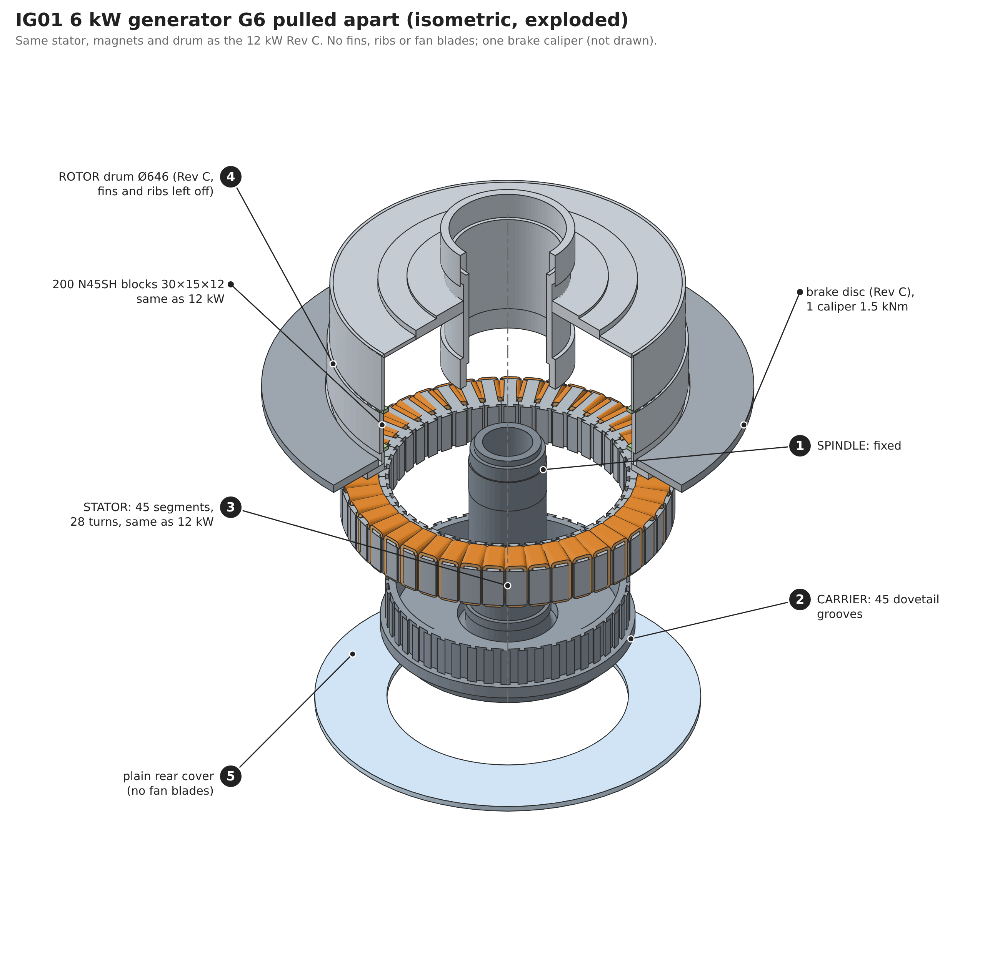
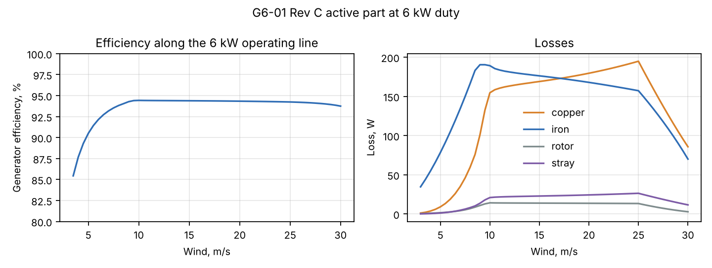
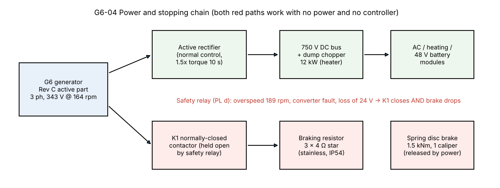
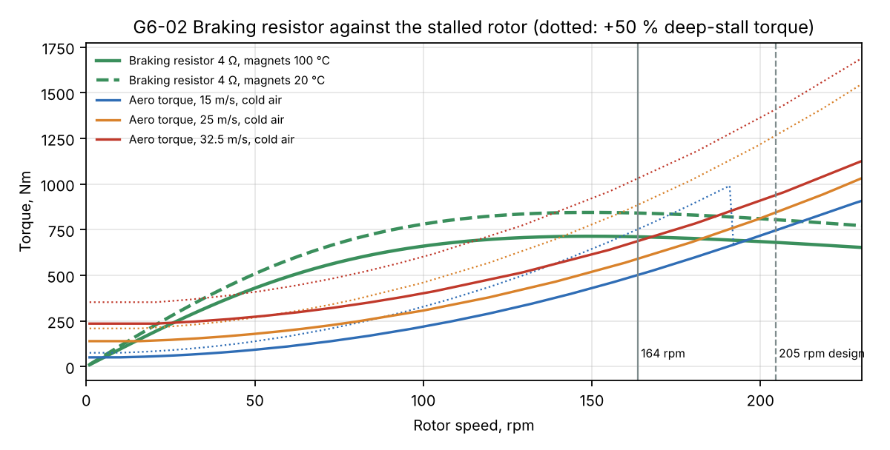
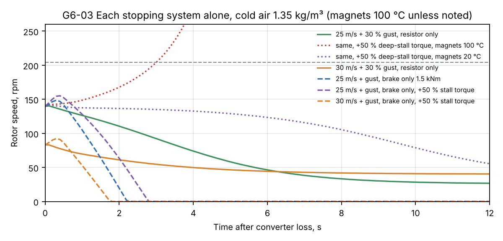
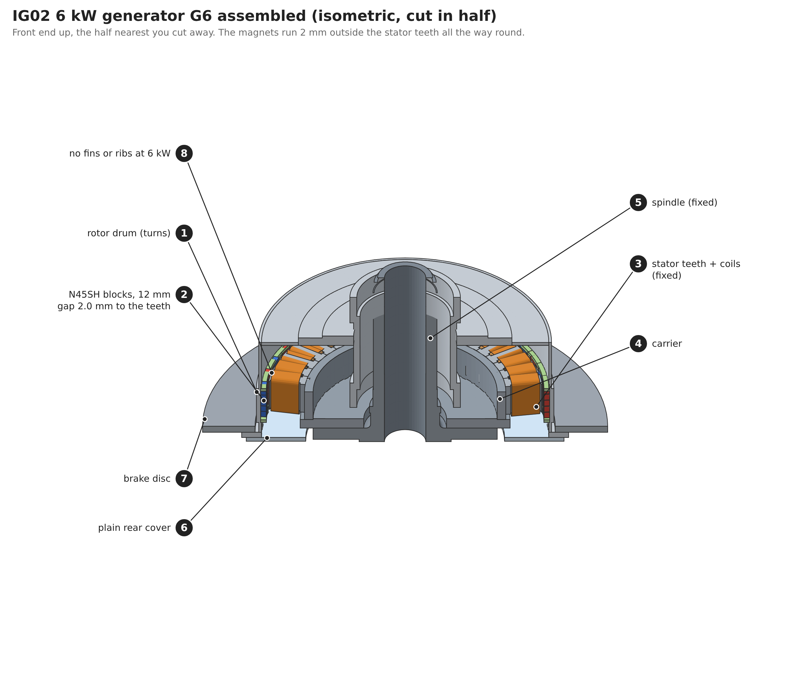

# 6 kW Wind Turbine: Generator G6, Complete Design

Status: **design for review** · 2026-11-06 (Martin: "Yes let's do a complete design of the generator")
Owner: Category 4 (Generator), with 7 (Power electronics) and 8 (Control and safety)
Builds on: [28 – 6 kW concept](28-6kw-turbine-concept.md) (duty, stall control, stopping systems), [23 – Generator Rev C](23-generator-rev-c.md) (FEA, drawings, checks), [18 – Manufacturing](18-generator-manufacturing.md), [22 – Smaller drum](22-smaller-generator-drum.md), [12 – Power electronics](12-power-electronics.md)
Analysis: [`analysis/generator6/g6.py`](../analysis/generator6/g6.py) → `results/g6.json`, figures G6-01 to G6-04
Views: [`cad/generator_g6/iso_g6.py`](../cad/generator_g6/iso_g6.py) → `out/iso/IG01`, `IG02`

## Summary

**G6 is the 12 kW Rev C active part: the same stator, winding, magnets and drum. It runs at half its rating and leaves off the passive cooling parts. It has its own braking resistor and a one-caliper brake.** Designing a generator only for the 6 kW does not pay off. Stall control (doc 28) needs a generator with torque reserve and low reactance, so the passive braking resistor can hold the rotor. A smaller machine that meets that ends up nearly as heavy as Rev C and needs all new tooling (§1).

| | Value |
|---|---|
| Type | Outer-rotor PMSG, direct drive, 40 poles / 45 slots, Ø646 drum, 74 mm stack, 28 turns: **Rev C unchanged** |
| 6 kW duty | 397 Nm rated at 164 rpm; 476 Nm continuous (1.2×); 595 Nm for 10 s (1.5×) |
| Capability | 802 Nm (Rev C sizing torque), so the 6 kW rating uses 50 % of it |
| Line EMF at 164 rpm | 342 V (magnets 100 °C) to 394 V (−30 °C) |
| Rated current | 12.9 A (Rev C at 12 kW: 23.7 A) |
| Reactance at the 6 kW rating | **0.24–0.31 pu** (doc 28 asked ≤ 0.30): the braking resistor gives **1.8–2.4×** rated torque |
| Efficiency at rated | 94.4 % (losses 379 W: iron 190, copper 153) |
| Yearly energy | 11.85 / 17.15 / 22.38 / 28.90 MWh (sheltered / inland / coastal / highland), **0.1–1.0 % more** than doc 28 assumed |
| Hot spot | **86 °C** at 1.2× continuous on a 30 °C day, without any fins (limit 130 °C) |
| Magnets | ≤ 53 °C in every case; transient short-circuit margin 30 % at 100 °C (doc 23); every 6 kW current is below the short-circuit current |
| Braking resistor | **3 × 4.0 Ω star**, normally-closed contactor; 12 kW peak, 120 kJ per event |
| Mechanical brake | Rev C disc, **one** spring caliper, **1.5 kNm** (needs 1.19 kNm) |
| Peak voltage | 697 V at 205 rpm, −30 °C (limit 1,200 V). The diodes cannot push the 750 V bus below 220 rpm |
| Mass | **≈ 263 kg** (Rev C 276 kg minus the fins, ribs and fan blades) |
| Differences from Rev C | inner fins, outer ribs and rear-cover blades left off; one brake caliper with a lighter spring pack; the resistor bank and contactor. **No new tooling.** |

**One open risk carries over from doc 28.** If deep-stall torque is really 50 % above the BEM model and the magnets are hot (100 °C), the resistor alone cannot hold the rotor above about 15 m/s. In that case the spring brake stops the rotor on its own, in every case simulated up to 30 m/s. With magnets at storm temperature (≈ 20 °C) the resistor holds to 30 m/s even with the +50 %. The prototype's high-wind tests settle it (§4).

## 1. Why the Rev C active part and not a new generator

Doc 28 sets three needs: 476 Nm continuous, 595 Nm for 10 s, and a reactance low enough that a plain resistor can hold the rotor without electronics (≈ 0.30 pu, resistor torque = 1 / (2 × reactance)). Reactance in per unit falls as the machine gets bigger for its rating. Torque reserve and low reactance are the same requirement: a generator with spare torque.

Four candidates, all with the same 30 × 15 × 12 N45SH magnet and the same pole (torque and reactance from the doc 22/23 FEA, scaled with stack length):

| Candidate | Stack | Torque capability | Reactance at 6 kW | Resistor torque | Magnets | Mass | New tooling |
|---|---|---|---|---|---|---|---|
| **Rev C (Ø646 × 74), no fins** | 74 mm, 5 rows | 815 Nm | **0.28 pu** | **1.78×** | 8.2 kg | **264 kg** | **none** |
| Ø646, 4 rows | 59 mm | 650 Nm | 0.37 pu | 1.37× | 6.6 kg | 243 kg | coil former, drum length, sleeve mould |
| Dedicated Ø490, 7 rows | 105 mm | 553 Nm | 0.31 pu | 1.60× | 9.2 kg | 221 kg | lamination die, coil former, drum, mandrel, all jigs |
| Dedicated Ø490, 8 rows | 120 mm | 632 Nm | 0.27 pu | 1.86× | 10.5 kg | 237 kg | same |

- The 4-row Ø646 saves 21 kg, but its resistor torque (1.37×) is below the 1.41× gust torque of doc 28, so it would rely on the brake alone in a storm.
- A dedicated Ø490 that meets the reactance need (8 rows) saves 27 kg (about 4 % of the tower-top mass) and uses more magnet material. It needs a new lamination die and every jig in doc 18.
- Rev C makes one production line, one stock of magnets, coils and segments, and one test procedure for both products. Volume doubles on the same tooling.

The mass estimates for the candidates are scalings, not designs (±10 %). The ranking holds within that.

## 2. Electrical data at 6 kW

| Magnets | Line EMF at 164 rpm | Current at 397 Nm | Reactance (4.78 Ω) in pu | Matched-resistor torque |
|---|---|---|---|---|
| −30 °C | 394 V | 11.2 A | 0.235 | 2.39× |
| 20 °C | 372 V | 11.9 A | 0.264 | 2.13× |
| 60 °C | 357 V | 12.4 A | 0.286 | 1.96× |
| 100 °C | 342 V | 12.9 A | 0.313 | 1.80× |

- **Winding unchanged at 28 turns.** The EMF is lower than at 12 kW (164 vs 178 rpm). The doc 12 active rectifier boosts to 750 V either way, and 12.9 A is half the Rev C current, so device losses are low. More turns would only cost a new coil plan.
- **Electrical frequency** 54.5 Hz. **Phase resistance** 0.307 Ω at 75 °C.
- **Losses at rated** (164 rpm, 397 Nm): iron 190 W, copper 153 W, stray 21 W, rotor 14 W, total 379 W, **94.4 %**. Iron loss dominates because the whole Rev C core is magnetised at nearly full speed. Below rated the efficiency rises with the lower speed (G6-01).
- **Energy:** 0.1 % (sheltered) to 1.0 % (highland) more than the doc 28 chain assumed. The oversized copper pays at high wind.

## 3. Power and stopping chain

- **Normal:** the active rectifier controls torque and speed (stall control, doc 28). Short-time limit 1.5× torque (19.4 A).
- **Stop path 1, electrical:** contactor K1 is normally closed and held open by the safety relay. On overspeed (189 rpm), converter fault or loss of the 24 V supply, K1 drops and connects the generator to the braking resistor. It needs no electronics.
- **Stop path 2, mechanical:** a spring-applied caliper on the Rev C disc, released by power, drops at the same moment.
- **The DC dump chopper** (12 kW, the water heater in the heating version) stays as in doc 12. It handles grid loss while the converter is still working, which is the normal case. K1 and the brake cover the case where the converter itself has failed.

## 4. Braking resistor and storm stops

The resistor torque depends on speed: R_ext sets the speed where it peaks (G6-02). The resistor value was chosen by simulating the rotor (J = 134 kg·m²) with the fixed-pitch BEM torques of doc 28. Each case starts with the converter lost at the stall operating point, cold air 1.35 kg/m³, and a +30 % gust over 1 s at the same moment. The pass criterion is staying under the 205 rpm design speed.

| R_ext per phase | Peak torque at | Torque at 164 rpm | Holds to (BEM, 100 °C) | +50 % stall, 100 °C | +50 % stall, 20 °C |
|---|---|---|---|---|---|
| 2.5 Ω | 98 rpm | 1.59× | 30 m/s | 11 m/s | 21 m/s |
| 3.0 Ω | 115 rpm | 1.69× | 30 m/s | 12 m/s | 24 m/s |
| 3.5 Ω | 132 rpm | 1.76× | 30 m/s | 14 m/s | 30 m/s |
| **4.0 Ω** | **150 rpm** | **1.79×** | **30 m/s** | **15 m/s** | **30 m/s** |
| 5.0 Ω | 184 rpm | 1.79× | 30 m/s | 14 m/s | 23 m/s |

**Chosen: 3 × 4.0 Ω in star.**

| Case (converter lost, +30 % gust) | Max speed | Result |
|---|---|---|
| 25 m/s, resistor only | 141 rpm | slows to 26 rpm, held; brake parks it |
| 25 m/s, resistor only, +50 % stall torque, magnets 20 °C | 142 rpm | held, 35 rpm |
| 25 m/s, resistor only, +50 % stall torque, magnets 100 °C | **runaway** | resistor too weak: the brake is needed |
| 30 m/s, resistor only | 84 rpm | held, 40 rpm |
| 25 m/s, brake only (1.5 kNm) | 149 rpm | stopped in ≈ 2.2 s |
| 25 m/s, brake only, +50 % stall torque | 155 rpm | stopped |
| 30 m/s, brake only, +50 % stall torque | 92 rpm | stopped in ≈ 1.8 s |
| 25 m/s, both | 141 rpm | stopped |

**What this means.** The brake stops the rotor alone in every case. The resistor holds the rotor alone in every case except one corner: real deep-stall torque well above BEM *and* hot magnets *and* 25 m/s with a gust. Storms come with cold air, and the thermal model gives 17–20 °C magnets at 25 m/s (§5), so that corner is unlikely but not ruled out. The mitigations, in order:

1. Measure the prototype's stall torque at high wind (doc 28 §7). If it is within +25 % of BEM, the corner closes.
2. If it is higher, set the fixed pitch 1° further toward stall with the root shims. That lowers the stall torque.
3. The controller already estimates magnet temperature from the EMF. Above 80 °C it can lower the storm ramp start from 25 to 20 m/s.

**Resistor rating.** Peak power 12 kW in the normal cases (11.5 kW in the worst holding case), energy up to 120 kJ per event, about 0.6 kW while holding at 25 m/s. Current up to 39 A (205 rpm, −30 °C). Specification: stainless steel grid resistor, 3 × 4.0 Ω ±5 %, 15 kW for 10 s, 150 kJ per event, 1 kW continuous, IP54 enclosure in the tower base. Contactor K1: 3-pole, ≥ 40 A AC-3, normally closed (or a normally-open contactor with a mechanical latch that releases on loss of coil power), 690 V.

## 5. Thermal

Doc 06 thermal network with the Rev C geometry. Iron loss is scaled with speed and copper loss with torque squared. Two builds were checked: the full Rev C passive package, and no cooling parts at all.

| Case | Rev C fins, ribs, blades | **G6: no cooling parts** |
|---|---|---|
| 6 kW rated, 30 °C day, 10 m/s | 58 °C hot spot / 43 °C magnets | **75 / 47 °C** |
| Same, weak wake (rotor shades the drum) | 59 / 45 °C | **77 / 49 °C** |
| 1.2× continuous (476 Nm), 30 °C, weak wake | 65 / 47 °C | **86 / 53 °C** |
| Stall at 25 m/s, 466 Nm, 10 °C | 33 / 17 °C | **51 / 20 °C** |
| (12 kW Rev C at rated, for reference) | 94 / 55 °C | 144 / 66 °C |

The 6 kW duty is cool enough without the passive package: 44 K under the 130 °C design limit at 1.2× continuous on a hot day. The **G6 drum is the Rev C drum weldment with the fin and rib welding steps skipped**, and the rear cover has no blades. That saves 12.5 kg and about a day of welding per drum. The 10 s overload at 1.5× adds 0.4 K to the copper.

## 6. Demagnetisation

All Rev C results (doc 23 §3) apply unchanged, because the magnets, gap and winding are the same:

- Transient short-circuit margin **30.1 % at 100 °C**, against the rule of ≥ 20 %. The short-circuit peak current is 62.6 A.
- The largest 6 kW currents are 27 A peak (1.5× for 10 s, below the 12 kW rated-load current of 34 A peak, where the margin is 55 %) and 43 A peak (resistor braking at 164 rpm, hot). That is mostly d-axis current like a short circuit, but at 69 % of the steady short-circuit current, where the margin is 45 %.
- Magnets run at ≤ 53 °C in every 6 kW case (§5), where the transient margin is about 50 %.

## 7. Voltage

| | Line peak |
|---|---|
| 164 rpm, −30 °C | 557 V |
| Trip speed 189 rpm, −30 °C | 641 V |
| Design overspeed 205 rpm, −30 °C | 697 V |
| 1,200 V device limit reached at | 352 rpm |

Below 220 rpm the generator's diode voltage cannot even reach the 750 V DC bus, so an uncontrolled rotor cannot charge the bus through the rectifier's diodes. The 1,200 V parts are kept the same as for 12 kW.

## 8. Mechanical

- **Torque:** the largest torque is the brake stop at 1.5 kNm, 1.9× the Rev C sizing torque of 802 Nm. Bond shear at the 3× stop torque is 42 kPa against ≥ 5 MPa. The Rev C short-circuit case (6× rated) stays the bond design case.
- **Brake:** one spring-applied caliper of the Rev C type on the Rev C disc, with a spring pack giving 1.5 kNm (two calipers and 8.7 kNm at 12 kW). Required: 1.19 kNm (3× rated). Deceleration with no wind 11 rad/s², a stop from trip speed in 1.8 s, so blade edgewise inertia loads stay small. Keeping the 34.5 kg disc keeps the drum's rear end held round. Doc 23 §5 shows the drum is only stable with both ends held round.
- **Drum stability, unbalanced pull, centrifugal loads:** unchanged from doc 23. Margin 302 with the ends held round, 1.3 kN per mm of eccentricity. The 6 kW speeds (≤ 205 rpm) are below the Rev C 250 rpm basis.

## 9. Bill of materials: differences from Rev C

| Rev C part (doc 23) | G6 |
|---|---|
| Stator: carrier, 45 segments, 28-turn coils, VPI, potting | **same** |
| Rotor: drum weldment, 200 N45SH blocks + 10 spares, comb bars, end rings, glass sleeve | **same**, except that the 36 inner fins and 48 outer ribs are **not welded on** (−12.5 kg) |
| Rear cover with 24 fan blades (NP1-212C) | **plain rear cover** (same blank, no blades) |
| Brake disc | **same** |
| 2 spring calipers, 8.7 kNm | **1 caliper, 1.5 kNm spring pack** |
| — | **new:** braking resistor 3 × 4.0 Ω, contactor K1, safety relay input (doc 28 safety chain) |
| Mass ≈ 276 kg | **≈ 263 kg** |

The Rev C drawing set (`cad/generator_rc/out/NP1-generator-RevC.pdf`) builds G6 with these notes. Separate drawing sheets are only needed for the plain cover and the resistor box. They can be made when the 6 kW nacelle is drawn.

## 10. Effect on doc 28

- Tower-top mass: the generator is about 18 kg heavier than doc 28 assumed (263 vs ≈ 245 kg), so the head is now ≈ 740 kg instead of 720.
- The doc 28 reactance target (≤ 0.30 pu) is met at magnet temperatures up to about 90 °C. It is 0.31 pu at 100 °C.
- Energy is 0.1–1.0 % higher than doc 28.
- **Suggestion:** the 6 kW nacelle could also reuse the 12 kW spindle and bearings (doc 07), since the 6 kW rotor loads are lower. Checking that is the natural next step and would make the two drivetrains identical.

## 11. Limits

- Torque and reactance for the dedicated candidates are scaled from the doc 22 FEA, and their masses are estimates. Rev C itself uses its full doc 23 FEA.
- The stop simulations use steady BEM torques and a rigid rotor. The doc 08 aeroelastic model (`sim.py`) should repeat the worst cases with blade and drivetrain flexibility.
- The thermal model is the doc 06 lumped network. Its absolute values are ±10 K, which is small against the 44 K margin.
