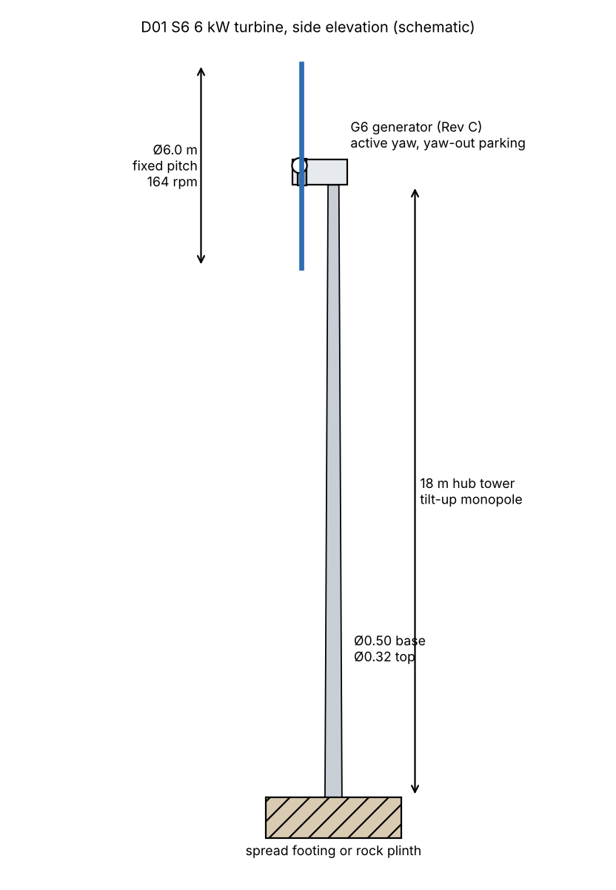
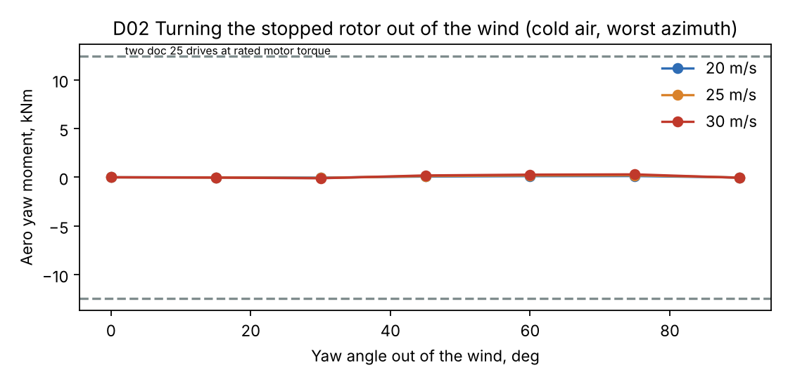

# 6 kW Wind Turbine S6: Complete First-Pass Design

Status: **first-pass design for review** · 2026-11-06 (Martin: "Ok lets continue with the rest of the design")
Owner: Category 1 (Systems engineering), all subsystem categories
Builds on: [28 – Concept and pitch study](28-6kw-turbine-concept.md), [29 – Generator G6](29-6kw-generator-g6.md), and the 12 kW models: [07](07-nacelle-spindle-bearings.md) nacelle, [08](08-load-verification.md) loads, [09](09-tower-foundation.md) tower, [10](10-blade-structure.md) blade, [11](11-control-safety.md) control, [12](12-power-electronics.md) power electronics, [25](25-yaw-system.md) yaw
Analysis: [`analysis/turbine_6kw/design6.py`](../analysis/turbine_6kw/design6.py) → `results/design6.json`, `slm_6kw.json`, figures D01–D02

## Summary

S6 is a 3-blade upwind, fixed-pitch, variable-speed turbine. Above rated wind the generator holds power by slowing the rotor into stall (doc 28). **Everything from the hub back to the tower top is a 12 kW part:** Rev C generator (doc 29), spindle and bearings, bedplate and yaw system. New 6 kW parts: the blades, a fixed welded hub, the tower and the electronics settings. The IEC 61400-2 simple load model (SLM) puts every drivetrain load at or below the 12 kW value, so the 12 kW parts are reused without change.

| Subsystem | S6 design | Shared with 12 kW? |
|---|---|---|
| Rotor | Ø6.0 m, 3 blades, TSR 5.5, fixed pitch −2° (±2° shims), 41–164 rpm | new |
| Blade | 2.72 m long, glass/epoxy with glass UD caps, **20.6 kg**, root Ø0.22 m with 10 × M12 inserts | new (doc 10 method) |
| Hub | welded S355NL, three Ø220 × 8 arms with root flanges, **87 kg** + 6 kg spinner, no bearings | new (simple weldment) |
| Generator | **G6 = Rev C** (doc 29), no fins/ribs, 1 caliper 1.5 kNm, braking resistor 3 × 4 Ω | **yes** |
| Spindle, bearings, bedplate | doc 07/14 parts unchanged | **yes** |
| Yaw | doc 25 ring, pads and 2 gearmotors; plus **yaw-out storm parking** | **yes** |
| Tower | 18 m tilt-up monopole, Ø0.50 → 0.32 m, 10/8 mm, **1,824 kg**, f1 0.87 Hz | new size, same design |
| Foundation | spread footing 3.8–4.2 m square, 9.5–11.4 m³; or rock plinth 2 m³ with 8 anchors | same method |
| Power electronics | doc 12 front end and modules, firmware limits for 6 kW; 12 kW dump chopper | **yes** (settings only) |
| Control and protection | doc 11 structure with stall speed control, yaw-out and the K1 + brake safety chain | adapted |
| **Tower-top mass** | **935 kg** above the tower flange (12 kW: 1,103 kg) | |

**Two results that change doc 28:**

1. **Tower-top mass is 935 kg, not ≈ 740 kg.** Doc 28's figure came from the doc 27 scaling model. Reusing the 12 kW bedplate (150 kg), spindle and yaw system (275 kg with the adapter) costs about 150–200 kg against a turbine sized only for 6 kW. The tower still comes out lighter than the 12 kW one (1,824 vs 1,940 kg). A 6 kW-specific bedplate could get some of that back later, if the mass matters more than the commonality.
2. **The blade weighs 20.6 kg, not 15 kg.** The thin glass caps are sized by buckling at minimum thickness, not by strength. Strength use is at most 0.43 (parked storm) and fatigue 0.26. A carbon-cap blade only saves 0.8 kg, so glass is chosen.

Energy, noise and the stopping systems are unchanged from docs 28 and 29: **11.8 / 17.1 / 22.4 / 28.9 MWh** a year at sheltered / inland / coastal / highland sites, ≈ 44 dB(A) at 60 m.

---

## 1. Design loads (IEC 61400-2 SLM)

The 6 kW inputs to `analysis/loads/slm.py` are R 3.0 m, 397 Nm at 164 rpm, design overspeed 205 rpm, brake 1.5 kNm, blade 20.6 kg and overhang 0.75 m. Design values with γ = 3.0:

| SLM case | 6 kW | 12 kW (doc 08) | Ratio |
|---|---|---|---|
| H parked, blade root flap | 18.5 kNm | 26.0 kNm | 0.71 |
| H parked, shaft thrust | 37.1 kN | 41.6 kN | 0.89 |
| G shutdown, shaft torque | 5.7 kNm | 28.4 kNm | 0.20 |
| E overspeed, blade root pull | 31.8 kN | 63.7 kN | 0.50 |
| D max thrust | 16.2 kN | 25.4 kN | 0.64 |
| B yaw, shaft moment | 3.0 kNm | 5.35 kNm | 0.57 |
| E overspeed, shaft bending | 1.62 kNm | 1.63 kNm | 0.99 |
| A fatigue ranges | 0.43–0.69 × the 12 kW values | | |

The parked storm (case H) governs blades, hub and tower, as on the 12 kW machine. Operating and fatigue loads for the blade and tower come from the doc 11 simulations scaled to the 6 kW rotor. They carry an extra **×1.3 on fatigue**, because a stall rotor does not take the edge off gusts the way a pitch rotor does. The aeroelastic check of the stall controller is listed in §10.

## 2. Blades

Doc 10 method (`blade.py`): PET-cored glass/epoxy shell, UD spar caps, shear web, cylindrical root with bonded inserts. The section thickness follows the doc 10 distribution scaled to the 6 kW span. Blade loads are SLM H and G, overspeed at 205 rpm, and the scaled operating and fatigue loads.

| | **Glass caps (chosen)** | Carbon caps |
|---|---|---|
| Mass | **20.6 kg** | 19.9 kg |
| Centre of gravity | 1.12 m from the axis | 1.11 m |
| 1st flap / edge, standstill | 15.2 / 38.3 Hz | 20.8 / 41.3 Hz |
| Flap at 164 rpm vs 3P (8.2 Hz) | 15.7 Hz, 1.9 × 3P | 21.2 Hz |
| Tip deflection, design gust | 0.08 m (tower clearance 0.83 m) | 0.04 m |
| Highest use: strength / fatigue / cap buckling | 0.43 / 0.26 / 1.00 | 0.32 / 0.14 / 0.98 |

- **Glass is chosen.** It is cheaper, simpler to infuse in-house, and only 0.8 kg heavier. Every check except minimum-cap buckling has more than 2× margin.
- **Stall-induced vibration** (doc 28 §7): the first edge mode at 38 Hz is far above every rotor harmonic, and the blade is short and stiff. This is still to be checked in the aeroelastic runs with dynamic stall (§10).
- **Root joint:** Ø0.22 m root, **10 × M12 10.9** inserts on a Ø185 bolt circle. The design bolt force is 43 kN against 61 kN. **Shim seat:** a 3-piece wedge-washer set under the root flange gives −4°, −2° (standard) and 0° pitch, checked by a template on the hub flange.
- Planform: max chord 0.37 m at 0.6 m radius, tip chord 0.18 m, twist as the doc 03 rule for TSR 5.5. One blade mould for all three blades.

## 3. Hub

With no pitch bearings, the hub is a plain welded S355NL part:

- **Central shell** Ø380 × 240 × 12 mm with a **front flange** to the Rev C drum on the same interface as 12 kW (12 × M16 10.9, PCD 400). Bolt load 9.3 kN against 113 kN, and the joint carries the 5.7 kNm design torque in friction.
- **Three arms** Ø220 × 8 mm, each ending in a 25 mm root flange (Ø280) with the shim seat. Parked storm stress 68 MPa against 323 MPa. Fatigue at the flange weld (detail 71) 16 MPa against 31 MPa.
- **Mass 87 kg**, plus 6 kg glass-fibre spinner. The 12 kW collective-pitch hub weighs 239 kg (doc 24). No grease points, no slip-ring power and no electronics in the hub. The slip ring carries only the blade-heating option and sensors.
- A cast EN-GJS-400-18U-LT hub of the same shape would be about 50 kg, a possible series option once volumes justify the pattern.

## 4. Drivetrain (shared with 12 kW)

Every SLM shaft load in §1 is at or below the 12 kW value (ratio 0.20–0.99; the highest is overspeed shaft bending, 1.62 vs 1.63 kNm), and the generator is Rev C. So the **doc 07/14 spindle (42CrMo4, 140/90 mm), the tapered roller pair, the bedplate weldment and the brake disc are used unchanged.** Changes are limited to doc 29: no fins or ribs on the drum, a plain rear cover, and **one caliper with a 1.5 kNm spring pack**. The second caliper position is left blank.

## 5. Yaw system and yaw-out parking

The doc 25 system is reused: Dpw 360 four-point ring, two passive friction pad units, two braked gearmotors and the yaw lock.

| Check | 6 kW | 12 kW |
|---|---|---|
| Mass above the yaw bearing | 801 kg | 969 kg |
| Tilt moment, SLM set | 28.0 kNm | 34.6 kNm |
| Ring static safety s0 | **1.78** | 1.44 |

**Yaw-out parking** is the storm strategy of doc 28. The rotor is stopped and turned 90° out of the wind, where the fixed blades sit edge-on like feathered blades.

- The aerodynamic yaw moment on the stopped rotor while it turns is small: at most **0.3 kNm** at 30 m/s in cold air, because a fixed 3-blade rotor is nearly symmetric. The friction pads (4.8 kNm cold breakaway) dominate the effort. Total need with a 1.35 factor: **5.5 kNm**. The two doc 25 drives give 12.4 kNm at rated motor torque.
- Turning 90° at 0.5°/s takes **3 minutes** and uses about **6 Wh**. A 48 V, 200 Wh battery in the nacelle cabinet does it twice even with no grid. In the off-grid version the system battery does it.
- Parked at 90° in a 77 m/s gust, the rotor's total force drops from 13.2 kN (facing the wind, characteristic) to 0.2 kN. The yaw moment is 0.3 kNm, far below the 8 kNm the doc 25 brakes and pads hold.
- If the yaw cannot turn (drive fault), the rotor stays braked facing the wind. That broadside case is what every structural part above is sized for (SLM H).

## 6. Tower and foundation

Doc 09 model (`tower.py`) with the S6 head (935 kg), the SLM H thrust, the parked side force scaled with blade area, and the doc 09 operating and fatigue spectra scaled to S6 (ultimate × 0.89, fatigue × 0.96).

| | S6 | 12 kW (doc 09/26) |
|---|---|---|
| Tower | 18 m, Ø0.50 → 0.32 m, 10 / 8 mm, 2 sections | Ø0.55 → 0.32, 10 / 8 |
| Mass | **1,824 kg** | 1,940 kg |
| Governing case | parked V_e50 storm, use 0.97 | same |
| First frequency | 0.87 Hz (0.81 on soft soil with ice), window 0.75–1.86 Hz | |
| Speed exclusion zone | **48–57 rpm** (rotor passes through quickly at 3–4 m/s) | |
| Fatigue damage, base / mid | 0.47 / 0.34 | |
| Base flange | 24 × M24 10.9 on Ø0.60 m | |
| Tilt-up | base moment 405 kNm, use 0.64; winch pull 68 kN with a 6 m gin pole | |

| Ground | Footing | Concrete |
|---|---|---|
| Firm gravel / moraine | 3.8 × 3.8 × 1.6 m | 9.5 m³ |
| Soft volcanic ash, pumice | 4.2 × 4.2 × 1.6 m | 11.4 m³ |
| Frost-susceptible silt | 3.9 × 3.9 × 1.6 m | 10.0 m³ |
| Rock | plinth 1.6 × 1.6 × 0.8 m, 8 × Ø28 anchors 3 m long | 2.0 m³ |

As in doc 09, the SLM thrust applied directly with γ = 3 to the tower is a sensitivity case only (use 1.8). The tower is sized with the IEC 61400-1 storm, ice and earthquake cases, the same as 12 kW.

## 7. Power electronics

| Item | S6 |
|---|---|
| Front end | doc 12 SiC active rectifier, 1,200 V, **same hardware**; firmware limits 13 A rated, 20 A for 10 s |
| DC link | 750 V. The generator diodes cannot charge it below 220 rpm (doc 29) |
| Dump chopper | **12 kW** (12 kW turbine: 20 kW), hardware-triggered from 820 V; the water heater in the heating version |
| AC module | 6.5 kW; grid-tie **single-phase or three-phase** (6 kW may fit a single-phase connection where the 12 kW does not; doc 12 open point) or heater feed |
| Battery module | doc 12 isolated 48 V module, same |
| Safety chain | K1 normally-closed contactor + 3 × 4.0 Ω braking resistor (doc 29 §4), spring brake 1.5 kNm |
| Auxiliary | 48 V 200 Wh battery for the controller, the safety relay and yaw-out |
| Net rated power | 6.14 kW |

## 8. Control and protection

Doc 11 structure (controller plus an independent hardwired safety relay, PL d category 3), with these 6 kW changes:

**Operating modes**

| Wind | Mode | Rotor speed | Generator torque |
|---|---|---|---|
| < 2.5 m/s | idle, brake released | free | 0 |
| 2.5–9 m/s | optimum TSR (torque = k·ω²) | 41 → 164 rpm | up to 322 Nm |
| 9–25 m/s | **stall speed control**: constant power, speed set slightly below the stall line | 164 → 145 rpm | 399–447 Nm |
| 25–30 m/s | storm ramp: power falls to 40 % | 145 → 88 rpm | ≤ 447 Nm |
| > 30 m/s (10 min), or ice, or fault | **stop**: converter brakes to 30 rpm, spring brake applies, **yaw 90° out**, hold | 0 | — |
| Back below 22 m/s for 10 min | yaw in, release, restart | | |

- **Stall speed control** is a speed loop, not just a torque curve. On the stall side the rotor's own torque rises with speed, so it would speed up under constant generator torque. The speed controller holds the set point with the 1.5× torque reserve. If the converter reaches its limit for more than 2 s, it stops the turbine.
- **Trip limits (safety relay, hardwired):** overspeed **189 rpm** (1.15 ×). Converter fault, 24 V loss or the emergency stop button also trip. A trip closes K1 and drops the brake together. Vibration trip as doc 09 R6.6.
- **Ice:** detected from the power curve deviation and an ice sensor. The turbine stops and yaws out, which also cuts ice throw, since a rotor parked edge-on and braked does not throw ice. Blade heating stays an option through the slip ring.
- **Off-grid / heating:** with a full battery or a hot tank the dump chopper takes the power. If that is not possible the turbine stops the normal way (converter, then brake). It never idles unloaded.
- **Magnet temperature** is estimated from the EMF (doc 23). Above 80 °C the storm ramp starts at 20 m/s instead of 25 (doc 29 §4 mitigation).

## 9. Mass list

| Item | kg |
|---|---|
| Blades 3 × 20.6 | 62 |
| Fixed hub + spinner | 93 |
| Generator G6 rotor (no fins) | 149 |
| Generator G6 stator | 115 |
| Spindle | 57 |
| Bedplate (P1 weldment) | 150 |
| Nacelle cover and electrics | 20 |
| Slip ring (signals), sensors, cabling, caliper | 15 |
| Yaw parts above the bearing (doc 25) | 141 |
| Yaw ring outer half, adapter, cable loop (doc 25) | 134 |
| **Above the tower flange** | **935** |
| Tower | 1,824 |
| Footing (firm ground) | 9.5 m³ concrete, ≈ 23 t |

## 10. What is still open

1. **Aeroelastic loads for the stall controller.** The doc 08 simulator (`sim.py`) has a pitch controller. Add the stall speed loop and the K1/brake stops, then rerun the DLC set (turbulence in stall, gusts, grid loss, the doc 29 stopping cases, parked yaw-lost) to replace the scaled operating and fatigue loads used here. Expect the fatigue factor (×1.3 assumed) to move.
2. **Stall torque measurement** on the prototype (docs 28/29), the main design risk.
3. **6 kW-specific bedplate study:** about 60–100 kg could be saved if the mass matters more than shared parts.
4. **Drawings:** blade mould and root, hub weldment, tower sections and footing, the resistor box and the plain rear cover. The generator, spindle, bedplate and yaw drawings exist.
5. **Icelandic grid:** confirm with the DSO whether 6 kW single-phase is allowed (doc 12 open point).

## 11. Limits

First-pass design: SLM loads plus scaled operating loads, as doc 26 did before its aeroelastic pass. Blade masses come from the doc 10 section model. Tower and foundations come from the doc 09 model with scaled spectra. Hub stresses are hand calculations; the hub needs an FE check with the final arm-to-shell weld details.
