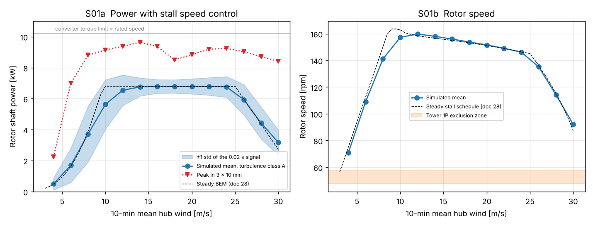
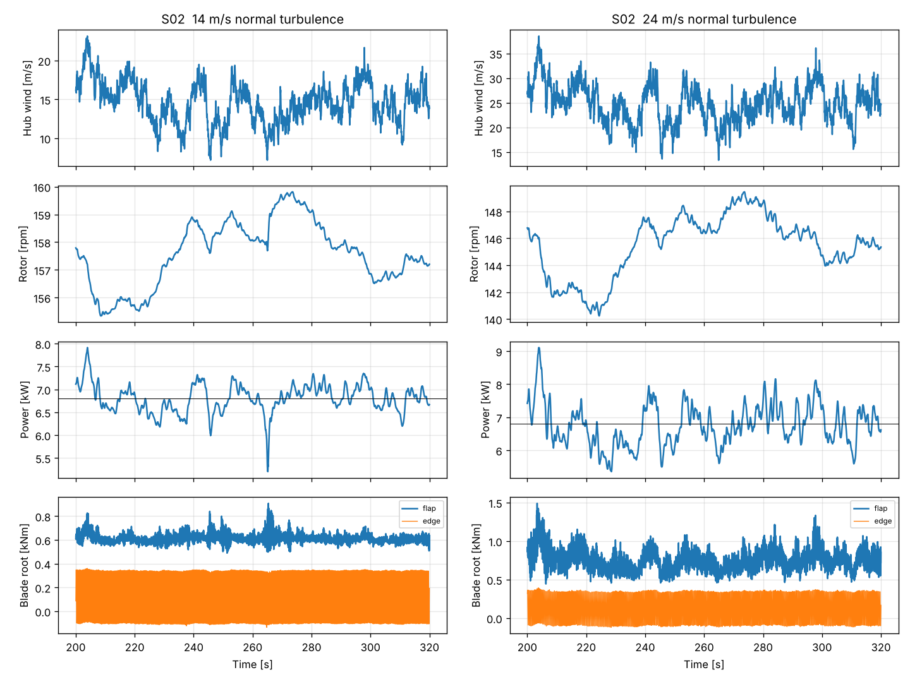
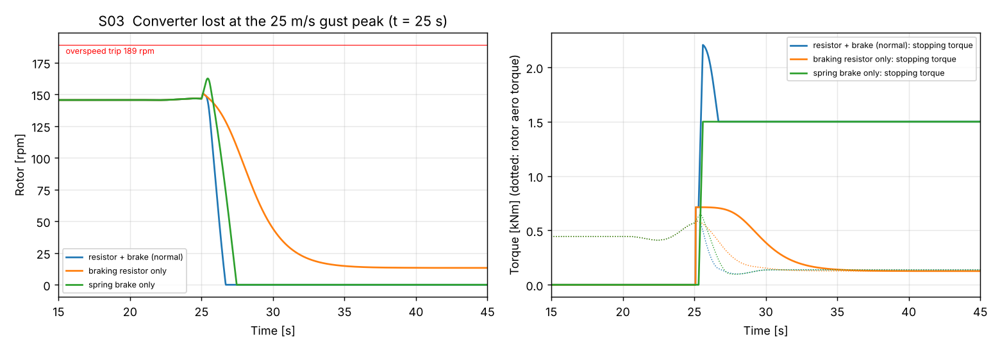
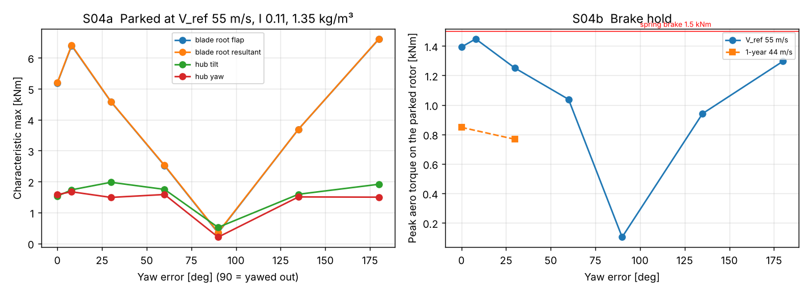

# 6 kW Turbine S6: Aeroelastic Simulation with the Stall Controller

Status: **simulation results for review** · 2026-11-06 (Martin: "Let's do the simulation")
Owner: Category 1 (Systems engineering), Category 6 (Control and safety)
Builds on: [28 – Concept](28-6kw-turbine-concept.md), [29 – Generator G6](29-6kw-generator-g6.md), [30 – First-pass design](30-6kw-turbine-design-s6.md), [08 – Load verification](08-load-verification.md) (simulator), [11 – Control](11-control-safety.md)
Analysis: [`analysis/turbine_6kw/sim6.py`](../analysis/turbine_6kw/sim6.py), [`dlc6.py`](../analysis/turbine_6kw/dlc6.py) → `results/dlc6/`, [`recheck6.py`](../analysis/turbine_6kw/recheck6.py) → `results/recheck6.json`, [`plots6.py`](../analysis/turbine_6kw/plots6.py) → figures S01–S04

## Summary

The full S6 turbine was simulated with the doc 08 time-domain simulator, changed for fixed pitch, stall speed control and the doc 29 safety chain (resistor contactor K1 plus spring brake). 113 runs cover normal and extreme turbulence 4–30 m/s, gusts, ice, loss of the converter, emergency and normal stops, and the parked 50-year storm at every yaw error. The 12 kW bedplate and other shared parts are kept, as in doc 30.

**The stall controller works, and the doc 30 design holds.** Nothing has to get bigger. Fatigue loads are much lower than the first pass assumed. **One change is needed: a stronger spring pack on the brake caliper** (§5).

| Question | Result |
|---|---|
| Does stall speed control hold 6.8 kW in turbulence? | **Yes.** Mean 6.76–6.80 kW from 14 to 24 m/s; speed 146–160 rpm; storm ramp 25–30 m/s works (S01). |
| Unwanted stops in 42 × 10 min normal turbulence, ETM, gusts, ice? | **None.** Highest speed in operation 167 rpm (trip 189). |
| Torque and power peaks | Converter torque reaches its 1.5× limit (595 Nm) only in gusts above 22 m/s, never for 2 s. Shaft power peaks 9.6–10.0 kW for a few seconds. |
| Converter lost, both stopping systems | Stop in **1.6–1.7 s**, peak speed 164 rpm. |
| Spring brake alone | Stop in **2.0–2.4 s**, peak **173 rpm**, below the 189 rpm trip. |
| Braking resistor alone | Slows to **3–15 rpm** and holds there; a PM resistor cannot hold zero speed, as expected. Safe. |
| Parked 50-year storm, yawed out (90°) | Blade root 0.04–0.36 kNm, hub moments ≤ 0.5 kNm: the rotor is nearly unloaded. |
| Parked, yaw lost (worst yaw) | Blade root **6.6 kNm** characteristic, still below the SLM design load the blade is sized for. |
| **Brake hold, yaw lost, 50-year storm** | Aero torque on the parked rotor up to **1.45 kNm** against **1.5 kNm** of brake. **Too thin: raise the spring pack to 2.5 kNm.** |
| Blade / hub / tower / footings | **Unchanged.** Blade fatigue 0.10 (first pass 0.26), hub weld 5.7 MPa (16.3), tower fatigue 0.06 (0.47). |

## 1. What was simulated

**Simulator.** `sim6.py` is the doc 08 simulator (`analysis/loads/sim.py`): unsteady BEM with dynamic inflow, three flap modes, tower fore-aft and turbulent 3D wind. The S6 changes are:

- **Fixed pitch.** Blades at −2° with a ±0.3° shim error between blades (+0.3 / 0 / −0.3°). There is no pitch actuator.
- **Stall speed control** (doc 30 §8). Below rated wind, generator torque follows k·ω² at the optimum tip speed ratio. Above rated, a PI speed loop holds a speed set point with the converter torque, capped at 1.5× rated (595 Nm). A slow outer loop lowers the set point while the estimated rotor power is above 6.8 kW, which pushes the rotor further into stall. The power estimate is generator torque plus rotor acceleration, filtered over 2 s. 25–30 m/s storm ramp to 40 % power. Speed exclusion zone 47.5–57.4 rpm around the tower 1P frequency.
- **Safety chain** (doc 29). A trip turns the converter off, closes K1 on the 3 × 4 Ω resistor and drops the 1.5 kNm spring brake (ramp 0.3 s, after 0.2 s). The "resistor only" and "brake only" variants each disable one of them. A normal stop has the converter braking at the torque limit down to 30 rpm, then the brake. The resistor model uses hot magnets (100 °C, lowest EMF) and the doc 29 reactance.
- **S6 data** from doc 30. Ø6.0 m rotor, blade 20.6 kg and 15.2 Hz flap, rotor and drum inertia 134 kg·m², 935 kg head, tower f1 0.87 Hz with a 456 kg modal mass, 18 m hub.

**One tuning finding.** The first controller version used measured electrical power in the outer loop and moved the set point quickly (0.15 pu/s). In a 25 m/s gust it ran away: torque the converter took out to slow the rotor counted as "too much power", so the set point kept falling, the rotor stalled deeper, and the converter hit its limit and stopped the turbine. The final controller fixes this in three ways:

- it estimates rotor power from torque plus acceleration;
- it moves the set point 5× slower;
- it has an anti-windup at the torque limit.

**The firmware must use the same structure.** It is a real failure mode of stall speed control.

**Load cases** (`dlc6.py`, IEC 61400-1 / -2 as `run_dlcs.py final`):

| DLC | Cases |
|---|---|
| 1.1 normal turbulence (class A) | 4–30 m/s every 2 m/s, 3 seeds × 600 s (fatigue, power curve) |
| 1.3 extreme turbulence | 10.5, 14, 18, 24 m/s, 2 seeds × 600 s |
| 1.4 extreme operating gust | 8, 12, 25 m/s |
| 1.5 ice on one blade | 9.1 kg (IEC mass scaled from 15.1 kg), 8 and 12 m/s |
| 2.2 loss of converter torque | EOG peak at 12 and 25 m/s; turbulence 14, 20, 26 m/s; × 3 stopping variants |
| 5.1 emergency stop | 10.5, 18, 25 m/s × 3 stopping variants |
| 4.1 normal stop | 14 and 25 m/s |
| 6.x parked, V_ref 55 m/s, I 0.11, 1.35 kg/m³ | yaw 0, 8, 30, 60, 90, 135, 180° × azimuth 0, 30, 60, 90° (yaw 90° = yawed out) |
| 6.4 parked 1-year wind 44 m/s | yaw 0, 30° (brake hold) |

Pitch runaway, stuck blade and stuck-at-fine cases do not exist on S6.

## 2. Power and speed

| Wind m/s | 4 | 8 | 10 | 12 | 14 | 18 | 22 | 24 | 26 | 28 | 30 |
|---|---|---|---|---|---|---|---|---|---|---|---|
| Mean shaft power, kW | 0.50 | 3.72 | 5.63 | 6.55 | 6.76 | 6.80 | 6.80 | 6.76 | 5.94 | 4.43 | 3.17 |
| Mean speed, rpm | 71 | 141 | 157 | 160 | 158 | 154 | 149 | 146 | 135 | 114 | 92 |
| Peak converter torque, Nm | 172 | 505 | 524 | 538 | 553 | 529 | 590 | 595 | 595 | 595 | 595 |

- **Power is held flat from 14 to 24 m/s**, and the speed follows the doc 28 stall schedule within 1–2 rpm (S01b).
- **Turbulence rounds the knee** at 8–12 m/s. That costs 5 % of rotor energy against the steady curve at a 10 m/s mean, Rayleigh: 37.1 vs 39.1 MWh/yr at the shaft. Every variable-speed turbine loses this; it is not a stall penalty. The class A turbulence used here is harsher than most Icelandic sites.
- **The rotor stays out of the tower exclusion zone** above 6 m/s. It spends 2.7 % of the time inside the zone at 4 m/s, where loads are tiny.
- **Power is noisier than with pitch** (± 0.4–0.6 kW standard deviation above 14 m/s). Peaks reach 9.6–10.0 kW for a few seconds in gusts, so the converter must pass 1.5× power briefly. Doc 30 §7 already rates it for the 1.5× torque at rated speed.
- **Generator heating:** mean torque at 24 m/s is 441 Nm (1.11×), inside the doc 29 1.2× continuous rating. The 1.5× limit is touched only in gusts.

## 3. Stopping: converter lost, emergency stop, normal stop

| Case (worst of all winds) | Peak rpm after the event | Time to stop | Final state |
|---|---|---|---|
| Resistor + brake (normal safety chain) | 164 | 1.4–1.7 s | stopped |
| Spring brake only (K1 failed) | **173** | 2.0–2.4 s | stopped |
| Braking resistor only (brake failed) | 164 | — | **crawls at 3–15 rpm** (14.7 rpm at 25 m/s) |
| Normal stop (converter, then brake) | no rise | 5.1–5.3 s | stopped |

- **The two-channel safety chain works.** Either channel alone keeps the rotor well below the 189 rpm trip; the doc 29 runaway speed of 930 rpm is never approached.
- **The resistor alone never reaches zero.** A shorted or resistor-loaded PM generator gives no torque at standstill. It holds the rotor at a crawl where aero torque equals resistor torque, and that is a safe state. It means a brake failure leaves the rotor turning slowly, not locked, until the brake is repaired, so the brake needs a fault alarm, as doc 30 plans.
- Blade loads in all stops stay below the operating maximum (flap ≤ 1.4 kNm).

**Not covered here:** the doc 29 corner case of 50 % more deep-stall torque (3D stall delay) with the resistor alone. The 2D polars give about 0.15 kNm aero torque at the crawl, so 50 % more is still far inside the brake. That leaves a faster crawl, not a runaway. The stall torque measurement on the prototype (doc 30 §10) remains the main check.

## 4. Loads against the doc 30 first pass

| Load | Doc 30 first pass | Simulated (γ 1.35 incl.) | Change |
|---|---|---|---|
| Blade root, operating flap (design) | 3.39 kNm (12 kW × scale × 1.3) | **2.61 kNm** (DLC 1.1 at 30 m/s) | −23 % |
| Blade root, extreme resultant incl. parked (design) | 6.06 kNm | **8.92 kNm** (parked, yaw lost, 180°) | +47 % |
| Blade flap DEL (m = 10, 10⁷) | 2.22 kNm | **0.78 kNm** | −65 % |
| Blade edge DEL (m = 10, 10⁷) | 1.03 kNm | **0.73 kNm** | −29 % |
| Tower base, operation (characteristic) | 146 kNm | **135 kNm** | −8 % |
| Tower base DEL (m = 4, 10⁷) | scaled 12 kW spectra × 1.3 | 36 kNm | fatigue damage 0.47 → **0.06** |
| Hub tilt / yaw (all cases, char.) | — | 2.0 / 1.7 kNm (parked) | — |

- **The ×1.3 fatigue penalty for stall was not needed.** S6 flap fatigue is a third of the scaled 12 kW value. Two reasons: the stiff short blade (15 Hz) sits far from any excitation, and in deep stall the lift barely changes with angle of attack, so gusts change the flap load less than they do on an attached-flow pitch rotor.
- **The parked yaw-lost storm is the largest simulated blade load**, +47 % over the first-pass scaling. It is a dynamic gust response that the static doc 28 number (5.4 kNm) did not include. It is still below the SLM case H (18.5 kNm design) that sizes the blade.

**Yaw-out parking works as doc 28 predicted.** At 90° every load drops by a factor of 10–20 (S04a). The worst yaw errors are 8° (gusts swinging around the broadside position) and 180° (wind from behind, which happens if yaw is lost and the wind turns).

## 5. Recheck of blade, hub, tower and the brake

`recheck6.py` reruns the doc 30 models with the simulated loads in place of the scaled ones:

| Part | Doc 30 | With simulated loads | Verdict |
|---|---|---|---|
| Blade (glass caps) | 20.6 kg; strength 0.43 (SLM H); SIM 0.23; fatigue 0.26; cap buckling 1.00 | 20.6 kg; strength 0.43; SIM **0.33**; fatigue **0.10**; cap buckling 1.00 | **unchanged** (minimum-thickness buckling still governs) |
| Blade tip deflection | 0.077 m | 0.059 m, tower clearance use 0.07 | OK |
| Hub arms Ø220 × 8 | 68 MPa static, 16.3 MPa fatigue (allow 30.8) | 68 MPa, **5.7 MPa** | **unchanged**, large fatigue margin |
| Tower 18 m, Ø0.50/0.32, 10/8 mm | use 0.97 (parked V_e50), fatigue 0.47 | use 0.97 (parked V_e50), fatigue **0.06** | **unchanged** |
| Footings | 3.8–4.2 m square, 9.5–11.4 m³ | same | **unchanged** |
| Drivetrain, bedplate, yaw (12 kW parts) | SLM ratios ≤ 0.99 | simulated hub moments ≤ 2.0 kNm char. | **unchanged** |

The tower is still governed by the parked V_e50 storm (617 kNm design, doc 09 method). The simulated parked runs give 435 kNm characteristic at yaw 0°, consistent with that (×1.35 = 588 kNm).

**Brake hold, the one change.** In the 50-year storm with yaw lost, the parked rotor sees up to **1.45 kNm** of aero torque (S04b). The single caliper with a 1.5 kNm spring pack would only just hold, with no safety factor. If it slips, the rotor turns slowly against the resistor, which is not dangerous but should not be the design case. **Recommendation:** fit the caliper with a **2.5 kNm spring pack**, about 1.7× the peak. The 12 kW caliper gives 4.35 kNm, so this is a spring change, not a new caliper.

Side effects of the stronger brake:

- Brake-only stops get faster.
- Edge loads at a stop rise but stay small: SLM case G use is 0.05.
- The hub-drum joint already carries the 5.7 kNm SLM shaft torque.

The 1-year wind with yaw lost needs only 0.85 kNm.

## 6. Changes to doc 30

1. **Brake spring pack: 1.5 → 2.5 kNm** (doc 29 §6 and doc 30 summary table). Same caliper.
2. **Controller structure fixed for firmware:** rotor power estimated from torque plus acceleration (2 s filter); set point moves about 0.7 rpm/s per kW of power error (k = 0.03 pu/s); integrator anti-windup at the torque limit; stop only after 2 s at the limit.
3. **Brake fault alarm:** with the resistor alone the rotor crawls at up to 15 rpm, so a failed brake must be flagged and the turbine kept parked (yawed out) until repair.
4. **Remove the ×1.3 stall fatigue factor.** The design keeps its margins. The lighter fatigue loads could later allow a thinner tower top (fatigue 0.06), but the tower is set by the parked storm and the soft-stiff frequency window, so nothing changes now.

## 7. Limits

- **BEM in deep stall.** 2D Viterna polars, quasi-steady in the parked runs, with no dynamic stall model. 3D stall delay usually raises the operating torque near the root. The torque reserve (1.5×) and the brake rating cover +50 %, and the prototype stall torque test is still needed (doc 30 §10).
- **Parked loads** use the doc 08 method: structural velocities are left out of the parked inflow, so there is no aerodynamic damping of the blades or tower. This is conservative for loads. Stall-induced edgewise vibration at some yaw angles is not modelled (doc 08 note) and needs a dynamic-stall check, the same open item as at 12 kW.
- **Tower model** is one fore-aft mode; side-side and torsion are not simulated.
- **Turbulence** is IEC class A, with 3 seeds per wind speed. Peak values can move about 10 % with more seeds; the design margins are larger than that everywhere except the brake hold, which is why the brake is changed.
- **Converter and generator** are ideal torque sources with a 1.5× limit; electrical dynamics are not modelled, except the K1 resistor torque.

## 8. Still open (from doc 30 §10)

1. Stall torque measurement on the prototype.
2. 6 kW-specific bedplate study (optional; not needed for loads).
3. Drawings: blade mould and root, hub weldment, tower sections and footing, resistor box, plain rear cover.
4. Grid connection: confirm 6 kW single-phase with the DSO.
5. Dynamic-stall check of the parked rotor for edgewise vibration.
