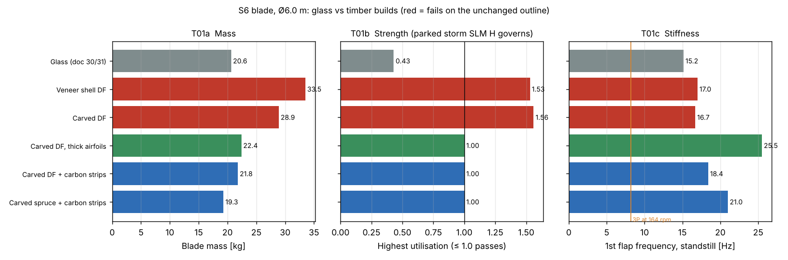
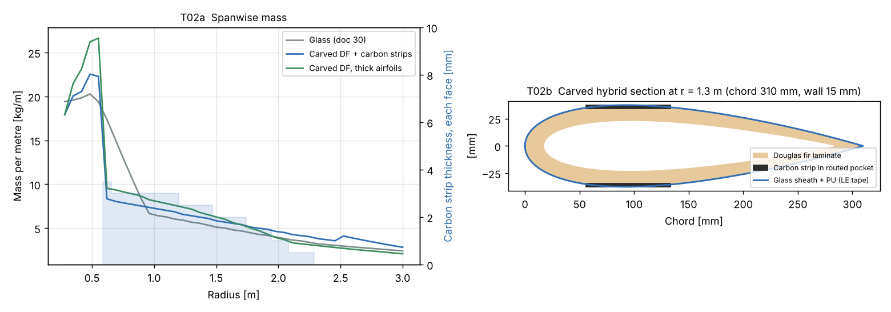

# Timber Blades for the 6 kW S6 (and a Look at 12 kW)

Status: **for review** · 2026-11-06 (Martin: "Ok let's think if it's possible to make the blades out of timber")
Owner: Category 2 (Rotor and blades), Category 9 (Materials), Category 10 (Manufacturing)
Builds on: [10 – Blade structure](10-blade-structure.md), [30 – Design S6](30-6kw-turbine-design-s6.md), [31 – Simulation S6](31-6kw-simulation-s6.md)
Analysis: [`analysis/turbine_6kw/timber6.py`](../analysis/turbine_6kw/timber6.py) → `results/timber6.json` (6 kW), `python3 timber6.py 12kw` → `results/timber12.json`; figures [`timber_plots.py`](../analysis/turbine_6kw/timber_plots.py) → `results/T01`, `T02`

## Summary

**Yes, the S6 blades can be made of timber, at about the same mass and stiffness as the glass blade.** Plain wood is not strong enough in the thin sections of the present outline. A timber blade needs one of two things: thicker airfoils, or a small amount of carbon in the faces.

| | Glass (doc 30/31) | **Carved Douglas fir + carbon strips** | Carved Douglas fir, thick airfoils |
|---|---|---|---|
| Outline / airfoils | S6 | **S6 unchanged** | t/c 36 % → 26 % at mid-span (was 24 → 20 %) |
| Mass per blade | 20.6 kg | **21.8 kg** (1.0 kg of it carbon) | 22.4 kg (all wood) |
| Static moment | 21.3 kg·m | 23.2 kg·m (+9 %) | 21.8 kg·m (+2 %) |
| 1st flap / edge, standstill | 15.2 / 38.3 Hz | 18.4 / 44.1 Hz | 25.5 / 58.5 Hz |
| Flap at 164 rpm vs 3P | 1.9 × 3P | 2.3 × 3P | 3.2 × 3P |
| Highest strength use | 0.43 (cap buckling 1.00) | 1.00, parked storm SLM H | 1.00, parked storm SLM H |
| Fatigue use | 0.10 | 0.27 | 0.25 |
| Aerodynamics | as designed | unchanged | Cp −1.4 % (BEM, optimistic; expect −1.5 to −3 %) |
| Tooling | two-half infusion mould | **no mould**: CNC router, press, vacuum bag | as hybrid |

- **Recommendation for S6.** If timber is pursued, use the **carved Douglas fir blade with carbon strips on the unchanged outline**. The aerodynamics, the loads of doc 31 and the stall controller then stay valid as they are, and the rotor is 4 kg heavier in total. The all-wood thick-airfoil blade is the fallback if no carbon is wanted, but it changes the aerodynamics and the controller tuning.
- **Glass stays the production baseline.** Timber matches glass on mass and stiffness. It loses on proven durability in a wet freeze-thaw climate, on certification effort (wood has no standard material data, so it needs its own coupon test programme), and on imported raw material. Its gains are no mould, easy design changes and an in-house craft process. The best use of timber is **the first prototype blade set**, which can be made without waiting for a mould. If it then survives two Icelandic winters on test, it can become a product option.
- **12 kW Ø7.5 m: no.** All-wood fails even with thick airfoils (use 1.41). The carbon-strip hybrid works at **26.1 kg against 20.5 kg** for the doc 10 carbon blade, so the static moment is 28 % higher, with a heavier pitch system and a 70 m/s tip for erosion. Timber offers nothing there that glass does not.

## 1. What was checked

`timber6.py` uses the glass blade's section model and sizing loop (`analysis/blade/blade.py`) with the S6 loads from doc 31 (`recheck6.json`):

| Load | Design value | Note |
|---|---|---|
| SLM H, parked storm, flap | 18.5 kNm at the root | **governs every timber build** |
| SLM G, shutdown, edge | 2.6 kNm | |
| SLM E, overspeed 205 rpm, γ 3 | centrifugal | |
| Aeroelastic extreme (doc 31) | 8.9 kNm resultant | parked yaw lost |
| Fatigue DEL, 10⁷ cycles | flap 0.78 × 1.3, edge 0.73 × 1.3 kNm | ×1.3 because wood's S-N slope is m = 13, not the m = 10 used to rainflow |

**Wood properties.** These are characteristic values along the grain for an epoxy-encapsulated laminate at 12 % moisture, from published wood-epoxy blade data (Gougeon Brothers / NASA programme, Spera *Wind Turbine Technology* ch. 8):

| | E | Density | Tension strain | Compression strain | S-N slope |
|---|---|---|---|---|---|
| Douglas fir veneer / epoxy (DF) | 15.0 GPa | 600 kg/m³ | 0.50 % | **0.32 %** | 13 |
| Sitka spruce veneer / epoxy (SS) | 11.5 GPa | 470 kg/m³ | 0.55 % | 0.29 % | 13 |
| Glass UD / epoxy, for comparison | 42 GPa | 1,950 kg/m³ | 2.0 % | 1.5 % | 10 |

The wood values are multiplied by **K_MOD = 0.80**, for moisture up to about 15 %, a +40 °C skin temperature and load duration, in the same way as Eurocode 5. The project's γm of 1.35 (SLM route) and 2.2 (aeroelastic route) apply on top, as for glass.

**Why wood is harder to use than glass.** Wood is about a third as stiff as UD glass, but it fails in compression at only a fifth of the strain. Glass caps are sized by buckling of thin laminates (doc 30), and their strength use is only 0.43. Wood cannot buckle at the thicknesses it needs, so it runs straight into compression strength. The only remedies are more depth (thicker airfoils) or a stiffer material in the faces.

**Builds sized.** Each was run on three thickness distributions: S6 as designed, "thick" (40 % at max chord), and "extra thick" (45 % at max chord, 36 % at mid-span, 26 % at 0.7 R):

1. **Moulded veneer shell** (Gougeon "WEST" method): UD veneer caps, veneer shell wall, birch plywood webs, no foam. The thin-wall model was corrected for thick laminates.
2. **Carved laminated**: glued lamella blanks in two halves, CNC carved outside, hollowed to a wall (solid where too thin), glued together. Root block with at least 60 mm wall over the first 0.30 m for the studs.
3. **Carved + carbon strips**: as 2, with a 15 mm wall and pultruded carbon strips (0.25 × chord wide, 0.5–3.5 mm thick) bonded into routed pockets in both faces, under the sheath.

Every timber build carries a **glass/epoxy sheath (2 × 300 g/m²)**, PU leading-edge protection, a PU topcoat and 2.5 kg of root studs.

## 2. Results, 6 kW

| Build (Douglas fir) | Outline | Mass | Flap f | Highest use | Verdict |
|---|---|---|---|---|---|
| Veneer shell | S6 | 33.5 kg | 17.0 Hz | 1.53 | fails, caps at 80 mm |
| Veneer shell | extra thick | 25.8 kg | 24.1 Hz | 1.00 | works, but heavier and needs a mould |
| Carved | S6 | 28.9 kg | 16.7 Hz | 1.56 | fails, solid 0.35–2.25 m and still too weak |
| Carved | thick | 27.4 kg | 21.7 Hz | 1.16 | fails at mid-span |
| **Carved** | **extra thick** | **22.4 kg** | **25.5 Hz** | **1.00** | **works, all wood** |
| **Carved + carbon** | **S6** | **21.8 kg** | **18.4 Hz** | **1.00** | **works, outline unchanged** |
| Carved + carbon (spruce) | S6 | 19.3 kg | 21.0 Hz | 1.00 | works; root wall 78 mm, weaker studs in spruce |

- Sitka spruce is lighter, but too weak in compression for the all-wood builds (use 1.09 to 2.25). It only works with carbon. Douglas fir is also harder and holds glued-in studs better, so **Douglas fir is the species to use**.
- The moulded veneer shell is the classic large-blade wood method. At this size it loses to carving: the walls get so thick that the "shell" is nearly solid anyway, and it still needs a mould.
- Tip deflection is 0.02–0.03 m against 0.83 m tower clearance. Every timber build is stiffer than glass, so there are no frequency problems: the lowest flap mode is 2.3 × 3P, against 1.9 × 3P for glass.
- **Aero cost of the extra-thick airfoils.** BEM at TSR 5.5 with the section drag scaled by the Hoerner form factor (1 + 2 t/c + 60 (t/c)⁴) gives Cp −1.4 %. This leaves out the lower maximum lift and higher roughness sensitivity of thick sections, so expect −1.5 to −3 % energy. It would also need new stall-torque numbers (doc 28/31), because thick airfoils stall differently.

### Effect on the rest of S6 (hybrid, outline unchanged)

- Rotor +3.6 kg and static moment +9 %. SLM H is aerodynamic and unchanged. The mass-driven SLM loads rise by a few percent. Doc 30 reused the 12 kW spindle because every S6 shaft load was at or below the 12 kW value; the closest was overspeed shaft bending at 0.99 of it, which would now go slightly above 1.0. The 12 kW spindle has its own margin, but that one load must be rechecked against it once the blade mass is fixed.
- The higher flap frequency (18.4 against 15.2 Hz) moves the blade further from every excitation. Edge 44 Hz.
- **Root joint.** Glued-in steel studs (Gougeon / Riberholt type) in a solid Douglas fir root block: **12 × M20 8.8, 240 mm embedded, on PCD 180**. The design stud force is 37 kN against 52 kN bond capacity and 141 kN steel. Fatigue stud range is about 2 kN at 10⁷ cycles, which is far below the bond's fatigue capacity. The hub root flange keeps its Ø280 and shim seat, but its drilling changes from 10 × M12 on PCD 185 to 12 × M20 on PCD 180.

## 3. Iceland-specific issues

| Issue | Timber | Glass | Mitigation for timber |
|---|---|---|---|
| **Moisture** | Wood swells, softens (−5 % compression strength per 1 % moisture) and can rot above ~20 %. Iceland is wet and salty year-round. | Not affected | Fully epoxy-saturated laminate built at 8–10 % moisture, glass sheath, PU topcoat. Annual visual inspection; seal any crack the same season. |
| **Moisture imbalance** | Taking up 1 % moisture adds 0.19 kg to a blade, about **0.2 kg·m of static moment, the whole doc 09 rotor balance budget** (R6.6). | None | Matched blade sets; balance pocket near 0.7 R; the vibration trip (R6.6) catches drift; rebalance at service. |
| **Freeze-thaw** (south and west coast: frequent cycles around 0 °C) | Water in a sheath crack freezes and splits the glue lines. **The main durability risk.** | Small | As above. Hardest test in the qualification: humidity, freeze-thaw and fatigue on coupons and on one full blade. |
| **Cold, −40 °C** | Wood gets stronger and stiffer when cold. The steel studs (α 12 × 10⁻⁶/K) shrink more than the wood along the grain (≈ 4 × 10⁻⁶/K), which loads the bond line. | Glass and steel similar | Cold cycling of a root-joint specimen, with pull-out after cycling. |
| **Icing** | Same surface (PU over glass), same ice detection and yaw-out (doc 30). Wood insulates, so a heater mat under the sheath sends its heat outward. | Same | Heater mat option unchanged. |
| **Leading-edge erosion** (rain, sleet, volcanic ash and sand in the highlands) | Bare wood erodes fast; it must be protected. Tip speed 51 m/s (64 m/s at the overspeed trip) is a mild erosion class. | PU LEP needed too | Same PU tape or shell on the leading 15 %, replaceable; glass sheath underneath stops damage reaching the wood. |
| **Lightning** (low flash density, but winter lightning on the coast) | Wet wood can split from steam when struck. | Similar risk to laminate | Tip receptor and down-conductor as for glass. |
| **UV** | Epoxy chalks without a topcoat. | Same | PU topcoat, as for glass. |

**Lifetime.** Wood-epoxy has a flat S-N curve and a good field record: the Gougeon Brothers built thousands of wood-epoxy blades in the 1980s and 1990s, and wood-epoxy was a mainstream blade material until glass took over on cost at large sizes. A 20-year design life for S6 is realistic **if the encapsulation stays intact**. That makes inspection and resealing part of the maintenance plan in a way it is not for glass: an annual visual check of the sheath and leading edge, sealing cracks the same season, and LEP replacement roughly every 5 years (the same interval as glass).

## 4. Manufacturing in-house

1. **Timber.** Kiln-dried, structurally graded Douglas fir (straight grain, ≥ 6 rings/25 mm, slope of grain ≤ 1:15, no knots in the caps). It has to be imported, from the Pacific Northwest or from European plantations (UK, France, Germany). Iceland's own Sitka spruce and larch plantations are young and fast-grown, with low density and many knots, so they are not blade grade today. They could serve for non-structural parts.
2. **Blanks.** Plane the lamellae to 20–25 mm, weigh and sort them so all three blades of a set match, scarf-join them 1:12 (no finger joints in the faces), and glue each half-blank with epoxy under vacuum or a press.
3. **CNC.** A 3-axis router with a ≥ 3.2 m bed carves the outer surface from the 3D model and hollows the inside to the wall plan. It also routs the carbon-strip pockets and the root-block bores.
4. **Carbon.** Pultruded strips are bought in, bonded into the pockets and tapered at the ends (1:50 ply drop).
5. **Close and root.** The two halves are glued together, the 12 stud holes are drilled in a jig, and the studs are bonded with thickened epoxy.
6. **Finish.** Glass sheath under vacuum bag, fairing, PU topcoat, LEP tape, then **weigh and balance** each blade and match the set (static moments within the R6.6 budget).

No mould is needed, and the outline can be changed by editing the CNC file. That is the real advantage for prototypes and small series. The skills (woodworking, epoxy laminating, CNC) are general and easy to hire in Iceland. Quality control replaces infusion checks with timber grading, glue-line inspection (tap test, ultrasound) and moisture measurement of the lamellae before glueing.

## 5. Certification and qualification

IEC 61400-2 accepts any blade material whose properties are shown by test, but there is no ready-made characteristic data for wood-epoxy as there is for glass. Before release:

- **Coupon programme** on the chosen Douglas fir supply: static tension and compression at 12 % and 18 % moisture and at −30 °C, S-N curves at R = −1 and R = 0.1 to 10⁷ cycles, and a scarf joint.
- **Root joint**: static pull-out and fatigue of single studs, plus pull-out after cold cycling.
- **Full blade**: static test to the SLM H design load (18.5 kNm), fatigue test to 10⁷ cycles at the doc 31 DEL × 1.3, then a moisture and freeze-thaw exposure and a residual static test.
- **Field**: one prototype set for two winters on a coastal site, with mass and balance checks each service.

## 6. Recommendation

1. **Keep glass as the S6 production blade.** It is the lower-risk route in a wet freeze-thaw climate, and certifiers know it.
2. **Timber is feasible and worth doing as the prototype blade set.** Use carved Douglas fir with carbon strips on the unchanged outline: 21.8 kg, flap 18.4 Hz, glued-in 12 × M20 studs. It needs no mould, so the prototype rotor can turn sooner, and it can carry the stall-torque test of doc 30 §10, because the aerodynamics are identical.
3. **Make timber a product option only after** the coupon programme, the full-blade test and two winters in the field.
4. **12 kW: stay with the doc 10 carbon-cap blade.**

## 7. Limits of this study

- Wood properties come from published wood-epoxy data, not from tests of our own supply. Wood scatter is larger than glass scatter, and the 5 % characteristic values depend strongly on grading.
- The carved section uses an offset of the outer airfoil to model the cavity. Carbon-strip ends, scarf joints and glue lines are not modelled; they need a local FE and the full-blade test.
- The aero penalty of thick airfoils is estimated from drag only. A polar set for the actual thick sections is needed before that build could be chosen.
- The doc 31 fatigue spectra were rainflowed with m = 10. The ×1.3 factor for m = 13 is an estimate; the margins are large (use 0.27), so the conclusion does not depend on it.
- The S6 SLM and aeroelastic loads were not rerun with the 21.8 kg blade. The +9 % static moment needs a recheck of overspeed shaft bending (0.99 of the 12 kW value in doc 30) before release.
