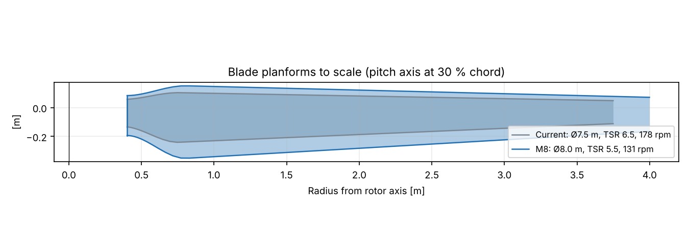
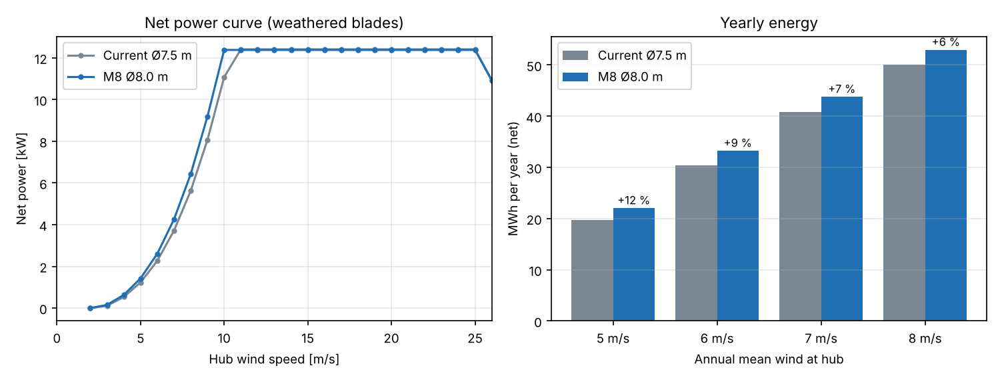
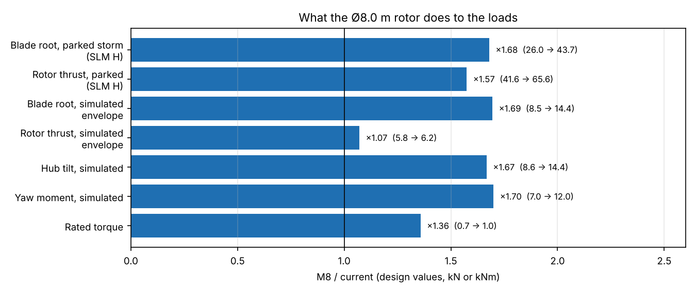
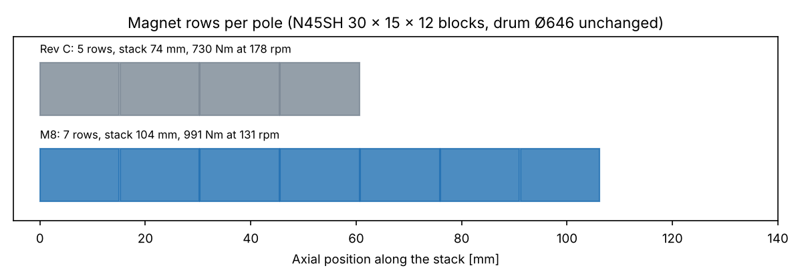
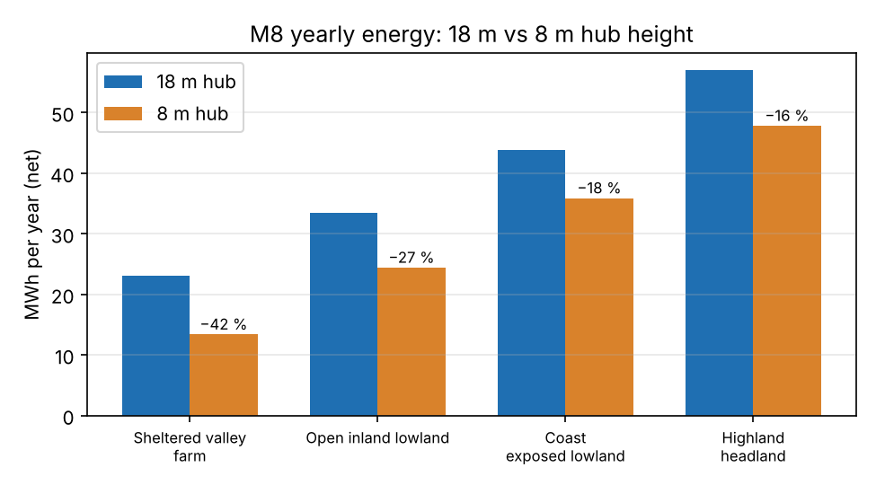

# 12 kW Wind Turbine: New Baseline M8 (Ø8.0 m, TSR 5.5, 131 rpm)

Status: **Draft, revision 1** · 2026-11-06
Owner: Category 1 (Systems engineering), with all design categories
Request (Martin, 2026-11-06): "Ok let's go back to 12kw and let's do the 8m (unless 8.5 or 9 is much better) tsr5.5 (unless 5 or 4.5 is even better)."
Builds on: [27 – Size × TSR map](27-size-tsr-decision-map.md) (recommended M8), [26 – Slow variant V5](26-slow-rotor-variant-v5.md) (same method), [23 – Generator Rev C](23-generator-rev-c.md), [24 – Collective pitch and hub](24-collective-pitch-hub.md), [25 – Yaw](25-yaw-system.md), [32 – Bedplate finding](32-6kw-bedplate-drawings-viewer.md), [09 – Tower](09-tower-foundation.md)
Models: [`analysis/variant_m8/`](../analysis/variant_m8/). Each script reuses the existing project model unchanged and only replaces its inputs. Run order in the README there.

## Summary

The 12 kW turbine is redesigned around a **Ø8.0 m, three-blade rotor with design TSR 5.5, rated 131 rpm at 10.0 m/s**. Ø8.6/9.4 m and TSR 5/4.5 were checked in the doc 27 grid and were not much better, so they were not pursued. Every subsystem was re-sized against a new IEC SLM load set and a full 103-case aeroelastic rerun, and the rotor–tower loop was run twice until it closed.

| | Current (Ø7.5 m) | **M8 (Ø8.0 m)** | Change |
|---|---|---|---|
| Rated speed / tip speed | 178 rpm / 70 m/s | **131 rpm / 55 m/s** | −26 % / −22 % |
| Rated wind | 10.5 m/s | **10.0 m/s** | −0.5 m/s |
| Rated shaft torque | 730 Nm | **991 Nm** | +36 % |
| Sound at 60 m (doc 27 model) | 47.3 dB(A) | **≈ 44.4 dB(A)** | meets the 45 dB(A) target (R2.7) |
| **Yearly energy, net, 6 m/s mean** | 30,400 kWh | **33,200 kWh** | **+9 %** |
| **Yearly energy, net, 7 m/s mean** | 40,800 kWh | **43,800 kWh** | **+7 %** |
| Blade (carbon caps, doc 10 build) | 20.5 kg, max chord 0.34 m | **34.1 kg, max chord 0.50 m** | +66 % |
| Parked storm load at the blade root (SLM H, design) | 26.0 kNm | **43.7 kNm** | ×1.68 |
| Generator | Rev C, 5 magnet rows, stack 74 mm | **Rev C, 7 rows, stack 104 mm** | +48 kg |
| Hub + collective pitch | 239 kg | **337 kg** | +41 % |
| Rotor brake | 2 calipers, 8.7 kNm | **3 calipers, 13.1 kNm** | +1 caliper |
| Bedplate | NP1-300, 333 kg as drawn | **NP8-300, 136 kg** (lightened, doc 32 method) | −197 kg |
| Yaw ring | Dpw 360 | **Dpw 410** | one size up |
| **Head mass above the tower flange** | **1,286 kg** (real, with the 333 kg bedplate) | **1,280 kg** | **≈ 0** |
| 18 m tower | 1,940 kg, 0.85 Hz | **2,356 kg, 0.97 Hz** | +21 % |
| Footing, soft volcanic soil | 4.3 m, 11.9 m³ | **4.6 m, 13.5 m³** | +13 % concrete |
| Power electronics | 750 V SiC chain | **unchanged** | none |

**Bottom line: M8 gives 7–9 % more energy at typical Icelandic sites, meets our own 45 dB(A) noise target, and cuts the tip speed by a fifth. The storm loads grow by about 1.7×, which costs a heavier hub, a third brake caliper, a larger yaw ring and 0.4 t more tower. Because the bedplate is lightened at the same time, the tower-top mass stays where the current machine really is (≈ 1,280 kg).** Every check below passes. Nothing in the electrical system changes.

### Decisions for Martin

My defaults are in bold; everything in this document is computed with them. None of them blocks the next step.

| # | Decision | Options | My recommendation and why |
|---|---|---|---|
| D1 | Bedplate | keep NP1-300 as drawn (333 kg) / **new lighter NP8-300 (136 kg)** | **NP8-300.** NP1-300 is loaded to 41 % at most even with M8 loads; NP8-300 is the 6 kW NS6-300 with a 30 mm bottom plate, highest hand-check utilisation 0.68. It saves ≈ 200 kg at the tower top. FE check before release. |
| D2 | Rotor brake | **3 calipers (13.1 kNm)** / 4 calipers (17.5 kNm) | **3 calipers.** Parked aero torque is 9.3 kNm characteristic, 12.6 kNm design; 13.1 kNm holds the design value (1.41 × characteristic). 4 calipers would add margin, but also raise the SLM G shutdown loads on the blade edge, hub and drum bolts. |
| D3 | Blade cap build | **plain carbon caps (34.1 kg)** / cored carbon caps (32.2 kg) / glass caps (36.2 kg) | **Plain carbon caps,** as in doc 10. The cored version saves 2 kg but runs at 0.92 on SLM H and 0.99 on panel buckling, and is harder to build. |
| D4 | Generator turns | **keep 28 turns** / 27 turns | **Keep 28.** EMF at rated is 3.4 % higher than Rev C (385 vs 372 V at 100 °C), peak 881 V cold at design overspeed (Rev C 852 V, limit set by the 1,200 V devices). Same coils, same winding tooling. |
| D5 | Pitch crank radius | **r 140 with a ~27 kN cylinder** / r 110 with a ~36 kN cylinder (Ø40 screw) | **r 140,** so the cylinder stays in the doc 24 frame size. Doc 24 had to move the crank to r 110 to clear the drum bearing housing, so r 140 needs the 3D clash check on the larger hub first. If it clashes, r 110 with the bigger cylinder is the fallback. |

---

## 1. Rotor (`rotor_m8.py`, `power_m8.py`)

Same BEM model, polars, storm ramp (full power to 25 m/s, 40 % at 30 m/s) and losses as doc 03 and doc 12. Only the radius, the design TSR and the speed cap change.

| | Current | M8 |
|---|---|---|
| Diameter | 7.5 m | **8.0 m** |
| Design TSR / optimum TSR in operation | 6.5 / 6.9 | **5.5 / 6.0** |
| Cp max, clean / weathered | 0.478 / 0.448 | 0.473 / 0.448 |
| Chord max / tip / root cylinder | 0.34 / 0.16 / 0.19 m | **0.50 / 0.24 / 0.28 m** |
| Blade planform area | 0.85 m² | **1.34 m²** (+57 %) |
| Solidity | 5.8 % | 8.0 % |
| Speed range | 40–178 rpm | **35–131 rpm** |
| Max steady thrust in operation | 2.18 kN | 2.28 kN |
| Pitch at 25 m/s | 26° | 31° |

**Why 131 rpm.** A scan of the rated speed (125, 128, 131, 135, 140 rpm) shows that 131 rpm is the lowest speed that reaches 12 kW at 10.0 m/s; at 125–128 rpm rated moves to 10.5 m/s. Energy at 131 and 135 rpm is the same to 0.01 %, so the lower speed is taken: it is quieter and gentler on the leading edge. Tip speed is 54.9 m/s.

### Yearly energy

Net energy after generator, rectifier, inverter and 120 W auxiliaries, 97 % availability, Rayleigh wind at hub height, doc 12 loss chain with the M8 generator losses (§4).

| Mean wind at hub | Current, weathered | **M8, weathered** | Gain | Current, clean | M8, clean |
|---|---|---|---|---|---|
| 5 m/s | 19,700 kWh | **22,000 kWh** | +12 % | 20,800 | 23,000 |
| 6 m/s | 30,400 kWh | **33,200 kWh** | +9 % | 31,800 | 34,400 |
| 7 m/s | 40,800 kWh | **43,800 kWh** | +7 % | 42,300 | 45,000 |
| 8 m/s | 50,100 kWh | **52,900 kWh** | +6 % | 51,500 | 54,100 |
| 10 m/s | 64,400 kWh | **66,800 kWh** | +4 % | 65,600 | 67,800 |

The ±15 % uncertainty of doc 26 applies to both columns; the ratio between the designs is much more reliable. The aeroelastic runs confirm the curve: mean shaft power in turbulence is 11.4 kW at 10 m/s and 13.1–13.6 kW from 12 to 24 m/s.

---

## 2. Loads (`structure_m8.py` SLM, `dlc_m8.py` simulation)

**SLM (IEC 61400-2 simplified load model)**, doc 08 equations, γ_f 3.0, with the 3-caliper brake:

| Case (design values) | Current | M8 | Ratio |
|---|---|---|---|
| H parked: blade root flap | 26.0 kNm | **43.7 kNm** | 1.68 |
| H parked: shaft thrust | 41.6 kN | **65.6 kN** | 1.57 |
| G shutdown: shaft torque | 28.4 kNm | **42.3 kNm** | 1.49 |
| G shutdown: blade root edge | 10.4 kNm | 15.6 kNm | 1.51 |
| E overspeed: blade root pull | 63.7 kN | 57.7 kN | 0.91 |
| D max thrust | 25.4 kN | 28.9 kN | 1.14 |
| B yaw: shaft moment | 5.4 kNm | 7.2 kNm | 1.34 |

**Aeroelastic rerun.** The doc 11 final case set (103 runs) was rerun in the in-house simulator with the M8 blade (34.1 kg, flap 18.5 Hz), rotor inertia 385 kg m², brake 13.1 kNm, the M8 head (1,280 kg) and the resized 18 m tower (0.97 Hz, §7). Doc 11 controller: constant power, storm ramp, speed exclusion zone, ±0.3° pitch misalignment. The overspeed torque term was scaled to 740 Nm per rad/s by the torque and speed ratios, and the speed loop runs at 4 rad/s as in V5. The loop was run twice (first pass 1,400 kg head and 0.95 Hz); the second pass changed no envelope value by more than 1.3 %.

| Channel (design, γ 1.35) | Current (doc 11 final) | M8 | Governing case (M8) |
|---|---|---|---|
| Blade root resultant | 8.5 kNm | **14.4 kNm** | 6.x parked V_ref, 90° yaw |
| Blade root flap | 7.0 kNm | 11.9 kNm | 7.1 parked, one blade stuck at fine |
| Rotor thrust | 5.8 kN | 6.2 kN | 7.1 parked, blade stuck |
| Hub tilt moment | 8.6 kNm | 14.4 kNm | 7.1 |
| Yaw moment | 7.0 kNm | 12.0 kNm | 7.1 |
| Aero torque on the parked rotor (char.) | 5.8 kNm | **9.3 kNm** | 6.x parked V_ref, 30° yaw |
| Peak rotor speed | 232 rpm (130 %) | 172 rpm (131 %) | 1.3 extreme turbulence; design overspeed 184 rpm |
| Blade flap DEL (m 10) | 3.4 kNm | 3.8 kNm | |
| Tower base DEL (m 4) | 68 kNm | 89 kNm | |

- **Parked storm loads govern the structure**, as for the current design. They grow with the blade area (×1.57) and radius, so about ×1.7. Operating loads grow much less (thrust +7 %), because the rated thrust hardly changes.
- **Speed limits keep the doc 08/11 ratios to rated:** overspeed trip 155 rpm (118 %), design overspeed 184 rpm (140 %).
- **Trips:** the only overspeed trips are in the extreme-turbulence cases (DLC 1.3 at 14, 18 and 24 m/s), exactly as for the current design. No normal-turbulence run tripped.

---

## 3. Blade (`structure_m8.py`, doc 10 model)

Doc 10 layup sizing re-run with the M8 planform, the simulated loads, the SLM loads, and the thickness distribution stretched to the longer blade.

| Option | Mass | Flap / edge at 131 rpm | Highest utilisation |
|---|---|---|---|
| Glass caps | 36.2 kg | 13.1 / 28.1 Hz | cap buckling 1.00, web shear 0.87 |
| **Carbon caps (doc 10 build)** | **34.1 kg** | **18.8 / 30.9 Hz** | cap buckling 1.00 (sized by it), web shear 0.87, SLM H strain 0.29 |
| Carbon caps with foam core | 32.2 kg | 11.8 / 27.2 Hz | panel buckling 0.99, SLM H strain 0.92 |

**Recommendation: plain carbon caps (D3),** the doc 10 construction scaled up. The caps are sized by buckling, so they are much stronger than needed (SLM H strain 0.29), which leaves margin for the root transition and for any later load growth. Flap frequency at rated (18.8 Hz) is far above 3P (6.6 Hz). Tip deflection is 0.03 m against 0.93 m tower clearance.

**Root joint:** root cylinder Ø0.28 m, **12 × M16 inserts on PCD 245**, 64 kN per bolt against 113 kN (SLM H 43.7 kNm with 55 kN pull at design overspeed). The doc 10 root was Ø0.22 m with 10 × M16.

The cured blade is 3.6 m long and 0.50 m wide. It still suits in-house infusion; the moulds are new.

---

## 4. Generator (`generator_m8.py`, based on Rev C)

**Keep everything in Rev C and add two magnet rows.** Drum Ø646 (Martin's decision of 2026-11-05), 40 poles, 45 slots, the N45SH 30 × 15 × 12 block, 28 turns and the same wire are all unchanged.

Torque per amp and EMF per rpm both scale with stack length. Seven rows give a 104 mm stack (×1.405). Torque needs ×1.36 (991/730 Nm), so the rated current is 3 % lower than Rev C, and the EMF at 131 rpm is 1.405 × 131/178 = 1.034 × the Rev C EMF at 178 rpm. Demagnetisation margins depend on current per turn and are unchanged. The doc 23 2D FEA is per unit length, so its results scale exactly.

| | Rev C | **M8** |
|---|---|---|
| Stack / magnet rows / blocks | 74 mm / 5 / 200 (+10 spares) | **104 mm / 7 / 280 (+14 spares)**, rows 106.2 mm |
| Skew | 5 steps of 0.20° | 7 steps of 0.143° |
| Magnet mass | 8.2 kg | 11.5 kg |
| Line EMF at rated, 100 °C | 372 V at 178 rpm | **385 V at 131 rpm** |
| Electrical frequency | 59.3 Hz | 43.7 Hz |
| Peak line voltage, −30 °C at design overspeed | 852 V | 881 V |
| Transient short-circuit demag margin, 100 °C | 30.1 % | 30.1 % |
| Copper loss at rated | 518 W | **596 W** (turns 23 % longer, current 3 % lower) |
| Core + rotor loss | 258 W | 232 W (lower frequency) |
| Generator efficiency at rated (loss chain) | 94.7 % | **94.4 %** |
| Drum stability (shell, ends held round) | 302 × | 237 × |
| Mass rotor / stator / total | 161 / 115 / 276 kg | **174 / 150 / 324 kg** |

**Cooling (passive, doc 23 §4a model).** The rotor turns 26 % slower, so the inside air is stirred less, and the copper loss is 15 % higher. With the Rev C package as drawn (24 cover blades, 36 inner fins, 48 outer ribs to Ø676) the hot spot is **117 °C at 110 % load on a hot day** (limit 130 °C), 108 °C at rated, and 76 °C at a typical Icelandic 10 °C. Magnets stay below 60 °C. **No change to the cooling package is needed**; the Ø696 rib option of doc 26 is not required.

What changes in manufacturing: carrier, drum and stator stacks 30 mm longer, 7 rows of magnets to place, coils with 30 mm longer straight legs. The segment tooling and the doc 18 winding process carry over, with only the stack fixture changed.

---

## 5. Hub, collective pitch and rotor brake (`hub_yaw_m8.py`, doc 13/24 models)

| | Doc 24 (current) | **M8** |
|---|---|---|
| Pitch bearing (4-point, ungeared) | Dpw 250, 22.2 mm balls, ≈ 19 kg | **Dpw 300, 30 mm balls, Z 28, ≈ 25 kg**: s0 1.37 (SLM H, ≥ 1.25), L10 210 × the need |
| Pitch trip torque per blade (−30 °C, SLM G) | 433 Nm | **611 Nm** |
| Crank radius | 110 mm | **140 mm** (stroke 205 mm), see D5 |
| Electric cylinder | 25.5 kN rated, 11.3 Nm motor | **26.5 kN rated, 11.7 Nm motor** (same frame class) |
| Storm holding on the screw (all blades pushing, ×1.5) | 20 kN | **35 kN**, motor brake ≈ 13 Nm |
| Supercap strokes at end of life | 5.1 | **3.6** (2 required): one module |
| Welded hub | shell Ø460 × 10, necks Ø330 × 10, 117 kg | **shell Ø530 × 10, necks Ø360 × 10, ≈ 180 kg**: neck 117 MPa static (≤ 323), 31.5 MPa fatigue (≤ 42) |
| Hub-to-drum joint | 12 × M16 PCD 400 | **12 × M16 PCD 400, unchanged** (17 kN per bolt) |
| **Hub + pitch total** | 239 kg | **337 kg** |

The pitch moments stay small (storm holding 0.68 kNm per blade). The growth comes from the larger bearings, needed for the 1.7 × parked blade-root moment, and the larger hub around them.

**Crank radius (D5).** With r 110 the cylinder would need 35.5 kN and a Ø40 screw. At r 140 it stays at 26.5 kN, essentially the doc 24 unit. The doc 24 clash check moved the crank from r 120 to r 110 to clear the drum bearing housing at fine pitch. The M8 hub is larger (Dpw 300 bearings, shell Ø530), so r 140 is plausible but must be confirmed in the 3D model before the cylinder RFQ.

**Rotor brake (D2).** The simulation gives **9.3 kNm aerodynamic torque on the parked, feathered rotor** (12.6 kNm design) at V_ref with 30° yaw error. The current two calipers (8.7 kNm) cannot hold it. **Three calipers of the doc 07 type give 13.1 kNm**, which holds the design value. With all blades stuck at fine pitch (R3.8 of doc 24) the aerodynamic torque is 1.0 kNm at 32 m/s, far below the brake. The disc and its radius stay; the third caliper fits around the Ø646 drum (cover lip clearance to check, as already open for Rev C).

**Main bearings and spindle** (doc 07): their margins were very large (spindle reserve 17) and V5, with higher loads, still passed with reserve ≈ 7. For M8 the spindle only grows 30 mm to keep the bearing spacing around the longer stator (≈ 63 kg instead of 57). Not re-run in detail; included in the open points.

---

## 6. Bedplate and yaw (`bedplate_m8.py`, `hub_yaw_m8.py`, doc 25 and doc 32 models)

### Bedplate (D1)

Doc 32 found that NP1-300 as drawn weighs **333 kg**, not the 150 kg carried in docs 25 and 30, so the real current head is ≈ 1,286 kg. The doc 32 plate model was run with the M8 SLM loads, the 0.78 m overhang and the M8 rotor, generator and hub mass ahead of the flange (≈ 825 kg):

| Bedplate | Plates front / bottom / side | Mass | Highest utilisation (hand checks) |
|---|---|---|---|
| NP1-300 as drawn | 40 / 40 / 20 mm | 338 kg | 0.41 (yaw bolts) |
| NS6-300 (6 kW) | 20 / 25 / 10 mm, lightening holes, short rear | 129 kg | **0.98** (bottom plate): too close |
| **NP8-300 (proposed)** | **20 / 30 / 10 mm**, NS6 geometry | **136 kg** | **0.68** (bottom plate); root 0.12, front plate 0.31, fatigue 0.14 |

NP8-300 was chosen as the lightest plate set that keeps every hand check at or below 0.70, leaving margin for the FE check. Interfaces stay those of NP1-300 (spindle flange 12 × M20 PCD 350; yaw flange 16 × M16), so the spindle and yaw parts bolt on unchanged, apart from the larger ring below.

### Yaw

| | Doc 25 | **M8** |
|---|---|---|
| Mass above the yaw bearing | 969 kg (with a 150 kg bedplate) | **1,146 kg** (with NP8-300) |
| Design tilt moment at the bearing (SLM H + shaft moment) | 34.6 kNm | **52.4 kNm** |
| Ring Dpw 360, s0 | 1.44 | **0.95: fails** |
| **Ring Dpw 410** (22.2 mm balls), s0 | – | **1.41** (≥ 1.25) |
| Yaw holding moment (design) | 8 kNm | **13.6 kNm** |
| External gear | z150 m4, face 50 | **pitch radius 330 mm, m4, face 60**: static S_H ring 1.18, pinion 1.54; S_F > 2.6 |
| Gearbox static rating needed | ≥ 1,500 Nm | **≥ 2,300 Nm** |
| Bolts (bedplate, adapter, tower flange) | | loaded to 32–48 % of preload: pass |

The doc 25 concept stays: passive friction pads, two braked gearmotors, no hydraulics. The ring goes one standard size up (Dpw 410 instead of the Dpw 450 that V5 needed). The pad units, adapter NY-400 and the bedplate yaw flange grow with the ring; the bolt checks above used the doc 25 bolt circles, which is conservative. The gearmotors need a heavier output stage (≥ 2,300 Nm static) with the same 0.18 kW motors.

---

## 7. Tower and footing (`tower_m8.py`, doc 09 model)

Doc 09 sizing re-run with the M8 head (1,280 kg), the M8 operating loads and fatigue spectra from the simulation, and the parked side force on the rotor scaled with blade area (18.7 kN against 13.8 kN). The frequency window follows the new speed range: 1P runs to 2.18 Hz and 3P starts at 1.75 Hz, so a freestanding tower sits below 3P(35 rpm)/1.1 = 1.59 Hz, with a speed exclusion zone around its 1P crossing, as in doc 09.

For a fair comparison the current turbine was sized in the same run with its **real 1,286 kg head** (doc 32).

| 18 m freestanding monopole | Current (1,286 kg head) | **M8** |
|---|---|---|
| Base Ø / top Ø / walls | 0.55 / 0.32 m, 10 / 8 mm | **0.55 / 0.40 m, 12 / 8 mm** |
| Mass | 1,940 kg | **2,356 kg** |
| First frequency, rigid / soft soil with ice | 0.85 / 0.80 Hz | 0.97 / 0.91 Hz |
| Speed exclusion zone | 46–56 rpm | **53–64 rpm** (rotor is in the zone 3–6 % of the time at 4–6 m/s) |
| Governing case | earthquake 0.5 g + operation | **parked V_e50**, earthquake close behind |
| Base moment, design | 660 kNm | **826 kNm** |
| Utilisation / fatigue damage, mid flange | 0.86 / 0.23 | 0.90 / 0.58 |
| Base flange | 24 × M24 on 0.65 m | **28 × M24 on 0.65 m** |
| Mid flange | 12 × M24 | 16 × M24 |

| Footing (square, 1.6 m deep) | Current | **M8** |
|---|---|---|
| Firm soil | 3.8 m, 9.5 m³ | **4.1 m, 10.9 m³** |
| Soft volcanic soil | 4.3 m, 11.9 m³ | **4.6 m, 13.5 m³** |
| Frost-susceptible silt | 4.0 m, 10.4 m³ | **4.3 m, 11.9 m³** |
| Rock plinth, anchors | 8 × Ø28 | **8 × Ø32** |

The tower frequency used in the load rerun (0.97 Hz) is this result: the loop was run twice and closed. As in doc 26, the side-side 1P resonance check and the tilt-up rotor area in `tower.py` are still hard-wired to the current rotor and need updating before the tower is detailed.

---

## 8. Power electronics (`power_m8.py`, doc 12 model)

**No change.** The voltage at rated is 3 % higher and the current 3 % lower than Rev C, well inside the doc 12 chain (active SiC rectifier, 750 V DC link, dump load, grid, heating and battery modules).

| | Current | M8 |
|---|---|---|
| Rated: EMF / current / DC link needed | 379 V / 20.7 A / 642 V | 392 V / 20.0 A / **643 V** |
| E-stop braking at peak speed: DC link needed | 882 V | **873 V** |
| Lowest operating speed: EMF | 138 V at 40 rpm | 105 V at 35 rpm (boosted by the active rectifier) |
| Rotor energy at e-stop | 64 kJ | 60 kJ |
| Generator / rectifier / inverter efficiency at rated | 94.7 / 98.8 / 98.5 % | 94.4 / 98.8 / 98.5 % |

---

## 9. Mass and part changes

| Item | Current (real) | M8 |
|---|---|---|
| Blades | 3 × 20.5 kg | 3 × 34.1 kg |
| Hub + pitch | 239 kg | 337 kg |
| Generator | 276 kg | 324 kg |
| Spindle | 57 kg | ≈ 63 kg |
| Bedplate | 333 kg (NP1-300 as drawn) | **136 kg (NP8-300)** |
| Cover, electrics, slip ring, cabling, yaw nacelle side | 186 kg | 186 kg |
| **Above the yaw bearing** | **≈ 1,152 kg** | **1,146 kg** |
| Yaw tower side + adapter | 134 kg | 134 kg (grows with the Dpw 410 ring, ≈ +20–30 kg, not yet counted) |
| **Head above the tower flange** | **≈ 1,286 kg** | **1,280 kg** |
| 18 m tower | 1,940 kg | 2,356 kg |
| **Steel and composites above the footing** | **≈ 3.2 t** | **≈ 3.6 t** |

If NP1-300 were kept as drawn (D1), the M8 head would be ≈ 1,480 kg, and the yaw ring and tower would have to be re-checked for it.

What carries over unchanged: converter and all electrical modules, controller and safety architecture (new gains), generator electromagnetic design, winding, segments, drum, magnet block, cooling package, collective pitch concept, hub-to-drum joint, yaw concept, tower concept and tilt-up method.

What is new: blade moulds and root joint, generator stack length (+2 rows), larger pitch bearings, hub, crank and cylinder stroke, a third brake caliper, the lighter bedplate NP8-300, the Dpw 410 yaw ring and gear, the tower and footing drawings.

---

## 10. Assessment

- **Energy:** +7 to +9 % at the 6–7 m/s sites most customers have, +12 % at sheltered 5 m/s sites, with rated power at 10.0 m/s.
- **Noise and erosion:** tip speed 55 m/s instead of 70. By the doc 27 model the sound at 60 m drops from 47.3 to ≈ 44.4 dB(A), so the 45 dB(A) target (R2.7) is met, though the ±4 dB model uncertainty still needs the early prototype sound measurement that doc 27 asked for. Leading-edge erosion from rain, ash and sleet drops sharply (it scales with roughly the 5th to 8th power of tip speed).
- **Loads and structure:** storm loads ×1.7 at the blade root and on the hub, yaw and tower. That is about half of V5's growth for about two-thirds of its energy gain, as doc 27 predicted. With the lighter bedplate the head mass does not grow at all; the tower grows by 0.4 t and the footing by 1.4–1.6 m³ of concrete.
- **Risk:** low. The electrical system and the generator's electromagnetic design carry over; every mechanical change is a size step of a part already designed.

**This becomes the 12 kW baseline.** Docs 03, 10, 13/24, 23 and 25 describe the predecessor where they differ from this document.

---

## 11. Open points (next steps)

1. **Blade:** detailed layup and root transition (Ø0.28 m cylinder, 12 × M16 on PCD 245), mould design.
2. **Generator drawings:** update Rev C to the 104 mm stack (NP1-200C carrier, 201C stacks, 210C drum, 223C pole pack with 7 rows, skew 0.143°). Call it Rev D.
3. **Hub and pitch:** 3D clash check with the Dpw 300 bearings and crank r 140 (D5), hub FE check, cylinder supplier enquiry (≈ 27 kN, 205 mm stroke).
4. **Brake:** three-caliper layout on the drum and the cover lip clearance.
5. **Bedplate:** NP8-300 drawing and FE check, with the yaw flange adapted to the Dpw 410 ring.
6. **Yaw:** Dpw 410 ring RFQ, adapter NY-400 and pad units resized; gearmotor output stage ≥ 2,300 Nm.
7. **Spindle and main bearings:** detailed doc 07 check with the M8 loads and the 30 mm longer spindle.
8. **Tower:** update the side-side resonance and tilt-up checks in `tower.py` for the M8 rotor, then the 24 m tower.
9. **Certification loads:** the simulator has no edgewise blade DOF or dynamic stall; the parked-yawed cases that govern need an OpenFAST/QBlade check (doc 08 open point, still valid).
10. **3D viewer and fit-check model:** update to M8 once the drawings above exist.

---

## 12. Option: 8 m tower (`tower8_m8.py`, doc 34 method)

Martin, 2026-11-06: "Can we have an 8m tower?" Same method and geometry as the 6 kW 8 m tower of doc 34: hub height 8.0 m, 0.20 m pedestal, tube 6.87 m, the M8 head (1,280 kg), the M8 SLM and simulated loads, class S extreme winds kept at hub height, fatigue scaled for the shorter lever and for 23 % more turbulence near the ground.

**Frequency strategy.** A soft-stiff tower (0.64–1.59 Hz, like the 18 m one) is impossible at 8 m: any tube strong enough is far stiffer. The tower is therefore **stiff**: f1 above 1.15 × 1P at 131 rpm (2.51 Hz) and below 3P at rated / 1.1 (5.95 Hz). The 3P excitation crosses f1 during start-up, so the controller passes through an exclusion zone under torque, as in doc 34.

| | 18 m (§7) | **8 m** |
|---|---|---|
| Tube | Ø550 → Ø400, 12 / 8 mm, 18 m | **Ø420 → Ø400, 10 / 8 mm, 6.87 m** |
| Mass | 2,356 kg | **689 kg** |
| f1 rigid / soft soil with ice | 0.97 / 0.91 Hz | **3.02 / 2.86 Hz** |
| Exclusion zone | 53–64 rpm (1P crossing) | **52–66 rpm (3P crossing)** |
| Governing case | parked V_e50 | earthquake 0.5 g + operation (utilisation 0.70) |
| Fatigue damage at the base | 0.54 | **0.85** (turbulence near the ground) |
| Base flange | 28 × M24 on 0.65 m | **16 × M24 on 0.52 m** |
| Footing, soft volcanic soil | 4.6 m, 13.5 m³ | **3.4 m, 7.8 m³** |
| Footing, firm soil | 4.1 m, 10.9 m³ | **3.0 m, 6.2 m³** |
| Lowest blade tip above ground | 14.0 m | **4.0 m** |

**What it costs in energy** (net, weathered blades, doc 27 site climates defined at 18 m, log-law shear to 8 m):

| Site | 18 m hub | **8 m hub** | Change | Turbulence |
|---|---|---|---|---|
| Sheltered valley / farm (z0 0.25) | 23.0 MWh | **13.4 MWh** | **−42 %** | +23 % |
| Open inland lowland (z0 0.05) | 33.4 MWh | **24.4 MWh** | −27 % | +16 % |
| Coast / exposed lowland (z0 0.01) | 43.8 MWh | **35.9 MWh** | −18 % | +12 % |
| Highland / headland (z0 0.03) | 57.0 MWh | **47.8 MWh** | −16 % | +15 % |

**Assessment.** Structurally the 8 m tower is easy: 1.7 t less steel, about 40 % less concrete, a short tilt-up without a crane, and service from a low platform. But the turbine loses 16–27 % of its energy at typical sites, which is two to three times what the larger Ø8.0 m rotor gained, and 42 % at sheltered sites. The 4 m tip clearance also needs a fenced keep-out zone and is close to Icelandic snow-drift heights. Fatigue at the base (0.85) is the highest of all tower checks and must be confirmed with a dedicated simulation at 8 m (turbulence and shear across a rotor that spans 4–12 m).

**Recommendation:** keep 18 m as the standard 12 kW tower and offer 8 m as an option for open coast and highland sites, or where planning rules limit height. It is also a good choice for the first prototype, where easy access matters more than energy.
