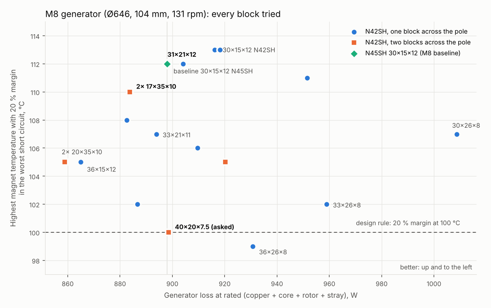

# 12 kW Wind Turbine for Iceland: M8 Generator with N42SH 40 × 20 × 7.5 Magnets, and the Best Block Size

Date: 2026-11-07 · Status: **proposed alternative, baseline unchanged**
Question (Martin, 2026-11-07): "Can u run alternative design with N42SH 40x20x7.5 and compare them", then "Can u also see if there is better design from block shaped magnets, of different sizes".
Builds on: [35 – 12 kW baseline M8](35-12kw-baseline-m8.md) §4, [23 – Generator Rev C](23-generator-rev-c.md), [19 – Magnet geometry](19-magnet-geometry.md) §13 and §16, [21 – Best N42SH shape](21-n42sh-optimal-shape.md)
Scripts: `analysis/m8_magnets/` (`blocks_m8.py`, `compare_m8.py`, `figures_m8mag.py`)

The M8 baseline (doc 35) is not changed by this document.

---

## Summary

**The 40 × 20 × 7.5 N42SH design works, but it is not better than the baseline.** It needs 27 turns instead of 28, uses 240 blocks instead of 280 and 0.55 kg less magnet. Its total generator loss is the same 898 W: copper falls 23 W, but core and magnet eddy losses rise by the same amount. The cost is the magnet safety reserve. In the worst short circuit it keeps exactly the required 20 % at 100 °C, against 30 % (20 % up to 112 °C) for the baseline. It also puts 16 mm of magnet outside the stack (unless the blocks are cut to 35 mm), adds 9.7 kg of drum steel, and puts two blocks side by side on every pole.

**The sweep of 15 block sizes found one clear simplification and one real improvement:**

1. **Make the baseline block 21 mm long instead of 15 mm.** Five rows instead of seven gives **200 blocks instead of 280**, with the same EMF, losses, voltage, safety reserve and seat. The skew is Rev C's 0.20° in five steps. In N42SH the same idea is **31 × 21 × 12** (1 mm wider). Its numbers equal the N45SH baseline within 1 %, so the grade can follow whichever a European maker quotes.
2. **Best performer: two 17 × 35 × 10 N42SH blocks across each pole, in 3 rows.** It loses 14 W less, runs 3 K cooler, uses 0.6 kg less magnet, and keeps 20 % margin up to 110 °C. It needs 240 custom-width blocks and 27 turns.

**Recommendation:** do not adopt 40 × 20 × 7.5. When the M8 magnet drawings are made, use the **21 mm long block** (30 × 21 × 12 N45SH, or 31 × 21 × 12 N42SH). It is the baseline with 80 fewer parts to buy, inspect and place. Keep the 2 × 17 × 10 layout as the option if efficiency ever matters more than part count. The efficiency differences between all the good designs are 0.3 points or less.



---

## 1. Method

Everything uses the machine of doc 35 §4: drum Ø646, 40 poles / 45 slots, stator unchanged, 2.0 mm gap, 0.5 mm sleeve, magnet face at r 301.5, 0.15 mm bond, **stack 104 mm, 131 rpm, rated torque 991 Nm**. Only the magnet blocks change.

- **FEA:** the same 2D model as docs 19 to 23 (`fem.py` + `magnets.py`, unchanged), run per metre of stack and scaled to 104 mm as `generator_m8.py` does. The baseline was recomputed in the same run and reproduces doc 35: 384.7 V, 596 W copper and 30.0 % margin at 100 °C.
- **For each block:** EMF at 100 °C, the rated ampere-turns for 991 Nm, cogging and load ripple with the step skew of its own number of rows, magnet eddy loss at 131 rpm (rotor-frame time stepping with a 3D correction for block length), and the demagnetisation margin in rated load, steady and 2 × transient short circuit at 100, 110 and 120 °C.
- **Losses:** copper = 596 W × (ampere-turns / baseline)². With the same slot fill this is independent of the number of turns. Core loss scales with the flux squared, and the rotor loss with the magnet eddy loss.
- **Turns** are picked so the EMF stays close to the baseline's 385 V, which keeps the converter and the 1,200 V device margin (doc 12) unchanged.
- **Cooling:** doc 23 §4a passive model with the M8 inputs (`generator_m8.thermal`), using each design's losses.
- **Design rule** (doc 23 §2): at least 20 % margin after a 3-phase short circuit at 100 °C magnet temperature. The M8 thermal model puts the magnets at 60 °C on a hot day at 110 % load, so 100 °C is a 40 K reserve.
- **No credit is taken for magnet overhang** beyond the stack (doc 19 §13.3 estimates +1–2 % EMF).

Grades use catalogue minimums: N42SH Br 1.29 T, N45SH 1.32 T, both HcJ 1,592 kA/m (−0.60 %/K).

## 2. The requested design: N42SH 40 × 20 × 7.5

The block lies as in doc 19 Rev B: 20 mm across, 40 mm along, two blocks side by side per pole (span 0.84), seat Ø618.62. Three rows of 40 mm cover 120.4 mm against the 104 mm stack. Two rows (80 mm) would need a much higher current: copper about +50 %, which the cooling cannot carry.

| | **M8 baseline** | **40 × 20 × 7.5 N42SH** |
|---|---|---|
| Block, grade | 30 × 15 × 12, N45SH | 40 × 20 × 7.5, N42SH |
| Layout per pole | 1 across × 7 rows | 2 across × 3 rows |
| Blocks (+ spares) | 280 (+14), 41.0 g | **240 (+12), 45.6 g** |
| Magnet mass | 11.49 kg | **10.94 kg** |
| Rows length / overhang per end | 106.2 / 1.1 mm | 120.4 / **8.2 mm** |
| Seat Ø / drum steel under magnets | 628.02 / 9.0 mm | 618.62 / 13.7 mm |
| Seat land | 120 mm | 134 mm (drum length unchanged) |
| Turns | 28 | **27** |
| Line EMF, 100 °C, rated | 384.7 V | 386.4 V |
| Peak line voltage, −30 °C, design overspeed | 881 V | 885 V |
| Copper / core / rotor + stray loss | 596 / 202 / 100 W | **573** / 219 / 106 W |
| **Total generator loss, efficiency** | **898 W, 94.4 %** | **898 W, 94.4 %** |
| Cogging, unskewed / skewed | 7.5 / 0.00 Nm (7 × 0.143°) | 10.9 / 0.02 Nm (3 × 0.333°) |
| Load ripple (skewed) | 2.4 % | 1.8 % |
| Magnet eddy loss | 2.9 W | 9.3 W |
| **Short-circuit margin 100 / 110 / 120 °C** | **30.0 / 21.9 / 11.4 %** | **20.0 / 10.8 / −1.1 %** |
| Highest magnet temperature with 20 % margin | **112 °C** | **100 °C** (exactly on the rule) |
| Steady short circuit margin, 100 °C | 45 % | 40 % |
| Drum shell stability (ends held round) | 238 × | 383 × |
| Rotor mass vs baseline | – | **+9.2 kg** (drum +9.7, magnets −0.55) |
| Hot spot, hot day rated / 110 % / Iceland 10 °C | 104 / 117 / 76 °C | 103 / 115 / 75 °C |
| Magnets, hot day 110 % | 60 °C | 60 °C |

**What it gains:** 40 fewer blocks, 0.55 kg less magnet, lower load ripple, and a stiffer drum (the thicker steel under the thinner magnets). If the blocks are cut to 35 mm (3 × 35 = 105.4 mm), magnet mass falls to 9.58 kg with the same electrical results. But then it is no longer the 40 × 20 face, and the eddy loss is 8.7 W.

**What it loses:**
- **The reserve against demagnetisation.** At 100 °C it sits exactly on the 20 % rule and fails at 120 °C. The baseline keeps 30 %, and 20 % up to 112 °C. Thin 7.5 mm blocks are simply easier to push backwards than 12 mm blocks, and N42SH has no more HcJ than N45SH. Doc 19 §16 allowed this only with a bench-measured magnet temperature ≤ 75 °C, an IR drum watch (derate 85 °C, stop 95 °C) and no deliberate phase shorting. The baseline needs none of those as hard conditions.
- **No efficiency gain.** The wider span makes more flux, so copper falls 4 %, but core loss rises with the flux, and the long 40 mm blocks have three times the eddy loss. The totals are equal.
- **Manufacturing.** There are two blocks per pole that repel each other sideways, as Rev B had. The 0.84 span sits on the cogging peak (10.9 Nm unskewed), so the 0.333° skew must be held precisely (doc 19 found ±0.02° for 0.50°). There is 8 mm of magnet beyond each end of the stack, the seat land is 14 mm longer, and there is 9.7 kg more drum steel.
- **27 turns** instead of 28 is a small change (thicker wire, the same coil tooling), but it is a change.

**Sourcing.** Both N42SH and N45SH are low-Dy SH grades that European and US makers quote (doc 19 §16.4). N42SH is the more common grade, and 40 × 20 is a standard face size. But 7.5 mm is not a stock thickness, so it is ground to order either way, like the 30 × 15 × 12 block. There is no real sourcing advantage.

## 3. The block-size sweep

Fifteen N42SH blocks, plus the baseline, all on the same machine. Lengths along the stack were chosen so whole rows cover the 104 mm stack (15 × 7, 21 × 5, 26 × 4, 35 × 3 or 52 × 2 mm). The fewest pieces were taken that keep magnet eddy loss ≤ 10 W and a block ≤ 60 g for handling.

| Block (w × l × t) | Across | Span | Blocks | kg | Turns | Copper W | Total loss W | Cogging unsk. Nm | Margin 100 °C | 20 % up to |
|---|---|---|---|---|---|---|---|---|---|---|
| **30 × 15 × 12 N45SH (baseline)** | 1 | 0.63 | 280 | 11.5 | 28 | 596 | 898 | 7.5 | 30.0 % | 112 °C |
| 30 × 15 × 12 N42SH | 1 | 0.63 | 280 | 11.5 | 29 | 622 | 916 | 7.6 | 31.6 % | 113 °C |
| 30 × 21 × 12 | 1 | 0.63 | 200 | 11.5 | 29 | 622 | 918 | 7.6 | 31.6 % | 113 °C |
| **31 × 21 × 12** | 1 | 0.65 | **200** | 11.9 | **28** | **601** | **904** | 6.1 | **30.6 %** | **112 °C** |
| 30 × 26 × 10 | 1 | 0.63 | 160 | 9.5 | 29 | 664 | 952 | 7.9 | 29.7 % | 111 °C |
| 30 × 26 × 8 | 1 | 0.63 | 160 | 7.6 | 31 | 736 | 1009 | 8.0 | 25.8 % | 107 °C |
| 33 × 15 × 12 | 1 | 0.70 | 280 | 12.6 | 27 | 569 | 883 | 1.2 | 27.2 % | 108 °C |
| 33 × 21 × 11 (doc 21 best) | 1 | 0.70 | 200 | 11.6 | 28 | 583 | 894 | 1.2 | 26.1 % | 107 °C |
| 33 × 21 × 10 | 1 | 0.70 | 200 | 10.5 | 28 | 605 | 910 | 1.0 | 24.9 % | 106 °C |
| 33 × 26 × 8 | 1 | 0.70 | 160 | 8.4 | 29 | 669 | 959 | 0.2 | 21.8 % | 102 °C |
| 36 × 15 × 12 | 1 | 0.76 | 280 | 13.8 | 26 | 537 | 865 | 5.8 | 24.0 % | 105 °C |
| 36 × 21 × 10 | 1 | 0.76 | 200 | 11.5 | 27 | 567 | 887 | 5.9 | 21.5 % | 102 °C |
| 36 × 26 × 8 | 1 | 0.76 | 160 | 9.1 | 28 | 627 | 931 | 5.9 | **18.9 %** ✗ | 99 °C |
| 2 × 17 × 52 × 8 | 2 | 0.72 | 160 | 8.6 | 28 | 616 | 920 | 7.3 | 24.7 % | 105 °C |
| **2 × 17 × 35 × 10** | 2 | 0.72 | 240 | 10.9 | 27 | **564** | **884** | 7.6 | **28.1 %** | **110 °C** |
| 2 × 20 × 35 × 10 | 2 | 0.84 | 240 | 12.8 | 25 | 510 | 859 | 10.9 | 24.7 % | 105 °C |
| **2 × 20 × 40 × 7.5 (asked)** | 2 | 0.84 | 240 | 10.9 | 27 | 573 | 898 | 10.9 | **20.0 %** | **100 °C** |

All designs are skewed by rows and cog below 0.1 Nm with the skew. Results per case are in `analysis/m8_magnets/results/blk_*.json`, and the table is in `blocks_summary.json`.

**What the sweep shows:**

- **Thickness buys safety, width buys EMF.** Thin blocks (8 mm) lose margin fast and need more current. Wider blocks give more flux but leave the pole edges exposed in a short circuit. This is the same trade as doc 21, now at the M8 length.
- **The block's length along the stack costs almost nothing up to about 21 mm.** It changes only the piece count and the eddy loss: 15 mm gives 2.9 W, 21 mm 4.9 W, 35 mm 8.6 W, 52 mm 11.3 W for a 30 mm wide block. **Five 21 mm rows instead of seven 15 mm rows removes 80 parts** at a cost of 2 W.
- **Two narrower blocks across a pole beat one wide block of the same span.** Two 17 mm blocks fit the round air gap better than one 33–36 mm flat block, so they give more flux with a better short-circuit margin: 2 × 17 × 10 has 564 W and 28 %, against 605 W and 25 % for a single 33 × 10. The price is twice the pieces per row and a skew that must be held precisely.
- **Span 0.70 is the cogging valley** (about 1 Nm unskewed), which is robust to skew errors. Spans 0.63 and 0.84 sit on cogging peaks and rely on the skew.
- **Over all good designs, efficiency differs by 0.3 points or less** (859 to 918 W of loss on 13.6 kW). The design choice is about safety reserve and making it, not energy.

## 4. The three designs worth keeping

| | Baseline (doc 35) | **A. 21 mm long block** | **B. 2 × 17 × 35 × 10** |
|---|---|---|---|
| Block | 30 × 15 × 12 N45SH | **30 × 21 × 12 N45SH or 31 × 21 × 12 N42SH** | 17 × 35 × 10 N42SH, 2 across |
| Rows, skew | 7 × 0.143° | **5 × 0.20° (Rev C template)** | 3 × 0.333° |
| Blocks (+ spares), weight | 280 (+14), 41 g | **200 (+10), 57–59 g** | 240 (+12), 45 g |
| Magnet mass | 11.5 kg | 11.5 / 11.9 kg | 10.9 kg |
| Seat Ø, drum steel | 628.0, 9.0 mm | 628.0–628.1, 9.0 mm (same) | 623.5, 11.2 mm |
| Turns, EMF, peak | 28, 385 V, 881 V | 28, 384–385 V, 879–881 V | 27, 384 V, 880 V |
| Total loss, efficiency | 898 W, 94.4 % | 900 / 904 W, 94.4 % | **884 W, 94.5 %** |
| Hot spot hot day 110 % | 116.5 °C | 117 °C | **113.7 °C** |
| Short-circuit margin 100 °C, 20 % up to | 30 %, 112 °C | 30–31 %, 112 °C | 28 %, 110 °C |
| Magnet eddy | 2.9 W | 4.8–4.9 W | 5.7 W |
| Rotor mass vs baseline | – | +0.0 / +0.4 kg | +3.5 kg (drum +4.1) |
| Change to the M8 drawings | – | **comb bars 21 mm pitch, 5 rows; nothing else** | new seat, comb, end rings, 27-turn coils |

**A** is the baseline with fewer, longer parts. Every number that matters is the same, and it saves 80 blocks to buy, gauge, sort by Br and place (doc 19 §9). It also takes 2 rows of comb bars and skew steps out of the jig. A 57–59 g block is heavier to place than 41 g, but it is still in the range of Rev B's 45.6 g block, and the doc 18 comb jig holds it the same way. The N42SH version needs the block 1 mm wider (31 mm) to keep 28 turns, so both grades fit one drawing with only the width changed. That leaves the grade to whichever maker quotes first.

**B** is the best electromagnetic design found. It has 1.6 % less loss, 3 K cooler windings, 0.6 kg less magnet and 28 % margin, with the gain coming from two blocks fitting the round gap. It costs a custom 17 mm width, 240 parts, a 3-step skew that must be held precisely (7.6 Nm unskewed), a new seat and 27 turns. It is worth it only if efficiency or winding temperature becomes the limit, for example if the bench shows the cooling is weaker than modelled.

## 5. Recommendation

1. **Do not adopt 40 × 20 × 7.5 N42SH for the M8 generator.** It saves 40 blocks and 0.55 kg of magnet, but gives no efficiency and uses up the whole demagnetisation reserve (100 °C instead of 112 °C). It also adds drum steel and puts 16 mm of magnet outside the stack.
2. **Use the 21 mm long block (design A) when the M8 generator drawings are made.** It does not change anything that the M8 thread is drawing now except the comb bar pitch and the number of rows. Put both versions on the RFQ: 30 × 21 × 12 N45SH and 31 × 21 × 12 N42SH.
3. **Keep 2 × 17 × 35 × 10 (design B)** as the documented higher-efficiency option.

## 6. Open items

- **End effects** are not modelled (2D FEA). Overhang adds 1–2 % EMF for the 40 mm design and nearly nothing for the others. The skew between rows is modelled as ideal steps, so the bench measures EMF and cogging (doc 19 §11 item 4a).
- **Core loss scaling** with flux squared is an estimate, and it is the reason the 40 × 20 × 7.5 design shows no efficiency gain. A tooth-flux FEA check would firm it up (±10 W).
- **Block handling** for 57–59 g pieces: check the comb jig pull-in force on the first rotor.
- Prices and lead times for 21 mm long blocks in N45SH and N42SH should come back with the magnet RFQ.

## Appendix. How to rerun

```
cd analysis/m8_magnets
pip install numpy scipy matplotlib
python3 blocks_m8.py all          # 17 FEA cases, ~9 min each, 4 in parallel (~45 min on 4 cores)
python3 blocks_m8.py table        # results/blocks_summary.json
python3 compare_m8.py A40 W31_12 W33_11 D17_10 D20_10   # losses, cooling, drum, mass -> results/compare_m8.json
python3 figures_m8mag.py          # results/B01-blocks.png
```
