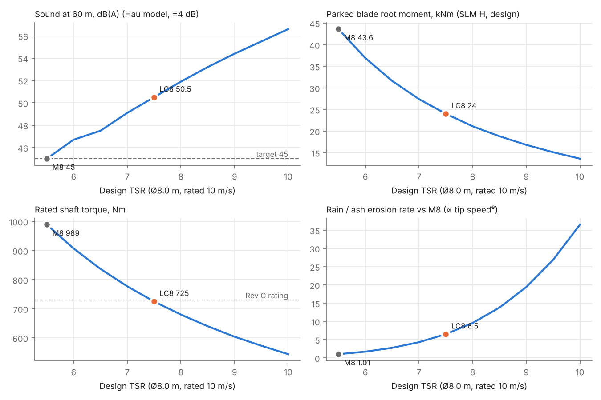
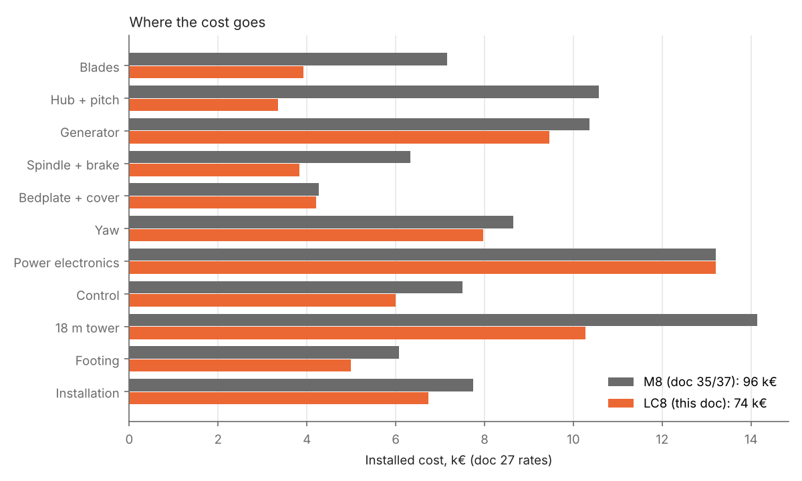

# Low-Cost 12 kW Turbine LC8: Concept (Ø8.0 m, TSR 7.5, Fixed Pitch)

Status: **Concept, revision 1** · 2026-11-07
Owner: Category 1 (Systems engineering), with 2 (Rotor), 3 (Hub/yaw), 4 (Generator), 13 (Product/business)
Request (Martin, 2026-11-07): "Ok now let's build a lightweight version of this, we can have higher much higher tsr" → "I meant completely different design that focuses on low cost of production".
Builds on: [27 – Size × TSR map](27-size-tsr-decision-map.md) (cost model, site scenarios), [28 – 6 kW concept](28-6kw-turbine-concept.md) and [31 – 6 kW simulation](31-6kw-simulation-s6.md) (fixed-pitch stall control), [30](30-6kw-turbine-design-s6.md)/[34](34-6kw-build-book-8m.md) (S6 parts), [35](35-12kw-baseline-m8.md)/[37](37-12kw-m8-build-book-8m.md) (M8, the reference), [10 – Blade](10-blade-structure.md), [23 – Generator Rev C](23-generator-rev-c.md)
Models: [`analysis/low_cost_12kw/`](../analysis/low_cost_12kw/) and the TSR sweep in [`analysis/variant_l7/`](../analysis/variant_l7/). Every model is an existing project model with new inputs.

## Summary

LC8 is a second 12 kW product, designed for **low production cost** instead of lowest noise. It keeps the M8 rotor diameter (so nearly the same energy), runs the rotor about 35 % faster, and drops active pitch.

| | **M8** (doc 35/37, quality baseline) | **LC8** (this doc) | Change |
|---|---|---|---|
| Rotor | Ø8.0 m, TSR 5.5, 131 rpm | **Ø8.0 m, TSR 7.5, 178 rpm** | tip 55 → 75 m/s |
| Power control | collective pitch, electric cylinder, supercap | **fixed pitch, stall by speed control** (as the 6 kW S6) | no pitch system |
| Blade (carbon caps, doc 10 build) | 34.1 kg, chord 0.50 m | **18.7 kg, chord 0.28 m** | −45 % |
| Hub | welded, 3 pitch bearings Dpw 300, 353 kg with pitch | **fixed welded hub, ≈ 112 kg with spinner** | −240 kg |
| Generator | Rev C + 2 rows (stack 104 mm) | **Rev C unchanged, at its own 178 rpm** | the drawn generator |
| Rotor brake | 3 calipers, 14.4 kNm | **1 caliper + braking-resistor contactor** (S6 layout) | −2 calipers |
| Bedplate, yaw, electronics | NP8-300, yaw Dpw 410 | **S6 parts: NS6-300, yaw Dpw 360** | shared with 6 kW |
| Head mass (same bookkeeping) | 1,392 kg | **1,030 kg** | −26 % |
| 18 m tower / footing (soft soil) | 2,356 kg / 13.5 m³ | **≈ 1,710 kg / 11.1 m³** | −27 % / −18 % |
| **Installed cost, doc 27 rates** | **96 k€ (13.9 M ISK)** | **74 k€ (10.7 M ISK)** | **−23 %** |
| Yearly energy, inland 6 m/s site | 33.0 MWh | 32.2 MWh | −2.7 % |
| **Cost of energy, inland / coastal** | **311 / 238 €/MWh** | **246 / 187 €/MWh** | **−21 %** |
| Sound at 60 m (doc 27 model, ±4 dB) | 45.0 dB(A) | **50.5 dB(A)**; 45 dB(A) at 115 m | +5.5 dB |
| Leading-edge erosion (∝ tip speed⁶) | 1 | **×6.5** (×1.5 against the original 70 m/s rotor) | needs a leading-edge shield |

**Bottom line: LC8 is about a quarter cheaper to build and a fifth cheaper per kWh than M8, for 2–3 % less energy.** The saving comes from three moves: a faster rotor (slim blades, low storm loads, a generator that already exists), no pitch system (the most complex and heaviest rotating part), and building on the 6 kW S6 platform so both products share the drivetrain, bedplate, yaw and electronics. **The price is noise:** LC8 is about 5 dB louder than M8 and needs roughly twice the distance to the nearest neighbour to meet 45 dB(A). That makes LC8 the farm and rural product and M8 the quiet product.

### Decisions for Martin

My defaults are in bold; every number above uses them.

| # | Decision | Options | My recommendation and why |
|---|---|---|---|
| D1 | Design TSR | 6.5 / **7.5** / 8 / 9 | **7.5 at 178 rpm.** Lightest blade that still clears 3P, and the Rev C generator runs at exactly its rated speed and voltage. TSR 8 and above need a stiffer, heavier blade (§2), are 1.5–4 dB louder again and erode 1.5–3× faster. TSR 6.5 is 3 dB quieter but its stall torque (≈ 950 Nm) needs one to two more magnet rows and a 24 kg blade. |
| D2 | Power control | **fixed pitch, stall by speed control** / keep collective pitch | **Fixed pitch.** It removes 240 kg and the most complex assembly from the rotor and costs 2.3 % energy. The method is the one already simulated for the 6 kW S6 (doc 31). |
| D3 | Standard tower | **18 m freestanding** (in the cost) / 18 m guyed / 8 m freestanding | **18 m freestanding** as the standard; offer guyed as the cheapest option for open farmland (about −8 k€, estimate, §6). 8 m costs 16–42 % of the energy (doc 35 §12). |
| D4 | Noise position | **farm and rural product, 45 dB(A) at ≈ 115 m** / add a night quiet mode | **No quiet mode as standard.** With the doc 27 model a rotor-speed cap only lowers the noise if it is below 62 m/s tip, and reaching 45 dB(A) at 60 m costs 25 % of the energy. Measure the prototype first (doc 27 asked for this already); the model is ±4 dB. |

---

## 1. Rotor and the TSR choice

Same method as doc 27: Ø8.0 m (Martin's decision of 2026-11-06), rated 12 kW at 10 m/s, tip speed = TSR × 10 m/s. The doc 27 rotor tables were extended from TSR 8 to TSR 10 with the same blade rule and BEM model (`variant_l7/cp_tables_l7.py`, `sweep_l7.py`).

| Design TSR | rpm | Tip, m/s | Sound at 60 m | 45 dB(A) at | Parked blade root (SLM H, design) | Rated torque | Erosion vs M8 | Energy vs M8 |
|---|---|---|---|---|---|---|---|---|
| 5.5 (M8) | 131 | 55 | 45.0 dB(A) | 60 m | 43.6 kNm | 989 Nm | 1 | 0 |
| 6.5 | 155 | 65 | 47.5 | 81 m | 31.6 | 837 | 2.8 | +0.3 % |
| 7.0 | 167 | 70 | 49.1 | 97 m | 27.4 | 777 | 4.3 | +0.3 % |
| **7.5 (LC8)** | **178** | **75** | **50.5** | **115 m** | **24.0** | **725** | **6.5** | **+0.1 %** |
| 8.0 | 191 | 80 | 51.9 | 134 m | 21.1 | 680 | 9.6 | −0.1 % |
| 9.0 | 215 | 90 | 54.4 | 176 m | 16.8 | 604 | 19.4 | −0.6 % |
| 10.0 | 239 | 100 | 56.6 | 225 m | 13.6 | 544 | 36.5 | −1.4 % |

Energy is flat (doc 27's main finding holds up to TSR 9); what TSR trades is storm load and torque against noise and erosion.

**Why 7.5 and not higher:**

1. **The blade hits 3P.** A slimmer blade is also a softer blade. Doc 10 requires the rotating flap frequency to be at least 1.10 × 3P. Sized for strength only, the doc 10 carbon-cap blade gives:

   | TSR / rpm | 3P | Flap frequency, rotating | Mass | Verdict |
   |---|---|---|---|---|
   | 7.0 / 167 | 8.35 Hz | 11.46 Hz (1.37 × 3P) | 21.4 kg | passes |
   | **7.5 / 178** | **8.90 Hz** | **10.08 Hz (1.13 × 3P)** | **18.7 kg** | **passes** |
   | 8.0 / 191 | 9.55 Hz | 9.10 Hz (0.95 × 3P) | 16.5 kg | **fails**; 24 % thick outboard aerofoils and 8× the cap carbon fix it at **20.2 kg** |
   | 9.0 / 215 | 10.75 Hz | 8.42 Hz (0.78 × 3P) | 14.0 kg | fails badly |

   So the lightest blade is at TSR 7.5. Above it the blade gets heavier again, not lighter (`blade_e8.py`).
2. **The generator already exists at 178 rpm.** Rev C was designed for 730 Nm at 178 rpm (the original Ø7.5 m rotor). At TSR 7.5 the Ø8.0 m rotor needs 725 Nm at 178 rpm, so every electrical number of docs 12 and 23 stays as it is: EMF, current, converter, overspeed limits (trip 210 rpm, design overspeed 250 rpm), peak voltage 852 V.
3. **Noise and erosion rise steeply.** Each 0.5 step in TSR adds about 1.4 dB, and erosion goes with roughly the sixth power of tip speed. At 75 m/s LC8 is 1.5× the erosion rate of the original 70 m/s rotor; a polyurethane leading-edge shell on the outer third (already in doc 10 for the original rotor) covers that. At 90–100 m/s the erosion rate is 3–6× higher again; that is large-turbine territory and needs a replaceable shield programme.

## 2. Power control: fixed pitch, stall by speed control

The doc 28 regulation study (`turbine_6kw/regulation.py`, unchanged) run for the 12 kW rotor (`stall12.py`). Above rated wind the converter slows the rotor so the fixed blades stall and the power stays at 13.6 kW shaft. This is the S6 controller that doc 31 simulated through 113 load cases.

| | TSR 7.0 | **TSR 7.5 (LC8)** | TSR 8.0 | TSR 9.0 |
|---|---|---|---|---|
| Energy lost vs pitch (inland site) | −2.2 % | **−2.3 %** | −2.4 % | −2.3 % |
| Generator torque, continuous above rated (cold air) | 1.15 × rated | **1.14 ×** | 1.14 × | 1.14 × |
| Gust torque (+30 % wind step) | 1.31 × | **1.27 ×** | 1.26 × | 1.24 × |
| Torque to stop the rotor at 30 m/s (cold air) | 1.98 × | **1.93 ×** | 1.96 × | 1.96 × |
| Stop at 30 m/s with a 3 × rated brake | 2.9 s | **2.9 s** | 3.6 s | 4.5 s |
| Parked blade root, rotor aligned / yawed 90° out (strip theory, characteristic) | 8.1 / 4.6 kNm | **7.0 / 4.1 kNm** | 6.2 / 3.7 | 4.9 / 3.0 |

Fixed pitch −2° (as S6). In stall the rotor holds 156–163 rpm and 800–830 Nm in cold air, which is 1.10–1.14 × the Rev C rating. This study's check of Rev C at 778 Nm and 167 rpm (`variant_l7/generator_l7.py`, doc 23 §4a model) gives **101 °C hot spot at rated and 114 °C at 110 % load on a hot day** (limit 130 °C); stall operation happens in strong wind, which cools the drum well. **Rev C with its fins, ribs and cover blades is kept unchanged.** The plain S6 drum (G6, no fins) is not enough for 12 kW.

**Two independent stops, as on S6:** a normally-closed braking-resistor contactor and one spring-applied caliper. Without any load a fixed-pitch rotor would run away above 700 rpm at 25 m/s, so both stops are safety functions (doc 28 §5). The caliper is the 12 kW type (4.4 kNm spring pack, doc 07). It covers 3 × rated torque (2.2 kNm) for stopping and the parked torque with yaw lost, estimated at 1.9 kNm characteristic by scaling the S6 simulation (doc 31: 1.45 kNm) with the SLM H moment. The 12 kW parked torque must be confirmed in the aeroelastic run (§8).

**Storm parking:** the yaw drives turn the stopped rotor 90° out of the wind, as on S6. That lowers the parked blade-root moment from 7.0 to 4.1 kNm. Design loads still assume yaw lost (IEC SLM H), as for S6.

Furling with a tail vane was also checked: it saves the yaw drive but loses 4.5 % (inland) to 11 % (highland) of the energy, the rotor keeps running in storms, and a Ø8.0 m rotor needs a 3–4 m² tail. Not recommended.

## 3. Blade and hub

**Blade (doc 10 build, carbon UD caps on a glass/epoxy shell):** 18.7 kg, max chord 0.28 m, flap 10.1 Hz rotating, tip deflection 0.29 m against 0.90 m tower clearance. Highest utilisation: cap buckling 1.00 (sizes the caps), web shear 0.87, SLM H 0.69. Glass caps are too soft here (they fall below 3P), so the carbon caps stay. SLM H design blade-root moment 24.1 kNm (the original Ø7.5 m rotor: 26.0, M8: 43.7). **Root: Ø0.22 m with 10 × M16 inserts on PCD 190, the doc 10 root unchanged** (≈ 56 kN per bolt against 113 kN, including the pull at design overspeed).

**Hub:** the S6 fixed welded S355NL hub (doc 30, 79 kg for an 18.5 kNm root), scaled to 24.1 kNm: **≈ 98 kg + 14 kg spinner**. No bearings, no grease points, no hub electronics, no slip-ring power. A cast EN-GJS-400-18U-LT hub would be about 40 % lighter once volume justifies the pattern (doc 30). The S6 pitch-shim washers (−4/−2/0°) let the stall point be tuned on the prototype.

## 4. Generator, drivetrain, nacelle and yaw: the S6 platform

| Part | LC8 | Source |
|---|---|---|
| Generator | **Rev C, unchanged** (Ø646 × 74 mm, 200 × N45SH 30 × 15 × 12, 28 turns, fins, ribs, cover blades) | doc 23 drawings |
| Spindle, bearings 32028 X, seals, lock pin | unchanged | doc 14 / S6 |
| Brake | Rev B disc, **one** caliper with the 12 kW 4.4 kNm spring pack | S6 layout, 12 kW pack |
| Braking resistor | S6 box 3 × 4 Ω with NC contactor; resistor values to re-check for 12 kW | doc 29/31 |
| Bedplate | **NS6-300** (6 kW bedplate). Under the LC8 SLM loads the doc 32 model gives highest utilisation 0.57 (`variant_l7/bedplate_l7.py`, run with the slightly heavier TSR 7 rotor) | doc 32 |
| Yaw | **Dpw 360 ring, 2 gearmotors, friction pads, NY-400 adapter**: the doc 25 system that S6 uses. The LC8 rotor loads are below the original Ø7.5 m rotor's (SLM H 24.1 vs 26.0 kNm), for which doc 25 sized it | doc 25 / S6 |
| Power electronics and control | doc 12 chain and the S6 stall controller (doc 31) at 12 kW settings | doc 12 / 31 |

**What this means for production:** two products, one drivetrain. The 6 kW S6 and the 12 kW LC8 differ in the blades and blade mould, the hub (same design, larger arms), the generator cooling parts and the spring pack. Everything else is one part number. Compared with M8, LC8 drops 3 pitch bearings, 3 cranks and links, the yoke and guide rods, the electric cylinder, the supercap module and pitch controller, the nose frame, two calipers and their brackets, and the larger Dpw 410 yaw ring.

## 5. Mass and cost

Same bookkeeping for both machines: the CAD part masses (M8 from `cad/turbine_m8`, LC8 from the S6 build plus the new blade and hub), the base cabinet left out of the head. Cost uses the doc 27 rates (in-house manufacture, installed, no development, tooling, certification or margin). The rates are rough; the comparison is more reliable than the absolute numbers. Tower and footing come from the doc 27 tower law calibrated on the M8 18 m tower, because no tower has been sized for LC8 yet.

| Item | M8 kg | **LC8 kg** | M8 k€ | **LC8 k€** |
|---|---|---|---|---|
| Blades | 102 | **56** | 7.2 | **3.9** |
| Hub + pitch | 353 | **112** | 10.6 | **3.4** |
| Generator | 259 | **237** | 10.4 | **9.5** |
| Spindle, brake, lock | 181 | **153** | 6.3 | **3.8** |
| Bedplate + cover | 170 | **168** | 4.3 | **4.2** |
| Yaw | 288 | **266** | 8.6 | **8.0** |
| Power electronics | | | 13.2 | 13.2 |
| Control and safety | | | 7.5 | **6.0** |
| 18 m tower | 2,356 | **≈ 1,710** | 14.1 | **10.3** |
| Footing (soft volcanic soil) | 13.5 m³ | **≈ 11.1 m³** | 6.1 | **5.0** |
| Installation | | | 7.7 | **6.7** |
| **Total** | head **1,392** | head **1,030** | **96.0** | **73.9** |

**Energy and cost of energy** (net, weathered blades, doc 27 site climates at 18 m hub; LC8 includes 0.5 % for its speed exclusion zone):

| Site | M8 | **LC8** | Change | M8 €/MWh | **LC8 €/MWh** |
|---|---|---|---|---|---|
| Sheltered valley / farm (5.0 m/s) | 22.8 MWh | **22.1 MWh** | −3.2 % | 451 | **359** |
| Open inland lowland (6.0 m/s) | 33.0 MWh | **32.2 MWh** | −2.7 % | 311 | **246** |
| Coast / exposed lowland (7.0 m/s) | 43.3 MWh | **42.3 MWh** | −2.2 % | 238 | **187** |
| Highland / headland (8.5 m/s) | 56.3 MWh | **55.4 MWh** | −1.6 % | 183 | **143** |

The biggest remaining items are the power electronics (13.2 k€), the tower (10.3 k€), the generator (9.5 k€) and the yaw (8.0 k€). That is where the next round of cost work should look (§6).

## 6. Further cost levers (not in the 74 k€)

| Lever | Estimated effect | Comment |
|---|---|---|
| **Guyed 18 m tilt-up tower** (tube about Ø273 × 6.3, 4 guys at about 11 m radius) | **≈ −8 k€** (≈ 0.8 t steel and 5–6 m³ of concrete instead of 1.7 t and 11 m³) | Rough estimate, not yet sized. Needs land around the base and frost-safe anchors; tower frequency must avoid 1P (3.0 Hz) and 3P. Martin chose "offer both" in doc 09. |
| Buy a certified commercial wind inverter instead of the in-house doc 12 chain | open, needs quotes | Power electronics is the largest single cost. Buying also moves grid certification (EN 50549) to the supplier. The off-grid and heating modules stay simple. |
| Cast ductile-iron hub | ≈ −40 kg, cost depends on volume | doc 30 already proposes it for S6 |
| Magnet sourcing | open | Martin chose non-Asian sourcing (2026-11-05); the RFQs are still open |
| 8 m tower | −40 % tower and footing steel and concrete | costs 16–42 % of the energy (doc 35 §12); prototype or height-limited sites only. The S6 8 m tower (f1 3.50 Hz) sits just above 1.15 × 1P at 178 rpm and needs a check. |

**Rejected for LC8:** two blades (blade cost −6 % at the same solidity, but 2P yaw loads, a teeter hub and more noise); a gearbox with a standard high-speed generator (cheaper material, but oil and gear service on an Icelandic tower top and the Rev C tooling already exists); TSR 8 and above (§1).

## 7. What LC8 gives up against M8

- **Noise:** 50.5 dB(A) at 60 m by the doc 27 model, 45 dB(A) at about 115 m (M8: 60 m). The R2.7 requirement (45 dB(A) at 60 m) is not met; LC8 needs a setback rule in the sales documents or a measured result better than the model.
- **Energy:** 2–3 % less (stall control 2.3 %, speed exclusion zone 0.5 %).
- **Erosion:** 75 m/s tip; a PU leading-edge shell on the outer third, inspected yearly, is part of the design.
- **Safety concept:** without pitch, stopping depends on the brake and the resistor contactor only, both fail-safe, as accepted for S6 (doc 28).
- **Stall uncertainty:** BEM is weakest in deep stall. Real stall usually gives more torque than BEM, so the generator torque and brake carry the doc 28 1.5× margin, and the pitch shims allow tuning. The prototype must measure its high-wind power curve and brake stops.

## 8. Next steps

1. **Martin: D1–D4.**
2. Aeroelastic load run with the S6 stall controller at 12 kW (doc 31 `dlc6.py` method, 113 cases), including the parked torque with yaw lost, which sets the caliper spring pack.
3. 18 m tower and footing for the LC8 head (doc 09 model), and the guyed tower option if D3 asks for it.
4. Blade outline and mould (Ø0.22 m root, 10 × M16, 0.28 m max chord), hub weldment from the S6 drawing with longer arms.
5. Braking-resistor and contactor values for 12 kW (doc 29 method), and the Rev C thermal check in stall operation at the stall speeds.
6. Updated cost estimate with supplier quotes for the inverter, magnets, bearings and calipers.

---

## Appendix: how the numbers were made

| Script | What it does |
|---|---|
| `variant_l7/cp_tables_l7.py`, `sweep_l7.py`, `quiet_l7.py` | doc 27 tables to TSR 10, sweep at Ø8.0 m, rpm-capped quiet mode |
| `low_cost_12kw/stall12.py` | doc 28 `regulation.py`, unchanged, with the 12 kW design: stall schedule, torques, stops, parked loads, energy |
| `low_cost_12kw/blade_e8.py` | doc 10 blade model with the LC8 SLM loads, plus the 1.10 × 3P frequency search |
| `variant_l7/generator_l7.py`, `bedplate_l7.py` | Rev C thermal check at 778 Nm / 167 rpm; doc 32 bedplate model |
| `low_cost_12kw/concepts.py`, `figures_lc8.py` | masses, costs, cost of energy, F01–F02 |

The first pass of this thread (a lightened M8 "L7" with TSR 7 and pitch kept) is described in `analysis/variant_l7/README.md`; its results fed §1–§4 and it was stopped when the request changed to a low-cost clean sheet.
