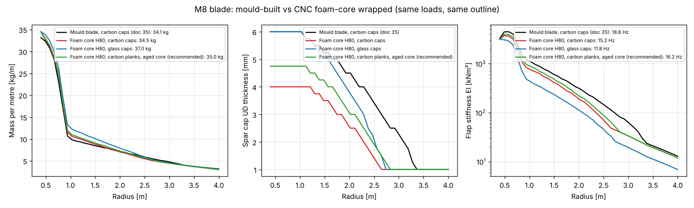
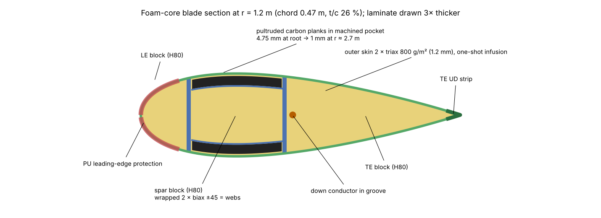
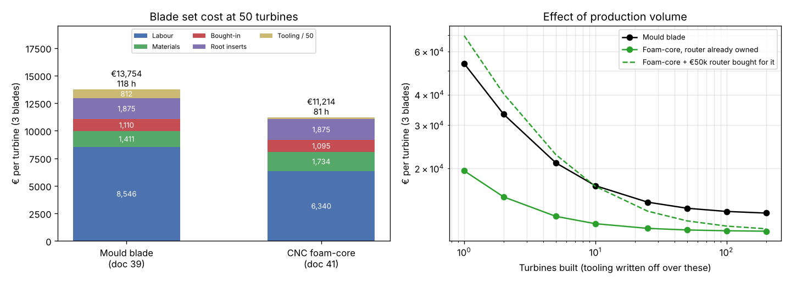

# 41 · CNC foam-core blades for the 12 kW M8: structure, Iceland, process and cost

Date 2026-11-07 · basis: doc 35/37 blade loads (8 m tower, larger of the 18 m and 8 m runs), doc 39 cost model and rates, doc 10 section model · status: **for review**

Martin, 2026-11-07: "Ok let's focus on the blades and its manufacturing. What if I CNC machine hard foam core and we wrap this core with carbon fiber/glass."

| Deliverable | File |
|---|---|
| Structural sizing of 12 foam-core builds against the mould blade, same loads and outline | `analysis/blade_foam/foam_m8.py` → `results/foam_m8.json`, `F01-foam-vs-mould.png` |
| Cost and hours of both routes on the doc 39 rates, volume sensitivity | `analysis/blade_foam/cost_foam.py` → `results/cost_foam.json`, `F02-cost.png` |
| Section drawing | `analysis/blade_foam/section_sketch.py` → `F03-section.png` |

## Bottom line

**Yes, it works, and it is cheaper.** A CNC-machined closed-cell PVC foam core, wrapped into a spar box with biax, with pultruded carbon planks as spar caps and a glass skin infused over everything in one shot, carries the M8 loads at the same mass and outline as the mould blade.

| | Mould blade (doc 35/39) | **Foam-core blade (recommended)** |
|---|---|---|
| Build | 2 infused shells + web, bonded in a heated mould | **CNC H80 PVC core, carbon planks, one-shot infusion, no mould** |
| Mass per blade | 34.1 kg | **35.1 kg** (+1.0 kg, +3 %) |
| Static moment | 49.4 kg·m | 49.9 kg·m (+0.9 %: hub, pitch, brake unchanged) |
| 1st flap at 131 rpm | 18.8 Hz = 2.87 × 3P | **16.2 Hz = 2.48 × 3P** |
| 1st edge at 131 rpm | 30.9 Hz | 27.1 Hz |
| Tip deflection (extreme × 1.35, stiffness / 1.1) | 0.045 m | 0.064 m against **0.93 m** clearance |
| Highest strength use (parked storm SLM H) | 0.29 | 0.51 |
| Fatigue use | 0.13 | 0.23 |
| What sizes the caps | cap buckling between webs (1.00) | cap wrinkling on the foam (1.00, with the core aged to 85 %) |
| Root and hub interface | root Ø0.28, 12 × M16 on PCD 245 | **unchanged** |
| **Cost per turbine (3 blades), 50 turbines** | **€13,750** | **€11,210 (−€2,540, −18 %)** |
| Hours per set | 118 h | **81 h** (incl. 15 h CNC) |
| Tooling | €40.6k (plug, 2 moulds, frame, jigs) | €8.5k (root-tube mandrel, cradles, jigs) |
| First blade after design freeze | 12–16 weeks | 3–4 weeks |

- **The saving is real but moderate at series volume:** −€2.5k per turbine is 18 % of the blade line and 2.1 % of the €118.3k ex-works turbine. Labour is 62 % of the blade cost, so the gain comes from fewer steps (one infusion instead of three, no separate web, no bond-and-close, no mould prep), not from materials, which cost slightly more (solid foam core).
- **At low volume it is a big saving.** The first turbine's blades cost €19.5k by this route against €53.5k with moulds. Below about 10 turbines the mould route is never competitive. It also lets the rotor change by editing a CAM file, which has happened three times in this project already.
- **The main risk is the outer surface.** The aerodynamic surface is the bag side, so it needs filling and fairing; the estimate has 4 h per blade for this. The foam route stays cheaper as long as the real extra time is under **11.8 h per blade**, which leaves a wide margin. It must be measured on the first blades.
- **Iceland:** the solid core is an advantage in one way: there is no cavity where condensation can collect and freeze, and no drain holes are needed. The new risk is water reaching the skin-to-core interface through a crack and growing a debond in freeze-thaw cycles, which matters more here because the core holds the caps against wrinkling. The design therefore uses core properties knocked down to 85 %, a 1.2 mm skin, sealed edges everywhere and a tap-test inspection of the caps at service.

**Recommendation:** make the foam-core blade the M8 blade, for the prototype set and for the first series. Use **PVC H80 core, pultruded carbon planks, glass triax skin, a prefabricated root tube with the existing 12 × M16 inserts, and a single male-tool infusion**. Glass caps and PET foam work but are heavier (37–40 kg). Keep the mould route as a fallback for volume above ~100 turbines a year, and only if the measured fairing time is much higher than estimated.

## 1. What was checked

`foam_m8.py` uses the doc 10 blade model as patched for M8 by `structure_m8.py` (same chord, twist and thickness, same root Ø0.28 m), and the final M8 loads from `blade_m8_8m.json`:

| Load (design, root) | Value |
|---|---|
| SLM H, parked storm, flap | 43.7 kNm |
| SLM G, shutdown, edge | 15.6 kNm |
| Aeroelastic extreme resultant / operating flap | 15.4 / 7.1 kNm |
| Fatigue DEL 10⁷, flap / edge | 5.34 / 2.58 kNm |
| Centrifugal at 184 rpm, γ 3.0 | from blade mass |

Material factors are the same as the mould blade: 1.35 (SLM route), 2.2 (aeroelastic route), 1.96 fatigue, 1.1 stiffness, 1.5 on stability. The reference mould blade reruns to exactly the doc 35 result (34.07 kg), so the comparison is like for like.

**The foam-core section** (F03) replaces the sandwich shell and the separate webs:

- The machined foam fills the section. It is cut into three blocks along the web lines at 15 % and 45 % chord.
- The middle (spar) block is wrapped in biax. Where the wraps of neighbouring blocks meet they form the two shear webs; the wrap also runs under the caps. Minimum 2 × 600 g/m² (1.0 mm), 1.5 mm where web shear requires it.
- The caps are UD bonded into pockets machined into the spar block, so the outer surface stays flush.
- The outer skin is 2 × triax 800 g/m² (1.2 mm) over everything, with the same 2 mm UD strip at the trailing edge as the mould blade.
- Inboard of r ≈ 0.75 m (where t/c > 50 %), a prefabricated glass root tube carries the inserts, with the same 16 mm root build-up as the mould blade. Inside it the foam is only a 30 mm mandrel wall.
- Mass adds the core, **0.30 kg/m² of resin taken up by the cut foam cells** (1.3 kg per blade), and **0.25 kg/m² of fairing filler and primer** on the 2.9 m² wetted surface (0.7 kg). The 10 % allowance for adhesive, paint, LEP and heating stays on the laminate, as for the mould blade.

**Why wrinkling replaces buckling.** In the mould blade the caps span freely between the webs, so they buckle as plates. This sizes them: their strength use is only 0.29. On a solid core every face is continuously supported, and the failure mode becomes short-wave wrinkling of the face into the foam, σ_wr = 0.5 (E_face E_core G_core)^⅓. This gives an allowable compressive strain of about 0.27 % for carbon on H80, or 0.57 % for glass, before factors. It uses the same factors as plate buckling. Panel buckling of the shell disappears.

### Results, all builds

| Build | Mass | Static moment | Flap at 131 rpm (× 3P) | Tip defl. | Fatigue | Cap UD |
|---|---|---|---|---|---|---|
| Mould blade, carbon caps (doc 35) | 34.1 kg | 49.4 kg·m | 18.8 Hz (2.87) | 0.045 m | 0.13 | 4.2 kg fabric |
| Foam H80, carbon caps | 34.5 | 49.0 | 15.2 (2.32) | 0.073 | 0.27 | 3.2 kg |
| **Foam H80, carbon planks, core aged to 85 % (recommended)** | **35.1** | **49.9** | **16.2 (2.48)** | **0.064** | **0.23** | **3.8 kg** |
| Foam H80, glass caps | 37.0 | 52.7 | 11.8 (1.80) | 0.122 | 0.42 | 5.7 kg |
| Foam H100, glass caps | 36.9 | 52.9 | 10.5 (1.60) | 0.149 | 0.48 | 4.0 kg |
| Foam H100, carbon caps | 35.2 | 50.5 | 13.3 (2.03) | 0.091 | 0.32 | 2.4 kg |
| Foam PET 100, carbon caps | 36.8 | 52.8 | 15.4 (2.35) | 0.067 | 0.25 | 3.6 kg |
| Foam PET 100, glass caps | 39.6 | 56.8 | 11.8 (1.81) | 0.115 | 0.38 | 6.2 kg |
| Foam H80 + H200 strip under carbon caps | 34.4 | 50.5 | 11.2 (1.71) | 0.120 | 0.40 | 1.5 kg |
| Foam H80, hollowed to a 25 mm wall | ≈ same as solid (core 6.2 vs 6.4 kg) | | | | | |

What this shows:

1. **Every foam build passes** every check with a margin on frequency (≥ 1.5 × 3P) and tip clearance (≤ 16 % used).
2. **Carbon remains the right cap material.** Glass caps cost 2.6 kg per blade and 3.6 kg·m of static moment to save about €80 of carbon per blade. The pultruded planks also bring the straight fibres that wrinkling strength depends on.
3. **H80 PVC is the right core.** H100 raises the wrinkling limit, so the caps get thinner, but the extra 1.6 kg of core outweighs the carbon saved. PET has about half the shear modulus of PVC at the same density, so its caps get thicker and the blade 1.8 kg heavier. PET's advantages are that it can be recycled and that it takes a 100 °C post-cure.
4. **Hollowing the core gains nothing.** Outboard of r ≈ 1 m the sections are thin enough that a 25 mm wall already nearly fills them, and hollowing would mean two half-cores and an internal bond line. The core is solid apart from the root mandrel and the balance pocket.
5. A high-density strip under the caps is the lightest on carbon, but it makes the blade much softer (11.2 Hz), and it adds a bonded part. It is not worth it.
6. The 0.85 knock-down on core stiffness costs 0.6 kg per blade. It stays in until our own aged coupons show otherwise (§5).

**Root.** The bending moment and the hub interface are unchanged, so the doc 35 joint stands: 12 bonded M16 10.9 inserts on PCD 245 in root Ø0.28, 64 kN design load per bolt against 113 kN. The difference is only in how the inserts get into the laminate. Here they are cast into a separate root tube (§3, step 6), which can be inspected before it is joined to the blade. Pull-out tests on that tube are needed in any case.

**Rest of the turbine.** Static moment +0.9 % and rotor mass +3 kg are inside the margins of the doc 37 hub, pitch and spindle checks. The lower flap frequency (16.2 against 18.8 Hz) is still far above 3P at every speed up to the 184 rpm design overspeed (16.5 Hz). The doc 37 loads do not need a rerun.

## 2. Iceland: freeze-thaw, moisture, cold

| Issue | Foam-core blade | Compared with the mould blade | Measure |
|---|---|---|---|
| **Condensation inside the blade** | No cavity: nothing collects, nothing freezes inside, no drain holes. | Hollow blades breathe, collect condensate at the tip and need drain holes that ice can block. | **Advantage of the foam blade** |
| **Water uptake of the core** | Closed-cell cross-linked PVC does not wick. Water that gets in through a crack stays local. | Same foam family, but only as a 6 mm shell core | Seal every cut edge: root end, tip, drilled holes (potted), receptor |
| **Freeze-thaw at a skin crack** | Water at the skin-to-core interface freezes and grows a debond. Under a cap that matters, because the core holds the cap against wrinkling. **Main durability risk.** | In the mould blade, a crack exposes the bond line or the cavity. That is serious too, but the caps do not rely on a core. | Core knock-down 0.85 in the design; 1.2 mm skin (no thin gelcoat-only areas); PU topcoat; LEP. Tap test of both cap lines at every annual service, thermography at 5 years. Repair rule: cut out, dry, re-core, scarf patch, same season. |
| **Cold, −40 °C** | Foam shrinks more than the skins: 0.4 % mismatch strain from the 65 °C post-cure gives 0.36 MPa in the foam against about 2.2 MPa strength (factor 6). PVC gets stiffer and slightly more brittle when cold. | No core-to-cap interface | Coupon and full-blade cold tests (§5) |
| **Cure temperature** | Cross-linked PVC must stay at or below about 70 °C: post-cure 8 h at 65 °C, which gives an epoxy Tg of roughly 80 °C. That is enough for a blade surface that stays below 45 °C in Iceland. Dry the foam before lay-up (12 h at 50 °C) so it does not outgas into the laminate. | The mould route can post-cure hotter | Epoxy system qualified for a 65 °C post-cure; PET core if a hotter cure is ever needed |
| **Leading-edge erosion** (rain, sleet, ash, sand; tip 55 m/s, 77 m/s at overspeed) | There is no gelcoat. The skin is the substrate. | Gelcoat plus LEP | PU erosion tape or PU-coated LE over the outer 50 % of span, replaceable about every 5 years (same as mould blade) |
| **Icing** | Same surface, same ice detection and yaw strategy. The core insulates, so a heater mat under the skin sends its heat outwards. | Same | Heater mat option unchanged, laid under the outer skin before infusion |
| **Lightning** | The carbon planks must be bonded to the down conductor, as in the mould blade. The conductor runs in a groove machined in the core beside the rear web, so it is fully embedded. | Same requirement | Bond at root, mid-span and tip; aluminium tip receptor block bonded into the core |
| **Balance** | The outside is the bag side, so thickness and filler vary more. Expect more mass scatter. | Mould sets the outside | Balance pocket machined in the core at r ≈ 1.0 m with a sealed lid; blades matched in sets of three to the R6.6 static-moment budget |

## 3. Manufacturing process, step by step

**Equipment.** A 3-axis gantry router with a bed of at least 4.5 × 1.8 m and 600 mm Z travel, set up for foam (a 25 mm ball-nose finishing tool and a 12 mm end mill, with dust extraction). The core is machined from two sides with dowel registration. A 4-axis machine with a rotary axis would avoid the flip, but it is not needed. Hot-wire cutting is ruled out: cross-linked PVC gives off HCl when heated, and the blade surface is not a ruled surface. Also needed: a heated tent or simple oven for 65 °C, an infusion set-up and a small lathe for the root tube face.

**Materials.**
- Core: cross-linked PVC H80 sheet, 40–60 mm, cut near-net and stacked. About 0.08 m³ per blade finished, 0.13 m³ bought.
- Caps: pultruded carbon planks, standard modulus, 1 mm and 2 mm thick × 50 mm wide, peel-ply surface.
- Glass: biax ±45 600 g/m² (webs), triax 800 g/m² (skin), UD 600 g/m² (TE strip, root).
- Resin: one infusion epoxy for the skin and the root tube, suited to a 65 °C post-cure. A toughened epoxy paste for the block joints and the root tube joint.
- Root inserts: the existing doc 39 M16 inserts (NM8-105).

**Process** (hours per blade, as costed in §4):

| # | Step | What is done | h |
|---|---|---|---|
| 1 | **Blank** | Cut the H80 sheets to stepped outlines on the router. Bond the stack flat-wise (glue lines parallel to the chord plane) under vacuum; dowel holes for registration. | 1.0 + 0.5 CNC |
| 2 | **Machine the core** | Side 1: pressure side, cap pocket (depth = planks + biax wrap, ±0.2 mm), web slits, conductor groove. Flip on dowels. Side 2: suction side, cap pocket, balance pocket, tip receptor seat, root spigot that fits the root tube. The CAM surface is the aerodynamic surface offset inwards by the local skin thickness, with ply drops taken into account. | 3.5 CNC |
| 3 | **Split and seal** | Separate the LE, spar and TE blocks at the slits. Squeegee a thin epoxy and micro-balloon slurry into the cut surfaces to limit resin uptake to about 0.3 kg/m². Dry the foam at 50 °C. | 1.0 |
| 4 | **Spar box** | Lay the down conductor in its groove. Wrap the spar block in 2 × biax ±45 with a 50 mm overlap on a cap face. Add a third ply inboard where web shear needs 1.5 mm. | 1.5 |
| 5 | **Caps** | Cut the planks to length, chamfer the ends 1:50 and sand them. Stack them in the pockets on the wrap: 4.75 mm at the root (2 + 2 + 0.75 equivalent), stepping down to 1 mm by r ≈ 2.7 m, with drops staggered at least 50 mm. Narrow 50 mm planks lie side by side to follow the chordwise curve. Tack them with paste or leave them dry for the infusion. | 1.5 |
| 6 | **Root tube** | On a turned aluminium mandrel, the 12 inserts are held on PCD 245 by an indexed end plate. Wrap UD and biax plies, with glass/foam wedges between the inserts, to 35 mm at the inserts, tapering to 16 mm. Bag, infuse, cure. Face the root on the lathe and check the PCD before the tube is used. | 3.0 + 1.0 CNC |
| 7 | **Assemble** | Bond the LE and TE blocks to the spar box with paste. Slide the root tube onto the spigot with a paste joint. Fit the aluminium tip receptor block. Check the twist and the straightness in the cradle. | 1.0 |
| 8 | **Skin lay-up** | Dry: 2 × triax over the whole blade with staggered overlaps at the LE (doubles the LE thickness), UD strip at the TE, and root plies scarfed 1:20 over the root tube. Heater mat here if ordered. Peel ply, flow mesh, bag on a flat table with the blade in cradles; leak test. | 3.5 |
| 9 | **Infuse and cure** | One-shot infusion from the root. Cure at room temperature, then post-cure 8 h at 65 °C. | 1.0 |
| 10 | **Debag and inspect** | Trim the TE and tip. Tap test the whole surface, thermography of the cap lines. Record. | 1.0 |
| 11 | **Fair** | Fill fabric print and step lines with lightweight filler only where needed, block-sand to template sections at 8 stations, spray filler-primer. | 4.0 |
| 12 | **Finish** | PU topcoat, LEP tape or coating on the LE, drill the receptor and bond to the conductor. | 2.0 |
| 13 | **Weigh and balance** | Mass and static moment; trim mass in the balance pocket; match the set. | 1.5 assy |

Total per blade: **21.5 h composite + 5.0 h CNC + 1.5 h assembly = 27 h**, plus the 12 inserts (doc 39 line, unchanged). The mould blade takes 38 + 1.5 h.

## 4. Cost and hours

Rates are those of doc 39: composite €72/h, CNC €105/h, assembly €75/h; glass €4.80/kg, epoxy €11/kg, PVC foam €25/kg, carbon planks €32/kg; tooling written off over 50 turbines.

| Per turbine (3 blades) | Mould blade (doc 39) | Foam-core blade |
|---|---|---|
| Labour | €8,546 (118.5 h) | €6,340 (81 h, of which 15 h CNC) |
| Materials | €1,411 | €1,734 |
| Bought-in (consumables, LEP, paint, LPS) | €1,110 | €1,095 |
| Root inserts (36) | €1,875 | €1,875 |
| Tooling / 50 turbines | €812 (of €40.6k) | €170 (of €8.5k) |
| **Total** | **€13,754** | **€11,215** |
| Mature, unit 50 (mould 25 h, foam −33 % hours) | €10,945 | €9,700 |

Material per blade, foam route: H80 blank 10.1 kg €253, glass 12.6 kg €70, carbon planks 3.8 kg €130, epoxy 11.3 kg €125. The solid core is the only material that costs more than in the mould blade.

Where the hours go (mould route, doc 39's 38 h split into steps for comparison): mould prep and gelcoat 2.5, kitting 3, shell lay-up 6, two shell infusions 4, separate web 4, root 4, bond and close 4, demould and trim 2, inspection and repair 2, finishing 3, LEP and root 3. The foam route drops the mould prep, the second and third infusion, the web and the bond-and-close (about 18 h). It adds the blank, CNC, root tube and fairing (about 9 h of labour plus machine time).

| Turbines built | 1 | 2 | 5 | 10 | 25 | 50 | 100 |
|---|---|---|---|---|---|---|---|
| Mould blade, € per turbine | 53,547 | 33,244 | 21,062 | 17,002 | 14,565 | 13,754 | 13,347 |
| Foam-core, router already owned | 19,545 | 15,295 | 12,745 | 11,895 | 11,385 | 11,215 | 11,130 |
| Foam-core, €50k router bought for it | 69,545 | 40,295 | 22,745 | 16,895 | 13,385 | 12,215 | 11,630 |

- The doc 39 CNC rate (€105/h) already includes machine depreciation, as for all other machined parts. If a router has to be bought only for the blades, the foam route is still €1.5k per turbine cheaper at 50 turbines. The router also serves the spinner, nacelle cover and LC8/S6 plugs.
- **Break-even:** the foam route stays cheaper unless it takes **11.8 h more per blade** than estimated. Fairing is the step most likely to overrun. On the prototype set it should be timed separately.

## 5. Qualification before release

1. **Sandwich coupons** (carbon plank on H80 with the real biax wrap and skin): four-point bending to wrinkling at +23 °C and −30 °C, as made and after 50 freeze-thaw cycles with the face pre-cracked and wet. This sets the real core knock-down (0.85 assumed).
2. **Core shear and peel**: H80 beam shear and plank-to-core climbing-drum peel after moisture conditioning.
3. **Root tube**: static and fatigue pull-out of single inserts, and after cold cycling (same as doc 10).
4. **Full blade**: static test to SLM H 43.7 kNm, fatigue to 10⁷ cycles at the doc 37 DEL, then residual static. Thermography before and after.
5. **Field**: the prototype set on the test turbine, with a tap test and mass check at every service through two winters.

## 6. Decisions for Martin

| # | Decision | Recommended |
|---|---|---|
| F1 | Blade build route for M8 | **CNC foam-core, one-shot infusion, no mould** (prototype and first series) |
| F2 | Core | **PVC H80**; PET 100 only if recyclability becomes a sales point (+1.8 kg per blade) |
| F3 | Caps | **Pultruded carbon planks** (glass works, +2.6 kg per blade) |
| F4 | Router | Buy a 4.5 × 1.8 m foam/wood router in-house (≈€50k), also used for plugs |

## 7. Limits of this study

- Foam properties are data-sheet values. The wrinkling formula is the usual lower bound, but plank waviness, pocket steps and glue lines in the core lower it locally. That is the reason for the 0.85 knock-down and the coupon programme.
- The section model is the doc 10 thin-wall model (no camber, no shear deformation, no torsion check). The core's contribution to stiffness is ignored, which is conservative. Core shear near ply drops and plank ends needs a local FE.
- Hours are estimates built from step times, on the same basis as doc 39. They need timing on the prototype set, especially fairing (step 11).
- The doc 37 aeroelastic loads were not rerun for the 16.2 Hz, 35.1 kg blade. The changes (−14 % flap frequency, +3 % mass) are small next to the margins.
